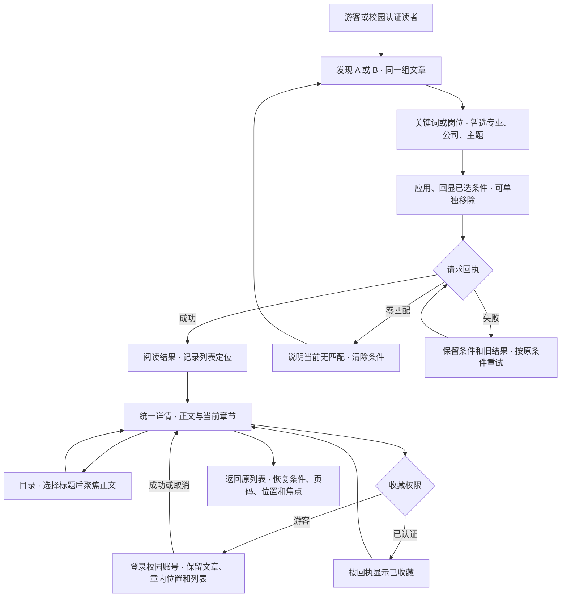

# 城院帮 G04 交互原型 V2 · 首轮评审

范围为发现、筛选、文章详情。游客可读取公开全文，校园认证后可读取作者与评论等受保护内容并收藏。登录、权限、排序和分页沿用既有合同。此处只模拟交互，评审过程不发送验证码、不请求业务接口、不写入收藏。

## 角色与任务流程

| 路径 | 起点与点击顺序 | 预期观察 |
| --- | --- | --- |
| 1 筛选 | A/B 默认 → 搜索 Java 后端 → 组合筛选 → 选计算机科学与技术、拼多多 → 应用 → 移除公司 | 按查询条件得出 6 → 2 → 1 → 2。当前词、职业选择和选中的分类值具备可移除入口。 |
| 2 目录 | 评审入口切 A/B → 同一篇长文 → 滚至第三节 → 目录 → 「四、项目」 | 目录标第三节，点击后关闭，正文对齐第四节标题。 |
| 3 登录回位 | 第四节 → 收藏 → 登录提示 → 校园账号 → 模拟登录成功 → 收藏 → 返回发现 | 登录后仍在第四节，同一章内偏移，先读取当前收藏状态。用户再次点击收藏后才提交。返回恢复所在 A/B、当时条件和定位。 |
| 4 无匹配 | 搜索「深海考古」 → 查看无匹配 → 清除条件 | 明确空的是本次匹配；清除回初始结果，排序保留。 |
| 5 请求失败 | 评审入口启用失败场景 → 发现按当前条件刷新 → 重试 | 旧结果和当前条件可见。只有重试成功才替换旧结果。场景结束后关闭故障注入。 |

## 状态与交互说明

- 搜索提交后去除空白。关键词只搜索标题和摘要。快捷岗位与进一步筛选共用同一个已应用状态。筛选面板的勾选是暂存，取消后保留原结果。标签移除、清空与排序都重置分页。仅使用目录中仍启用的分类 ID。同专业从有效认证用户的本人资料取得，没有资料时提示补充专业，游客显示登录引导，可继续手选专业。
- 首次加载用三行骨架和「正在读取经验」。加载下一页时保留已加载内容，失败在列表尾只显示「重试加载更多」。无公开内容提供重新读取。无匹配显示当前条件及清除入口。列表整体失败已存在快照时标明「当前显示上次读取的结果」。两个请求先后发出时，只允许当前条件对应的回执替换结果。
- 返回列表恢复关键词、筛选、排序、已加载页、滚动位置及离开的条目焦点。切 A/B 是评审工具，放在画板外。真实使用只有最终选中的一种布局。
- 小程序原生胶囊置于右上，读者目录保持 44×44 CSS px，跟随正文顶栏。桌面正文最大 680px，右侧 240px 目录和右下圆形回顶。390px 转单列，保留目录与回顶。空目录不保留空弹层；文章不可用时只给可用状态和返回入口。
- 正文使用完整 A01 原文，资料来源留在文章尾。游客不会看到受保护的作者认证或评论信息；认证后才显示作者资料与认证结果，显示值以接口为准。文末保留评论、举报、点赞、硬币及既有权限路径，本轮交互只深入收藏。图片失败保持原位、说明和重试按钮。用 A03 的项目图描述作为故障状态样例，A01 原正文不插入演示图片。
- 关闭目录回到触发按钮。选章节后聚焦标题，给固定顶栏预留间距。进入登录前记录文章 ID、正文版本、章节锚点和相对偏移。如果版本更新且原锚点不可用，回到可定位位置并显示提示。收藏处理中只锁收藏，回执不确定时读取服务端状态。

## 页面、需求与组件

| 画板 | 现有映射 | TDesign 组件或布局 |
| --- | --- | --- |
| 发现 A/B、搜索、快捷岗位、排序、分页、长标题 | M01–M02 / W01 · FR-R01–FR-R04、FR-R06 · WBS 5.4.2 | Search、Tag、Tabs、Loading；A 轻卡容器，B 用 Cell 与 Divider |
| 进一步筛选、标签移除、同专业、无匹配及失败保留 | M03–M04 / W01 · FR-R02–FR-R04、FR-P03 · WBS 5.4.2 | Popup、Radio、Checkbox、Tag、Button、Empty、Skeleton |
| 小程序、桌面与 390px 详情，目录、图片、空目录及不可用 | M05–M06 / W02–W03 · FR-R01、FR-R05–FR-R06 · WBS 5.4.2 | Navbar、Popup、Cell；正文、章内偏移和桌面 Sticky 目录单独定义 |
| 收藏、登录、回位、作者和文末互动 | M05–M07、M09、M17 / W02–W04、S01 · FR-A01–FR-A03、FR-I01–FR-I05、FR-G03、FR-P01、FR-P03 · WBS 5.5、5.7、5.8 | Dialog、Input、Button、Icon、Loading；明确权限、回读和原位置 |
| 内容泄漏保护 | M17 / W09 · FR-I04、FR-C08 · WBS 5.7、5.8 | Empty、Button；不可用时隐藏历史标题与正文 |

| 初始变量 | 数值 |
| --- | --- |
| 颜色 | 主操作 #0052D9、浅状态 #E8F1FF、文字 #162238、辅助 #526179、背景 #F4F6F9、白色 #FFFFFF、分隔 #DEE5EF |
| 字体 | 使用系统中文无衬线；列表标题 17/25，摘要 14/22，元信息 12/18；手机正文 16/27，桌面正文 18/32 |
| 几何 | 375px 横边距 16，搜索和主要按钮 44 高，A 外间距 10、半径 12，B 行分隔 1；375px 目录 44×44；390px 与桌面重新排版 |
| 操作 | 主要态蓝色，次要态描边或文字。目录选中显示名称和标记。筛选标签移除、底栏和回顶都有可访问名称和焦点样式。 |

[TDesign 小程序组件](https://tdesign.tencent.com/miniprogram/overview) · [微信小程序设计指南](https://developers.weixin.qq.com/miniprogram/design/) · [WeUI 官方仓库](https://github.com/Tencent/weui) · [HarmonyOS 多设备新闻阅读案例](https://developer.huawei.com/consumer/cn/doc/doccenter-multi-device/multi-news-read) · [Apple 文字排版指南](https://developer.apple.com/design/human-interface-guidelines/typography)

TDesign 是尺寸和控件语义的参考。长文采用独立正文、文末互动和按设备变化的目录。Logo 使用仓库 G04 标识。无第三方模板；文章来源见 [A01 正文](content/A01.md) 与 [文章索引](content/articles.json)。

## A/B 评审

两版共用六篇来源已标注的项目演示文章；正常默认首批四篇，另两篇用于加载更多。使用同一顺序、标签、摘要和作者展示。列表中的文章数量按演示样本计算，无阅读量或热度数值。目标文章为 A01，比较文章为 A10。使用相同任务，组内按 AB／BA 交叉顺序，第二次走查独立重置。上线前可用目标用户复做。

| 任务 | 成功条件 | 记录 |
| --- | --- | --- |
| 找 Java 后端经验 | 首次找对入口和 A01 | 首次正确点击、完成秒数、误点 |
| 说出当前岗位和专业 | 能准确区分已选条件和文章标签 | 原话、停顿、混淆位置 |
| 去掉公司 | 只移除公司，专业与关键词保留 | 点击路径、是否误清全部 |
| 比较 A01 和 A10 | 能说出适用对象与「准备到投递／单次失败调整」区别 | 是否反复滚动、误开条目 |
| 阅读并跳章 | 打开目录，跳到第四节并读到首段 | 完成秒数、当前章识别、遮挡 |
| 收藏后回列表 | 章内登录回位并完成收藏，返回原列表位置 | 锚点、条件、焦点及主观舒适度 1–5 |

每位记录参与者编号、AB 或 BA、首次点击、正确率、用时、误点、犹豫、原话和阅读评分。设计走查只检查布局、条件和画板路径；评审者观察与真实用户结果分别填表，均待实际采集。

建议先以 **A 的轻卡片作为候选**。六条经验的长标题和多标签使边界更有价值。B 的分隔方式适合已缩小范围后比较结果。若实测 B 减少对比耗时且误点和筛选判断不劣于 A，可选 B，或用 A 的边界配 B 的紧凑行距。当前推荐来自设计走查假设，待同任务对照确认。

## 基线与范围

2026-11-18 核对远端 main `134f8f75a0580eb567567415b4d4753f26618fc7`。#45、#47、#48、#49 均 OPEN，#49 以 #45 分支为目标。前端目录有上一轮未提交网页改动，原型在独立文档工作树制作。旧的 64 个状态只用于需求覆盖；小程序 375px 发现和个人中心样板使用历史截图与记录。本轮没有重新运行产品页面。 [发现与个人中心样板](https://github.com/jason-bitc/HZCU-CampusHub/blob/fc1ccb0d2fd68748304d72905d7eeddccd2f027b/miniprogram/docs/LAYOUT-SAMPLES-20261117.md)

[任务流程导出](boards/00-task-flow.png) · [画板索引](墨刀走查.md) · [墨刀演示与点击记录](墨刀演示记录.md) · [A/B 走查表](A-B原型走查.csv)
