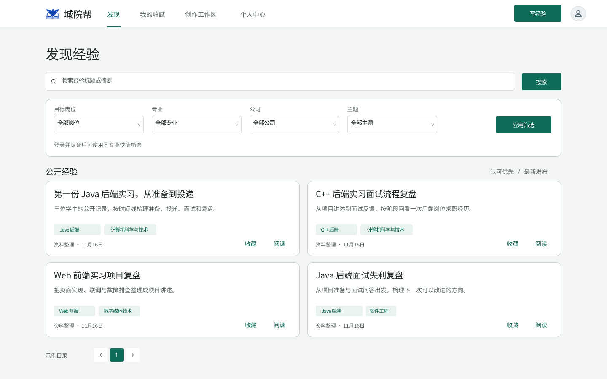
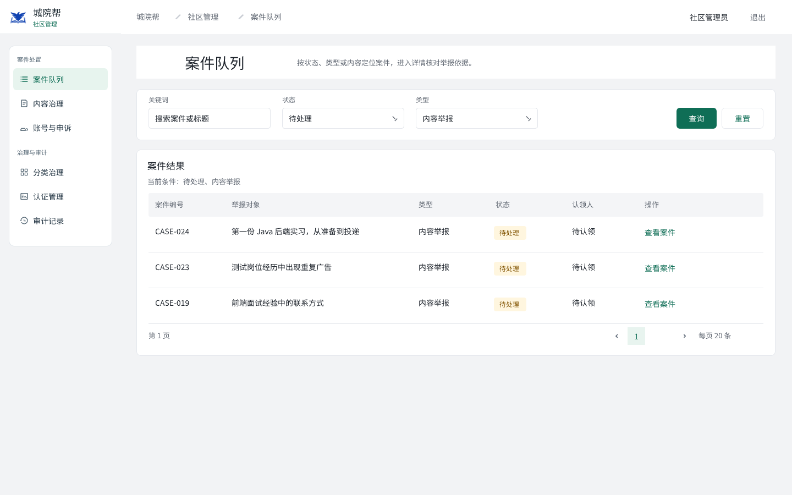
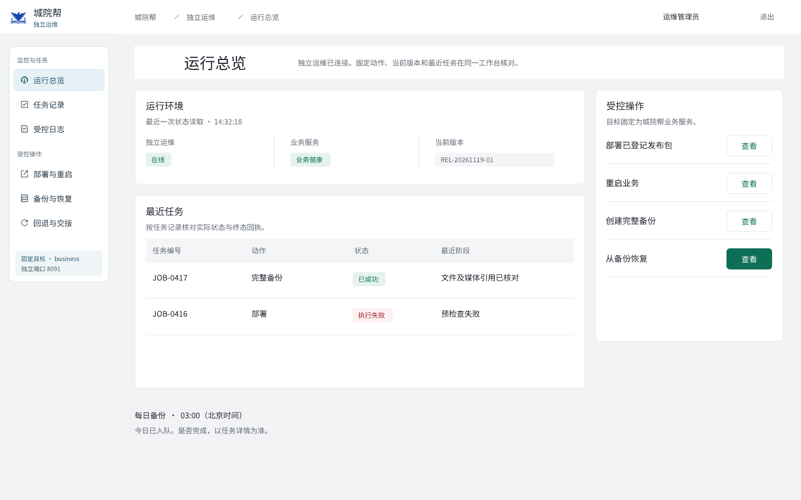

# 三端 Pixso 可点击原型与评审记录

2026-11-24。本目录同步读者与作者网页、社区管理网页、独立运维网页的最新 Pixso 原型。它用于界面与交互评审，不是运行产品，也不替代 2026-11-04 的 64 屏需求覆盖基线。

本次信息来自 Codex 主线会话 `01a1e41b-e7f3-7782-9eac-4c897f070f50` 的最终交付记录、Pixso 画板回读、浏览器走查记录和对应导出图。共享文档不收录会话原文、访问凭据或临时执行日志。

## 1. 当前设计入口

| 范围 | Pixso 演示入口 | 演示画板 | 有效跳转 | 已记录的浏览器点击场景 |
| --- | --- | ---: | ---: | --- |
| 读者与作者网页 | [发现与阅读](https://pixso.cn/app/presentation/2XU6hh8Wf-5TtUpFhmIP_w?pageId=63%3A66076&nodeId=63%3A66077&zt=4) · [作者编辑](https://pixso.cn/app/presentation/2XU6hh8Wf-5TtUpFhmIP_w?pageId=63%3A66076&nodeId=63%3A66894&zt=4) | 15 | 109 | 应用和清除筛选、进入文章和返回发现、游客登录、资料、通知与收藏回原文、目录跳章、作者预览与返回编辑、发布结果 |
| 社区管理 | [案件队列](https://pixso.cn/app/presentation/6oYUo89iVIThki4yW1L5lw?pageId=135%3A14271&nodeId=135%3A14272&zt=4) | 14 | 104 | 案件队列与内容治理往返、查看举报、认领、关联投币、确认失效、回执、审计、返回保留筛选的队列 |
| 独立运维 | [运行总览](https://pixso.cn/app/presentation/6oYUo89iVIThki4yW1L5lw?pageId=135%3A15678&nodeId=135%3A15679&zt=4) | 16 | 124 | 任务记录、部署预检失败、受控日志、备份清单、创建完整备份、成功回执、返回备份清单与总览 |
| **合计** | 三个演示页 | **45** | **337** | 在已登录 Pixso 的 Chrome 演示模式中执行；登录和业务动作均为原型状态切换 |

远程回读记录称 45 张演示画板均可从对应首屏经交互到达，337 条跳转均指向所在演示页的有效画板。这里的“有效”指 Pixso 连线目标有效，不代表所有控件均已做成可交互控件。

## 2. 已选设计与模板来源

| 范围 | 当前采用 | 模板与组件来源 | 许可与适配边界 |
| --- | --- | --- | --- |
| 读者与作者网页 | 发现、筛选、长文阅读、收藏、资料、创作工作区与 Markdown 编辑；顶栏区分游客和已登录头像 | [腾讯 TDesign 桌面组件库](https://pixso.cn/community/file/rHGnmqg_TSuh_Z3y2d6IfA)、[TDesign Starter 卡片列表](https://github.com/Tencent/tdesign-vue-next-starter/blob/develop/src/pages/list/card/index.vue)、[筛选模板](https://github.com/Tencent/tdesign-vue-next-starter/blob/develop/src/pages/list/filter/index.vue)、[TDesign User 图标](https://github.com/Tencent/tdesign-icons/blob/develop/svg/user.svg) | TDesign Starter 与图标的源仓库均为 [MIT](https://github.com/Tencent/tdesign-vue-next-starter/blob/develop/LICENSE)；头像底框和业务页面是项目适配，不称为腾讯官方成品页面 |
| 社区管理 | 采用用户选定的 [A02 B 版浅色导航卡](https://pixso.cn/app/design/6oYUo89iVIThki4yW1L5lw?page-id=129%3A11226&item-id=129%3A11526)，分为“案件处置”与“治理与审计” | [Arco Pro Vue 菜单](https://github.com/arco-design/arco-design-pro-vue/blob/main/arco-design-pro-vite/src/components/menu/index.vue)、[筛选表格](https://github.com/arco-design/arco-design-pro-vue/blob/main/arco-design-pro-vite/src/views/list/search-table/index.vue)、[Arco 可编辑社区副本](https://pixso.cn/community/file/LHQUrYr9F3OdMPekr-Wd9A) | Arco Pro Vue 源仓库为 [MIT](https://github.com/arco-design/arco-design-pro-vue/blob/main/LICENSE)；Pixso 社区副本按原记录标注 CC BY 4.0；业务画板与本地组件不是 Arco 官方页面 |
| 独立运维 | 采用用户选定的 [O02 B 版浅色导航卡](https://pixso.cn/app/design/6oYUo89iVIThki4yW1L5lw?page-id=129%3A11226&item-id=129%3A12152)，分为“监控与任务”与“受控操作”，保留固定目标和独立端口 | [Arco Pro Vue 菜单](https://github.com/arco-design/arco-design-pro-vue/blob/main/arco-design-pro-vite/src/components/menu/index.vue)、[分步表单](https://github.com/arco-design/arco-design-pro-vue/blob/main/arco-design-pro-vite/src/views/form/step/index.vue)、[Arco 可编辑社区副本](https://pixso.cn/community/file/LHQUrYr9F3OdMPekr-Wd9A) | 同上；固定目标、任务状态、部署失败与恢复确认属于城院帮业务适配 |

管理端 67 个状态标签已从 Arco 官方 Sketch 资源提取源图层并形成项目本地组件，回读记录覆盖社区管理 19 处、独立运维 48 处。它们不是仍保持云端图库更新关系的官方实例，后续替换时须继续保留状态语义和来源说明。

## 3. 代表截图

### W01 发现与组合筛选

### A02 案件队列

### O02 运行总览

三张图均为 1440×900 的 Pixso 演示画板导出。图中账号、文章、案件、任务编号、时间和状态为演示数据；运维图中的 `PREFLIGHT / OPS_EXECUTION_FAILED` 是失败状态样本，不是本轮重新执行部署所得结果。

## 4. 评审复现路径

1. 用有文件访问权限的 Pixso 账号打开对应演示链接。
2. 读者路径：发现 → 应用岗位与专业筛选 → 打开文章 → 游客登录并回到文章 → 目录跳到末章 → 收藏页回原文。
3. 作者路径：作者编辑 → 完整预览 → 返回编辑 → 再次预览 → 确认公开发布 → 查看发布结果。
4. 社区路径：案件队列 → 查看举报 → 认领 → 关联内容或投币 → 确认失效 → 查看回执与审计 → 返回保留筛选的队列。
5. 运维路径：运行总览 → 任务记录或部署预检失败 → 受控日志 → 备份清单 → 创建完整备份 → 成功回执 → 返回总览。

上述步骤用于组内复核 Pixso 原型。真实用户任务仍按 `../原型场景与异常G04.csv` 和用户代表走查表执行，不能用本记录代替受访者签字或反馈。

## 5. 需求与 WBS 对照

| 原型范围 | 主要需求编号 | 相关 WBS | 本次证据覆盖到的内容 |
| --- | --- | --- | --- |
| 发现、筛选、阅读与收藏 | FR-R01、FR-R02、FR-R03、FR-R05、FR-R06、FR-I04、FR-P01、FR-P02 | 5.4.2、5.8.2 | 公开阅读、组合筛选、登录边界、目录、收藏和通知入口的原型跳转 |
| 网页创作与工作区 | FR-C01、FR-C02、FR-C04、FR-C05、FR-C06、FR-P01 | 5.5.1、5.5.2、5.8.2 | Markdown 编辑、预览、发布结果和工作区入口；自由输入、真实保存及冲突分支不在本次点击证据内 |
| 社区管理 | FR-M02、FR-M03、FR-M07、FR-G06 | 5.9.2 | 案件定位、认领、内容与投币处置、审计和队列返回 |
| 独立运维 | FR-O01、FR-O02、FR-O03、FR-O05、FR-O06、FR-O07 | 5.11.1、5.11.2 | 状态、日志、受控操作、备份恢复、失败与任务回执的原型状态；不证明真实执行成功 |

完整需求与原始 64 屏的关系继续以 [全需求原型覆盖对照](../全需求原型覆盖对照G04.json) 为准。本次没有修改 SRS、需求编号、接口契约或排期。

## 6. 验证边界与待办

- **已有证据**：Codex 的 Pixso 远程回读、已登录 Chrome 演示点击、代表画板导出；Kimi Code 在本次信息同步中查看了上述三张导出图并核对最终评审记录。
- **本次未重跑**：未重新点击 Pixso 全部流程，未运行业务后端、网页自动化或微信模拟器，未修改应用源码。
- **原型静态部分**：自由输入、任意筛选组合、表单保存和部分异常分支仍有静态画板；分类归并、认证撤销和重启提交结果未在本演示中串完。
- **设备与可访问性**：本次 B 版替换覆盖桌面画板；390px 抽屉仍是独立评审稿。三套演示未验证窄屏、键盘、焦点顺序或屏幕阅读器。
- **外部验收**：真实学生、社区管理员和运维人员走查仍待执行。小程序不在本次三端 Pixso 交付范围内，不据此宣称小程序已换成同一模板或完成验收。
