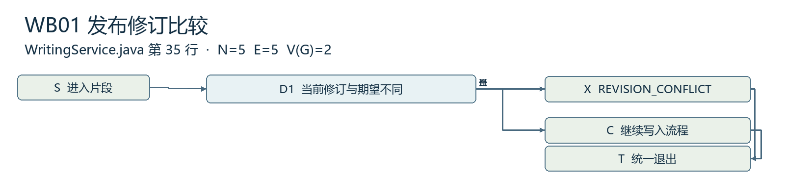
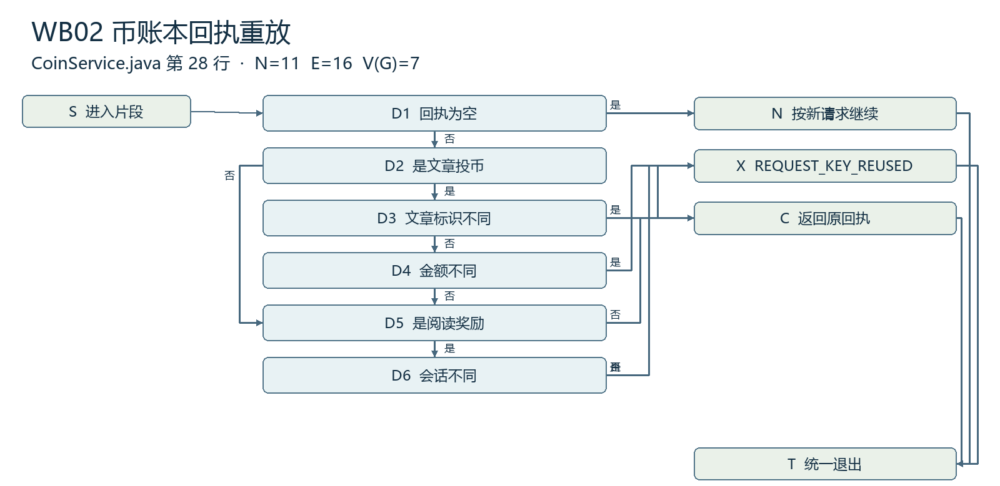
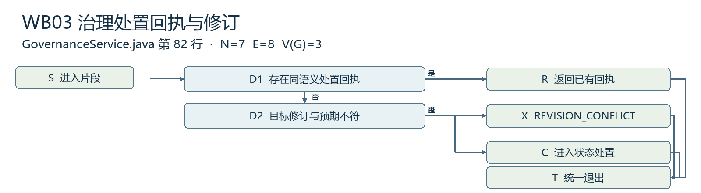
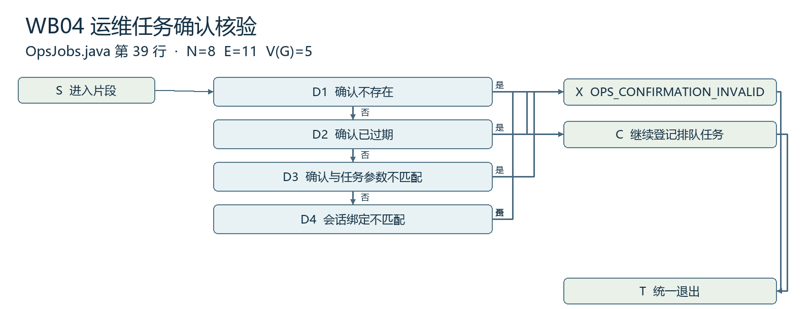

# 城院帮单元与白盒测试用例

软件工程课程项目 G04

浙大城市学院

组长兼项目负责人 王晨 32401211

成员 刘景浩 32401205

G04-UT-20261112-01　V1.0　2026 年 11 月 12 日

## 文档控制

| 项目 | 记录 |
| --- | --- |
| 文档标识 | G04-UT-20261112-01，V1.0，2026-11-12 |
| 项目 | 浙大城市学院软件工程课程项目 G04 |
| 需求与计划基线 | SRS V1.5.1；项目计划 V1.8，G04-BL-20261112-DT |
| 设计与代码基线 | 总体设计 V1.2.1；主分支 d161553 |
| 编制用途 | 列出单元用例、控制流、复杂度与基本路径。 |

列出单元用例、控制流、复杂度与基本路径。

## 目录

- [1 单元测试用例](#1-单元测试用例)
  - [1.1 单元用例与测试入口](#11-单元用例与测试入口)
- [2 白盒控制流与基本路径](#2-白盒控制流与基本路径)
  - [2.1 发布修订比较](#21-发布修订比较)
  - [2.2 币账本回执重放](#22-币账本回执重放)
  - [2.3 治理处置回执与修订](#23-治理处置回执与修订)
  - [2.4 运维任务确认核验](#24-运维任务确认核验)
- [3 实现阶段取证](#3-实现阶段取证)
  - [3.1 代码走查和单元证据交接](#31-代码走查和单元证据交接)

# 1 单元测试用例

候选版本在 server 模块用 Maven Surefire 执行单元测试。记录命令、版本、Java 环境、时间、报告和失败重跑情况。表中已有测试类来自本地源码基线 d161553。数据库事务和跨进程运维结果在集成层验证。

## 1.1 单元用例与测试入口

| 编号与对象 | 输入及前置 | 预期断言 | 现有入口 |
| --- | --- | --- | --- |
| UT01 校园邮箱规范化。A02 | 合成校园邮箱、大小写和空白；不同域后缀 | 匹配校园域后规范化，其他域拒绝 | AuthInputTest；王晨 |
| UT02 检索解析及排序参数。R02、R04 | 分类 ID、合法页码和错误参数 | 返回查询对象；错误参数返回校验失败 | ArticleQueryTest；王晨 |
| UT03 正文与图片引用。C02、C04 | 含图片和代码的合成 Markdown，附无效引用 | 解析有效引用，失败项有可解释结果 | MarkdownReferencesTest、MediaStoreTest；刘景浩 |
| UT04 评论输入。I01 | 正文、图片和回复对象组合 | 合规字段入模，非法字段返回明确拒绝 | CommentInputTest；刘景浩 |
| UT05 投币请求输入。G02、G03 | 缺少字段、类型错误、合法请求键与金额 | 合法输入被解析，其他输入由校验拒绝 | CoinInputTest；王晨 |
| UT06 反馈和举报入参。M01 | 合成反馈、举报与关联对象 | 仅符合契约的类型与字段进入处理 | CommunityInputTest；刘景浩 |
| UT07 任务确认与状态互斥。O02、O07 | 隔离任务状态和两个会话，比较确认绑定 | 会话和动作一致时才可受理，持久状态可查 | OpsControlTest；刘景浩 |
| UT08 诊断与关联标识。NFR10、NFR11 | debug／release 两种设置、合成隐私值 | 诊断信息按模式写出且私密字段保持脱敏 | RunModeTest、RequestTraceTest、SafeFileLogsTest；王晨 |

# 2 白盒控制流与基本路径

以四个可定位的代码片段为度量范围。每个布尔短路判断按单独的控制节点计算，所有出口归并到一个终点。V(G) 使用 E−N+2，并与判定节点数加一核对。路径表说明片段的独立路径，整条业务链仍按集成用例验证。

## 2.1 发布修订比较

WritingService.java 第 35 行。revision 的比较与退出，调用方为草稿保存和发布。节点 5、边 5，V(G)=2。已有测试入口为 AuthoringMySqlIT，independentIncompleteDraftsCreationRetriesAndConcurrentSaves。

| 路径 | 条件 | 预期 |
| --- | --- | --- |
| WB01-1 S→D1→X→T | 当前修订 2，期望 1 | 返回修订冲突，保留草稿和公开版 |
| WB01-2 S→D1→C→T | 当前修订 2，期望 2 | 通过修订检查，继续处理 |

## 2.2 币账本回执重放

CoinService.java 第 28 行。replay 对投币、阅读与登录奖励回执的短路判断。节点 11、边 16，V(G)=7。已有测试入口为 CoinsMySqlIT，onePlusOneAndDirectTwoRespectLifetimeLimitAndReplayFingerprint。

| 路径 | 条件 | 预期 |
| --- | --- | --- |
| WB02-1 S→D1→N→T | 无回执 | 返回空，调用方继续原流程 |
| WB02-2 S→D1→D2→D3→X→T | 同键投币，文章不同 | 拒绝，钱包和账本保持 |
| WB02-3 S→D1→D2→D3→D4→X→T | 同键同篇，金额不同 | 拒绝，钱包和账本保持 |
| WB02-4 S→D1→D2→D3→D4→D5→C→T | 同键、同篇、同金额 | 返回原回执，只产生一次扣币 |
| WB02-5 S→D1→D2→D5→D6→X→T | 阅读奖励回执对应另一会话 | 拒绝重复使用请求编号 |
| WB02-6 S→D1→D2→D5→D6→C→T | 同一阅读会话 | 返回原奖励回执 |
| WB02-7 S→D1→D2→D5→C→T | 同一登录奖励回执 | 返回原回执 |

## 2.3 治理处置回执与修订

GovernanceService.java 第 82 行。moderate 中管理授权后的回执检查至修订校验。HIDE／RESTORE 的状态分支由集成用例继续验证。节点 7、边 8，V(G)=3。已有测试入口为 GovernanceMySqlIT；TC-M03 复查管理会话、旧修订与审计。

| 路径 | 条件 | 预期 |
| --- | --- | --- |
| WB03-1 S→D1→R→T | 重复同语义请求 | 返回已有回执，无第二条事件 |
| WB03-2 S→D1→D2→X→T | 无回执，目标修订变化 | 拒绝处置，旧目标状态保持 |
| WB03-3 S→D1→D2→C→T | 无回执，修订匹配 | 继续校验处置状态 |

## 2.4 运维任务确认核验

OpsJobs.java 第 39 行。submit 中已通过任务互斥后对确认存在、有效期、请求摘要和会话绑定的短路判定。节点 8、边 11，V(G)=5。已有测试入口为 OpsControlTest，confirmationsAreSessionBoundMutationsAreExclusiveAndKeysAreDurable。

| 路径 | 条件 | 预期 |
| --- | --- | --- |
| WB04-1 S→D1→X→T | 未取得确认 | 拒绝受理，无任务 |
| WB04-2 S→D1→D2→X→T | 确认已过期 | 拒绝，重新确认后再操作 |
| WB04-3 S→D1→D2→D3→X→T | 确认后更改所选版本或备份 | 拒绝受理，保持运行状态 |
| WB04-4 S→D1→D2→D3→D4→X→T | 用另一运维测试会话提交 | 拒绝受理，无任务 |
| WB04-5 S→D1→D2→D3→D4→C→T | 确认、任务和会话一致 | 建立任务并返回排队状态 |

# 3 实现阶段取证

## 3.1 代码走查和单元证据交接

4.13.1 准备用例与路径。5.1–5.11 在各模块实际运行适用用例并登记失败，5.12.2 汇总代码走查和单元记录。用例版本与执行版本一致后，5.12.3 封存 11 月 29 日提交材料。
