# 城院帮总体设计报告

软件工程课程项目 G04

浙大城市学院

组长兼项目负责人 王晨 32401211

成员 刘景浩 32401205

G04-HLD-20261112-03　V1.2.1　2026 年 11 月 12 日

## 文档控制

| 项目 | 记录 |
| --- | --- |
| 文档标识 | G04-HLD-20261112-03，V1.2.1，2026-11-12 |
| 项目 | 浙大城市学院软件工程课程项目 G04 |
| 需求与计划基线 | SRS V1.5.1；项目计划 V1.8，G04-BL-20261112-DT |
| 设计与代码基线 | 总体设计 V1.2.1；主分支 d161553 |
| 编制用途 | 同步项目计划 V1.8、方案估算与设计测试交接。 |

同步项目计划 V1.8、方案估算与设计测试交接。

## 目录

- [1 引言](#1-引言)
- [2 步骤1 设想供选择的方案](#2-步骤1-设想供选择的方案)
  - [2.1 从需求数据流划分处理](#21-从需求数据流划分处理)
- [3 步骤2 选取合理的方案](#3-步骤2-选取合理的方案)
  - [3.2 方案 A 低成本的集中网页展示](#32-方案-a-低成本的集中网页展示)
  - [3.3 方案 B 中等成本的双端与模块化单体](#33-方案-b-中等成本的双端与模块化单体)
  - [3.4 方案 C 高成本的业务服务分区](#34-方案-c-高成本的业务服务分区)
  - [3.5 比较结果](#35-比较结果)
- [4 步骤3 推荐最佳方案](#4-步骤3-推荐最佳方案)
- [5 步骤4 功能分解](#5-步骤4-功能分解)
  - [5.1 逐项检查 DFD 处理](#51-逐项检查-dfd-处理)
  - [5.2 结构设计与过程设计的交接](#52-结构设计与过程设计的交接)
  - [5.4 层次图与 HIPO](#54-层次图与-hipo)
- [6 步骤5 设计软件结构](#6-步骤5-设计软件结构)
  - [6.1 物理结构与模块接口](#61-物理结构与模块接口)
  - [6.2 面向数据流的设计过程](#62-面向数据流的设计过程)
  - [6.4 七条启发规则的应用](#64-七条启发规则的应用)
  - [6.5 设计优化](#65-设计优化)
- [7 步骤6 设计数据库](#7-步骤6-设计数据库)
  - [7.1 逻辑实体到持久化结构](#71-逻辑实体到持久化结构)
- [8 步骤7 制定测试计划](#8-步骤7-制定测试计划)
  - [8.2 代表性用例与预期结果](#82-代表性用例与预期结果)
- [9 步骤8 书写文档](#9-步骤8-书写文档)
  - [9.1 配套文档与交付位置](#91-配套文档与交付位置)
  - [9.3 交给详细设计的输入](#93-交给详细设计的输入)
- [10 步骤9 审查和复审](#10-步骤9-审查和复审)
  - [10.1 本轮技术自查](#101-本轮技术自查)
  - [10.2 复审与问题跟踪](#102-复审与问题跟踪)
- [附录 A 课件要求与自查](#附录-a-课件要求与自查)
- [附录 B 功能需求与设计追踪](#附录-b-功能需求与设计追踪)
- [附录 C 物理表和迁移索引](#附录-c-物理表和迁移索引)
- [附录 D 实现阶段评审准备](#附录-d-实现阶段评审准备)
- [参考资料](#参考资料)

# 1 引言

城院帮面向正在准备实习与求职的同学，提供按岗位查找经验、免费阅读全文、认证后交流及发布、作者自愿公开站外联系方式等能力。推荐采用原生微信小程序、独立 Vue 3 网页、Spring Boot 模块化业务单体与独立运维进程。业务数据由 MySQL 保存，运维任务状态由独立控制目录保存。选择这一结构的主要依据是发布、投币及治理需要本地事务，业务维护期间又必须保留运维查询能力。

本报告回答整体如何实现。内容包括方案取舍、功能与模块分解、模块接口、逻辑实体到物理存储的转换、验证安排及设计审查。详细设计接收模块职责、边界条件和状态约束，再决定程序流程、界面行为及过程复杂度。

## 1.1 需求和实施基线

| 对象 | 引用版本 | 在本报告中的用途 |
| --- | --- | --- |
| 软件需求规格说明书 | V1.5.1，G04-SRS-20261105-03 | 52 项功能、12 项非功能、18 条业务规则及 ER、DFD、STD、原型 |
| 项目计划与 WBS | V1.8，G04-BL-20261112-DT | 设计活动 4.1—4.9、后续活动 4.10—4.14、资源预算及进度 |
| 集成实现 | GitHub main d161553 | 按该提交读取代码，确认已存在的接口、页面、迁移和历史记录 |
| 治理与独立运维实现 | b487c3b，已进入上述 main | 管理身份、治理、申诉和隔离进程执行的实现依据 |
| 设计过程与检查表 | 第5章、第6章课件，实现阶段评审表 | 第5章决定本文结构，第6章和评审表定义后续交接 |

设计与测试采用本地项目计划 V1.8。实现代码基线继续按 d161553 引用。11 月 5 日周会采用旧 WBS 编号，纪要中的 4.5 对应当前九步排期的 4.9 审查和复审。历史会议保留原编号，计划和报告使用修订后的编号。

## 1.2 角色和系统边界

| 角色或外部系统 | 正常入口 | 数据和动作边界 |
| --- | --- | --- |
| 访客及未认证用户 | 小程序和网页公开区 | 公开分类、文章与来源，按文章标签筛选 |
| 校园认证读者 | 小程序和网页会员区 | 评论、点赞、收藏、投币、奖励和案件，按权限查看作者资料 |
| 校园认证作者 | 两端创作与个人工作区 | 编辑本人草稿与文章，管理本人联系方式 |
| 社区管理员 | 管理网页及业务管理接口 | 受理案件、巡查、限制及申诉，访问受控上下文 |
| 运维管理员 | 独立运维入口 | 查状态和日志，确认并提交固定目标的受控操作 |
| 邮件服务与本机执行环境 | 后端适配接口 | 邮箱验证码投递，受控进程及备份工具执行 |

认证读者和作者共用账号。社区和运维凭据各自校验。微信绑定、材料认证、平台付费和站内咨询属于当前交付边界之外的能力。公开阅读体验及身份、内容、激励、治理和运维规则以 SRS 为准。

# 2 步骤1 设想供选择的方案

## 2.1 从需求数据流划分处理

下列四张图直接引用 SRS V1.5.1。DFD00 定义系统与外部实体边界，DFD01–03 给出 P1–P5 的一级处理、D1–D6 存储及共享流。按这些处理的授权、共享状态和时序划分候选运行单元。

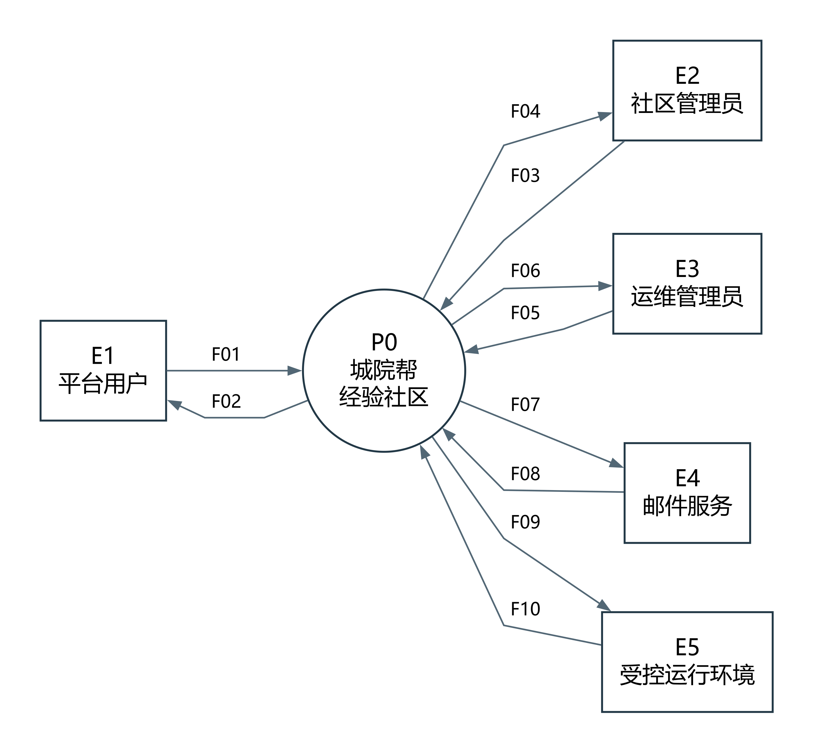

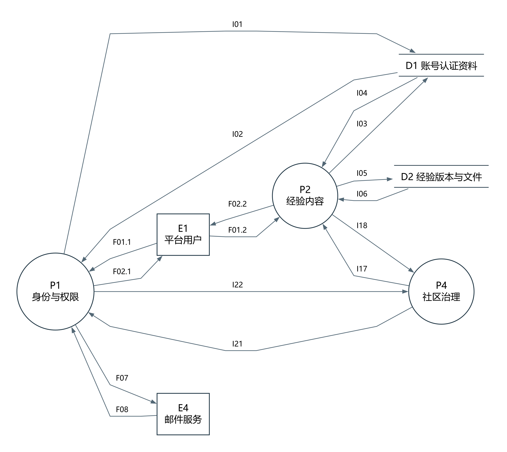

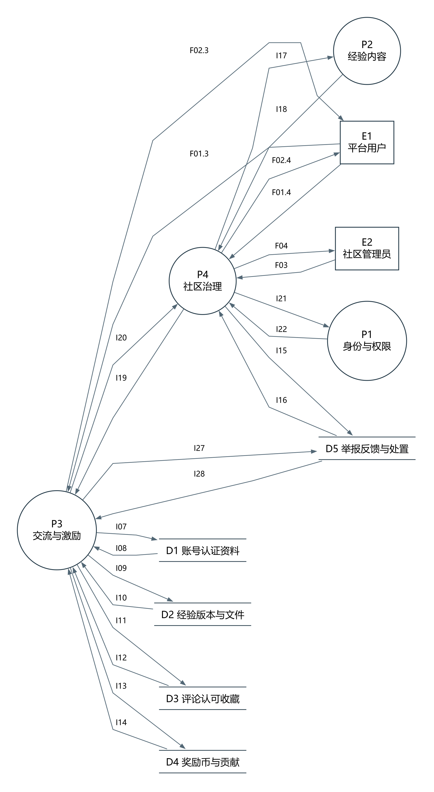

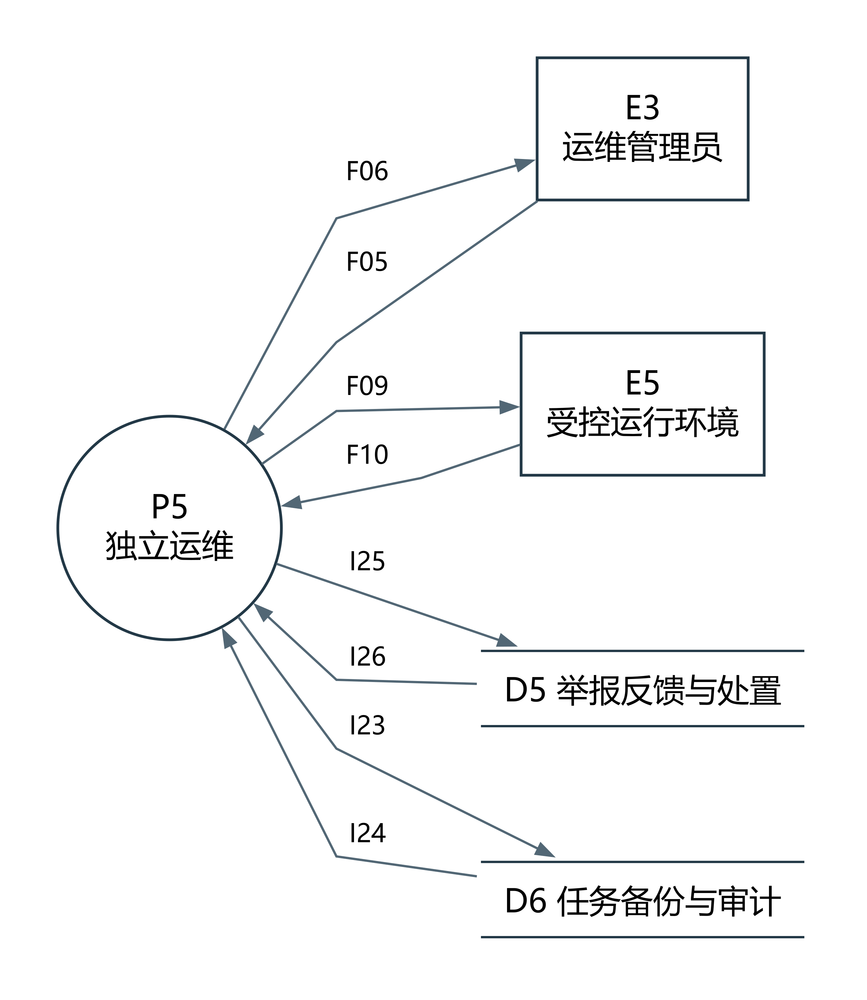

| 处理与关键数据流 | A 集中模板 | B 独立双端 | C 业务分域 |
| --- | --- | --- | --- |
| P1 身份与权限；F07／F08 校园邮件 | 同业务进程内验证，模板复用会话 | 业务身份模块向阅读及创作提供受控状态 | 独立身份服务，通过契约提供主体信息 |
| P2 内容；I05／I06 连接 D2 | 模板和小程序共享读写逻辑 | 原生端与 Vue 共用内容 API 和公开投影 | 内容服务负责文章、版本和媒体 |
| P3 交流激励；I11–I14 连接 D3、D4 | 与内容同进程，账本独立事务职责 | 同业务进程，分交流与激励模块 | 内容与账本同事务域，避免跨服务扣币和文章状态不一致 |
| P4 治理；I17–I22 连接 P1–P3 | 管理模板在业务进程内，授权独立 | 治理模块与普通身份隔离，共用内容边界 | 独立治理服务以受控请求与回执驱动处置 |
| P5 运维；F05／F06、F09／F10 | 独立入口及控制进程 | 独立入口及执行进程，D6 文件持久化 | 独立运维节点控制固定服务和备份 |

## 2.2 排除不满足约束的分组

| 分组设想 | 冲突 | 处理决定 |
| --- | --- | --- |
| P5 与 P1—P4 同进程且共用业务库登录 | 业务重启或 MySQL 维护时运维查询不可达 | 保留独立运行和持久状态，依据 BR17、NFR08 |
| 内容页直接读取私有草稿或完整作者记录 | 公开返回面扩大，认证失效和联系方式关闭难统一执行 | 内容服务输出白名单字段，依据 BR01、BR12 |
| 余额与扣币回执由端侧或两个独立写入单元分别更新 | 中途失败、重试及并发可能造成重复扣减 | 同一业务事务内处理，依据 BR14、NFR02 |
| 把恢复或备份放在普通请求线程内同步等待 | 长操作阻塞且断线后无法可靠查询结果 | 确认、任务接收、持久记录、异步执行分开 |
| 管理端和普通业务端共用权限凭据 | 社区处置与运维执行的权限范围无法隔离 | 保留三个身份域及服务端检查 |

这些约束保留了三类可进一步比较的实现策略。低成本方案合并网页展示设施，中等成本方案分别建设原生小程序与 Vue 页面并共享业务 API，高成本方案继续拆分业务部署单元与运维节点。

# 3 步骤2 选取合理的方案

## 3.1 比较条件与成本口径

三个备选都覆盖本期 SRS，以两人、本机课堂演示和 2027 年 1 月 6 日收尾为评估条件。人工统一按 45.76 元每人时计，使用方案 B 的项目全程计划工作量作为比较基数。A、C 的差额按受影响的工作包估算。共同工作与各方案差异分别计算，人工成本为方案测算值。

## 3.2 方案 A 低成本的集中网页展示

### （1）系统流程图

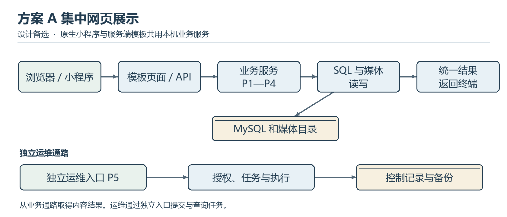

### （2）组成系统的物理元素清单

| 元素 | 配置与作用 |
| --- | --- |
| 终端 | 微信原生小程序、浏览器及服务端渲染页面 |
| 程序 | Java 业务进程兼网页模板、Markdown 编辑及预览脚本、独立运维进程 |
| 数据与文件 | MySQL 业务库、媒体、模板、运维任务和备份目录 |
| 外部设施 | 校园邮件、微信开发者工具、浏览器、本机数据库工具和独立运维页面托管 |

### （3）成本／效益分析

| 差额依据 | 人时 | 影响 |
| --- | --- | --- |
| 共用模板布局，减少独立网页组件和构建工作 | −26.00 | 节省网页基础、集成构建及维护配置 |
| 模板适配编辑器、跨端状态与回归 | +6.00 | 确认 Markdown、图片和修订冲突仍可处理 |
| 合计 275.85 − 26 + 6 | 255.85 | 255.85 × 45.76 = 11,707.70 元，较 B 少 915.20 元 |

网页入口可与服务一次构建，降低课堂安装步骤。编辑交互与服务发布耦合，模板变动需同时回归作者、管理页面和业务接口。该方案的收益以跨端草稿试验通过为条件。若需要替换现有 Vue 成果，实际迁移增量由复核后的清单重新估算。

### （4）实现这个系统的进度计划

| 阶段 | 负责人 | 前置与工期依据 | 产物与退出条件 |
| --- | --- | --- | --- |
| 模板验证 | 刘景浩主做，王晨确认接口 | DFD 分组后投入 2 人时验证模板、媒体和独立入口 | 可打开读者页、编辑页和停机运维入口 |
| 页面替换与接入 | 刘景浩模板；王晨 API | 以 B 的基础 WBS 为参照，模板共用减少 26 人时 | 登录、阅读、作者和治理走通 |
| 创作及回归 | 两人交叉复核 | 验证后投入其余 4 人时，复测草稿、预览与修订冲突 | 可提交的双端构建、回归记录与运维入口检查 |

排期按比较情景编制。目标是保留 11 月 27 日联调和 12 月初综合测试窗口，模板验证结束后按两人的实际可用时间复核日期。

## 3.3 方案 B 中等成本的双端与模块化单体

### （1）系统流程图

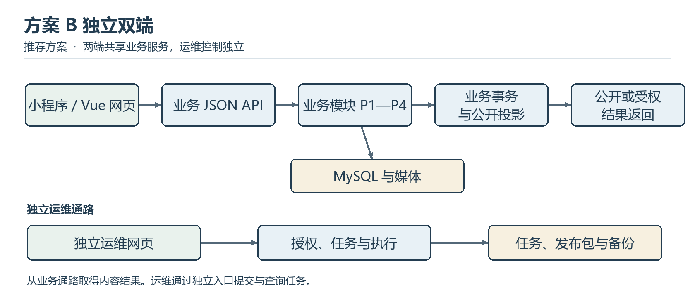

### （2）组成系统的物理元素清单

| 元素 | 配置与作用 |
| --- | --- |
| 小程序 | 微信原生 WXML、WXSS、JavaScript 和 JSON |
| 网页 | Vue 3、TypeScript、Vite，承担读者作者、社区管理及运维视图 |
| 业务服务 | Java 21、Spring Boot、Spring JDBC、Flyway，默认本机 8080 |
| 数据与文件 | MySQL、媒体目录、业务日志和审计记录 |
| 运维与外部设施 | 独立 Java 进程默认 8091，独立控制、发布及备份目录，校园邮件与开发调试工具 |

### （3）成本／效益分析

| 预算项 | 人时或金额 | 依据 |
| --- | --- | --- |
| 项目全程 | 275.85 人时 | 项目计划 V1.8 与 Project 资源分配 |
| 人工预算 | 12,622.90 元 | 275.85 × 45.76，结果按分取整 |
| 教室部署 | 使用已有本机 | Windows、WSL2、MySQL 和微信开发者工具 |

两端复用内容、权限与账本规则，网页有独立编辑体验，移动端使用原生页面和调试工具。验收成本集中在跨端草稿一致性、独立授权和双端回归。业务停机时，独立部署的网页入口和运维进程仍可提供状态与任务查询，这一条件纳入 NFR08 验收。

### （4）实现这个系统的进度计划

| 阶段与 WBS | Project 日期 | 负责人及人时 | 前置及验收产物 |
| --- | --- | --- | --- |
| 4.1–4.9 总体设计与内部复审 | 10/26–11/05 | 按末级任务分工 | 需求基线、设计图与复审 |
| 4.10–4.13 详细设计与测试准备 | 11/09–11/13 | 按末级任务分工 | 过程设计、用例与样本 |
| 4.14 设计修订与评审反馈 | 11/20–11/26 | 王晨 4.25、刘景浩 4.25 | 提交前整理；课堂反馈及交接 |
| 5.12 联调与实现证据封版 | 11/27 | 王晨 4.25、刘景浩 4.25 | 候选构建、源码与用例 |
| 6.1–6.7 验证和报告封版 | 11/30–12/04 | 见系统测试计划 | 12 月 6 日提交基线 |
| 6.8 复核及课堂准备 | 12/07–12/08 | 王晨 2.75、刘景浩 1.50 | 按实际证据修订 |

11 月 18 日、11 月 25 日分别是课程详细设计提交与设计评审节点。Project 内部设计任务、反馈修订与课堂节点分别列示。完成状态依据对应交接产物和复核记录登记。

## 3.4 方案 C 高成本的业务服务分区

### （1）系统流程图

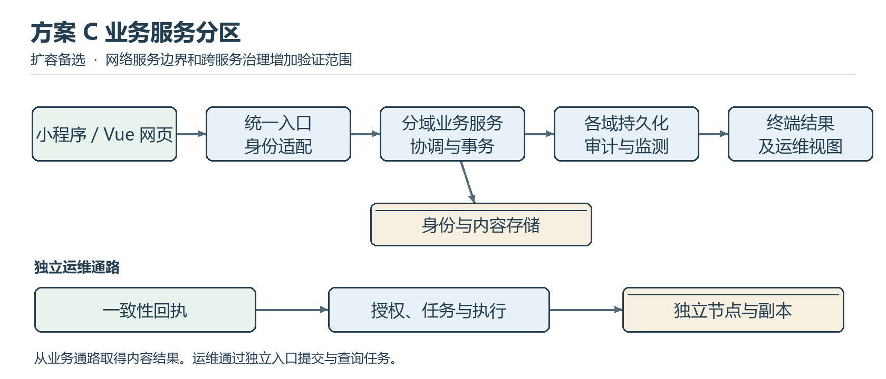

### （2）组成系统的物理元素清单

| 元素 | 配置与作用 |
| --- | --- |
| 双端和网关 | 原生小程序、Vue 网页、统一入口与身份适配 |
| 业务运行单元 | 身份服务、内容与账本服务、治理服务，独立运维进程 |
| 持久化 | 分域数据、跨服务治理回执、媒体、发布包、备份及异机副本 |
| 保障设施 | 多进程测试环境、跨服务监测、统一审计、部署与恢复工具 |

### （3）成本／效益分析

| 差额依据 | 人时 | 影响 |
| --- | --- | --- |
| 分域契约与一致性 | +24.00 | 处置请求、失效传播和幂等回执 |
| 部署和监测 | +18.00 | 服务启动、故障定位与维护 |
| 网络故障及恢复测试 | +18.00 | 超时、重复处理及数据核对 |
| 合计 275.85 + 60 | 335.85 | 335.85 × 45.76 = 15,368.50 元，较 B 多 2,745.60 元 |

身份与治理可按各自负载部署。内容与账本留在同一事务域，治理跨服务时需要验证目标修订和回执补偿。当前课堂容量目标由负载测试验证，独立扩缩的收益尚需实测容量和维护能力支持。

### （4）实现这个系统的进度计划

| 阶段 | 负责人 | 前置与增量工时 | 产物与退出条件 |
| --- | --- | --- | --- |
| 分域及契约 | 王晨，刘景浩复核 | 业务边界确认后 +24 人时 | 接口、状态传播、补偿及幂等方案可验证 |
| 部署与监测 | 刘景浩，王晨协作 | 契约冻结后 +18 人时 | 三个业务域、运维入口和监测可独立启动 |
| 故障试验与验收 | 两人交叉执行 | 部署及本机数据集就绪后 +18 人时 | 超时、重复、部分失败和恢复报告 |

按两人每天各投入 30–45 分钟的常态容量，60 个新增人时相当于约 40–60 个共同投入日。与 B 相比，先按先后依赖和集中开发容量重新排期，再确认课程节点可达性。

## 3.5 比较结果

| 判断项 | 方案 A | 方案 B | 方案 C |
| --- | --- | --- | --- |
| 需求匹配 | 关键约束可满足，网页技术路线需重新确认 | 符合现有原生小程序、独立网页及校园认证路线 | 可满足，增加跨服务一致性与环境条件 |
| 交付成本 | 估计 255.85 人时 | 计划 275.85 人时 | 估计 335.85 人时 |
| 版本演进 | 网页模板较紧密地跟随业务服务 | 双端可独立构建，接口集中维护 | 可独立发布，依赖治理复杂 |
| 风险集中处 | 创作体验及模板改造 | 两端兼容、管理运维网页与真实联调 | 授权传播、事务协调及多进程演练 |
| 进度 | 复用有收益，替换成本需试点 | 已有代码及计划支撑，仍需复核交付边界 | 须调整节点和资源 |

# 4 步骤3 推荐最佳方案

采用 B 作为详细设计的建议基线。P1—P4 在同一业务进程内通过服务边界协作。文章发布及投币的跨表写入可在 MySQL 事务内完成，社区处置经业务接口更新公开状态。P5 独立接收受控任务，即使业务库暂时不可用也可查询历史状态。这些边界由 SRS 的一致性和独立可达约束推出。

A 的成本优势取决于模板复用和编辑体验，当前设计已采用独立网页且已有相关代码。C 的扩容收益依赖实际容量数据与更充足的交付资源。先记录 B 的性能基线，再依据 NFR04、NFR05 的压测结果决定是否调整部署边界。

| 参与者 | 核查内容 | 当前证据 |
| --- | --- | --- |
| 需求代表 | 岗位筛选、全文阅读、跨端创作、反馈与操作影响 | 已有需求记录及原型，候选人走查结果待记录 |
| 技术复核人 | 双端契约、事务、隐私、运维独立性 | 有代码和历史测试记录，本报告技术复核见第 10 章 |
| 项目负责人 | 工期、资源、风险及交付条件 | 当前设计与测试排期已存在，独立管理复审待记录 |

进入详细设计时以接口、数据和状态约束为输入。对尚未确认的接口缺口先记录影响及验收条件，由项目负责人协调签署。计划日期和已有提交不能用于推定用户已经认可。

# 5 步骤4 功能分解

## 5.1 逐项检查 DFD 处理

同一 DFD 处理可以对应多个程序职责。拆分以独立授权、数据读写方式和单独失败的操作为依据。下表从分析模型到设计，接口参数和错误输出见 6.6。

| 处理编号 | 输入 → 输出 | 子功能与模块 | 程序或数据归属 | 验证场景 |
| --- | --- | --- | --- | --- |
| P1 | 校园邮箱、挑战、凭证 → 认证和会话 | M1 邮件挑战、登记、登录、退出 | AuthController；D1 平台账号和会话；E4 邮件 | 验证码过期及退出失效 |
| P2 | 查阅和创作请求 → 列表、正文或保存回执 | M2 阅读和 M3 创作分别分配 | ArticleController、WritingController；D2 内容 | 公开读取与本人草稿隔离 |
| P2.1 | 查询或创作字段、身份 → 规范输入或拒绝 | M2.1 查询验证；M3 权属及输入验证 | ArticleQuery、WritingInput；D1 认证 | 非法分类、非本人写入 |
| P2.2 | 文章标识、版本及文件 → 公开记录或可用草稿资源 | M2.2 版本读取；M3 草稿与媒体 | D2 article_version、article_draft、媒体文件 | 停用资源和上传失败 |
| P2.3 | 规范数据及修订 → 公开投影、检索或发布回执 | M2.3 裁剪；M3 发布和索引数据 | D2 article、article_version 及分类 | 修订冲突，公开旧版保留 |
| P3 | 互动、阅读奖励或投币 → 相应结果 | M4 交流；M5 激励；M8 入口与提示 | D3 互动、D4 钱包和账本 | 访客受限及两端互动 |
| P3.1 | 会话与对象 → 受权请求 | M4、M5 检查认证和内容状态 | D1、D2；授权和可见性规则 | 失效令牌、隐藏文章 |
| P3.2 | 评论、图片或互动数据 → 回执与计数 | M4 评论、赞、藏与作者 | CommentController、InteractionController；D3 | 图片失败与重复点赞 |
| P3.3 | 业务日、会话、金额与请求键 → 激励回执 | M5 去重、额度、事务写入 | CoinController；D4 coin_wallet、coin_event | 同键、同篇额度及余额 |
| P3.4 | 互动或激励结果 → 分页或反馈 | M4、M5 结果投影；M8 状态 | D3、D4、受权案件关联 | 回执刷新与分页 |
| P4 | 举报、反馈或管理操作 → 案件与治理结果 | M6 受理、调查、处置；M8 结果承接 | D5 案件与治理事件 | 报告者和管理者权限隔离 |
| P4.1 | 普通用户提交及证据 → 案件标识 | M6 收件、目标关联、证据归属 | CommunityController；D5 及媒体 | 私有证据访问 |
| P4.2 | 案件上下文与管理动作 → 决策和处置结果 | M6 认领、处置、分类、申诉 | GovernanceController；D5、P1–P3 关联 | 双管理者并发修订 |
| P4.3 | 真实处理结果 → 案件状态和事件 | M6 登记与审计；M8 通知 | D5 历史和治理事件；通知设计 | 失败时无成功事件 |
| P5 | 运维确认和任务请求 → 阶段与核查结果 | M7 独立授权、执行、查询 | OpsApplication；D6 控制目录、E5 环境 | 业务停机后查询任务 |
| P5.1 | 独立身份、动作、目标、引用 → 确认或拒绝 | M7.1 授权及绑定确认 | OpsAuth、OpsJobs；D6 本地控制记录 | 确认过期或引用不匹配 |
| P5.2 | 已确认请求 → 任务和执行事件 | M7.2 互斥、分派和核查 | OpsJobs、OpsRunner；E5 进程及备份设施 | 同目标互斥，损坏备份拒绝 |
| P5.3 | 任务号或状态请求 → 状态与结果 | M7.3 读取、脱敏和审计 | OpsStore；D6 任务记录与日志 | 重启后状态及错误可追溯 |

## 5.2 结构设计与过程设计的交接

结构设计确定调用、输入输出及持久化责任。过程设计在该边界内确定判断、顺序、状态转换和异常回退。下表把复杂处理拆到可分配的程序职责，判定表提供详细设计和测试的输入。

| 处理 | 拆分依据 | 结构与交接 |
| --- | --- | --- |
| 校园邮箱注册 | 邮件会失败，挑战有时效，账号和认证状态要求一致 | M1 规范化邮箱、检查频次并生成挑战，邮件适配接收投递请求。注册路径验证挑战并登记账号与认证，成功后才进入会话路径。 |
| 检索与阅读 | 列表分页和详情版本读取不同，公开字段限制共用 | M2.1 生成查询对象。M2.2 依据公开状态选文章和版本，M2.3 裁剪字段并返回页数据或全文。 |
| 草稿与发布 | 草稿是私有工作版本，上传是可重试准备，发布要原子切换公开版本 | M3 分为权属与修订校验、草稿、媒体和发布。发布接收已保存修订与请求键，提交版本及公开指针后返回回执。 |
| 奖励与投币 | 领取按业务日去重，扣币须同时更新余额和账本 | M5 先核对会话、文章、请求语义和规则。写入事务串行校验余额及累计额度，回执可供同语义请求重放。 |
| 案件与处置 | 受理、调查、决策和执行权限不同 | M6 接收案件和证据标识，调查投影提供目标版本，决策执行检查权属或管理权限并登记审计。 |
| 部署与恢复 | 提交时授权，执行时核查资源，长任务可中断 | M7.1 签发绑定确认。M7.2 持久化任务并调度白名单动作。M7.3 根据任务号提供状态、阶段结果及错误。 |

### 5.2.1 发布冲突判定表

| 条件 | 处理与状态 | 验证证据 |
| --- | --- | --- |
| 认证或权属不满足 | 拒绝，禁止读取或修改他人草稿 | 响应、草稿及公开版本快照 |
| 同请求键且语义一致 | 返回已登记回执，版本数保持 | 同键回执和版本计数 |
| 同键异义，或新请求的修订号已过期 | 拒绝冲突，旧公开版本仍可读；客户端保留编辑内容 | 两端修订、错误状态和公开详情 |
| 输入及图片归属有效，修订匹配 | 固化版本、更新指针、登记回执，事务提交后响应 | 一次提交对应一个公开版本 |

### 5.2.2 重复投币判定表

| 条件 | 处理与状态 | 验证证据 |
| --- | --- | --- |
| 同请求键、目标与金额一致 | 复用回执，余额和账本保留原变更 | 回执、钱包差额与账本 |
| 同键异义、本人文章、余额不足或同篇超额 | 拒绝写入，记录对应错误 | 错误响应与零新增账本 |
| 公开文章、金额合法且有余额 | 一次事务扣币并新增账本，作者贡献按有效事件计算 | 对比事务前后余额、计数、事件 |

### 5.2.3 处置冲突判定表

| 条件 | 处理与状态 | 验证证据 |
| --- | --- | --- |
| 非管理身份、不可处理对象 | 拒绝或不可见 | 授权响应和审计核对 |
| 目标修订变化或动作与当前状态不匹配 | 停止变更，重新查询最新目标后决定 | 两操作者的版本和处置结果 |
| 授权、修订和动作全部有效 | 在业务事务内变更对象，登记治理事件及关联记录 | 目标状态、事件与管理界面查询 |

### 5.2.4 恢复失败判定表

| 条件 | 处理与状态 | 验证证据 |
| --- | --- | --- |
| 确认失效、任务互斥或清单校验失败 | 拒绝执行，保留现有业务数据 | 拒绝回执、清单及任务记录 |
| 已执行且重启、健康或数据核对失败 | 任务登记失败。按执行阶段保留保护副本，核查进程和数据，再决定恢复措施 | 阶段事件、保护副本标识、检查记录 |
| 健康、样本及版本一致 | 记录恢复成功，保留前后数据和恢复计时 | 任务最终状态、健康检查及样本校验 |

## 5.3 程序和持久化设计清单

| 组成 | 程序职责 | 文件或数据库归属 |
| --- | --- | --- |
| 微信端 | 页面路由、身份状态、搜索、正文、图文编辑和错误恢复 | miniprogram 的 app、pages、components、services；本机调试配置单独管理 |
| 网页端 | 读者、作者、治理与运维视图，接口和角色路由 | web/src、构建产物及本机环境配置；运维入口部署随独立运行约束 |
| 业务后端 | Controller 解析和授权，Service 执行规则与事务，数据访问封装 SQL 和文件 | server/src/main、Flyway 迁移、MySQL 业务表、媒体和脱敏日志 |
| 运维执行器 | 独立会话、确认、队列、白名单执行和状态查询 | OpsApplication、OpsAuth、OpsJobs、OpsRunner、OpsStore；控制目录、发布包、备份清单和任务事件 |
| 外部接口 | 邮箱挑战投递、运行环境健康与进程操作 | 邮件适配与本机配置；运维使用隔离目标，交付文档记录配置键和位置 |

## 5.4 层次图与 HIPO

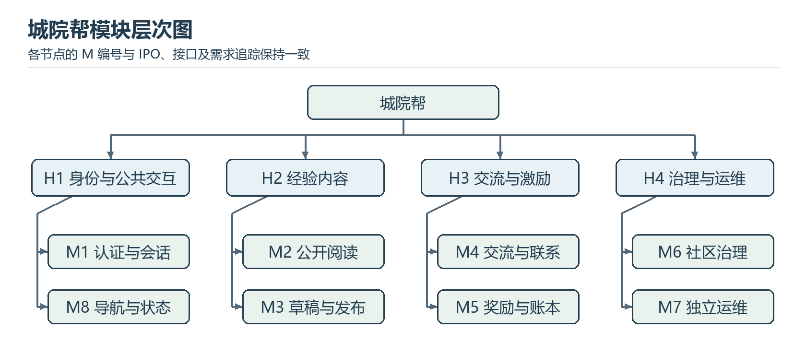

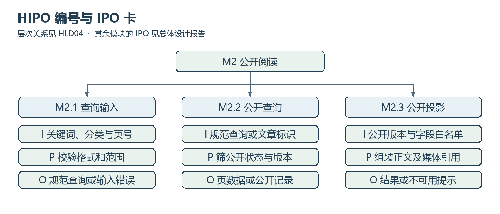

层次图标明职责归属和模块编号。M2.1–M2.3 的 IPO 卡与后续结构图及接口编号对应。其余关键模块按同一格式登记。

| HIPO 编号 | 输入 | 处理 | 输出 |
| --- | --- | --- | --- |
| M1.1 邮箱认证 | 邮箱、验证码、时效 | 校验域、挑战、时效与频率，登记认证 | 认证结果与必要提示 |
| M2.1 查询输入 | 关键词、分类、排序、分页 | 校验格式、范围和允许字段 | 规范化查询或拒绝原因 |
| M2.2 公开查询 | 查询对象或文章标识 | 选择公开状态、关联分类、按规则排序 | 页数据或公开版本 |
| M2.3 公开投影 | 公开版本和允许字段 | 组装标题、正文、来源及公开媒体 | JSON 响应或不可用结果 |
| M3.2 发布 | 草稿、预期修订、请求键 | 校验权属及资源，持久版本、切换公开指针 | 发布回执或冲突 |
| M5.2 投币 | 身份、文章、金额、请求键 | 判定上限、余额、重复请求，提交事务 | 账本结果和可查询状态 |
| M6.2 案件处置 | 管理身份、对象、修订、理由 | 核对受理状态及目标，登记处置和审计 | 处置回执或冲突 |
| M7.1 确认 | 运维身份、动作、目标、引用 | 形成影响预告，签发绑定确认 | 确认标识和过期时间 |
| M7.2 执行 | 已确认请求、版本或备份引用 | 查重互斥、分派、保护与执行 | 持久任务和阶段事件 |
| M7.3 查询 | 任务标识或状态请求 | 读取控制目录及允许的诊断信息 | 脱敏状态、结果与错误 |

# 6 步骤5 设计软件结构

## 6.1 物理结构与模块接口

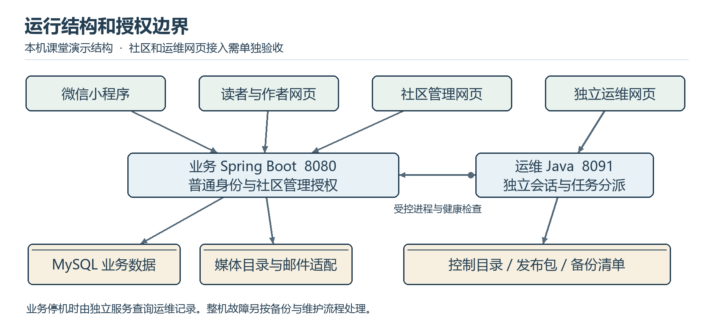

小程序和网页把交互状态留在各自页面层，将业务判断交由后端。业务进程通过 Controller 接收请求，Service 管理规则与事务，数据访问层操作数据库或文件。管理模块与业务模块共用可见性规则但保持各自授权。运维进程通过独立 HTTP 入口访问控制目录并调度固定目标，业务服务不承担运维登录或任务查询。

| 模块 | 职责与暴露边界 | 内部数据及失败约束 |
| --- | --- | --- |
| M1 身份 | 认证、登录、退出、本人状态 | 摘要、挑战、会话细节仅服务端使用，过期及受限结果由契约表达 |
| M2 阅读 | 分类、文章列表、详情与公开媒体 | 私有版本、作者隐私和失效内容不会进入公开投影 |
| M3 创作 | 本人资料、草稿、图片、发布与下架 | 修订号、公开版本指针和媒体关系在事务边界核对 |
| M4 交流 | 评论、作者及联系、点赞收藏 | 读取及写入检查认证与目标，隐藏内容按受控规则处理 |
| M5 激励 | 奖励、钱包、账本和投币 | 请求键、业务日、单篇上限和余额由服务端判定 |
| M6 治理 | 案件、分类、内容处置、限制和申诉 | 独立管理会话，受控上下文，事件可追溯 |
| M7 运维 | 任务确认、执行、查询、版本与备份 | 不接收任意命令、库名或目录，结果经校验后登记 |
| M8 公共交互 | 导航、错误状态、个人入口及通知 | 端侧会话和私有显示隔离，失败保留可恢复输入 |

## 6.2 面向数据流的设计过程

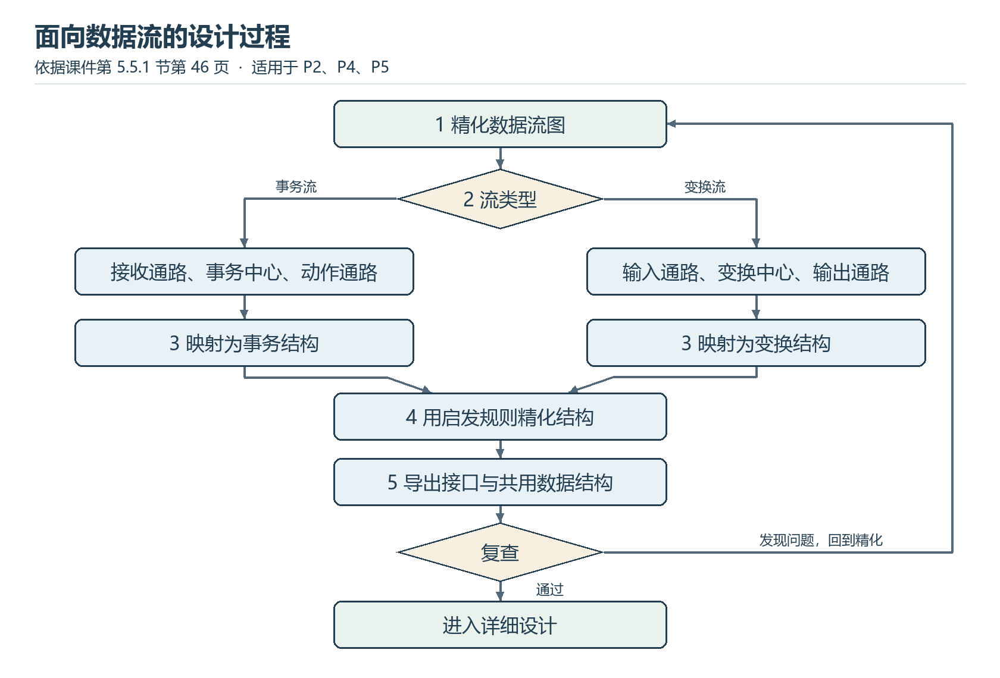

课件第 46 页的流程在本报告按五个交付步骤展开。复查检查接口、数据边界及功能覆盖。发现处理遗漏或方向变化时，先回到精化 DFD，再重做受影响的模块映射。

### 6.2.1 精化数据流图

先核对 DFD00 的系统边界、DFD01–03 的父处理与 DFD21、DFD31、DFD41、DFD51 的输入输出。原图继续作为 SRS 基线。精化图提取公开读取和管理动作通路，附表保留双向接口及未画出的原模型路径。

#### 公开读取原图与精化图

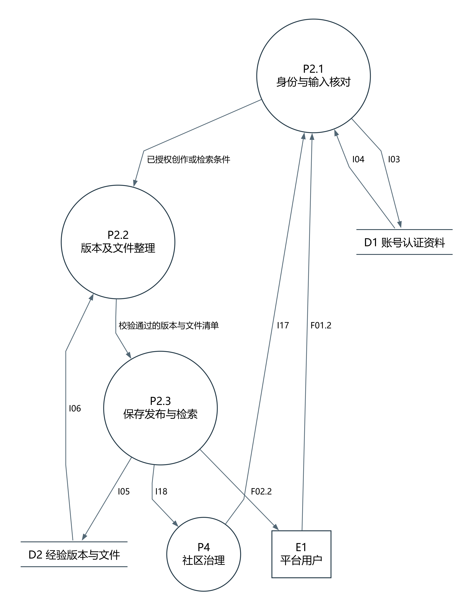

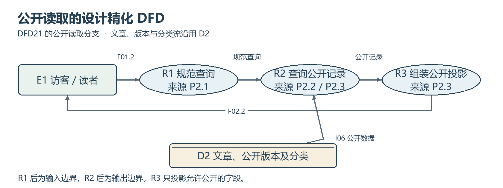

#### 社区处置原图与精化图

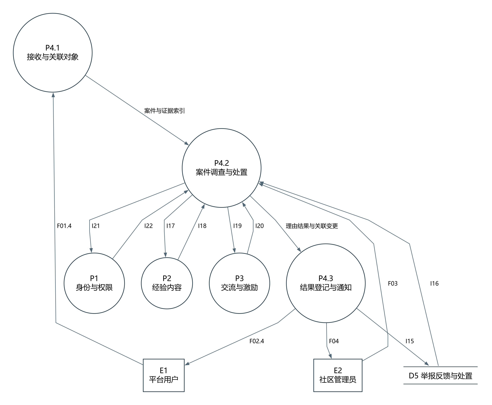

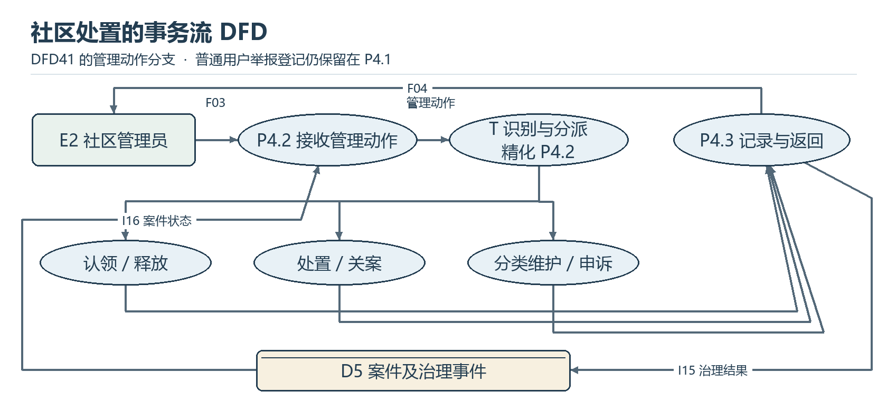

#### 独立运维原图与精化图

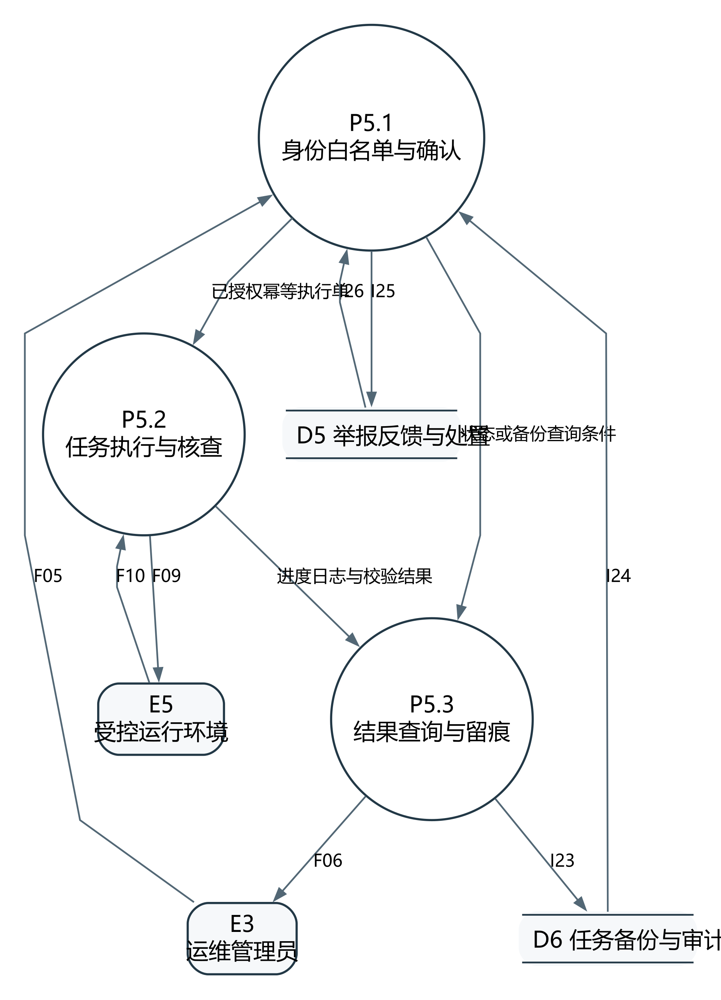

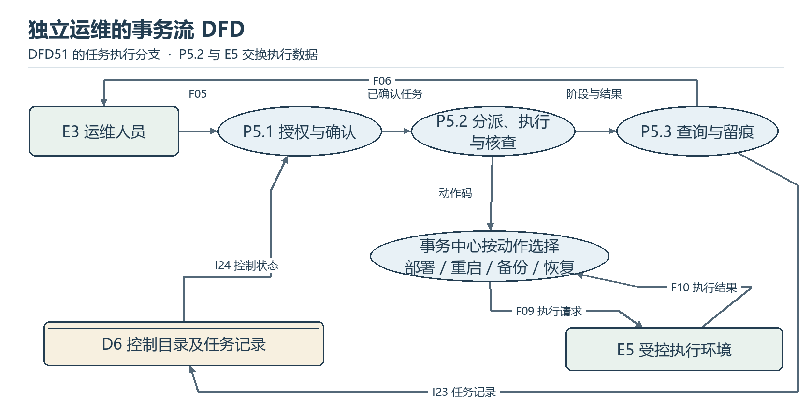

| 通路 | 原边界流 | 设计映射与原图保留范围 |
| --- | --- | --- |
| 公开读取 | F01.2／F02.2、I06 | E1 请求经 R1，R2 读取 D2，R3 返回公开结果。I05 写入、身份查询和管理交互仍按 DFD21。 |
| 社区治理 | F03／F04、I15／I16、I17–I22 | F03 的管理动作由 P4.2 内部接收、判型并分派，P4.3 记入 D5 并返回。普通用户登记和回复继续走 F01.4／F02.4。 |
| 独立运维 | F05／F06、F09／F10、I23／I24 | P5.1 认证与确认，P5.2 经 E5 执行与核查，P5.3 输出并留痕。I25／I26 的治理关联留在需求模型，运维主路径使用独立状态。 |
| 交流与激励 | F01.3／F02.3、I07–I14、I19／I20、I27／I28 | DFD31 保留交流和账本的处理分配。M4 与 M5 分别承接，详见步骤 4 的处理清单。 |

### 6.2.2 判定流类型与边界

| 通路 | 流类型与依据 | 界线 |
| --- | --- | --- |
| 公开文章读取 | 变换流。外部参数转为规范查询，数据库公开记录转为页面可用响应。 | R1 后是输入边界，R2 后是输出边界。R2 为中心，R3 只映射公开字段。 |
| 社区治理 | 事务流。接收管理动作后，按动作和目标选择处理路径。 | P4.2 内接收、判型与分派。认领、内容处置、分类或申诉结束后，P4.3 记录结果。 |
| 独立运维 | 事务流。已确认任务的动作决定部署、重启、备份或恢复通路。 | P5.1 接收并校验，P5.2 选择执行和核查，P5.3 提供状态与结果。 |

### 6.2.3 映射为软件结构

#### 公开阅读的变换分析七步

| 步骤 | 实施与产物 |
| --- | --- |
| 1 复查基本系统模型 | 在 DFD00 核对 E1 请求和结果边界，在 DFD01 确认 P2 的读取职责与 D2 的文章数据。 |
| 2 复查并精化 DFD | 从 DFD21 分离公开读取通路，拆出规范化、公开记录查询和字段投影，见 HLD12。 |
| 3 判定信息流类型 | 路径以输入、加工、输出为主，列表和详情都从公开数据形成结果。 |
| 4 确定变换边界 | R1 交接规范查询，R2 完成公开查询，R3 把内部记录变成响应。HLD06 标出相应边界。 |
| 5 第一级分解 | M2 协调输入、变换和输出三个下级控制模块，见 HLD15。 |
| 6 第二级分解 | 将分类校验、文章及版本查询、筛选排序、正文与来源投影分别映射为下层职责，见 HLD07。 |
| 7 用度量与启发规则精化 | 公共可见性规则归入查询边界，入口保留各自参数和分页职责。调用调整与复核见 6.2.4。 |

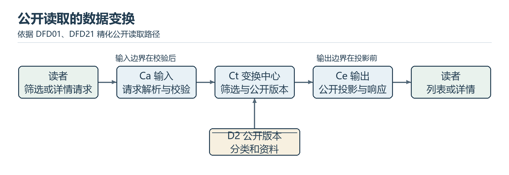

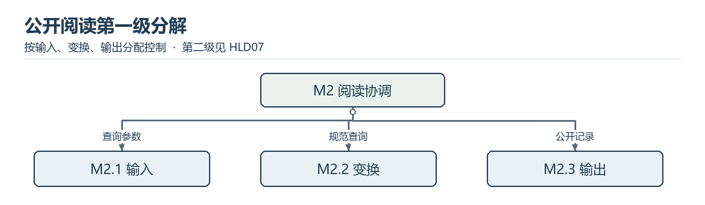

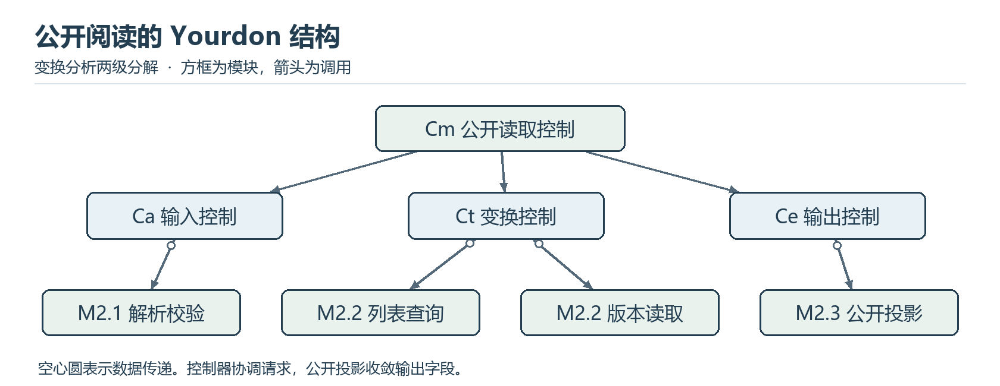

#### 社区治理与运维的事务分析

社区接收分支验证管理会话和动作数据。P4.2 内事务中心按认领、释放、闭案、内容处置、分类维护、申诉选择处理，P4.3 以实际业务结果组织审计与返回。用户提交举报走受理分支，受理时核对目标、报告者与证据。

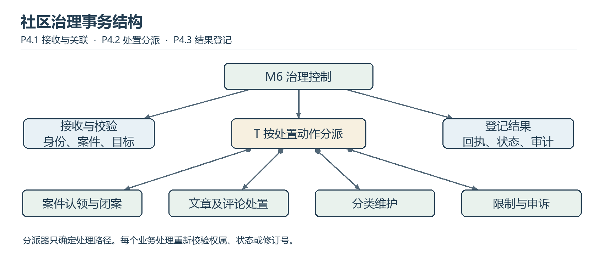

运维接收分支核验会话和确认。P5.2 的分派器按动作码调用部署、重启、备份或恢复，执行分支交回阶段事件及核查结果。P5.3 按任务号返回持久状态。受理与执行结果使用不同状态。

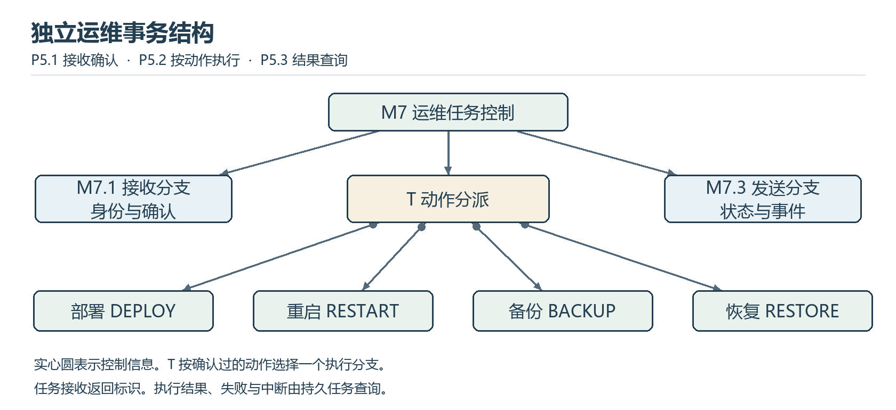

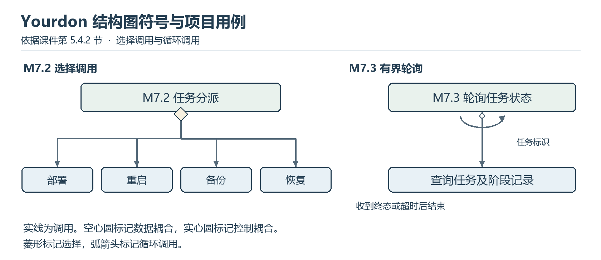

### 6.2.4 按启发规则精化

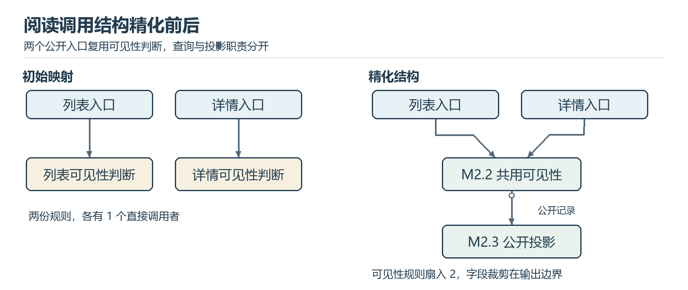

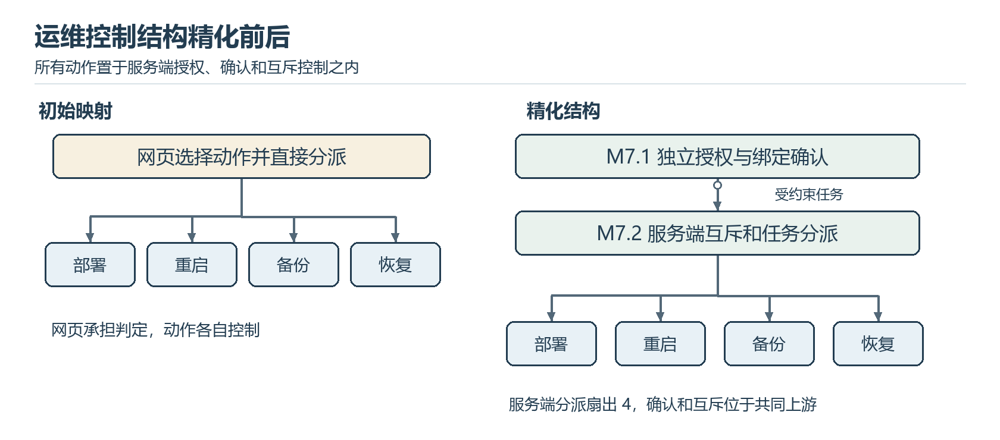

在阅读局部，列表和详情两个入口从各自执行规则改为共同调用可见性规则。该规则的扇入由两个独立实现各 1 改为共享模块 2，协调模块保持输入、查询、投影三条直接调用。查询模块在受控层完成选版及公开检查，输出层按允许字段投影。运维局部由网页选择四个动作改为服务端验证后由一个分派器控制四个动作，授权与互斥统一放在执行分支的上游。度量范围为图示局部，详细实现以调用走查记录复核。

### 6.2.5 导出接口和数据结构并复查

| 模块 | 交接输入 | 交接输出与错误 | 数据结构归属 |
| --- | --- | --- | --- |
| M2.1 → M2.2 | 关键词、岗位／公司／专业 ID、排序与页号，或文章 ID | 规范化查询或参数错误 | 查询对象，与页面显示状态分离 |
| M2.2 → M2.3 | 规范查询或文章 ID | 公开结果记录、空页或不可见 | D2 主体、公开版本及分类；内部字段留在读取层 |
| M3 发布 | 本人身份、文章 ID、expectedRevision、requestId | 发布回执、权限或版本冲突 | 草稿、公开版本及回执 |
| M5 投币 | 认证主体、文章 ID、amount、requestId | 新回执、重放回执或拒绝 | 钱包与事件，在一个事务内维护 |
| M6 处置 | 管理会话、对象 ID、预期修订和理由 | 对象状态及审计事件，或拒绝与冲突 | 案件、内容状态、治理事件 |
| M7.1 → M7.2 → M7.3 | 独立运维身份、动作、固定目标、引用及确认 | 任务 ID、阶段状态、核查结果或错误 | 确认绑定、持久任务、事件与备份清单 |

复查按“DFD 边界流 → 处理 → 模块 → 接口 → 数据 → 用例”走通每条代表路径。发现 F03 等流的来源、目标或授权边界改变时，回到设计精化图并同步接口说明、调用图及用例。详细设计接收已复查的接口、数据结构、判定表与 WBS 交接清单。组内交叉复核在评审记录中签认。

## 6.3 模块化、信息隐藏与独立性

模块分解降低单个问题的理解与维护工作量，过多的分区也增加接口、联调和部署成本。第5章的成本曲线是定性指导，本文使用事务边界、独立运行需求及组员可维护性确定模块粒度。先把系统当成一个需求边界，再逐步细化为终端、业务服务、运维服务、功能模块和可验证的过程。

| 审查对象 | 耦合判定 | 内聚判定与设计取舍 |
| --- | --- | --- |
| M2 查询与公开投影 | 传查询及公开结果，数据耦合 | 查询到投影属于顺序内聚，公开判定统一 |
| M3 草稿与发布 | 以标识和修订访问数据，事务内存在共享数据库环境 | 发布是功能内聚，上传单列以隔离失败 |
| M4 评论与作者资料 | 业务端共享账号及文章标识，公开投影限制特征耦合 | 按评论、联系和收藏拆成各自功能单元 |
| M5 钱包与账本 | 共享数据环境，锁和事务约束显式 | 投币的检查与入账是同一职责 |
| M6 治理分派 | 动作决定分支，控制耦合 | 案件、分类和申诉分别聚合，分派器只选路 |
| M7 运维分派 | 确认和动作决定分支，控制耦合 | 运行、备份、恢复可独立核查，任务登记共用 |
| M1、M8 | 身份结果及页面状态跨模块传递 | M1 封装认证内部数据，M8 避免汇集业务写入 |

应用层保持账号摘要、媒体路径、执行配置、备份目录及审计细节的可见范围。禁止越过公开接口修改他模块内部数据。共享数据库是已有的公共环境耦合，需用表权属、事务边界和明确的引用约束控制。课件内聚的七种分类用于定性诊断，按行为分析功能、顺序、通信、过程、时间、逻辑和偶然内聚。现阶段没有给模块编造综合分值。

| 内聚类别 | 课件示意分值 | 本项目辨认方法 |
| --- | --- | --- |
| 功能 | 10 | 把投币原子提交视为一个明确功能，所有子处理服务于该结果 |
| 顺序 | 9 | 将规范查询、结果读取、公开投影按输入输出逐级连接 |
| 通信 | 7 | 处置和审计围绕同一案件传递必要的身份和目标数据 |
| 过程 | 5 | 有序运行的启动与核查需进一步按状态及结果分配责任 |
| 时间 | 3 | 初始化时同时加载配置与建目录，仍分开各自失败处理 |
| 逻辑 | 1 | 若一个通用修改入口依赖许多动作开关，则拆成明确操作 |
| 偶然 | 0 | 零散工具仅因便于调用集中时，按文件、验证或日志职责归类 |

分值用于理解分类。实际模块的判断依据是职责、所需数据与调用结构，见本节的逐模块检查。

## 6.4 七条启发规则的应用

| 规则 | 本项目处理 | 复核依据 |
| --- | --- | --- |
| 提高独立性 | 分离业务与运维，上传与发布各自处理失败 | HLD05、HIPO 与事务边界 |
| 规模适中 | 拆分职责复杂的治理和运维方法，60 行作为走查参考 | 详细设计与代码走查记录 |
| 深度、宽度、扇入、扇出 | 维持三层职责分配，避免总控制器直接承包所有规则 | 图 7 的局部度量，复杂调用由后续走查测量 |
| 作用域在控制域内 | 授权决策放在调用受限操作的上级，查询和写入分别保护 | M1、M6、M7 接口与越权用例 |
| 简化接口 | 以强类型字段和标识取代完整对象、空字段或任意命令 | API 及字段清单 |
| 单入口单出口 | 每个模块职责通过公开接口进入，收敛正常与异常返回 | 统一响应和过程图复核 |
| 功能可预测 | 相同键与同语义给一致结果，状态和副作用显式 | 幂等、版本冲突和状态用例 |

如果把“可执行恢复”的判定留在网页弹窗，业务请求可绕过显示逻辑到达执行器。将判定上移到独立运维接收和确认模块，并让所有执行路径经其分派。另一种可行调整是把受影响的执行子模块移入该判定模块的控制域。当前采用两者结合，服务端做判定，受控执行器作为下级。

## 6.5 设计优化

| 课件第 5.5.4 节步骤 | 城院帮应用与证据 |
| --- | --- |
| 1 先精化结构 | 先通过权限、草稿修订、账本一致性和可恢复性检查。模块责任与数据边界见 HLD04、HLD16、HLD17。 |
| 2 识别耗时处理并细化算法 | 以固定数据集记录列表／详情、发布和评论 P95，按查询计划、索引命中及事务等待定位处理环节。 |
| 3 用现有高级语言完成程序 | 使用 Java、SQL、JavaScript 或 TypeScript 的既有实现，记录构建版本和基线测量。 |
| 4 隔离占用资源较多的模块 | 对文章排序、Markdown 图片渲染、邮件和备份分别采样耗时、CPU、内存及 IO，按证据划定热点。 |
| 5 必要时重新设计热点 | 达不到 SRS 目标且重复测量确认瓶颈时，先局部调整查询、索引或算法，再比较性能与回归结果。低层重写须另有成本效益依据。 |

性能方案、测试数据及证据要求见《城院帮系统测试计划》NFR04、NFR05 和恢复章节。

## 6.6 外部接口概要

| 模块 | 已核对的入口示例 | 合同与限制 |
| --- | --- | --- |
| M1 | POST /api/v1/auth/login，GET /api/v1/me | 登录返回不透明令牌，受限请求由服务端解析 |
| M2 | GET /api/v1/catalog、/articles、/articles/{id} | 组合过滤、稳定分页、发布状态检查与公开字段投影 |
| M3 | PUT /api/v1/me/articles/{id}/draft，POST /api/v1/me/articles/{id}/publish | 草稿修订、请求键、冲突拒绝及公开版本切换 |
| M4 | PUT /api/v1/articles/{id}/like，GET /api/v1/authors/{id}/contact | 独立互动语义，认证后才可取得相应数据 |
| M5 | GET /api/v1/me/rewards，POST /api/v1/articles/{id}/coins | 服务端计算余额、日上限与同篇额度 |
| M6 | GET /api/v1/admin/cases/{id}/context，POST /api/v1/admin/articles/{id}/moderation | 使用社区管理授权与受控资料投影 |
| M7 | POST /api/v1/ops/confirmations、/jobs，GET /api/v1/ops/jobs/{id} | 使用独立运维入口，排队、运行与结果分别读取 |

JSON 成功和失败都使用 code 与 traceId，成功携带 data，失败提供 message。图片下载按二进制接口规则处理。业务和运维的 HTTP 入口区分。对重复提交按具体接口使用 requestId 或幂等语义，版本冲突按该接口的实际状态处理，不能把接口概览当成所有参数的完整定义。

| 设计模块 | 主分支实现定位 |
| --- | --- |
| M1、M2 | AuthController 与 AuthService，ArticleController、ArticleService 与 ArticleQuery |
| M3、M4 | WritingController 与 WritingService，AuthorService、CommentService 与 InteractionService |
| M5、M6 | CoinController 与 CoinService，CommunityService、GovernanceService、AccountModerationService 与 AdminAuthService |
| M7 | OpsApplication 接收请求，OpsAuth 校验，OpsJobs 和 OpsStore 处理任务，OpsRunner 执行 |
| M8 | miniprogram 的 app.json、页面及请求服务，web 的 router.ts、页面与 API 客户端 |

实现定位以 d161553 文件为准。表中一个设计模块可由多个实际类共同实现，后续详细设计再给出方法级输入、状态和异常路径。

# 7 步骤6 设计数据库

## 7.1 逻辑实体到持久化结构

SRS 的 27 个实体和 134 个字段描述需求语义。分析实体可以拆成多张表，也可以与其他分析实体共用表或从事件计算。运维任务和备份以文件与清单实现。本报告从当前迁移提取 45 张物理表的主键、外键和索引，见附录 C。V2 位于演示数据迁移目录，常规迁移从 V1 到 V3—V11。

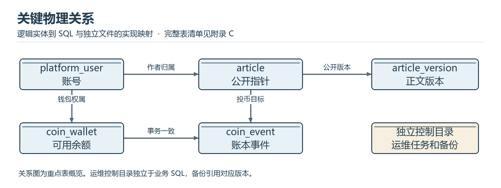

| 逻辑存储 | 实现映射 | 设计说明 |
| --- | --- | --- |
| D1 账号认证资料 | platform_user、author_profile、campus_certification、auth_session、email_challenge、auth_email_gate、category | 专业是分类域中的类型。本人资料、校验挑战和令牌摘要独立保存 |
| D2 经验版本与文件 | article、article_version、article_draft、分类与来源关系、media_image 及引用表 | 公开指针指向固定版本，草稿修订与公开版本并存 |
| D3 评论认可收藏 | discussion_comment、comment_image、comment_create_receipt、article_like、article_favorite | 点赞和收藏分别表达。评论父子和图片用途受限制 |
| D4 奖励币与贡献 | coin_wallet、coin_event、coin_reading_session | 账本记录入账和消费，贡献统计依赖有效事件。正式荣誉规则及发放待确认 |
| D5 举报反馈与处置 | community_case 系列、治理事件、限制、申诉及回执 | 案件与真实目标、处置状态、证据和处理人关联。通用通知与已读待补 |
| D6 运维任务与审计 | 独立控制目录中的任务与事件、备份清单、业务 business_audit | 业务审计和运维任务各自保存，不能用业务库失效同时阻断任务查询 |

## 7.2 关键一致性

文章主体保存状态及当前公开版本。公开版本使用文章与版本标识约束其归属。发布事务在校验草稿修订和资源后持久化版本及引用，再更新公开指针。请求失败时通过回执或重新读取确认状态，避免重复生成公开版本。

分类实体保存类型、名称与状态。文章与多个分类的关系进入中间表，停用分类保留历史关联。评论回复的父评论和文章关系由外键及业务校验约束。媒体保存对象标识与受控路径，下载按当前引用、用途和权限校验，避免仅凭可猜标识暴露私有内容。

钱包保存可用余额，事件保存变化及语义。业务日由 Asia/Shanghai 计算。投币同时检查账号、公开目标、禁止自投、余额和累计额度。用请求唯一性、锁定和事务提交保持余额及账本一致。作者有效贡献由事件聚合，作者可用余额具有独立意义。完整治理撤销规则和荣誉体系仍需细化。

## 7.3 规范化和索引

| 检查 | 项目例子 | 处理 |
| --- | --- | --- |
| 第一范式 | 一篇文章可有多个岗位、专业或图片 | 用分类关联及媒体引用记录多值关系，正文保持可整体渲染的文本 |
| 第二范式 | 文章版本与分类关联的复合标识 | 分类名、类型留在 category，关联表保存关系，避免只依赖键的一部分 |
| 第三范式 | 登录会话可通过用户标识定位身份 | 会话保存摘要与有效期，账号资料由所属表维护，避免传递依赖导致重复更新 |
| 受控冗余 | 钱包余额、当前公开版本和历史快照 | 以事务或明确快照语义维持一致性，结合账本和版本核对 |
| 索引 | 公开状态和排序、作者主页、登录日、审计主体 | 附录 C 提取已定义索引，查询计划和高负载性能由测试验证 |

## 7.4 迁移和恢复

| 版本 | 设计责任 |
| --- | --- |
| V1 | 文章、版本、分类及来源 |
| V2 演示 | 显式演示数据，单独加载 |
| V3—V5 | 账号认证、草稿媒体、联系方式及业务审计 |
| V6—V8 | 评论图片、点赞收藏、奖励与币账本 |
| V9 | 社区身份、案件及证据 |
| V10 | 治理事件、公开隐藏和修订 |
| V11 | 限制、限制事件及申诉 |

备份包含 SQL、媒体与版本清单及校验值。还原前校验文件集合、摘要和数据库模式，保留保护副本，恢复后核对关键业务记录及健康状态。当前受控网页发布要求登记包与现有数据库模式兼容。新增迁移与跨主机恢复的维护流程须在详细设计和验证中补齐。

# 8 步骤7 制定测试计划

## 8.1 可测试性与环境

各模块以可单独调用的入口、明确状态及稳定标识支持验证。使用独立测试库、合成账号、文章与图片，保留必要的版本、请求与 traceId。端侧、接口、真实数据库及运维执行分别验证。后端历史测试可证明其所用版本与环境的行为，新交付需按实现基线重跑。

| 层次 | 重点 | 工具和证据 | 计划节点 |
| --- | --- | --- | --- |
| 单元 | 校验、选择、边界与状态转换 | JUnit、前端已有脚本、用例与执行报告 | 4.13 细化，6.1 汇总 |
| 集成 | JDBC/Flyway、事务、并发幂等、HTTP 及隔离进程 | Maven、真实 campushub_test、接口报告 | 5.12 联调，6.1 复测 |
| 系统 | 双端阅读创作、身份、治理、运维故障与恢复 | 微信工具、浏览器、真实后端及状态记录 | 6.4—6.7 |
| 性能 | 常规负载、阶梯压力、持续运行及降载 | JMeter 脚本、JTL、资源与数据核对 | 6.2、6.3 |
| 用户环境 | 用户设备、账号、实际操作任务及反馈 | 走查记录、同意范围及修订结果 | 6.6 及交付复核 |

进入综合测试需要冻结可追踪代码与配置，测试数据可重建，测试用例和版本一致。退出需对关键安全、账本、发布和恢复场景有可复查结果。缺陷与修复提交、回归结果关联。未执行的环境和用户任务单列。

## 8.2 代表性用例与预期结果

| 场景 | 条件与动作 | 预期及证据 |
| --- | --- | --- |
| 发布事务 | 两端同时编辑同一草稿，先发布一版，再用旧修订发布 | 旧写入被拒，公开版本唯一且可回读，未确认结果可用回执核对 |
| 认证失效 | 认证用户取得作者入口后失效，再直接请求评论、联系或图片 | 受限内容不返回，公开详情可按公开契约阅读 |
| 投币判定 | 已认证且目标公开、非自投、余额充足且未超过累计 2 币 | 一次扣币、一次事件，有效贡献正确 |
| 同键重试 | 同语义请求重放，随后同键改金额 | 重放返回既有结果，改语义冲突，余额及事件保持一致 |
| 奖励边界 | 服务端累计未到及达到 180 秒，跨自然日检查 | 满足条件时仅一次入账，同日两类合计最多 3 币 |
| 治理处置 | 真实案件、关联对象、版本冲突及无权限账号 | 只有有效处置写入事件，错误无额外副作用 |
| 运维中断 | 业务停止，任务进行时运维进程中断后重启 | 任务可查，中断明确，人工核对保护状态 |
| 损坏备份 | 在隔离测试备份制造校验失败，提交恢复 | 拒绝损坏备份，保存校验结果和原状态 |

以判定表细化投币用例时，分别覆盖身份或目标不合规、额度或余额不足、同键同语义及同键变更。第6章要求的过程控制和白盒路径由详细设计分配。本文记录关键条件与可观测结果，下一阶段补齐函数级路径。

## 8.3 非功能目标和取证

| 编号 | 计划验收口径 | 证据 |
| --- | --- | --- |
| NFR01 | 直接请求、页面及图片均按角色授权 | 角色矩阵与受限字段核对 |
| NFR02 | 发布、奖励、投币及治理可判定，版本和账本一致 | 重试、并发与数据差异 |
| NFR03 | JPEG/PNG 内容校验，单文件 10 MiB，Markdown 安全 | 合法和危险输入、受控下载及日志核对 |
| NFR04 | 200 用户、2000 文章、5000 评论，30 并发，60 秒升载，持续 10 分钟。读 P95 ≤ 1 秒，写 P95 ≤ 2 秒，非预期错误率 < 1% | 固定环境和数据、原始 JTL、请求构成及 P95 |
| NFR05 | 10、30、50、100 并发各 2 分钟，10 并发 30 分钟。降到 10 并发后目标 2 分钟内恢复 | 资源趋势、容量边界及一致性 |
| NFR06 | 两端核心阅读、筛选、创作和管理入口可用 | 原生模拟器、真机和桌面浏览器分层记录 |
| NFR07 | 断网、上传失败、冲突和未知结果下可恢复 | 草稿恢复、图片与回执回归 |
| NFR08 | 业务停机与维护期间仍可查询运维任务 | 隔离进程和状态快照 |
| NFR09 | RPO ≤ 24 小时、RTO ≤ 10 分钟，演示期间每日备份，保留 7 份及 1 份离机副本 | 备份清单、时点、计时和恢复差异 |
| NFR10 | 需求、接口、实现与版本可定位 | 追踪矩阵、日志和复核记录 |
| NFR11 | 私有数据按用途授权，审计及运行日志保留不少于 30 天 | 访问、退出及保留策略核对 |
| NFR12 | 课堂本机环境可部署演示 | 安装清单、版本、端口及复现记录 |

历史依据包括 11 月 6 日后端 66 项单元与 121 项真实 MySQL 或隔离进程集成检查，及小程序原生模拟器、网页验证各自记录。该证据对应其原提交及环境。本报告未重跑软件测试，真实用户、手机真机、完整系统测试与容量指标尚需用本轮交付基线验证。

# 9 步骤8 书写文档

## 9.1 配套文档与交付位置

| 课件要求 | 独立交付文件 | 使用与复核 |
| --- | --- | --- |
| 系统说明 | 城院帮系统说明 G04 V1.0 | 系统边界、部署、接口、数据及停机诊断 |
| 用户手册 | 城院帮用户手册 G04 V1.1 | 五类用户操作，图像标明运行记录或原型 |
| 测试计划 | 城院帮系统测试计划 G04 V2.2 | 四项测试资料，按需求和 Project 核对 |
| 详细的实现计划 | 城院帮详细实现计划 G04 V1.1 | 任务、责任、前置、人时、交接与验收 |
| 数据库设计结果 | 城院帮数据库设计结果 G04 V1.0 | 逻辑与物理模型、字段、约束、迁移与恢复 |

六份文档同放在 reports 目录，配套图表与数据放在 models 下。Markdown、Word 和 PDF 使用同一正文。修订和评审基线从文档控制及项目文档入口追踪。

## 9.2 九步 WBS 对照

| WBS | 计划活动 | 日期 | 人员与人时 | 产物位置 |
| --- | --- | --- | --- | --- |
| 4.1 | 设想供选择的方案 | 10/26 | 王晨 1.50、刘景浩 0.50 | 第 3 章 |
| 4.2 | 选取合理的方案 | 10/26 | 王晨 2.00、刘景浩 1.00 | 第 4 章 |
| 4.3 | 推荐最佳方案 | 10/27 | 王晨 0.75、刘景浩 0.50 | 第 5 章 |
| 4.4 | 按DFD分解功能与过程 | 10/27 | 王晨 2.25、刘景浩 0.75 | 第 6 章 |
| 4.5 | 按数据流五步设计软件结构 | 10/28–10/29 | 王晨 6.25、刘景浩 2.00 | 第 7 章 |
| 4.6 | 设计并核对数据库 | 10/28–10/29 | 王晨 3.00、刘景浩 0.50 | 第 8 章 |
| 4.7 | 制定三级测试计划 | 11/02 | 王晨 1.25、刘景浩 2.25 | 第 9 章 |
| 4.8 | 汇编总体设计与五份配套文档 | 11/03–11/04 | 王晨 3.25、刘景浩 3.25 | 第 10 章 |
| 4.9 | 技术审查与管理复审 | 11/05 | 王晨 2.25、刘景浩 1.50 | 第 11 章 |

第 4 组计划 64.25 人时，项目计划 275.85 人时，人工预算 12622.90 元。4.9.2 为 5.1 的内部交接控制点，4.14.4 汇合设计修订并进入 5.12。课程日期、实际状态与剩余确认项见项目计划。

## 9.3 交给详细设计的输入

| 后续 WBS | 接收的总体设计约束 | 按第6章补齐 |
| --- | --- | --- |
| 4.10 | M1—M6 的接口、事务及状态 | 结构化程序、流程图或 N-S/PAD、投币及处置判定表、关键方法 McCabe 度量 |
| 4.11 | 小程序与网页边界、公开和会员交互、Markdown 与图片 | 响应与错误提示、导航及输入、原型与实际页面走查 |
| 4.12 | M7 授权、确认、执行和持久状态 | 部署恢复流程、异常判定、备份清单数据结构与交接手册 |
| 4.13 | 可测试接口、NFR 阈值及业务用例 | 白盒路径、测试数据、输入与预期输出 |
| 4.14 | 课堂反馈及技术问题 | 更新模块、接口、数据、用例与复核记录 |

详细设计按流程需要选择图、判定表、判定树、PDL 或 Jackson 表达。循环、分支、输入输出和错误处理由具体程序与数据结构决定。McCabe 度量从实际控制流图计算，避免以表格行数或模块数量代替复杂度。

# 10 步骤9 审查和复审

## 10.1 本轮技术自查

检查对象为 SRS V1.5.1、排期 G04-BL-20261112-DT、主分支 d161553 和本文图表。核对课程步骤、模型编号、方案、角色、迁移、接口与验收目标。自查由文档编制过程形成，组员交叉复核及项目负责人管理复审另行记录。

| 检查项 | 本轮证据 | 后续复核 |
| --- | --- | --- |
| 方案能追踪到需求加工 | 第 2—4 章、三套流程图和成本进度 | 评估候选用户反馈和推荐理由 |
| 数据流转化为软件结构 | 第 5、6 章，变换七步及事务结构图 | 逐项核对模块入口和局部接口 |
| 数据物理映射准确 | 第 7 章、附录 C 的迁移提取 | 在测试库执行迁移与约束验证 |
| 验证条件可执行 | 第 8 章、12 项 NFR 与评审对照 | 选定版本、端侧环境和数据，保存实际结果 |
| 计划、历史和实际一致 | 第 9 章与 DFD、WBS、PR 核对 | 按课程意见及本期范围关闭问题 |

## 10.2 复审与问题跟踪

| 问题 | 事实与影响 | 后续责任和完成条件 |
| --- | --- | --- |
| I-1105-02 | 周会核对设计输入，独立评审记录尚缺 | 王晨组织，刘景浩复核。按 4.9 补真实日期、问题及结论 |
| HLD-01 | 管理和运维后端已入主线，主线网页路由仅见读者作者页面 | 刘景浩、王晨在 5.12 核对实际页面接入、权限及停机时可达 |
| HLD-02 | 荣誉门槛、完整贡献失效、通知已读等存在设计与实现差距 | 两人依据 SRS 确认补齐顺序与验收范围，保持未来项状态明确 |
| HLD-03 | 定时备份、离机副本与恢复计时尚需验证 | 运维负责人在 6.5 保存实际清单、校验与耗时证据 |
| HLD-04 | 用户走查与正式认可未见完成证据 | 记录用户角色、日期、任务、反馈及修订 |
| HLD-05 | 九步排期及六份设计文档在本地设计分支，配套引用已统一 | 关联后续复核和审批结论 |

技术审查需逐项判定通过、修订或转后续。管理复审再核对资源、课程交付范围、用户意见与高风险问题处理。验收负责人以实际签署和日期确认，本文不预填审查通过、实际人时或成员绩效。

# 附录 A 课件要求与自查

| 教学要求 | 本报告位置 | 自查状态 |
| --- | --- | --- |
| 5.1 步骤1 从 DFD 设想与筛除 | 第 2 章 | 已给出处理分组、冲突与候选 |
| 5.1 步骤2 三档各四类资料 | 第 3 章 | 三套流程图、物理元素、成本效益与进度 |
| 5.1 步骤3 推荐与审查 | 第 4 章 | 推荐、取舍和确认条件，实际审批待补 |
| 5.1 步骤4 功能分解 | 第 5 章 | 处理、模块、HIPO 与 FR 对照 |
| 5.1 步骤5 软件结构 | 第 6 章 | 运行边界、结构图、接口和控制分配 |
| 5.1 步骤6 数据库 | 第 7 章、附录 C | 逻辑到物理、迁移及一致性 |
| 5.1 步骤7 测试计划 | 第 8 章 | 分层策略、代表用例、阈值、证据和进度 |
| 5.1 步骤8 文档 | 第 9 章 | 五类产物与版本引用 |
| 5.1 步骤9 审查和复审 | 第 10 章 | 已作技术自查，交叉复核及管理签署待完成 |
| 5.2 设计原理 | 6.3 | 模块化、抽象、求精、隐藏、局部化与独立性 |
| 5.3 七条启发规则 | 6.4 | 逐条应用及作用域调整 |
| 5.4 图形工具 | 5.4、6.2.3 | 层次、HIPO、Yourdon 调用和数据控制 |
| 5.5 数据流映射 | 6.2.1–6.2.5、6.5 | 五步图、变换七步、事务分派及五项优化 |
| 第6章详细设计输入 | 9.3 | 过程、交互、工具、复杂度和任务分配 |

# 附录 B 功能需求与设计追踪

以下按 SRS 原编号登记。状态是主分支源码或历史记录的核对结果。已见实现表示可定位到接口、组件或页面，仍需按对应场景验证。后续项保留范围边界。

## 账号与认证

| 需求 | 名称 | 模块 | 验证条件 | 源码及验证状态 |
| --- | --- | --- | --- | --- |
| FR-A01 | 统一账号登录与退出 | M1 | 登录读取本人状态，退出后原令牌失效 | 登录退出接口已见 |
| FR-A02 | 校园邮箱自动认证 | M1 | 验证码域、时效、错误、限流和投递回执 | 认证接口已见，实邮按环境复核 |
| FR-A03 | 证明材料人工认证 | M1 | 材料提交与审核留待扩展 | 本期不开放 |
| FR-A04 | 认证失效与权限变化 | M1/M6 | 失效或受限后直接请求和写入拒绝 | 状态和限制已见，传播待测 |
| FR-A05 | 资料与隐私设置 | M1/M3 | 仅本人维护资料，私有字段受控 | 资料接口已见 |
| FR-A06 | 管理账号分权 | M1/M6/M7 | 三个身份域的令牌不能互用 | 各域授权已见 |

## 检索与阅读

| 需求 | 名称 | 模块 | 验证条件 | 源码及验证状态 |
| --- | --- | --- | --- | --- |
| FR-R01 | 免费浏览与全文阅读 | M2 | 访客全文阅读，草稿和隐藏内容不可用 | 公开接口已见 |
| FR-R02 | 岗位与关键词检索 | M2 | 岗位、关键词和非法参数校验 | 查询解析已见 |
| FR-R03 | 专业与公司组合筛选 | M2 | 公司和专业同时满足，同专业使用本人资料 | 过滤已见，快捷项待复测 |
| FR-R04 | 认可与最新排序 | M2/M5 | 认可及最新排序和稳定分页 | 排序已见 |
| FR-R05 | 来源与资料链接 | M2/M3 | 正文及来源保留，外链操作符合平台 | 来源字段已见，端侧复测 |
| FR-R06 | 认证阅读边界 | M2/M4 | 访客不能取得评论、联系和作者隐私 | 公开投影已见 |

## 创作与文章管理

| 需求 | 名称 | 模块 | 验证条件 | 源码及验证状态 |
| --- | --- | --- | --- | --- |
| FR-C01 | 轻量发布信息 | M3 | 必要字段确认，可选信息可空 | 发布校验已见 |
| FR-C02 | 网页Markdown创作 | M3 | 网页 Markdown 保存预览与跨端阅读 | 编辑页面已见 |
| FR-C03 | 小程序基础图文创作 | M3 | 移动端图文保存发布 | 原生编辑已见，真机待验 |
| FR-C04 | 图片上传与失败处理 | M3/M4/M6 | 格式、大小、用途与上传失败 | 图片接口已见 |
| FR-C05 | 多草稿保存与恢复 | M3 | 多草稿隔离，失败输入可恢复 | 草稿接口已见 |
| FR-C06 | 预览与发布 | M3 | 预览、确认、同键发布一次 | 发布入口已见 |
| FR-C07 | 修改与版本冲突 | M3 | 旧修订拒绝，公开版本仍可读取 | 修订检查已见 |
| FR-C08 | 下架删除与恢复权限 | M3/M6 | 本人下架与治理隐藏权限不同 | 状态接口已见 |
| FR-C09 | 可跳过写作提示 | M3 | 跳过写作提示可继续编辑 | 界面按原型核对 |

## 交流与联系

| 需求 | 名称 | 模块 | 验证条件 | 源码及验证状态 |
| --- | --- | --- | --- | --- |
| FR-I01 | 评论与回复 | M4 | 评论、回复、图片及权限 | 评论接口已见 |
| FR-I02 | 评论管理边界 | M4/M6 | 按评论权属与管理权限处理 | 删除和处置入口已见 |
| FR-I03 | 点赞认可 | M4 | 点赞可取消，重试不增加计数 | 点赞接口已见 |
| FR-I04 | 收藏与重访 | M4/M8 | 收藏可回读和取消 | 两端入口已见 |
| FR-I05 | 作者公开主页 | M4 | 认证后只读允许的作者资料 | 作者接口已见 |
| FR-I06 | 作者联系开关 | M4 | 关闭联系后新请求不可读 | 联系配置已见 |
| FR-I07 | 自愿站外联系 | M4 | 自愿站外联系和关闭状态 | 入口已见，交互待核对 |

## 奖励与贡献

| 需求 | 名称 | 模块 | 验证条件 | 源码及验证状态 |
| --- | --- | --- | --- | --- |
| FR-G01 | 简单奖励任务 | M5 | 显示两类任务及可领状态 | 奖励查询已见 |
| FR-G02 | 奖励领取与日上限 | M5 | 登录2币、180秒1币，每日合计3币 | 领取与计时已见 |
| FR-G03 | 向文章投币 | M5 | 拒绝自投透支及超额，重试不重复扣 | 投币接口已见 |
| FR-G04 | 余额与账本查询 | M5 | 本人余额、账本及分页 | 钱包接口已见 |
| FR-G05 | 荣誉与勋章展示 | M5 | 确认荣誉门槛后按有效贡献展示 | 正式规则及发放待补 |
| FR-G06 | 贡献失效与追溯 | M5/M6 | 失效留痕，排名与贡献可复核 | 完整失效处理待补 |

## 社区治理

| 需求 | 名称 | 模块 | 验证条件 | 源码及验证状态 |
| --- | --- | --- | --- | --- |
| FR-M01 | 提交反馈和举报 | M6 | 反馈举报及证据授权 | 案件接口已见，端侧待验 |
| FR-M02 | 定位上下文处理 | M6 | 定位对象、评论与受控证据 | 上下文接口已见 |
| FR-M03 | 发布后内容巡查 | M6 | 处置后产生真实治理事件 | 巡查与处置接口已见 |
| FR-M04 | 用户限制及申诉 | M6 | 限制实际写入，申诉保留历史 | V11 与接口已见 |
| FR-M05 | 认证材料审核 | M6 | 材料认证审核等待扩展 | 本期不开放 |
| FR-M06 | 岗位专业和公司分类维护 | M6 | 建类、排序、停用保留关联 | 基础维护已见，合并映射待补 |
| FR-M07 | 治理审计与状态查询 | M6/M8 | 本人案件和管理事件分别追踪 | 审计已见，通知待补 |

## 独立运维

| 需求 | 名称 | 模块 | 验证条件 | 源码及验证状态 |
| --- | --- | --- | --- | --- |
| FR-O01 | 服务状态与错误日志 | M7 | 停机仍能查状态及允许的日志 | 独立入口已见 |
| FR-O02 | 受控操作与确认 | M7 | 确认绑定身份、动作、目标、引用、时效 | 确认入口已见 |
| FR-O03 | 网页实际执行部署 | M7 | 部署后核对版本、进程和健康 | 历史后端证据，网页待验 |
| FR-O04 | 网页实际重启业务 | M7 | 重启后核对进程变化与健康 | 历史后端证据，网页待验 |
| FR-O05 | 一致性备份 | M7 | 备份 SQL、图片、版本及校验 | 历史手动备份证据 |
| FR-O06 | 备份校验与恢复 | M7 | 损坏备份拒绝，恢复后核对数据 | 历史隔离恢复，计时待测 |
| FR-O07 | 任务互斥与持久记录 | M7 | 同目标互斥，重试及进程重启后可查 | 任务持久化已见 |
| FR-O08 | 恢复回退与运维交接 | M7 | 失败回退、保护副本及交接 | 流程已见，离机验证待补 |

## 公共交互

| 需求 | 名称 | 模块 | 验证条件 | 源码及验证状态 |
| --- | --- | --- | --- | --- |
| FR-P01 | 本人文章草稿和收藏入口 | M8/M3/M4 | 本人文章、草稿与收藏可重访 | 工作区和收藏已见 |
| FR-P02 | 业务通知与已读状态 | M8/M6 | 本人通知、跳转及已读 | 完整通知和已读待补 |
| FR-P03 | 规则说明与无结果提示 | M8 | 加载、空、失败、不可用可辨认 | 状态组件已见 |

# 附录 C 物理表和迁移索引

清单取自主分支常规 Flyway SQL。逻辑实体数按 SRS 统计，表数按 CREATE TABLE 统计。主键、外键与索引以建表及相关 ALTER 或 CREATE INDEX 声明为证据。新增字段的类型与默认值以迁移源为准。

## C.1 分析实体到持久化映射

| 逻辑实体 | 物理表或状态载体 | 含义 |
| --- | --- | --- |
| Account | platform_user | 账号及状态 |
| Profile | author_profile | 对外资料与专业 |
| Certification | campus_certification | 校园核验与状态 |
| EmailChallenge | email_challenge、auth_email_gate | 挑战与限流 |
| Major | category | 专业类型 |
| Article | article、article_draft | 主体及私有工作版本 |
| ArticleVersion | article_version | 公开历史版本 |
| Media | media_image、comment_image | 按用途管理文件 |
| MediaRef | article_draft_image、article_version_image | 图片引用 |
| Job | category | 岗位类型 |
| Company | category | 公司类型 |
| Comment | discussion_comment | 回复与可见性 |
| Reaction | article_like、article_favorite | 赞和收藏分离 |
| Wallet | coin_wallet | 可用余额 |
| CoinEntry | coin_event | 奖励及扣币事件 |
| Contribution | coin_event 聚合 | 有效贡献 |
| Case | community_case 及关联表 | 案件与证据 |
| ModerationAction | governance_event、community_case_history 等 | 按动作保留历史 |
| AdminIdentity | community_admin 与独立运维身份配置 | 分域授权 |
| OpsJob | 独立控制目录 | 持久任务与事件 |
| Backup | 备份目录与清单 | SQL、媒体与版本 |
| AuditEvent | business_audit 与运维事件 | 分域审计 |
| HonorRule | 待定规则版本 | 正式门槛待确认 |
| HonorAward | 待实现发放投影 | 依有效贡献 |
| Session | auth_session、community_admin_session、运维独立会话 | 三类会话 |
| Notification | 待实现完整通知和已读 | 案件历史可查 |
| ReadProgress | coin_reading_session | 服务端计时 |

## C.2 物理表主键与引用

本次扫描得到 45 张业务 MySQL 表。Flyway 自身历史表与运行时文件另计。命名索引见配套 CSV。

### 账号和经验数据

| 迁移 | 表 | 主键 | 外键目标 |
| --- | --- | --- | --- |
| V1 | article | id | article_version、platform_user |
| V1 | article_version | id | article |
| V1 | category | id | — |
| V1 | article_version_category | version_id,category_id | article_version、category |
| V1 | article_source_link | id | article_version |
| V3 | platform_user | id | — |
| V3 | campus_certification | user_id | platform_user |
| V3 | auth_session | id | platform_user |
| V3 | auth_email_gate | email,purpose | — |
| V3 | email_challenge | id | platform_user |
| V4 | authoring_sequence | name | — |
| V4 | author_profile | user_id | category、platform_user |
| V4 | article_draft | article_id | article |
| V4 | article_draft_category | article_id,category_id | article_draft、category |
| V4 | article_draft_source_link | article_id,link_order | article_draft |
| V4 | author_create_request | user_id,request_id | article、platform_user |
| V4 | article_publish_request | article_id,request_id | article_version |
| V4 | media_image | id | article |
| V4 | article_draft_image | article_id,image_id | article_draft、media_image |
| V4 | article_version_image | version_id,image_id | article_version、media_image |
| V5 | author_contact_setting | user_id | platform_user |
| V5 | business_audit | event_id | — |

### 评论和激励数据

| 迁移 | 表 | 主键 | 外键目标 |
| --- | --- | --- | --- |
| V6 | discussion_comment | id | article、discussion_comment、platform_user |
| V6 | comment_create_receipt | user_id,request_id | discussion_comment |
| V6 | comment_image | id | article、discussion_comment、platform_user |
| V7 | article_like | user_id,article_id | article、platform_user |
| V7 | article_favorite | user_id,article_id | article、platform_user |
| V8 | coin_wallet | user_id | platform_user |
| V8 | coin_reading_session | id | article、platform_user |
| V8 | coin_event | sequence_id | article、coin_reading_session、platform_user |

### 治理和管理数据

| 迁移 | 表 | 主键 | 外键目标 |
| --- | --- | --- | --- |
| V9 | community_admin | id | — |
| V9 | community_admin_session | id | community_admin |
| V9 | community_admin_login_gate | name_digest | — |
| V9 | community_case | id | article、article_version、community_admin、discussion_comment、platform_user |
| V9 | community_case_history | sequence_id | community_admin、community_case |
| V9 | community_admin_receipt | admin_id,request_id | community_admin、community_case |
| V9 | community_case_image | sequence_id | community_case、platform_user |
| V9 | community_case_comment | case_id,context_role | community_case、discussion_comment |
| V9 | community_case_media | case_id,image_id | community_case |
| V10 | governance_event | id | community_admin |
| V10 | governance_article_hold | article_id | article |
| V11 | community_restriction | id | community_admin、platform_user |
| V11 | community_restriction_event | id | community_admin、community_restriction |
| V11 | community_appeal | id | community_admin、community_restriction、platform_user |
| V11 | community_appeal_receipt | admin_id,request_id | community_admin、community_appeal |

## C.3 独立定义的索引

| 迁移 | 索引 | 表 | 列 |
| --- | --- | --- | --- |
| V5 | idx_author_public | article | owner_user_id,state,first_published_at DESC,id DESC |
| V8 | idx_session_login_day | auth_session | user_id,created_at |
| V9 | idx_audit_domain_actor | business_audit | actor_domain,actor_id,occurred_at,event_id |

# 附录 D 实现阶段评审准备

| 序号 | 评审产物或活动 | 已有依据及后续 |
| --- | --- | --- |
| 1 | 成果演示 PPT | 以最终可运行功能及真机或模拟器证据编排 |
| 2 | 实现阶段成果提交 | 按代码、设计修订、报告、手册和运行包建立清单 |
| 3 | 程序清单 | 已从 d161553 生成清单，5.12.3 更新至候选提交 |
| 4 | 代码规范与内部走查 | 有规范及记录页；模块交叉走查结果按实际登记 |
| 5 | 单元测试用例 | 单元与白盒用例已编制，候选版结果待登记 |
| 6 | 工具执行单元测试 | 有历史执行结果，按交付基线重跑并留存 |
| 7 | 修订后详细设计 | 4.10—4.14 交付，关联过程、界面及变更 |
| 8 | 白盒测试用例 | 四段源码控制流、环形复杂度及17条独立路径已编制 |
| 9 | 版本控制 | 已有 Git 和 PR 历史，阶段成果按授权提交 |
| 10 | 三层测试计划 | 第 8 章及配套计划含单元、集成、系统 |
| 11 | 结果与改正 | 留存原始报告、缺陷、修复与复测版本 |
| 12 | 集成工具与结果 | 历史真实 MySQL 和隔离进程检查，补最终集成 |
| 13 | 系统测试 | 按 6.1—6.8 完成跨端、权限、压力及恢复场景 |
| 14 | 用户实际环境 | 补实际设备、账号、网络和操作记录 |
| 15 | 最终用户测试 | 记录真实参与者、任务、反馈及修订 |
| 16 | 项目计划修订 | V1.8 已同步设计测试 WBS、原生 MPP、甘特及工程网络 |
| 17 | 部署与运行 | 已有本机脚本及历史记录，验收最终安装与运行 |
| 18 | 功能认可 | 保存真实用户结论及未解决问题 |
| 19 | 用户手册 | 手册 V1.1 已按运行截图、原型和失败路径修订，后续结合接入验收更新 |
| 20 | 总结和成员评价 | 收尾依据实际分工和成果，由双方确认 |

# 参考资料

| 编号 | 来源 | 在本文中的位置 |
| --- | --- | --- |
| R1 | 课程课件《第5章 总体设计》，PDF 62 页 | 九步骤 PDF 第 5—12 页，原理第 14—32 页，规则第 34—38 页，图形工具第 40—43 页，数据流方法第 45—60 页 |
| R2 | 《城院帮项目计划 G04》V1.8、排期 G04-BL-20261112-DT | 第 3、8、9 章，附录 A |
| R3 | 《城院帮软件需求规格说明书 G04》V1.5.1 与模型附件 | 全文功能、业务、数据与质量约束 |
| R4 | 主分支 d161553 的 server、miniprogram、web 及其验证文档 | 第 5—8 章、附录 B、C |
| R5 | 课程课件《第6章 详细设计》，PDF 58 页 | 第 9.3 节的详细设计交接 |
| R6 | 《软件工程》课程项目实现阶段评审检查表，PDF 2 页 | 附录 D |
| R7 | 11 月 5 日设计基线与原型开发周会议纪要 | 第 1、10 章，I-1105-02 |
