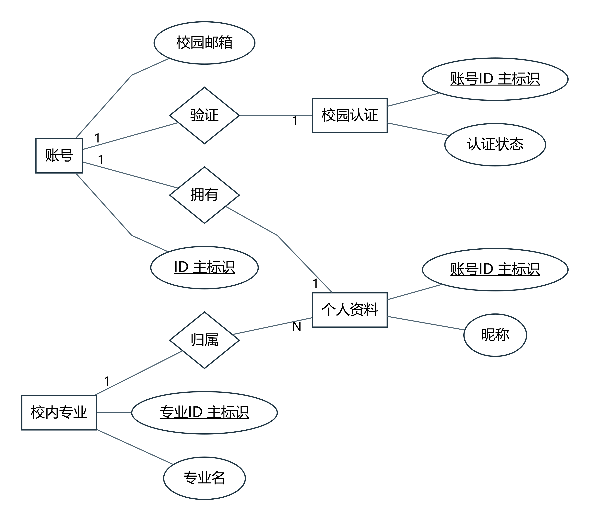
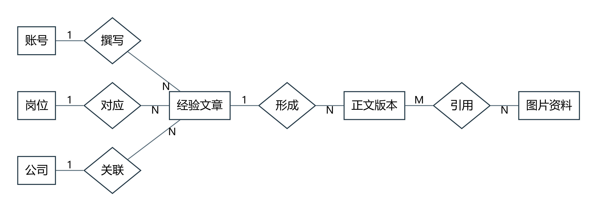
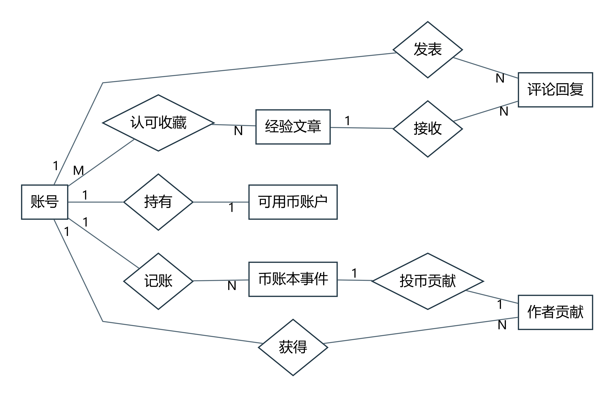
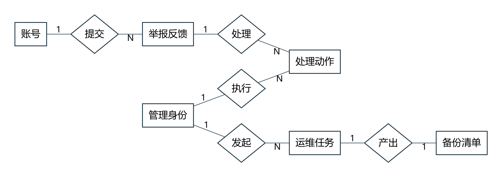
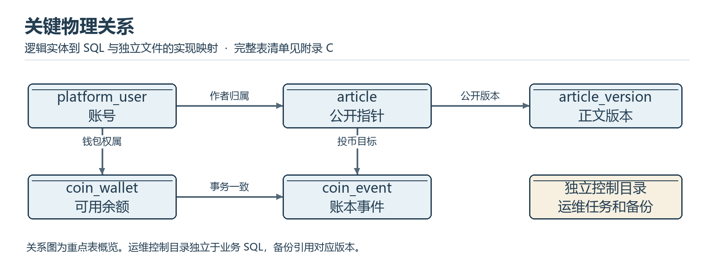

# 城院帮数据库设计结果

软件工程课程项目 G04

浙大城市学院

组长兼项目负责人 王晨 32401211

成员 刘景浩 32401205

G04-DBD-20261112-01　V1.0　2026 年 11 月 12 日

## 文档控制

| 项目 | 记录 |
| --- | --- |
| 文档标识 | G04-DBD-20261112-01，V1.0，2026-11-12 |
| 项目 | 浙大城市学院软件工程课程项目 G04 |
| 需求与计划基线 | SRS V1.5.1；项目计划 V1.7，任务分支 f9f0718 |
| 设计与代码基线 | 总体设计 V1.2；主分支 d161553 |
| 编制用途 | 用于核对逻辑模型、物理表、字段、约束及迁移恢复。 |

用于核对逻辑模型、物理表、字段、约束及迁移恢复。

## 目录

- [1 设计依据与范围](#1-设计依据与范围)
- [2 逻辑模型与物理关系](#2-逻辑模型与物理关系)
  - [2.1 实体到物理表的映射](#21-实体到物理表的映射)
- [3 表字段 键约束与索引](#3-表字段-键约束与索引)
  - [3.1 字段、键与约束](#31-字段键与约束)
  - [3.2 访问路径与索引](#32-访问路径与索引)
- [4 迁移与业务事务](#4-迁移与业务事务)
  - [4.1 Flyway 迁移顺序](#41-flyway-迁移顺序)
  - [4.2 事务边界与失败处理](#42-事务边界与失败处理)
- [5 文件设计与备份恢复](#5-文件设计与备份恢复)
  - [5.1 文件、日志与备份对象](#51-文件日志与备份对象)
  - [5.2 恢复验证与保留目标](#52-恢复验证与保留目标)

# 1 设计依据与范围

本结果依据 SRS V1.5.1 的 27 个分析实体、数据字典和代码基线 d161553 的 Flyway DDL。业务数据由 MySQL 8 和 InnoDB 持久化，媒体、诊断日志与独立运维任务采用文件存储。分析实体经过职责分解、关系规范化及历史记录设计，落到 45 张物理业务表。Flyway 的系统历史表另由迁移工具维护。

# 2 逻辑模型与物理关系

## 2.1 实体到物理表的映射

账号与会话按主体关联。会话及邮箱校验、荣誉、通知与阅读进度的分析图见 SRS ER05–ER07。文章主体与版本为一对多，当前公开版本指向本文章版本，复合外键防止指向他文版本。标签通过关系表表达多对多。钱包以用户为主键，事件按主体、业务日和请求语义控制重复。案件证据和操作历史分别保存，运维任务与数据库权限独立。

| 逻辑实体 | 物理表或状态载体 | 含义 |
| --- | --- | --- |
| Account | platform_user | 账号及状态 |
| Profile | author_profile | 对外资料与专业 |
| Certification | campus_certification | 校园核验与状态 |
| EmailChallenge | email_challenge、auth_email_gate | 挑战与限流 |
| Major | category | 专业类型 |
| Article | article、article_draft | 主体及私有工作版本 |
| ArticleVersion | article_version | 公开历史版本 |
| Media | media_image、comment_image | 按用途管理文件 |
| MediaRef | article_draft_image、article_version_image | 图片引用 |
| Job | category | 岗位类型 |
| Company | category | 公司类型 |
| Comment | discussion_comment | 回复与可见性 |
| Reaction | article_like、article_favorite | 赞和收藏分离 |
| Wallet | coin_wallet | 可用余额 |
| CoinEntry | coin_event | 奖励及扣币事件 |
| Contribution | coin_event 聚合 | 有效贡献 |
| Case | community_case 及关联表 | 案件与证据 |
| ModerationAction | governance_event、community_case_history 等 | 按动作保留历史 |
| AdminIdentity | community_admin 与独立运维身份配置 | 分域授权 |
| OpsJob | 独立控制目录 | 持久任务与事件 |
| Backup | 备份目录与清单 | SQL、媒体与版本 |
| AuditEvent | business_audit 与运维事件 | 分域审计 |
| HonorRule | 待定规则版本 | 正式门槛待确认 |
| HonorAward | 待实现发放投影 | 依有效贡献 |
| Session | auth_session、community_admin_session、运维独立会话 | 三类会话 |
| Notification | 待实现完整通知和已读 | 案件历史可查 |
| ReadProgress | coin_reading_session | 服务端计时 |

# 3 表字段 键约束与索引

## 3.1 字段、键与约束

| 表与来源 | 主要字段 | 键和约束数 |
| --- | --- | --- |
| article（V1） | id、state、public_version_id、effective_coins、effective_likes、count_origin、created_at、owner_user_id、first_published_at、updated_at、governance_revision | 11 项，见物理键约束和索引 |
| article_version（V1） | id、article_id、version_number、title、summary、body、body_format、experience_stage、source_type、source_note、published_at、created_at、updated_at | 8 项，见物理键约束和索引 |
| category（V1） | id、kind、name、enabled、display_order、revision | 3 项，见物理键约束和索引 |
| article_version_category（V1） | version_id、category_id | 4 项，见物理键约束和索引 |
| article_source_link（V1） | id、version_id、label、url、display_order | 2 项，见物理键约束和索引 |
| platform_user（V3） | id、email、password_hash、account_state、role、created_at、password_changed_at | 4 项，见物理键约束和索引 |
| campus_certification（V3） | user_id、method、state、verified_at | 4 项，见物理键约束和索引 |
| auth_session（V3） | id、user_id、token_digest、created_at、expires_at、revoked_at | 5 项，见物理键约束和索引 |
| auth_email_gate（V3） | email、purpose、last_attempt_at | 2 项，见物理键约束和索引 |
| email_challenge（V3） | id、email、purpose、code_digest、status、failed_attempts、created_at、expires_at、consumed_at、reset_user_id | 6 项，见物理键约束和索引 |
| authoring_sequence（V4） | name、next_value | 1 项，见物理键约束和索引 |
| author_profile（V4） | user_id、revision、nickname、major_id、current_stage、bio | 4 项，见物理键约束和索引 |
| article_draft（V4） | article_id、revision、title、summary、body、experience_stage、source_type、source_note | 3 项，见物理键约束和索引 |
| article_draft_category（V4） | article_id、category_id | 3 项，见物理键约束和索引 |
| article_draft_source_link（V4） | article_id、link_order、label、url | 2 项，见物理键约束和索引 |
| author_create_request（V4） | user_id、request_id、article_id | 3 项，见物理键约束和索引 |
| article_publish_request（V4） | article_id、request_id、expected_revision、result_revision、version_id | 2 项，见物理键约束和索引 |
| media_image（V4） | id、article_id、request_id、content_digest、mime_type、size_bytes、width、height、created_at | 5 项，见物理键约束和索引 |
| article_draft_image（V4） | article_id、image_id | 3 项，见物理键约束和索引 |
| article_version_image（V4） | article_id、version_id、image_id | 3 项，见物理键约束和索引 |
| author_contact_setting（V5） | user_id、revision、enabled、contact_type、contact_value | 5 项，见物理键约束和索引 |
| business_audit（V5） | event_id、occurred_at、trace_id、actor_id、action、object_type、object_id、before_revision、after_revision、before_state、after_state、result、actor_domain | 13 项，见物理键约束和索引 |
| discussion_comment（V6） | id、article_id、user_id、root_comment_id、reply_to_comment_id、state、revision、body、created_at | 12 项，见物理键约束和索引 |
| comment_create_receipt（V6） | user_id、request_id、article_id、comment_id、content_digest | 2 项，见物理键约束和索引 |
| comment_image（V6） | id、article_id、user_id、request_id、content_digest、mime_type、size_bytes、width、height、created_at、comment_id、image_order | 9 项，见物理键约束和索引 |
| article_like（V7） | user_id、article_id、active、revision、activated_at、updated_at | 6 项，见物理键约束和索引 |
| article_favorite（V7） | user_id、article_id、active、revision、activated_at、updated_at | 6 项，见物理键约束和索引 |
| coin_wallet（V8） | user_id、balance、revision | 4 项，见物理键约束和索引 |
| coin_reading_session（V8） | id、user_id、article_id、business_date、started_at、required_seconds | 6 项，见物理键约束和索引 |
| coin_event（V8） | sequence_id、event_id、user_id、action、request_id、business_date、reward_date、article_id、author_id、reading_session_id、delta、balance_after、wallet_revision、occurred_at、login_reward、reading_reward、reading_seconds、article_limit、rule_version、effective | 17 项，见物理键约束和索引 |
| community_admin（V9） | id、login_name、password_hash、enabled、created_at | 2 项，见物理键约束和索引 |
| community_admin_session（V9） | id、admin_id、token_digest、created_at、expires_at、revoked_at | 3 项，见物理键约束和索引 |
| community_admin_login_gate（V9） | name_digest、failures、window_started | 2 项，见物理键约束和索引 |
| community_case（V9） | id、user_id、request_id、content_digest、kind、category、target_type、article_id、comment_id、article_version_id、description、state、revision、assignee_id、created_at、updated_at | 14 项，见物理键约束和索引 |
| community_case_history（V9） | sequence_id、case_id、revision、actor_domain、actor_id、action、state、assignee_id、outcome、public_reply、internal_note、reason、occurred_at | 8 项，见物理键约束和索引 |
| community_admin_receipt（V9） | admin_id、request_id、case_id、content_digest、revision、state | 3 项，见物理键约束和索引 |
| community_case_image（V9） | sequence_id、id、user_id、request_id、content_digest、mime_type、size_bytes、width、height、created_at、case_id、image_order | 8 项，见物理键约束和索引 |
| community_case_comment（V9） | case_id、context_role、comment_id、available、body、created_at | 5 项，见物理键约束和索引 |
| community_case_media（V9） | case_id、image_id、source_kind、content_digest、mime_type、size_bytes | 3 项，见物理键约束和索引 |
| governance_event（V10） | id、admin_id、request_id、content_digest、target_type、target_id、action、before_state、after_state、revision、reason、occurred_at | 6 项，见物理键约束和索引 |
| governance_article_hold（V10） | article_id、previous_state | 3 项，见物理键约束和索引 |
| community_restriction（V11） | id、user_id、scope、enabled、revision、reason、admin_id、updated_at | 6 项，见物理键约束和索引 |
| community_restriction_event（V11） | id、admin_id、request_id、digest、restriction_id、before_enabled、enabled、revision、reason、occurred_at | 4 项，见物理键约束和索引 |
| community_appeal（V11） | id、user_id、request_id、digest、restriction_id、restriction_revision、reason、state、revision、reply、decided_by、created_at、updated_at | 6 项，见物理键约束和索引 |
| community_appeal_receipt（V11） | admin_id、request_id、digest、appeal_id、revision、state | 3 项，见物理键约束和索引 |

本次核对 320 个字段、234 项主键、索引及约束定义。完整字段与约束见同目录索引中的《物理字段字典G04.csv》《物理键约束和索引G04.csv》。字段表逐列给出类型、空值约束、缺省值、声明修饰和来源迁移。约束表列出主键、外键、检查条件、唯一键和命名索引。最新有效定义按迁移顺序合并。DDL 是运行时的具体约束依据。

## 3.2 访问路径与索引

| 访问路径 | 索引与核对 |
| --- | --- |
| 认可优先 | 核对文章状态、有效币、赞与稳定次序的组合索引，使用真实数据集核查过滤与排序计划 |
| 最新版本及作者文章 | 按发布时间和文章标识检查稳定分页，核对公开版本关联和作者复合索引 |
| 会话及奖励 | 校验用户／业务日、读取会话和账本唯一条件，核对并发冲突时的一致性 |
| 审计 | 按身份域、主体、时间与事件标识查询。受限记录按对象授权过滤 |

# 4 迁移与业务事务

## 4.1 Flyway 迁移顺序

| 顺序 | 脚本 | 作用 |
| --- | --- | --- |
| V1 | V1__article_reading_schema.sql | 文章、版本与分类 |
| V3 | V3__account_email_auth.sql | 校园邮箱、账号和会话 |
| V4 | V4__author_profiles_drafts_and_media.sql | 作者资料、草稿及媒体 |
| V5 | V5__author_contact_and_business_audit.sql | 联系设置与业务审计 |
| V6 | V6__authenticated_comments_and_images.sql | 评论、回复和图片 |
| V7 | V7__likes_favorites_and_live_counts.sql | 点赞、收藏与有效计数 |
| V8 | V8__coin_wallet_ledger_and_reading.sql | 钱包、阅读会话和账本 |
| V9 | V9__community_cases_and_admin_identity.sql | 社区身份、案件及历史 |
| V10 | V10__community_governance.sql | 内容治理、分类修订和审计 |
| V11 | V11__user_restrictions_and_appeals.sql | 用户限制和申诉 |

干净库按 Flyway 版本依次执行。生产式课堂基线和演示样本分别装载，演示用 V2 数据来自独立位置。迁移前记录版本、数据库和媒体备份；迁移后检查历史、表约束和基本读写。

## 4.2 事务边界与失败处理

| 事务 | 一致性与失败处理 |
| --- | --- |
| 草稿发布 | 校验所有权、预期修订和资源，写版本并切换公开指针，落回执后提交。失败保持旧公开版本。 |
| 奖励和投币 | 锁定相关记录核对额度和余额，以业务日与请求语义去重。钱包和账本同一事务完成，失败回滚。 |
| 内容治理 | 检查管理权限与目标修订，写目标状态与治理审计。冲突后读取当前版本再决定。 |
| 运维持久化 | 独立控制目录保存任务和阶段事件，过程与业务事务分开核查。受理记录与最终成功区分。 |

# 5 文件设计与备份恢复

## 5.1 文件、日志与备份对象

| 对象 | 组成和保护 |
| --- | --- |
| 媒体文件 | 正文、评论、案件证据按用途记录引用；存储位置和授权由服务端控制 |
| 业务配置和诊断日志 | 本机独立保存配置和日志。诊断按模式输出，隐私字段受约束 |
| 运维控制数据 | 会话域、任务、确认、状态与事件。控制记录使用独立目录和运行账号 |
| 发布和备份包 | JAR、版本记录、database.sql、media、manifest.json。清单用于校验实际文件和恢复兼容性 |

## 5.2 恢复验证与保留目标

重要变更与恢复前保留保护副本。使用隔离环境校验清单与版本后再恢复，记录恢复时点、业务健康、样本数据及媒体可读性。RPO 24 小时、RTO 10 分钟、最近 7 份成功备份及至少 1 份离机副本作为验收目标，参见系统测试计划。
