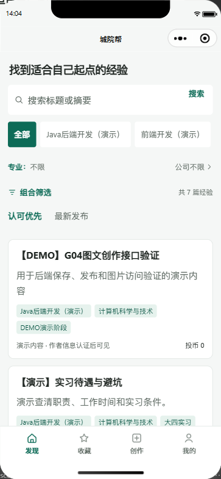
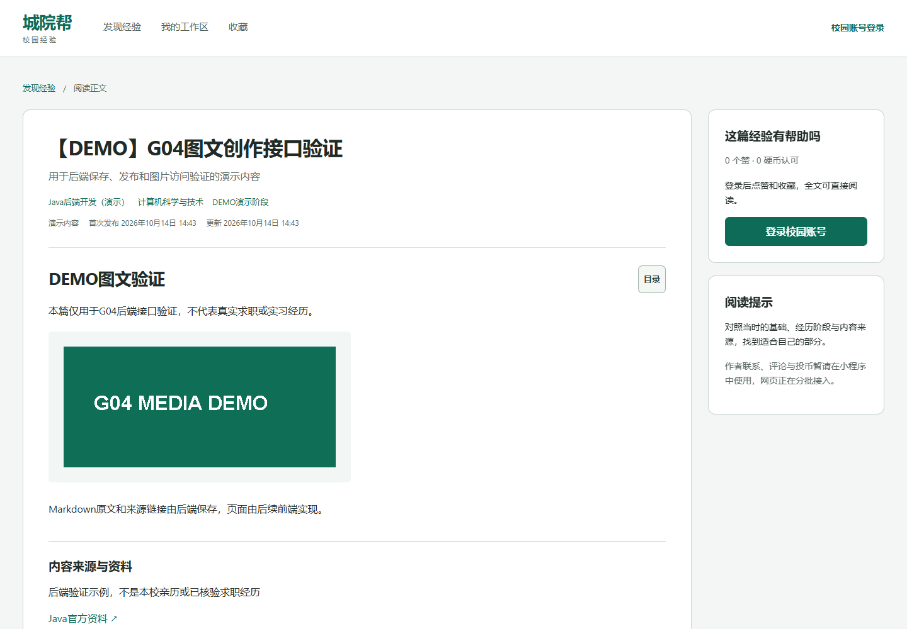
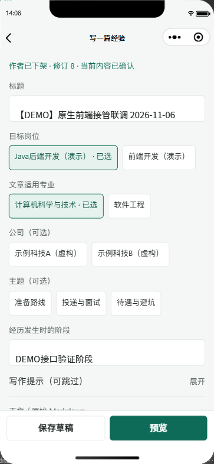
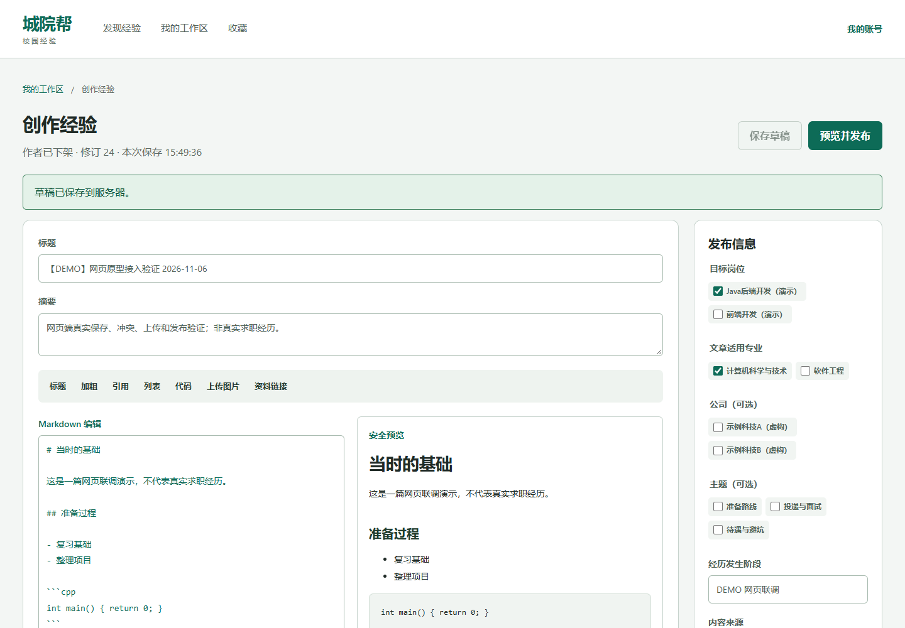
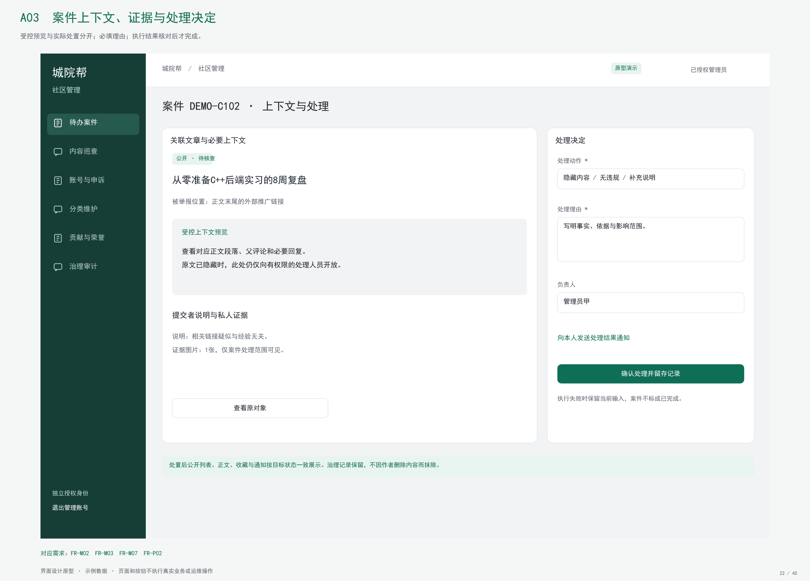
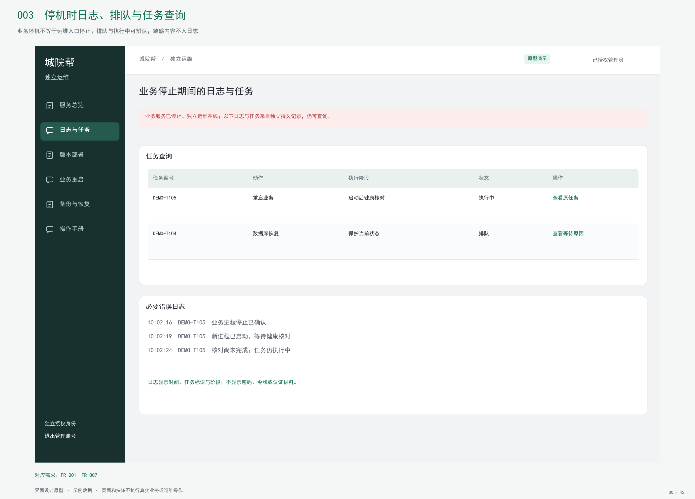

# 城院帮用户手册

软件工程课程项目 G04

浙大城市学院

组长兼项目负责人 王晨 32401211

成员 刘景浩 32401205

G04-UM-20261112-01　V1.1　2026 年 11 月 12 日

## 文档控制

| 项目 | 记录 |
| --- | --- |
| 文档标识 | G04-UM-20261112-01，V1.1，2026-11-12 |
| 项目 | 浙大城市学院软件工程课程项目 G04 |
| 需求与计划基线 | SRS V1.5.1；项目计划 V1.7，任务分支 f9f0718 |
| 设计与代码基线 | 总体设计 V1.2；主分支 d161553 |
| 编制用途 | 供访客、认证读者、作者、社区管理员与运维人员操作使用。 |

供访客、认证读者、作者、社区管理员与运维人员操作使用。

## 目录

- [1 使用前准备](#1-使用前准备)
- [2 访客阅读](#2-访客阅读)
  - [2.1 筛选与阅读经验](#21-筛选与阅读经验)
  - [2.2 空结果与访问失败](#22-空结果与访问失败)
- [3 认证读者交流](#3-认证读者交流)
  - [3.1 校园认证与登录](#31-校园认证与登录)
  - [3.2 互动与自愿联系](#32-互动与自愿联系)
  - [3.3 领取奖励和投币](#33-领取奖励和投币)
  - [3.4 提交反馈与举报](#34-提交反馈与举报)
- [4 作者图文创作](#4-作者图文创作)
  - [4.1 新建和编辑草稿](#41-新建和编辑草稿)
  - [4.2 发布与跨端冲突](#42-发布与跨端冲突)
- [5 社区管理员](#5-社区管理员)
  - [5.1 查询案件与受理处置](#51-查询案件与受理处置)
- [6 运维人员](#6-运维人员)
  - [6.1 部署、重启与恢复](#61-部署重启与恢复)
  - [6.2 业务停机与任务失败](#62-业务停机与任务失败)
- [7 参考资料](#7-参考资料)

# 1 使用前准备

访客可直接看公开经验。校园认证后可交流、查看作者允许公开的信息和创作。小程序与读者网页复用邮箱账号。社区管理和独立运维使用各自入口和账号。运行截图取自 2026 年 11 月 6 日已有记录。治理与运维页以需求原型说明使用路径，正式网页接入以实现阶段验证为准。

# 2 访客阅读

## 2.1 筛选与阅读经验

1. 打开小程序的发现页或读者网页首页。选择岗位，按需要输入关键词或选择公司、专业。先看筛选摘要，再查看结果或清空条件。
2. 点击标题打开正文。较长文章可使用目录跳到所需段落。回到列表继续筛选。

## 2.2 空结果与访问失败

3. 结果为空时调整条件，网络失败时重试。文章下架或隐藏后，公开页显示不可用。

# 3 认证读者交流

## 3.1 校园认证与登录

1. 打开账号页，填写校内邮箱并获取验证码。按页内提示完成注册，然后以相同邮箱与密码在网页或小程序登录。

## 3.2 互动与自愿联系

2. 打开一篇文章，可点赞、收藏、评论或回复。文章作者允许联系时，可查看其主动公开的联系方式；后续联系由双方自行协商。

## 3.3 领取奖励和投币

3. 打开钱包和任务，按规则领取登录奖励和阅读奖励。每日登录 2 币，阅读满 3 分钟可领 1 币、每日最多一次。每篇累计最多投 2 币，提交后可核对钱包与账本。

## 3.4 提交反馈与举报

4. 发现广告或疑似欺骗内容，从可用的反馈／举报入口提交对象和说明。提交后从本人案件查询受理结果。管理页处理与消息已读按接入状态验证。

| 情况 | 操作与预期 |
| --- | --- |
| 邮件延迟或验证码过期 | 核对地址和收件箱，在允许时间后重新请求 |
| 联系信息关闭 | 文章仍可读，联系入口显示关闭或不可用 |
| 连续投币或重试 | 以回执、余额和账本判断，失败后查看原因 |
| 账号权限改变 | 按页面提示重新登录、认证或查询限制 |

# 4 作者图文创作

## 4.1 新建和编辑草稿

1. 登录后进入创作工作区，新建文章或选本人草稿。填写必要信息和正文，写作提示可以跳过。
2. 在网页使用 Markdown 预览。在小程序完成基础文字与图片编辑。上传失败时先保存可用的正文和草稿，再重试失败资源。

## 4.2 发布与跨端冲突

3. 核对预览和公开字段，确认后发布。返回工作区检查状态，再用公开阅读页核对正文与图片。
4. 两端同时编辑时，旧修订会提示冲突。保留当前输入，打开服务端的新修订，比较后再保存。作者下架后可从工作区继续管理。

# 5 社区管理员

## 5.1 查询案件与受理处置

从社区管理入口以管理身份登录。打开案件队列，按状态筛选，进入案件详情核对举报描述、对象、关联文章或评论和证据。确认权限后认领案件，再按实际情况填写理由、处置或结案。发生修订冲突时先刷新目标及历史，再决定后续动作。案件回执、关联对象状态与审计事件都应可查。

# 6 运维人员

## 6.1 部署、重启与恢复

从独立地址以运维身份登录，查看业务状态、发布版本、备份和任务记录。选择部署、重启、备份或恢复前，先检查目标和影响。提交确认后，按任务号查看阶段、失败原因与最终核查结果。课堂验证使用隔离库、已登记版本和已校验备份。

## 6.2 业务停机与任务失败

业务停止时通过独立入口继续查询状态与既有任务。任务显示已受理时继续等待核查结果。恢复失败时保留保护副本和阶段记录，先确认当前进程与数据状态。

# 7 参考资料

《城院帮软件需求规格说明书》V1.5.1，《城院帮总体设计报告》V1.2，64 屏全需求原型，代码基线 d161553 中小程序与网页的 11 月 6 日运行截图和接口资料。
