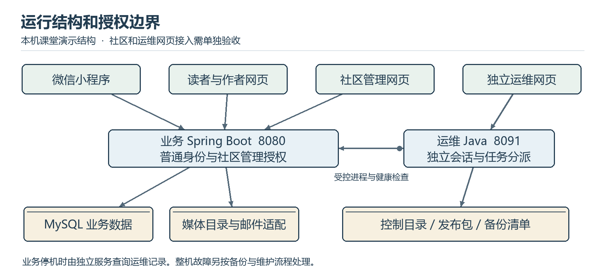

# 城院帮系统说明

软件工程课程项目 G04

浙大城市学院

组长兼项目负责人 王晨 32401211

成员 刘景浩 32401205

G04-SYS-20261112-01　V1.0　2026 年 11 月 12 日

## 文档控制

| 项目 | 记录 |
| --- | --- |
| 文档标识 | G04-SYS-20261112-01，V1.0，2026-11-12 |
| 项目 | 浙大城市学院软件工程课程项目 G04 |
| 需求与计划基线 | SRS V1.5.1；项目计划 V1.7，任务分支 f9f0718 |
| 设计与代码基线 | 总体设计 V1.2；主分支 d161553 |
| 编制用途 | 供系统部署、运行排查和技术复核使用。 |

供系统部署、运行排查和技术复核使用。

## 目录

- [1 系统用途与职责边界](#1-系统用途与职责边界)
  - [1.1 角色与权限矩阵](#11-角色与权限矩阵)
- [2 系统部署与运行环境](#2-系统部署与运行环境)
  - [2.1 课堂运行环境](#21-课堂运行环境)
  - [2.2 运行单元与启动核对](#22-运行单元与启动核对)
- [3 接口与数据归属](#3-接口与数据归属)
  - [3.1 接口与数据归属矩阵](#31-接口与数据归属矩阵)
- [4 停机诊断与故障处理](#4-停机诊断与故障处理)
  - [4.1 业务停机时的独立查询](#41-业务停机时的独立查询)
  - [4.2 任务提交与恢复异常](#42-任务提交与恢复异常)
  - [4.3 持久化位置与证据](#43-持久化位置与证据)
- [5 验收与参考资料](#5-验收与参考资料)

# 1 系统用途与职责边界

城院帮面向校内读者和经验作者。访客浏览免费公开文章，校园邮箱认证用户参与交流和创作。点赞、收藏和投币分别记录认可、再读和特别帮助。联系作者由作者自主开启，双方通过站外渠道继续交流。

## 1.1 角色与权限矩阵

| 使用角色 | 入口及主要职责 | 授权边界 |
| --- | --- | --- |
| 访客 | 发现、检索、阅读公开文章 | 只读公开投影及允许公开的媒体 |
| 校园认证用户 | 互动、作者主页、资料设置、写作和发布 | 个人资源检查本人权限，联系信息依公开设置显示 |
| 社区管理员 | 治理网页，受理反馈、举报和申诉 | 独立管理会话，访问范围受治理职责约束 |
| 运维人员 | 独立运维网页，状态、任务、发布和恢复 | 独立会话；执行受动作、目标、确认和互斥约束 |

# 2 系统部署与运行环境

## 2.1 课堂运行环境

课堂演示采用 Windows 与 WSL2 本机环境。小程序在微信开发者工具加载原生项目，网页使用 Vue 3、TypeScript、Vite，业务服务用 Java 21、Spring Boot、Spring JDBC 和 Flyway，数据库用 MySQL 8。业务与运维默认使用 8080 和 8091。以项目计划第 9 章的设备记录为资源依据，部署记录另记软件版本、端口、内存、存储和运行限制。外部邮箱服务用于验证邮件，课堂复现可使用准备好的账号和合成资料。

## 2.2 运行单元与启动核对

| 运行单元 | 职责 | 启动前核对 |
| --- | --- | --- |
| MySQL | 账号、内容、互动、治理数据和迁移历史 | 实例、数据库、账户授权及可用空间 |
| 业务服务 | REST API、权限、事务、媒体和诊断日志 | 迁移状态、媒体权限、健康检查和日志模式 |
| 读者作者网页与小程序 | 发现、阅读、创作、互动及错误状态 | API 地址、可用网络、认证入口及调试环境 |
| 独立运维服务 | 控制目录、任务状态、白名单动作、备份校验 | 独立端口、隔离配置、运行用户和允许目标 |
| 社区和运维网页 | 受理治理、查询与提交运维任务 | 各角色入口、目标 API、状态区分及独立托管 |

启动前先核对本机运行目录和备份空间，随后启动 MySQL、独立网页托管与运维服务，再启动业务服务。通过健康检查后启动读者网页和小程序。运维网页部署在业务进程之外，使用单独的运维地址、账号和令牌。代码基线包含独立运维 HTTP 服务与状态接口，治理及运维正式网页接入列入实现和验收计划。

# 3 接口与数据归属

业务接口使用 /api/v1 路径。普通会话、社区管理会话和运维会话分别授权。参数、数据结构及失败状态见总体设计报告的接口概要，实际请求字段以对应控制器与契约文档为准。

## 3.1 接口与数据归属矩阵

| 模块 | 接口示例 | 数据归属与结果 |
| --- | --- | --- |
| M1 | POST /api/v1/auth/register；GET /api/v1/me | 校园挑战、账号及本人身份 |
| M2 | GET /api/v1/articles；GET /api/v1/articles/{id} | 公开投影、分页或不可用 |
| M3 | PUT /api/v1/me/articles/{id}/draft；POST /api/v1/me/articles/{id}/publish | 私有草稿、公开版本、媒体和回执 |
| M4 | GET /api/v1/articles/{id}/author；GET /api/v1/authors/{id}/contact | 受权作者信息及开启的联系方式 |
| M5 | GET /api/v1/me/coins；POST /api/v1/articles/{id}/coins | 钱包、账本和投币回执 |
| M6 | GET /api/v1/admin/cases/{id}/context；POST /api/v1/me/cases | 受控案件上下文和反馈回执 |
| M7 | GET /api/v1/ops/status；POST /api/v1/ops/confirmations；GET /api/v1/ops/jobs | 任务状态、确认与结果，在独立服务处理 |
| M8 | 页面状态及所属模块接口 | 会话、导航与错误展示，通知及已读按实现计划接入 |

# 4 停机诊断与故障处理

## 4.1 业务停机时的独立查询

1. 从独立托管地址进入运维网页，使用运维身份登录。通过 8091 的状态与任务接口查询业务健康、版本及最近任务。当前基线可独立查询接口，网页接入验收保留页面、接口与停机证据。
2. 区分业务停机、运维服务不可达和业务库故障。仅业务停机时，仍可访问运维状态和已有任务。运维服务不可达时，由维护人员核对独立服务、网络和控制目录。禁止用业务会话替代运维会话。

## 4.2 任务提交与恢复异常

3. 通过批准的版本或备份引用提交操作，核对目标与影响后确认。任务受理后按任务号等待阶段更新，最终用进程、健康、数据和版本证据核对结果。
4. 部署或恢复失败时，读取任务阶段、错误和保护副本信息。恢复前记录现存版本和数据，确认修复路径后处理。运维错误、业务错误和图片失败都保留请求标识，公开界面显示可理解提示。

## 4.3 持久化位置与证据

| 持久化位置 | 内容 | 处理原则 |
| --- | --- | --- |
| MySQL | 业务数据、管理数据、迁移与审计 | 按角色访问，备份与恢复后核对引用 |
| 媒体目录 | 正文、评论及受控证据图片 | 通过服务校验用途、对象和授权 |
| 业务日志目录 | debug 或 release 模式下的诊断记录 | 调试仅在需要时开启，留可关联的脱敏信息 |
| 运维控制目录 | 独立凭证摘要、任务、确认及状态 | 本机权限保护，保留持久任务和审计 |
| 发布与备份目录 | JAR、清单、SQL、媒体和版本信息 | 以清单校验实际文件，保留保护副本 |

# 5 验收与参考资料

验收以《城院帮系统测试计划》的功能、权限、性能和独立恢复场景为准。11 月 6 日已有隔离运维、真实 MySQL 和历史运行证据。当前阶段安排跨端接入、实际设备、课堂环境以及用户走查。

依据《城院帮软件需求规格说明书》V1.5.1、《城院帮总体设计报告》V1.2、《城院帮项目计划》V1.7 及代码基线 d161553。
