# 城院帮详细设计报告

软件工程课程项目 G04　V1.0　评审提交版

编制依据  GB/T 8567—2006 第 7.13 节 软件设计说明

## 文档控制

| 项目 | 记录 |
| --- | --- |
| 文档标识 | G04-SDD-20261113-01，V1.0，评审提交版 |
| 适用课程节点 | 2026 年 11 月 15 日邮件提交，11 月 18 日课堂使用 |
| 输入基线 | SRS V1.5.1、总体设计 V1.2.1、项目计划 V1.8、源码 d161553 |
| 评审范围 | M1–M8、四类界面、第 6 章方法、WBS 4.10–4.14 |
| 后续复核 | 组内复核及课堂反馈以实际记录为准。11 月 26 日计划交接联调 |

## 目录

- [1 引言](#1-引言)
  - [1.1 适用范围与阅读顺序](#11-适用范围与阅读顺序)
  - [1.2 术语与证据口径](#12-术语与证据口径)
- [2 引用文件](#2-引用文件)
- [3 软件配置项设计决策](#3-软件配置项设计决策)
  - [3.1 业务、数据和授权边界](#31-业务数据和授权边界)
  - [3.2 结构程序设计](#32-结构程序设计)
- [4 软件配置项体系结构](#4-软件配置项体系结构)
  - [4.1 模块划分与运行协作](#41-模块划分与运行协作)
  - [4.2 公共数据、字段与执行约定](#42-公共数据字段与执行约定)
  - [4.3 接口标识与失败约定](#43-接口标识与失败约定)
- [5 软件配置项详细设计](#5-软件配置项详细设计)
  - [5.1 M1 校园邮箱验证与登录](#51-m1-校园邮箱验证与登录)
  - [5.2 M2 检索与全文阅读](#52-m2-检索与全文阅读)
  - [5.3 M3 草稿、媒体与发布](#53-m3-草稿媒体与发布)
  - [5.4 M4 评论、互动与自愿联系](#54-m4-评论互动与自愿联系)
  - [5.5 M5 奖励、币账本与投币](#55-m5-奖励币账本与投币)
  - [5.6 M6 反馈、治理与审计](#56-m6-反馈治理与审计)
  - [5.7 M7 独立运维与恢复](#57-m7-独立运维与恢复)
  - [5.8 M8 个人工作区与消息入口](#58-m8-个人工作区与消息入口)
  - [5.9 Jackson 五步设计备份校验](#59-jackson-五步设计备份校验)
  - [5.10 程序复杂度与路径复核](#510-程序复杂度与路径复核)
  - [5.11 人机界面详细设计](#511-人机界面详细设计)
  - [5.12 关键过程 PDL 交接](#512-关键过程-pdl-交接)
- [6 需求可追踪性](#6-需求可追踪性)
  - [6.1 从需求到实现与验证](#61-从需求到实现与验证)
  - [6.2 设计交付与评审安排](#62-设计交付与评审安排)
- [7 注解](#7-注解)
- [附录 A 课件覆盖与图表定位](#附录-a-课件覆盖与图表定位)
- [附录 B 附件与修订登记](#附录-b-附件与修订登记)

# 1 引言

本报告供 G04 课堂设计评审、开发交接和测试设计使用。以可检查的模块契约、过程图、界面状态和数据约束说明城院帮怎样实现校园求职经验的阅读、创作、交流、激励、治理和独立运维。报告编号 G04-SDD-20261113-01，版本 V1.0，2026 年 11 月 13 日编制。11 月 15 日提交，11 月 18 日课堂使用。

## 1.1 适用范围与阅读顺序

先读第 3、4 章了解设计约束和软件构件，再按第 5 章定位待实现或复核的模块。第 5.9 节给出备份校验的 Jackson 推导，第 5.10 节给出复杂度计算，第 6 章与附录将设计定位到需求、用例及评审项。本文将业务服务与两个客户端视为业务配置项，将独立运维服务及其网页入口视为运维配置项，两者分别维护接口和数据边界。[R1][R4]

## 1.2 术语与证据口径

| 术语 | 本报告含义 |
| --- | --- |
| DFD、PDL、CFG | 数据流图、过程设计语言、控制流图。DFD 表达数据去向，过程图表达模块内部控制。 |
| SDD、WBS | 软件设计说明、工作分解结构。设计工作在 4.10–4.12，用例交接在 4.13，修订在 4.14。 |
| 回执、修订号 | 回执记录一个业务请求的既有结果。修订号用于发现并发编辑或治理状态变化。 |
| 证据状态 | 源码已核对表示静态存在。设计待验证表示候选版本仍需执行测试。历史结果按原版本与环境引用。用户确认按实际走查记录。 |

# 2 引用文件

| 编号 | 文件、基线及用途 |
| --- | --- |
| R1 | GB/T 8567—2006《计算机软件文档编制规范》，第 7.13 节，印刷页 63–68。用于正文结构、接口、构件和需求追踪。 |
| R2 | 软件工程课程《第 6 章 详细设计》，58 页，按 PDF 页序引用。用于结构化程序、界面、过程工具、Jackson 与复杂度。 |
| R3 | 《城院帮软件需求规格说明书》V1.5.1，第 3–13 章及附录。用于功能、业务规则、模型、原型和质量目标。 |
| R4 | 《城院帮总体设计报告》V1.2.1，第 5、6、7、9 章，配套数据库设计结果和系统说明。用于 M1–M8、接口和数据边界。 |
| R5 | 《城院帮项目计划》V1.8、原生 Project、详细实现计划 V1.1。排期 G04-BL-20261112-DT，课堂日期及交接以 7b86438 中的文件为准。 |
| R6 | Java、原生小程序和 Vue 网页源码基线 d161553，仓库中的接口契约及 Flyway 迁移。用于核对字段、状态和方法。 |
| R7 | 系统测试计划 V2.2、单元与白盒测试用例、集成与系统测试用例、目标环境与用户验收记录。用于验证追踪。 |
| R8 | 《城院帮全需求界面原型》V1.0，PDF 45 页。M、W、A、O、S 号用于界面定位。 |
| R9 | 软件工程课程《实现阶段评审检查表》，2 页。用于第 7 项详细设计及相关证据。 |

# 3 软件配置项设计决策

## 3.1 业务、数据和授权边界

| 决策 | 详细设计约束 |
| --- | --- |
| 共用业务契约 | 原生小程序与 Vue 3 网页分别实现界面，共用 Java 业务接口及 MySQL。筛选、发布、额度和可见性由服务端判定。 |
| 角色隔离 | 普通校园会话、社区会话、运维会话各用本域入口。访客只取公开文章。评论、个人资料与联系信息依认证及授权返回。 |
| 一致性 | 文章状态与版本指针、钱包余额与事件、治理目标与审计各在事务内提交。请求超时后先查回执或按原语义重试。 |
| 运维独立 | 运维入口与控制记录独立于业务进程和普通登录。恢复使用受控备份引用，校验通过后再进入业务停机和执行阶段。 |
| 隐私与日志 | 客户端显示可理解的反馈和可用于核对的请求标识。日志保留阶段、错误类别与对象编号，屏蔽密码、验证码、令牌及私有材料。 |
| 实现状态 | 现有源码为设计依据。荣誉规则、通知闭环和部分双端交互的候选版本验证保留到相应 WBS；人工材料认证按 SRS 保留为扩展。 |

## 3.2 结构程序设计

课件 6.1 用顺序、选择和循环组合单入口、单出口的过程块，并介绍 CASE、UNTIL 和 BREAK 的扩展形式。发布采用“取目标 → 检查回执和修订 → 校验内容及图片 → 提交”的顺序，选择块把已处理请求与新发布分开，循环逐个验证图片。运维采用固定动作的 CASE 分派，按阶段记录执行结果。界面按终态或轮询停止条件结束查询。程序图将正常、拒绝、重放和异常汇到统一结果出口，事务内发生失败时由相应边界处理。Java 守卫式返回在流图中接到共同出口，局部数据仅在所属过程使用。[R2 第 5–9 页]

| 操作块 | 入口与局部数据 | 结束时可检查的结果 |
| --- | --- | --- |
| 发布 | 已认证主体、文章 ID、expectedRevision、requestId、草稿及图片引用 | 一次写入得到公开版本与回执，或拒绝并保持既有版本。 |
| 运维 | 运维会话、动作、目标、已登记引用、请求和确认标识 | 得到原任务或持久化排队回执，执行结果在任务终态核对。 |
| 备份校验 | 清单元数据、文件集合、当前兼容环境 | 先完成一致性检查，再向调用方返回可用清单或拒绝结果。 |

# 4 软件配置项体系结构

## 4.1 模块划分与运行协作

| 模块 | 入口与低层构件 | 主要数据或文件 | 调用边界 |
| --- | --- | --- | --- |
| M1 账号与认证 | AuthController、AuthService、AuthRepository、邮件适配器 | platform_user、邮箱挑战、普通会话、邮箱网关记录 | 向业务模块提供主体与认证状态。 |
| M2 检索与阅读 | ArticleController、ArticleQuery、ArticleService | category、article、article_version、已发布媒体 | 读取公开投影，文章权限边界由服务端裁剪。 |
| M3 图文创作 | WritingController、WritingService、WritingRepository、媒体存储 | article_draft、article_version、media_image、发布及审计数据 | 写入本人草稿与版本，与公开投影按版本指针衔接。 |
| M4 交流与联系 | CommentController、InteractionController、AuthorController | discussion_comment、互动关系、author_contact_setting | 检查认证、对象可见性和作者公开设置。 |
| M5 奖励与投币 | CoinController、CoinService、CoinRepository | coin_wallet、coin_event、coin_reading_session | 对公开目标和读者钱包排序加锁，向读取提供回执。 |
| M6 社区治理 | CommunityController、GovernanceController、账号限制服务 | community_case、community_case_history、governance_event、治理限制及证据媒体 | 管理会话独立，关联业务目标与审计。 |
| M7 独立运维 | OpsApplication、OpsAuth、OpsJobs、OpsRunner、OpsStore | 受控目录、任务 JSON、清单、日志、备份 SQL 与媒体 | 独立会话与执行进程，只对已登记目标和引用操作。 |
| M8 个人工作区 | 小程序与网页工作区、本人接口、通知和帮助组件 | 本人草稿、收藏、案件与通知的角色投影 | 聚合 M1、M3、M4、M6 结果，分区管理加载、空结果与错误。 |

## 4.2 公共数据、字段与执行约定

| 数据项 | 约定 | 生存期与核对点 |
| --- | --- | --- |
| 主体 ID、会话 | 从本域会话解析，前端提交的业务数据不指定操作者 | 认证或权限变化后由服务端重新裁定。 |
| expectedRevision | 使用本次加载的服务端修订。创作修订与治理修订分别读取 | 冲突时获取最新版本和状态，用户确认后再形成新请求。 |
| requestId | 用现有接口契约要求的标识格式，原操作重试保留键和语义 | 同键同语义按各接口规则返回既有回执，同键改语义拒绝。 |
| 业务日与时间 | 奖励按业务时区 Asia/Shanghai；跨日以服务端判断 | 日上限、计时完成和复核证据取服务端日期。 |
| 公开投影、媒体引用 | 公开版关联已发布版本和有效媒体。私有草稿及治理证据保留对应权限 | 文章失效或隐藏后重新校验可见性，端侧清理失效缓存。 |
| 运维清单 | id、database、schemaFingerprint、createdAt、files、complete | files 为相对路径到 SHA-256 的映射，清单单独保存；字段见 5.9。 |

## 4.3 接口标识与失败约定

业务接口以 /api/v1 为前缀，具体请求字段和返回对象见各模块及仓库契约。登录、本人读写、公开读取、治理和运维保留各自授权链。读取成功及写入受理按各接口契约解析。业务失败按响应错误码和上下文处理，失败后原草稿、筛选或处置理由可继续使用。运维查询返回 HTTP 成功时仍须检查任务 state。[R3][R4][R6]

| 典型结果 | 端侧处理 | 取证 |
| --- | --- | --- |
| 参数无效、认证失效 | 提示字段或重新登录，保留允许保留的本地输入 | 错误码、脱敏输入与登录状态 |
| REVISION_CONFLICT | 保留本地草稿或处置理由，加载最新服务端修订 | 旧／新修订、公开读与持久数据 |
| REQUEST_KEY_REUSED | 显示已有请求冲突，核对原操作的回执 | 同键事件数及数据差异 |
| PUBLISH_INCOMPLETE | 标出缺失字段或图片，留在编辑页 | 422、草稿、原公开版本 |
| OPS_CONFIRMATION_INVALID、OPS_TARGET_BUSY | 保留动作选择，提示重取确认或查看运行任务 | 任务号、原目标状态、确认是否有效 |

# 5 软件配置项详细设计

## 5.1 M1 校园邮箱验证与登录

入口为 POST /auth/registration-codes、POST /auth/register、POST /auth/login、POST /auth/logout。输入为校园邮箱、用途、挑战标识、验证码或密码，输出为受理信息、认证用户资料或普通会话。注册必须在合法域、正确用途、有效 SENT 状态与正确验证码下进行。局部数据含 challengeId、用途、到期时间、挑战摘要、尝试计数及结果对象。持久化写入挑战、账号和会话表。读取资料只暴露允许字段。

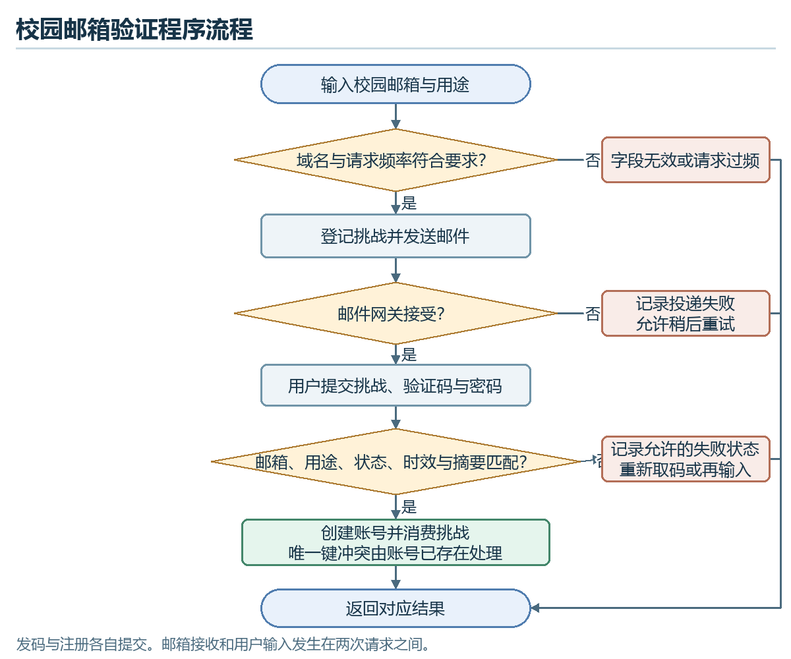

源码的挑战请求按同邮箱与用途设 60 秒间隔及小时窗口限制，验证码有效 300 秒。SMTP 接受后记录 SENT，投递失败记录 FAILED 并返回 MAIL_UNAVAILABLE。验证检查挑战所属邮箱、用途及状态，再核对到期和摘要。错误尝试及过期状态按验证结果记录，注册成功在同一事务创建账号并消费挑战。唯一键冲突由 ACCOUNT_EXISTS 返回。登录重验凭据与当前账号权限后签发普通会话，退出使会话失效。验证码、密码和令牌内容不得进入验收附件。用 TC-A01、TC-A02、TC-A04、TC-A06 验证两端登录、邮箱拒绝、权限变化与身份分域。真实投递仅以指定环境的实际记录为据。[R6][R7]

## 5.2 M2 检索与全文阅读

入口为 GET /catalog、GET /articles、GET /articles/{id}。页面入口、查询参数和排序语义按 API.md 对接。输入为岗位、关键词、公司、专业、排序和分页参数，输出为标签、公开列表或全文。查询先解析参数并筛除不合规的分类，再按公开可见条件与排序查询，最后构造列表、分页和正文投影。以 M03/M04 说明组合筛选，按岗位查找并可选公司与同专业。认证后的同专业筛选使用本人专业值，缺少专业时提示补充。列表请求失败保留条件，空结果提示可清除筛选，回到列表保留可用位置。文章隐藏或下架后返回不可用并清除失效正文。作者主页、评论及联系信息经 M4 独立验证。依据 article、article_version、category 及媒体关系核对全文、标签和排序。用 TC-R01–06、TC-NFR01 验证正文、筛选、排序和访客字段隔离。[R3][R6][R7]

## 5.3 M3 草稿、媒体与发布

入口为 GET／PUT /me/articles/{id}/draft、POST /me/articles/{id}/images、POST /me/articles/{id}/publish。输入为作者身份、文章 ID、预期修订号、草稿和图文引用，发布另传 requestId。输出为草稿、媒体引用、发布回执或冲突。持久数据为 article、article_draft、article_version、媒体关系和审计。

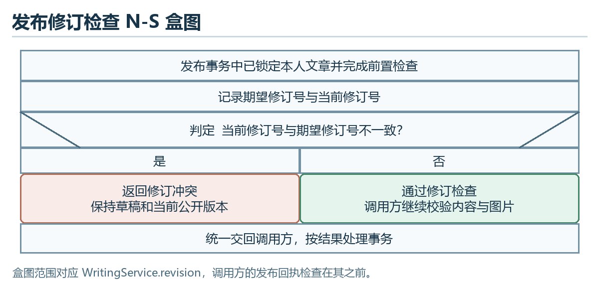

草稿允许暂缺发布字段。写入先锁定本人文章、检查可编辑状态与修订，再校验分类和媒体引用后保存。发布从已保存草稿读取内容，已有回执先按接口规则核对；新发布检查权限和修订，再逐个核对图片是否属于文章且文件可读。校验通过在同一事务写版本、切换公开指针、记录回执和审计。原公开版本在成功提交前继续服务。作者下架与治理隐藏是不同权限路径。客户端收到 409 时保留输入并显示服务器修订供手工比较。图片上传失败先保留正文和已成功图片，失败项单独重试。TC-C03–08、TC-NFR02/07 及 WB01 核对冲突、丢响应重试和数据一致性。[R6][R7]

## 5.4 M4 评论、互动与自愿联系

入口为 /articles/{id}/comments、/comments/{id}/replies、文章点赞与收藏接口、/authors/{id}/contact 和 /me/contact-settings。输入为当前认证身份、目标、操作、正文或作者公开设置，输出为评论回执、互动状态或允许展示的联系方式。评论先验证目标与上下文，检查正文和图片归属，再持久化评论、关联媒体及回执。点赞、收藏按关系目标状态更新。联系方式读取检查作者开关及认证权限，作者可更新本人设置。端侧将点赞、收藏与投币分开呈现，已确认关系与计数来自服务端。目标不可见或身份失效时清除受限数据，编辑中的评论可保留为本地输入。持久化由 discussion_comment、互动关系和 author_contact_setting 承担。验证 TC-I01–07、TC-R06 与 TC-NFR11。[R3][R6][R7]

## 5.5 M5 奖励、币账本与投币

入口为 /me/rewards、/me/coin-ledger、/articles/{id}/reading-session、/me/rewards/reading、/me/rewards/login 和 /articles/{id}/coins。输入为认证主体、文章或阅读会话、请求键和币数，输出为服务端回执、余额或拒绝原因。局部数据含业务日、目标作者、钱包修订、已投额度和请求语义。登录每日 2 币，阅读满 180 秒可领 1 币且每日一次，单人单篇累计最多 2 币。规则以服务端配置及现有契约为准。

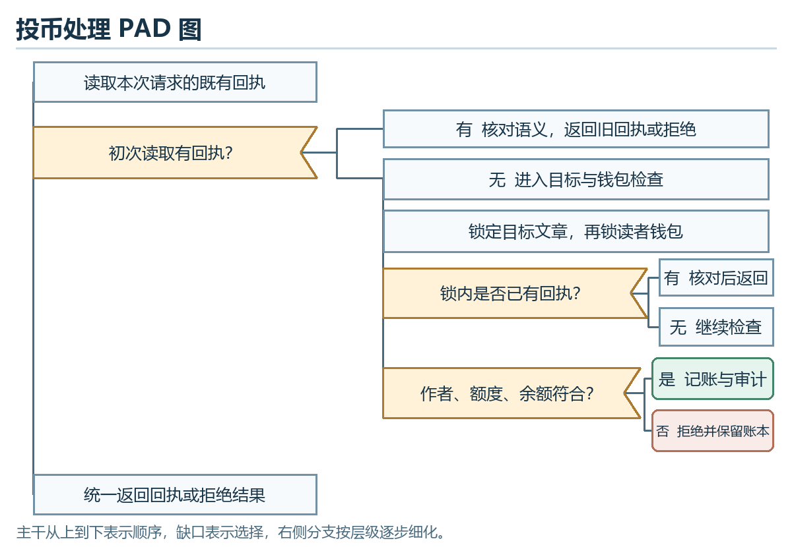

重试可先读回执。首次投币先锁目标文章再锁读者钱包，锁内复查回执与作者、额度、余额，提交余额和事件。目标刚不可见时再核对是否已有回执，已有成功请求仍可按原语义重放。拒绝或回滚时余额与账本保持一致。阅读奖励核对当天会话、到时状态和领取限制。荣誉展示与贡献失效按 SRS 保留验收，未配置正式规则时界面按未启用状态处理。验证 TC-G01–06、TC-NFR02 与 WB02。[R3][R6][R7]

## 5.6 M6 反馈、治理与审计

普通认证用户从 /me/cases 提交和查看本人案件，管理人员从 /admin/cases 及内容处置接口操作。输入为目标类别与编号、操作、理由、预期修订和请求键，输出为案件回执、治理事件或拒绝。私有证据按案件与角色读取。案例处理核对认领和状态，内容隐藏或恢复使用独立治理修订。

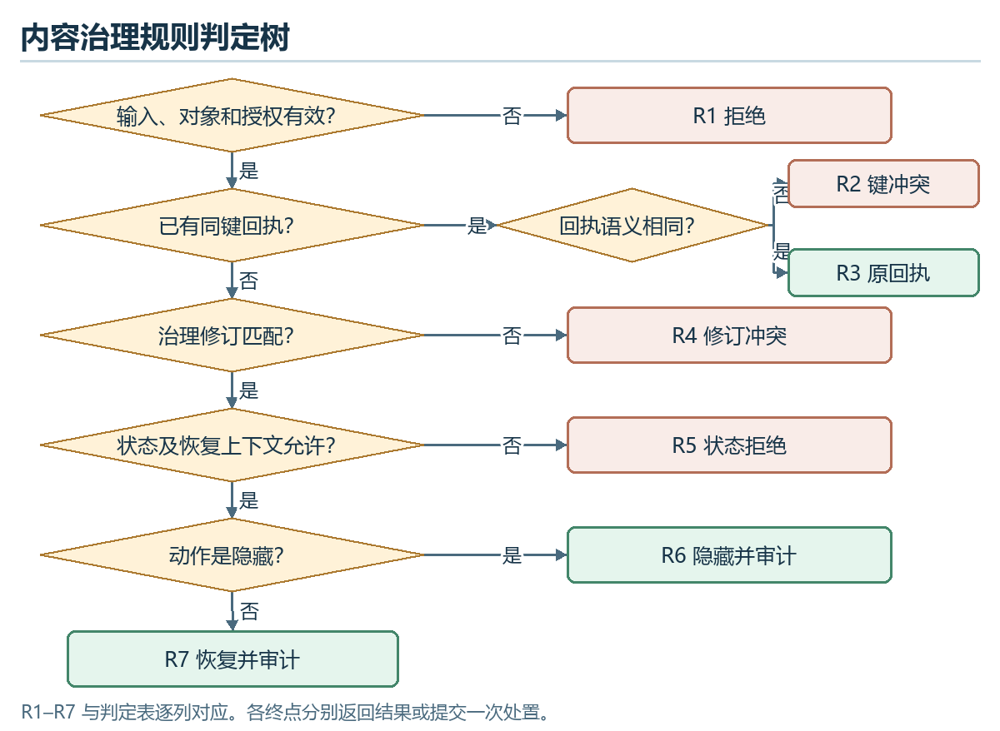

| 条件及动作 | R1 | R2 | R3 | R4 | R5 | R6 | R7 |
| --- | --- | --- | --- | --- | --- | --- | --- |
| 输入、对象与管理授权有效 | 否 | 是 | 是 | 是 | 是 | 是 | 是 |
| 已有同键回执 | — | 是 | 是 | 否 | 否 | 否 | 否 |
| 回执语义相同 | — | 否 | 是 | — | — | — | — |
| 治理修订匹配 | — | — | — | 否 | 是 | 是 | 是 |
| 状态及恢复上下文允许 | — | — | — | — | 否 | 是 | 是 |
| 动作是隐藏 | — | — | — | — | — | 是 | 否 |
| 返回或执行 | 拒绝 | 键冲突 | 原回执 | 修订冲突 | 状态拒绝 | 隐藏并审计 | 恢复并审计 |

表 5-1 按前置检查、回执、修订、状态和动作顺序匹配。每列唯一对应图 4 的同号终点。“—”表示规则在此前已经确定，或该条件无需参与。合法动作限隐藏和恢复。文章锁先于评论锁，再核对当前管理员授权和既有回执。新处置更新目标状态、治理修订和审计事件后提交。文章恢复参考治理保留的原状态和公开版本，评论恢复为可见。两个管理员用同一旧修订发起不同请求时仅一个新处置成功，另一个获取冲突并刷新上下文。验证 TC-M01–04、TC-M06–07、TC-NFR02 和 WB03。[R6][R7]

## 5.7 M7 独立运维与恢复

运维网页以独立会话访问 /api/v1/ops 下的状态、清单及任务。GET /status 返回目标、健康和恢复标志，POST /confirmations 返回确认标识及到期时间，POST /jobs 返回持久任务，GET /jobs/{id} 返回阶段、起止时间和结果。动作限定 DEPLOY、RESTART、BACKUP、RESTORE，目标为受控业务服务。确认绑定动作、目标、引用和当前会话，当前实现有效期为 300 秒。已有同语义任务重试返回原任务，已存在排队／执行中的任务拒绝新操作。新任务持久化后才返回 QUEUED，随后进入 RUNNING，结束记录 SUCCEEDED、FAILED 或 INTERRUPTED。阶段和结果从控制目录读取。业务服务停止后仍可通过独立入口查进度。

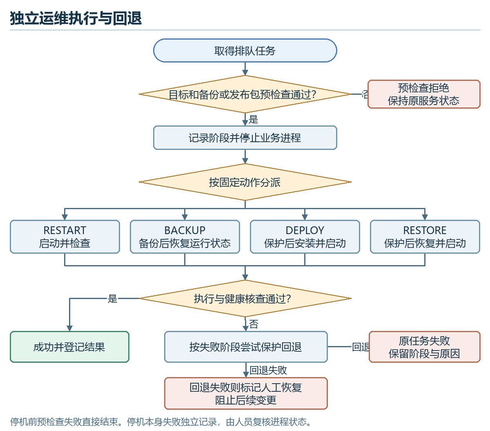

部署及恢复先做目标、包或备份检查。恢复前保留保护副本，并按清单校验兼容性、集合和文件摘要。导入 SQL、切换媒体和版本后检查服务是否恢复。候选验收另外核对样本数据与图片，保护副本和阶段日志留存。异常后尝试保护回退；回退通过仍保留原任务失败结论。回退失败记录 MANUAL_RECOVERY_REQUIRED 阶段和受控错误，锁住后续变更直至人工核对。源码中停机调用在保护阶段的 try 块之前，停机本身失败按任务失败登记，须核对进程状态及是否已有保护副本。备份的保留期与离机副本用 RPO ≤ 24 小时、RTO ≤ 10 分钟、保留 7 份成功备份及至少 1 份离机副本验收。用 TC-O01–08、TC-NFR08/09/12 及 WB04 核对授权、互斥、终态、失败和恢复。[R3][R6][R7]

## 5.8 M8 个人工作区与消息入口

入口为小程序“我的”和网页“我的工作区”。输入为当前认证身份、列表条件、查看项及通知动作。输出为本人草稿、文章、收藏、案件及通知的分区结果。先获取本人认证状态，再按页面需要读取各业务投影。本人数据页按 M1 会话隔离，资源仍由 M3、M4、M6 检查权限。分区分别区分加载、空结果、失败和已完成。通知中的目标若不可见，仅显示允许的通知摘要，禁止借通知扩大可访问范围。局部状态保存分页、分区和待恢复输入，退出后清理本人的敏感缓存。现有本人文章、收藏和案件接口可追溯；通知已读和双端同步按候选版本验证。用 TC-P01–03、TC-A04、TC-NFR06/11 核对。[R3][R6][R7]
## 5.9 Jackson 五步设计备份校验

本节用课件 6.4 的方法细化 OpsRunner.validateBackup。清单为分层数据，输入有兼容元数据、磁盘条目和重复的路径／摘要对，输出有拒绝类别或可用清单。前置为已经选定受控备份编号。实际成功返回清单，失败由受控异常或文件读取异常表达，图中的结果对象是逻辑结构。设计校验不改动业务数据。[R2 第 35–46 页][R6]

### 第一步 画出输入和输出结构

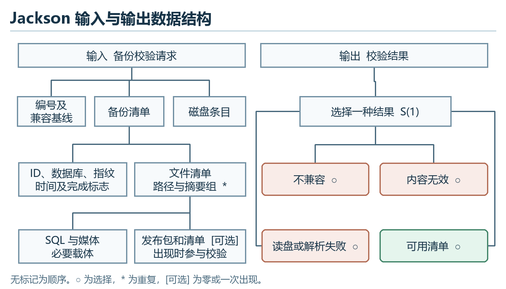

输入顺序为备份编号与兼容基线、清单、磁盘条目。清单包含 id、database、schemaFingerprint、createdAt、complete、files。数据库 SQL 与媒体目录为必要载体。发布包及发布清单在备份中可选，出现时必须纳入 files 并参与摘要校验。校验器额外要求磁盘的媒体目录存在。输出在“不兼容”“内容无效”“读盘或解析失败”“可用清单”中选择其一。

### 第二步 找出数据单元对应关系

| 输入数据单元 | 输出或中间结果 | 处理定位 |
| --- | --- | --- |
| 备份编号、数据库和迁移指纹、完成标志、SQL 条目 | 不兼容或继续校验 | 比较固定字段并检查数据库导出文件登记 |
| 磁盘条目与 files 路径键 | 集合一致或内容无效 | 排除清单自身，拒绝链接，比较集合 |
| 每组相对路径和摘要 | 逐条通过，或首个无效结果 | 解析受控相对路径，检查归属及摘要 |
| 媒体目录和可选发布文件 | 内容无效或可用清单 | 校验媒体目录。可选文件出现时参与统一检查 |
| 文件读取或解析错误 | 失败及阶段信息 | 交给任务层记录，禁止进入执行 |

### 第三步 由数据结构导出程序结构

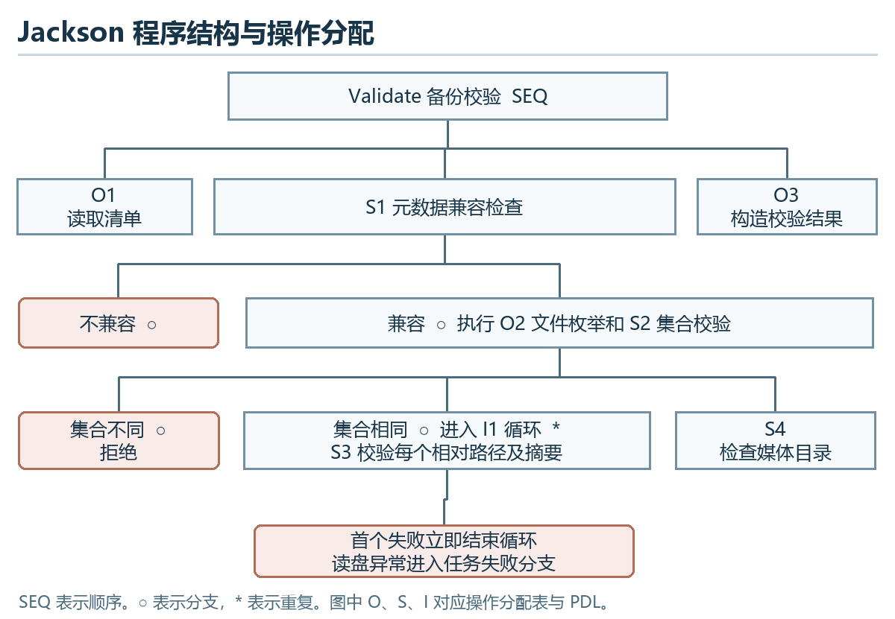

共同元素在同层合并为“元数据核对”“集合核对”“逐条核对”三个处理块。输入剩余项“媒体目录”归在最终检查，输出剩余项“失败类型或可用清单”归在结果构造。错误路径集中到一次逻辑返回，构件接口将拒绝类映射为受控结果。重复结构以迭代耗尽或首个拒绝退出。

### 第四步 分配操作及条件

| 标识 | 在程序图中的位置 | 操作和条件 |
| --- | --- | --- |
| O1 | 读取 | 打开受控根路径和 manifest.json，解析字段 |
| S1 | 兼容判定 | 只有 complete、ID、数据库、指纹和 SQL 条目均满足才继续 |
| O2、S2 | 枚举及集合判定 | 收集普通文件键，拒绝链接。键集合有差异则拒绝 |
| I1、S3 | 路径及摘要循环 | 对每个清单条目规范化路径并检查在根内，再比较摘要。第一次拒绝结束循环 |
| S4 | 媒体目录 | 确认媒体目录存在。允许目录为空 |
| O3 | 结果 | 返回原清单或错误，待上层决定是否执行 |

### 第五步 编写与程序图对应的 PDL

~~~pdl
Validate seq
  READ checked root and manifest                        O1
  SELECT metadata compatible                             S1
    BUILD actual file keys and expected file keys        O2
    SELECT file keys equal                               S2
      REPEAT for each expected key                       I1
        VERIFY relative path and checksum                S3
        IF invalid THEN remember first rejection and leave loop
      END REPEAT
      IF no rejection THEN verify media directory        S4
    OR keys differ SET invalid content
    END SELECT
  OR metadata differs SET incompatible
  END SELECT
  ON read or parse error SET validation failed
  RETURN manifest or rejection                           O3
Validate end
~~~

验证将元数据不一致、缺失或额外文件、摘要变化、缺失媒体目录、可选发布文件存在和清单读失败分别设为候选样本。通过样本只允许上层继续执行，恢复成功另由服务、SQL 和媒体证据确认。对应 TC-O05、TC-O06、TC-O08 与 TC-NFR09。

## 5.10 程序复杂度与路径复核

McCabe 按课件用三种办法计算。对单连通控制流统一入口和出口，简单顺序合并，AND／OR 按短路原子条件分别记判定节点。区域数含外部区域，边数用可编辑图中的有向边统计，P 为有两个后继的判定节点数。[R2 第 49–54 页]

| 片段 | 节点 N | 边 E | 判定 P | 区域数 | E−N+2 | P+1 |
| --- | --- | --- | --- | --- | --- | --- |
| WB01 发布修订检查 | 5 | 5 | 1 | 2 | 2 | 2 |
| WB02 币账本回执检查 | 11 | 16 | 6 | 7 | 7 | 7 |
| WB03 治理回执及修订 | 7 | 8 | 2 | 3 | 3 | 3 |
| WB04 运维确认检查 | 8 | 11 | 4 | 5 | 5 | 5 |

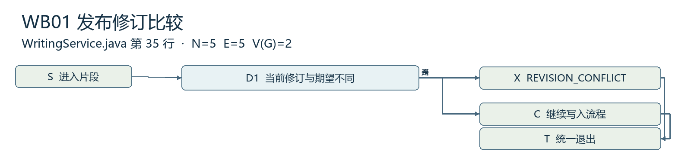

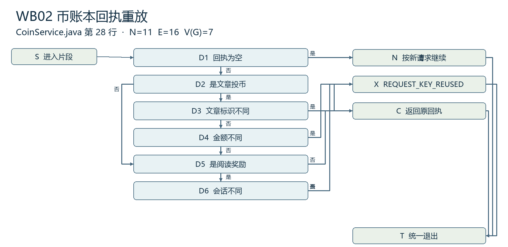

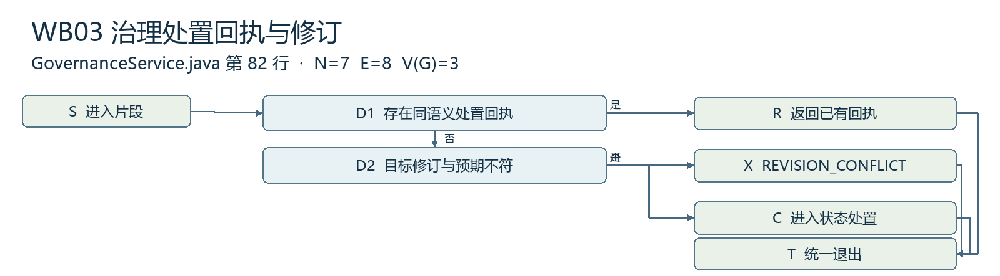

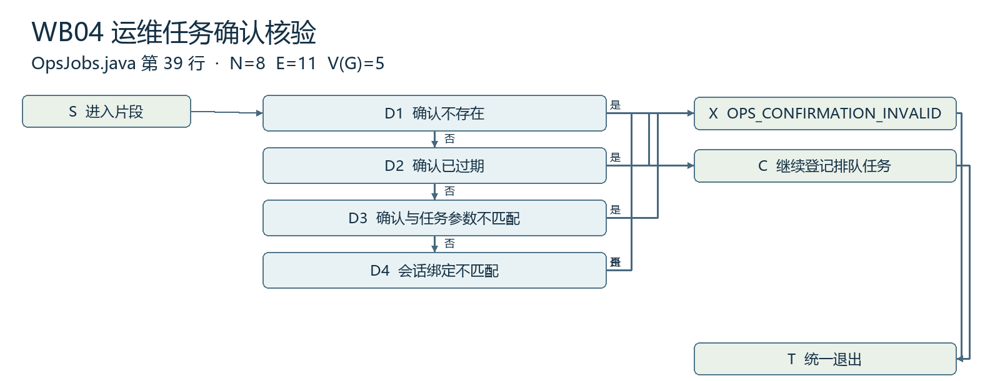

| 片段 | 源码定位及边界 | 基本路径与断言 |
| --- | --- | --- |
| WB01 | WritingService.revision，第 35 行。只计修订检查 | 2 条。旧修订拒绝、相同修订继续 |
| WB02 | CoinService.replay，第 28–32 行。只计既有回执判定 | 7 条。无回执、投币对象／金额不符、投币回执、阅读会话不符、阅读回执、登录回执 |
| WB03 | GovernanceService.moderate，第 82–85 行附近。授权后到修订判断 | 3 条。同语义回执、旧修订冲突、通过修订检查。同键改语义由内部 replay 与独立用例补查 |
| WB04 | OpsJobs.submit，第 39 行附近。只计已通过互斥后的确认表达式 | 5 条。确认缺失、过期、摘要不符、会话不符、通过确认 |

附《基本路径复核》保留 17 条路径的节点序列、触发数据和预期。路径基用于覆盖所量片段，事务并发、文件失败和业务链继续由集成与系统用例验证。四个片段均不超过课件建议的 V(G) ≤ 10。复杂度数值不表示完整业务已验证。[R7]

### Halstead 发布修订条件计数

计数范围为 WritingService.revision 中的判定与异常子句 if(a.revision()!=expected) throw conflict("REVISION_CONFLICT")。采用词法记号口径，方法名与变量、常量计为操作数，调用括号作为一个运算符记号，控制分组括号与语句终止符仅为语法界定。声明和前置 RequestTrace 两次调用不计。该范围适合复算一个判断片段。

| 类别 | 记号及出现次数 | 小计 |
| --- | --- | --- |
| 运算符 | if 1，成员访问点号 1，调用 2，!= 1，throw 1 | n1=5，N1=6 |
| 操作数 | a 1，revision 1，expected 1，conflict 1，字符串常量 REVISION_CONFLICT 1 | n2=5，N2=5 |
| 实际与预测长度 | N=N1+N2，H=n1·log2(n1)+n2·log2(n2) | N=11，H≈23.22 |
| 课件估计量 | N·log2(n1+n2)／3000 | 约 0.0122，作为公式示例 |

小片段中预测长度与记号实际数相差明显，反映预测依赖计数约定与规模。该估计不作缺陷数或验收结论。[R2 第 55–56 页]

## 5.11 人机界面详细设计

课件要求关注响应时间、帮助设施、出错处理和命令交互。响应同时记录长度和波动。30 并发下业务读 P95 ≤ 1 秒、写 P95 ≤ 2 秒、非预期错误率低于 1%，以测试计划的样本和计时口径执行。界面从动作到可见结果另记录时长、重复操作次数和失败后的恢复步骤。加载、无结果、不可访问及执行失败分别展示，更新前保留可恢复输入。帮助使用就地简短提示及层级帮助，关闭帮助后回到原步骤。按钮采用清晰动词，危险动作核对目标和影响，选中状态及错误同时使用文字提示。[R2 第 11–20 页][R7]

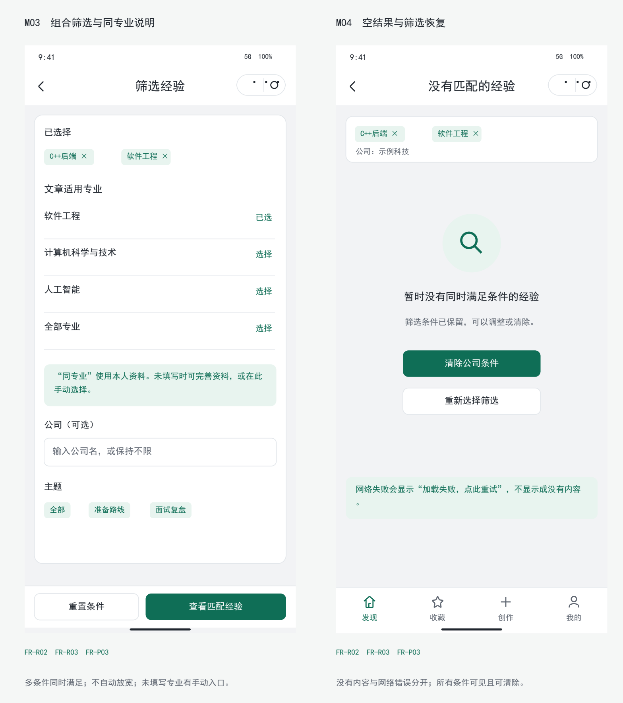

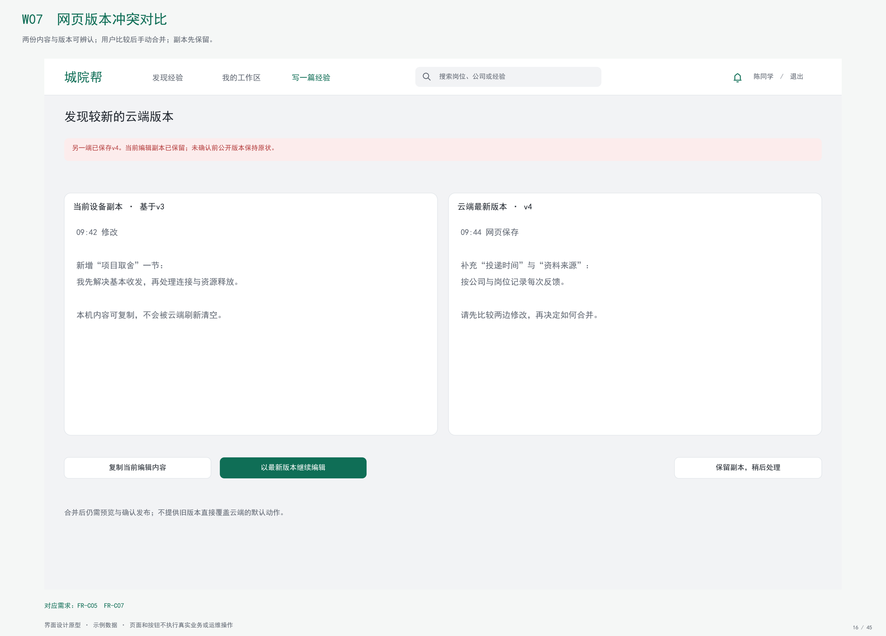

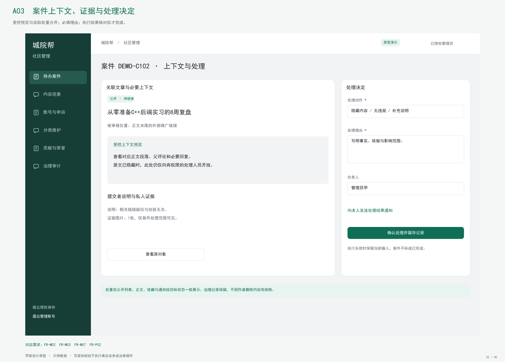

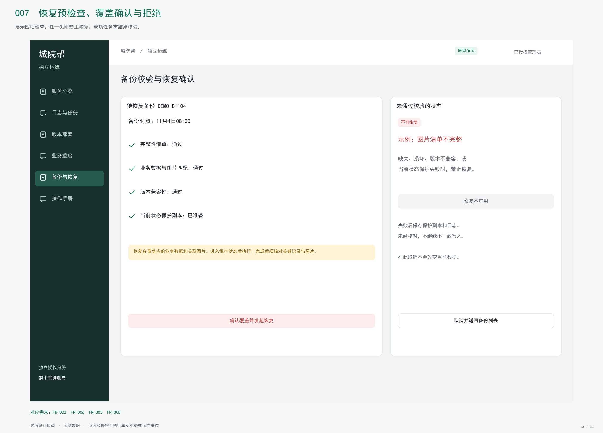

| 界面与入口 | 输入及可见反馈 | 异常、返回与保留 |
| --- | --- | --- |
| 小程序发现页 M03/M04，进入 M05 正文 | 岗位、关键词、公司、专业、排序。显示条件摘要、查询中与结果数量 | 请求失败保留条件，点重试发同一查询。空结果可清除条件。返回保留滚动位置与有效条件 |
| 小程序创作 M20–M25，网页 W05/W07 | 图文、标题、标签、修订及预览。显示草稿保存、部分图片失败、冲突与发布结果 | 409 保留输入与已上传引用，显示当前服务器修订。复杂 Markdown 保持原文，可切换到网页继续 |
| 社区案件 A02/A03/A04 | 从列表进入案件、定位对象、查看上下文、选择动作、填理由并确认 | 授权失败显示拒绝。修订冲突保留理由并刷新目标。提交受理与实际处置分别显示 |
| 运维状态 O02/O03，恢复 O07/O08/O09 | 选择备份，核对影响和预检查，确认后返回任务号。按阶段与终态反馈 | 确认过期重新确认，任务繁忙转已有任务。失败展示阶段、错误和保护结果。退出详情可用任务号回看 |

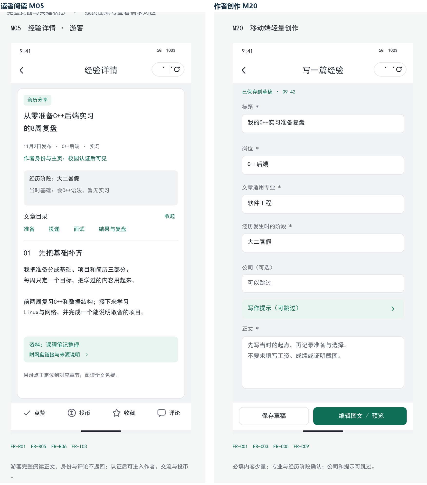

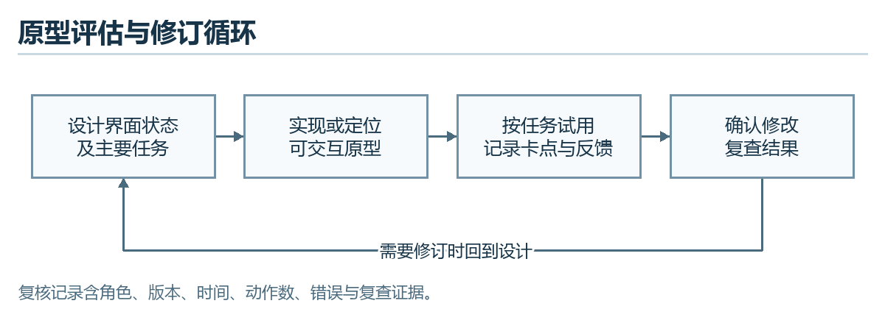

一般交互按角色分区并为危险操作设置确认。信息显示保留筛选摘要、修订号和任务状态。数据输入复用已有条件，隐藏不适用动作，提示当前字段的校验与恢复办法。早期复审按课程四项分别观察学习成本、交互动作与参数量、需要记忆的状态、风格／帮助／错误提示。读者观察筛选和返回时能否保留上下文，作者观察保留草稿和恢复编辑，管理人员观察理由与失败区分，运维人员观察能否独立定位停机和回退。走查按任务记录参与角色、环境、步骤数、耗时、卡点和反馈。实际记录进入《目标环境与用户验收记录》，课堂意见进入 WBS 4.14。图 12–16 为原型证据，用户认可和实际设备结果在对应测试执行后登记。[R7][R8]

## 5.12 关键过程 PDL 交接

~~~pdl
Register(email, challengeId, code, password)
  NORMALIZE and check form
  TRANSACTION
    CHECK challenge purpose, email, state, expiry and digest
    IF expired or incorrect THEN record allowed failure state
    IF verified and account absent THEN create account and consume challenge
    SET result to registration response or error
  END TRANSACTION
  RETURN result

Publish(actor, articleId, expectedRevision, requestId)
  TRANSACTION
    LOCK owned article and check editable state
    READ existing receipt using publication contract
    IF receipt applies THEN return its result
    CHECK publish capability, revision and saved draft
    FOR EACH image reference VERIFY ownership and file availability
    WRITE version, public pointer, receipt and audit
  END TRANSACTION
  RETURN committed result

Spend(actor, articleId, amount, requestId)
  TRANSACTION
    CHECK prior receipt and return or reject according to request semantics
    LOCK public target then reader wallet
    RECHECK receipt, author, cumulative limit and balance
    WRITE balance and ledger event with audit
  END TRANSACTION
  RETURN receipt or rejection

Moderate(admin, target, action, revision, requestId, reason)
  TRANSACTION
    VALIDATE command; lock article and comment as applicable
    RECHECK admin and receipt; apply table 5-1
    IF new valid change THEN write state, revision and audit event
  END TRANSACTION
  RETURN result

ExecuteOps(action, reference)
  CHECK target and artifact or backup as applicable
  STOP managed business service
  CASE action
    RESTART: start and verify health
    BACKUP: create protected snapshot and restore prior running state
    DEPLOY: preserve snapshot, install approved version and check health
    RESTORE: preserve snapshot, restore data and media, check health
  ON execution failure attempt protection rollback if available
  RECORD original outcome and rollback phase
  RETURN terminal status
~~~

# 6 需求可追踪性

## 6.1 从需求到实现与验证

附《需求与设计追踪》以每个 FR/NFR 为一行，记录范围、DFD 处理、模块和节号、接口或构件、数据位置、用例、设计 WBS 与验证 WBS。它包含 52 项功能和 12 项非功能，其中 50 项功能为本期。FR-A03 与 FR-M05 保留为扩展。附《构件反向追踪》以构件为入口回查相关需求和用例。非功能测试沿用测试计划的环境、样本、阈值及证据要求。图形及截图仅用于定位设计。

| 复核场景 | 期望及应核对的持久结果 | 用例 |
| --- | --- | --- |
| 跨端草稿旧修订及发布回执 | 旧修订被拒绝，本地输入和旧公开版保留。成功请求丢响应后按原语义核对同一回执 | TC-C07、TC-NFR07、WB01 |
| 重复投币及余额不足 | 同键同语义只记一次，同键改语义拒绝。失败无新增扣币，余额与账本可对账 | TC-G03、TC-G04、TC-NFR02、WB02 |
| 两名管理员同时处理 | 不同请求使用同一旧修订时仅一次有效状态变化。另一个请求刷新上下文 | TC-M03、TC-NFR02、WB03 |
| 损坏备份与停机查询 | 损坏文件拒绝恢复，原数据保留。业务停机时独立入口仍能读状态与任务 | TC-O01、TC-O06、TC-NFR08/09 |
| 执行失败与回退失败 | 保留原任务失败和回退结果。人工恢复标志出现时阻止后续变更并可定位阶段 | TC-O08、WB04 |

## 6.2 设计交付与评审安排

| WBS | 已编制的设计产物 | 计划节点及检查 |
| --- | --- | --- |
| 4.10 业务过程 | 第 5.1–5.6、5.10、5.12 节，流程、规则、事务及复杂度 | 核对认证、发布、奖励和治理逻辑 |
| 4.11 界面与异常 | 第 5.11 节，四端原型、响应及交互设计 | 检查草稿恢复、图片失败、版本冲突和角色反馈 |
| 4.12 独立运维 | 第 5.7、5.9 节，任务状态、备份结构、恢复与回退 | 核对受控路径、保护副本与独立查询 |
| 4.13 用例及交接 | 第 6 章、追踪表、白盒路径及已有测试计划 | 11 月 15 日提交，11 月 18 日课堂使用。实际交叉复核结论按记录补入 |
| 4.14 修订与联调输入 | 修订记录和实际证据定位 | 11 月 22 日提交设计修订材料，11 月 25 日课堂评审，11 月 26 日修订并交接联调 |

实现评审第 7 项使用本报告及附图。第 5 项关联单元用例，第 8 项关联白盒路径，第 10 项关联系统测试计划，第 17 项关联独立部署和恢复设计及后续执行证据。评审意见未发生的部分保留计划状态。见 [实现阶段评审证据对照](../models/总体设计G04/实现阶段评审证据对照G04.csv)。

# 7 注解

数值日期以当前项目计划为准。文中“受理”指请求或任务已经进入处理，完成仍须查回执或终态。业务 API 的路径、字段、状态及源码位置可按引用版本复查。表中的性能和恢复目标用于后续验收，实际测试结果按版本、设备和环境登记。章节结构对应 GB/T 8567—2006 第 7.13 节，配套接口和数据库资料保留在当前项目文档中。

# 附录 A 课件覆盖与图表定位

| 课件 | PDF 页序 | 本报告章节及成果 |
| --- | --- | --- |
| 6.1 结构程序设计 | 5–9 | 3.2、5.3、5.7、5.12，顺序、选择、循环、CASE 及异常出口 |
| 6.2 人机界面设计 | 11–20 | 5.11，四端界面、四项设计问题、三类指南和评估循环，图 12–17 |
| 6.3.1 程序流程图 | 22–23 | 5.1，图 1 |
| 6.3.2 N-S 盒图 | 24–25 | 5.3，图 2 |
| 6.3.3 PAD 图 | 26–28 | 5.5，图 3 |
| 6.3.4–6.3.5 判定表与判定树 | 29–31 | 5.6，图 4、表 5-1 |
| 6.3.6 PDL | 32–33 | 5.9、5.12，结构化伪码及模块接口 |
| 6.4 Jackson 图与设计法 | 35–46 | 5.9，图 6–7、五步推导 |
| 6.5.1 McCabe | 49–54 | 5.10，图 8–11、三种复算和 17 条路径 |
| 6.5.2 Halstead | 55–56 | 5.10，修订条件计数及计算 |

# 附录 B 附件与修订登记

- [可编辑详细设计图](../models/详细设计G04/城院帮详细设计图G04.drawio)
- [课件和 PDF 页码对照](../models/详细设计G04/课件覆盖与页码G04.csv)
- [需求与设计追踪](../models/详细设计G04/需求与设计追踪G04.csv)
- [构件反向追踪](../models/详细设计G04/构件反向追踪G04.csv)
- [基本路径复核](../models/详细设计G04/基本路径复核G04.csv)
- [修订记录](../models/详细设计G04/详细设计修订记录G04.csv)

| 版本与日期 | 依据及内容 | 状态 |
| --- | --- | --- |
| V1.0，2026-11-13 | 形成八个模块、过程工具、人机界面、Jackson、复杂度和双向追踪的课堂评审提交版 | 报告编制，交叉复核与课堂意见按实际登记 |
