# 城院帮软件需求规格说明书

软件工程课程项目 G04

V1.5.3  G04-SRS-20261108-02

王晨 32401211  组长兼项目负责人

刘景浩 32401205

参照 GB/T 8567—2006 第7.11节及 GB/T 9385—2008 编制

浙大城市学院  2026年11月8日

本文统一定义城院帮的用户目标、功能与质量要求，并展示数据字典、ER图、数据流图、状态转换图、原型和需求验证结果，作为需求评审、设计与验收的共同依据。

## 文档控制

| 项目 | 内容 |
| --- | --- |
| 文档标识与版本 | G04-SRS-20261108-02；V1.5.3；2026年11月8日 |
| 项目与责任 | 城院帮G04；王晨为组长兼项目负责人，刘景浩参与开发、文档与交叉复核 |
| 编制依据 | GB/T 8567—2006第7.11节；GB/T 9385—2008；第3章需求分析课件70页与需求阶段11项评审表 |
| 内容与范围 | 52项FR，其中50项本期必要、2项未来扩展；12项NFR；27个分析实体、134个字段 |
| 历史输入 | SRS V1.4、需求分析报告V1.6、模型说明V1.3；Git提交7ffe55a作为合并输入，历史原件仍可追溯 |
| 当前配套 | 项目计划V1.9、可行性V1.6、原生前端技术变更CR-G04-20261101-FE，以及 PowerDesigner CDM、ER图与数据结构附件。 |
| 本次修订 | 第2章登记四类用户代表和走查安排。第6章使用 PowerDesigner 逻辑模型，第8章提供字段结构与格式规则。 |
| 证据状态 | 已开展组内讨论和公开资料调研。四类代表已登记，待实际访谈、走查和确认。 |
| 配置与评审 | Git/GitHub个人文档分支维护，另一成员复核后由组长协调合并；文档检查不代替应用测试或用户确认 |

## 评审查阅导航

目录提供真实页码与内部跳转。评审时可先按下表定位正文；附录B逐项记录11项要求的材料与当前证据状态。

| 评审关注 | 本文件位置 | 配套证据 |
| --- | --- | --- |
| 用户类别与用户代表（第6项） | 2.1、2.4 | 四类代表已登记，角色与代表见2.1，走查按2.4和14.3记录。 |
| 界面原型及用户反馈（第7、8项） | 5.11—5.13、14.3 | 原型覆盖与真实走查记录分开登记 |
| 功能和非功能需求（第9项） | 第3章、第13章 | 52项FR与12项NFR逐项定义 |
| 数据字典与ER图（第10项） | 第6章、第8章 | 27实体134字段、46项数据流、结构与正则定义 |
| 课件要求的三模型 | 第6章ER、第7章DFD、第11章状态图 | 以同一投币业务贯通数据、加工与状态 |
| 计划、会议、评价及配置（第2—5、11项） | 第15章、附录B | 当前计划、10月31日纪要、Git记录及阶段成果 |

## 1 引言

### 1.1 目的与范围

服务对象以正在准备投递和面试的校内学生为主，认证用户可分享亲历，重点邀请已有实习或工作经历的人。文章按岗位组织，支持公司和同专业筛选，帮助读者判断经验与自身起点的适用性。

本文回答系统必须做什么，覆盖需求获取、分析建模、规格说明与验证。数据和行为模型描述逻辑要求，物理表、索引、模块内部算法与详细部署实现由设计阶段确定。

### 1.2 术语与编号

| 编号或术语 | 含义 |
| --- | --- |
| FR | 功能需求，分账号A、阅读R、创作C、交流I、激励G、治理M、运维O、工作区P |
| NFR | 非功能需求，含权限、安全、性能、兼容、恢复与可维护性 |
| ER / DFD / STD | 实体联系图 / 数据流图 / 状态转换图 |
| IPO / WBS | 输入处理输出图 / 工作分解结构 |
| UC / TC | 用户用例 / 验收场景 |
| 本期必要 / 未来扩展 | 当前交付范围与后续边界；未来材料人工认证A03/M05本期不开放入口 |
| 认证 | 校园关联身份核验，不为工作经历或文章真实性背书 |

### 1.3 分析任务与综合要求

| 类别 | 本项目规格位置及约束 |
| --- | --- |
| 功能需求 | 第3章52项FR及用例；本期50项必要能力，FR-A03与FR-M05材料认证保留为未来扩展。 |
| 性能需求 | 第13章NFR及测试计划：固定条件、30并发、读P95≤1秒写≤2秒；单独压力与稳定性验证。 |
| 可靠性与可用性 | 服务异常不得损坏草稿、重复扣币或静默丢数据；幂等写入；独立运维能定位失败；按恢复演练核验备份。 |
| 出错处理 | 权限拒绝、失效验证码、版本冲突、图片失败、余额不足、重复请求、停机和恢复失败均有确定结果。 |
| 接口需求 | 第12章用户、跨端、SMTP和执行器接口；状态、错误和权限一致。 |
| 约束 | 原生小程序及独立Vue 3网页、Java21/Spring Boot/MySQL、本地演示、校园邮箱白名单；受控Git协作与预算。 |
| 逆向需求 | 不得公开真实邮箱、不得普通用户升级管理员、不得自投和透支、不得自动把举报当违规、不得执行任意运维命令。 |
| 未来需求 | 微信身份绑定、毕业校友材料认证、完整荣誉表与扩展容量；新增需求走变更流程，不混入本期必要验收。 |

## 2 综合描述与需求获取

### 2.1 用户类别与能力边界

| 角色 | 能力 | 访问边界 | 用户代表 |
| --- | --- | --- | --- |
| 访客及未认证者 | 阅读公开经验、岗位公司专业筛选 | 只读文章，不返回评论、作者主页、他人资料与联系方式 | — |
| 认证读者 | 评论交流、收藏认可、投币、奖励、举报反馈 | 已知目标岗位，正在投递面试；仅访问被授权信息 | UR-R01 |
| 认证作者 | 分享亲历、双端图文创作、管理本人草稿和文章 | 作者也是普通认证用户，经历与任职不由校园认证背书 | UR-A01 |
| 社区管理员 | 案件查看、关联文章评论、巡查、处置与反馈 | 不得越权部署；所有关键处置有理由与审计 | UR-M01 |
| 运维人员 | 状态、日志、部署重启、备份恢复 | 独立登录授权，仅执行白名单操作，与社区管理分离 | UR-O01 |

本期采用免费阅读、非现金认可和自愿站外联系。站外沟通由双方自行协商；平台不组织咨询订单、付款、即时通讯、担保或服务评价交易。校园认证仅说明校内关联，不证明实习或工作经历。

### 2.2 业务范围与运行约束

| 行为 | 访客或未认证 | 校园认证用户 | 社区管理 | 独立运维 |
| --- | --- | --- | --- | --- |
| 公开文章及岗位筛选 | 允许 | 允许 | 按普通浏览 | 按普通浏览 |
| 作者主页及评论区、他人信息 | 拒绝 | 允许，但不返回真实邮箱 | 仅职责内核查 | 无社区越权 |
| 创作、评论、点赞收藏投币、联系 | 拒绝 | 按本人权限及作者联系开关 | 不代替作者操作 | 不具备普通用户互动权限 |
| 案件调查、隐藏与限制 | 拒绝 | 仅本人提交和回执 | 职责内允许并审计 | 拒绝 |
| 部署重启备份恢复 | 拒绝 | 拒绝 | 拒绝 | 白名单授权、确认和审计 |

终端为微信原生微信小程序和独立Vue 3网页。原生小程序使用WXML、WXSS、JavaScript及JSON配置；网页使用TypeScript及Vite，提供完整Markdown创作。两端页面和构建分别维护，共用Java21/Spring Boot/MySQL及统一业务契约。本地课堂演示为交付环境，腾讯云2核2GB为可选验证资源。

### 2.3 需求分析步骤与产物

| 课件任务 | 本项目具体分解 | 形成的结果 |
| --- | --- | --- |
| 确定综合要求 | 定义问题和范围→区分用户与权限→分解功能、性能、可靠性、错误、接口及约束→形成可验收条目 | 第2—5、12—13章的FR、BR、UC与NFR |
| 分析数据要求 | 识别实体与关系→确定标识及基数→定义字段、流、存储与加工→检查格式和语义 | 第6、8、9章与数据字典附件 |
| 导出逻辑模型 | 按边界分层DFD→建立事件/守卫/动作→以IPO和同一业务核对ER/DFD/状态图 | 第7、10、11章与流平衡检查 |
| 修正开发计划 | 追踪需求到WBS和验收→确认技术变更影响→评审分工和资源→登记变更 | 第15章；保留226.55人时基准，额外20—35人时仍须细化 |

### 2.4 需求来源与用户代表

输入以已有用户讨论、课程评审要求和已整理资料为主。以一个已明确提出的需求演示从表达、追问到规格的转换。

| 分解步骤 | 分析动作与已形成结果 |
| --- | --- |
| 2.1 收集原始表达 | “看和我相同专业的人，是怎么找到第一份实习的。” |
| 2.2 追问适用条件 | 关注目标岗位、分享者当时的年级与基础；专业用于判断课程背景，而非限制只能看同专业。 |
| 2.3 明确筛选含义 | 按经历所属专业筛选，和岗位、可选公司组合；清空专业条件后恢复岗位范围。 |
| 2.4 写入需求与数据 | FR-R03；Article.majorId及Major；P2经验检索；界面保留专业筛选与清空操作。 |
| 2.5 写出验收 | TC-R03：专业A筛选不返回专业B；清空后恢复；结果始终仅含公开文章。 |
| 2.6 验证表达是否合适 | 在任务3.8中让代表用户完成筛选并说明理解，再根据实际反馈修订。 |

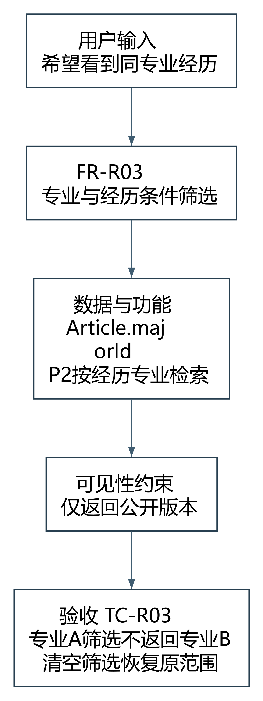

同专业筛选的需求形成与追踪

依据：课件3.2，第15—23页；用户已确认讨论；FR-R03。

#### 2.4.1 获取方法与执行安排

| 方法 | 具体分解与产物 | 记录入口 |
| --- | --- | --- |
| 访谈/情景分析 | 邀请准备投递的读者和已有经历的分享者；围绕找经验、写文章、联系意愿询问；记录原话、情景、障碍和要求。 | 用户代表与反馈登记 |
| FAST简易规格讨论 | ①确定目标和参与者；②各自列对象/服务/约束；③合并清单并消歧；④讨论冲突和优先级；⑤写简易规格及未决项；⑥双方确认修改。 | 需求周会与反馈模板 |
| 数据流自顶向下 | 先P0及F01—F10，再P1—P5，最后分解关键处理；每层核对输入输出与字典。 | 图表与模型；平衡核查 |
| 原型走查 | 14页可导航线框；读者筛选，作者保存/预览，管理员定位案件，运维员确认恢复；记录能否独立完成及误解点。 | 任务3.8；原型走查记录 |

本批已形成分析和线框材料。访谈、FAST会议和用户走查的实际参与者、时间、意见及确认由执行记录提供；不把文档编制视为用户签认。

读者、作者、社区管理员和运维人员各登记一位代表，见第2.1节。项目计划第4章登记名单，附录J列出 UW01—UW04 任务和待验证建议。邀约后记录实际参与时间、任务表现及代表意见。

### 2.5 三个模型的共同业务示例

演算情景：认证读者101给作者202的公开文章3001投1币；示例初始余额3币、该文章累计投币0。余额变为2、累计1、作者有效贡献加1；相同幂等键重试返回第一次结果。以上数字用于模型演算。

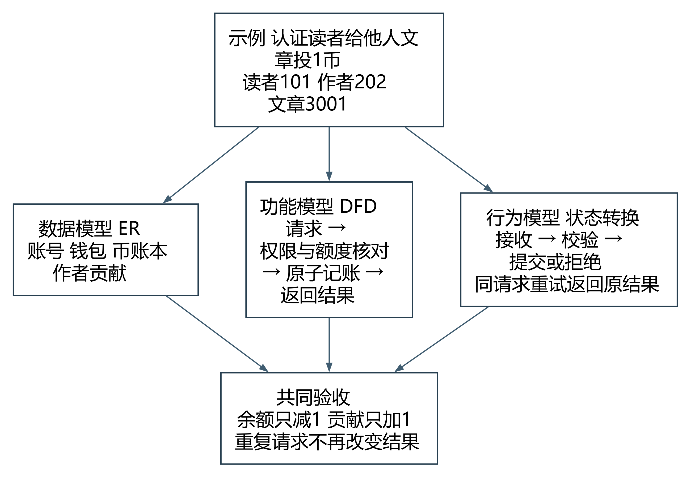

三模型与同一验收结果

| 分析模型 | 回答的问题 | 对应材料 |
| --- | --- | --- |
| 数据模型ER | 哪些对象和联系必须保存？ | Account、Wallet、CoinEntry、Article、Contribution |
| 功能模型DFD | 哪些数据进入、如何变换、写到哪里？ | P3.1→P3.3→P3.4，读写D1/D2/D4 |
| 行为模型STD | 请求在什么条件下改变状态，失败后怎样？ | STD04及第11章状态转换表 |

依据：课件3.3，第25—27页及小结第69页；本文件第6、7、11章。

## 3 功能要求

### 3.1 账号与认证

#### FR-A01 统一账号登录与退出

参与者 账号用户；优先级 本期必要；责任 王晨；刘景浩复核

要求 用户使用校园邮箱与密码登录，网页和小程序共用同一账号；注册必须先验证stu.hzcu.edu.cn邮箱。退出使当前会话失效，端侧清理受限资料。微信绑定列为后续扩展。

异常 凭证错误、失效或服务异常返回明确结果，不创建认证状态或管理权限。

验收 两端使用同一账号；非校园邮箱不能注册；退出后受限请求拒绝；普通登录不产生管理权限。

追踪 BR01,BR02,BR17；UC02；WBS 5.2,6.1,6.4；TC-A01。

#### FR-A02 校园邮箱自动认证

参与者 登录用户；优先级 本期必要；责任 王晨；刘景浩复核

要求 注册及找回密码通过本人校园邮箱验证码核验；邮箱规范化后校验固定后缀，验证成功记录依据与时间。验证码为6位数字，有效期300秒，重发间隔60秒，同邮箱同用途每小时发送请求最多5次；参数集中管理。

异常 邮箱不符合条件、验证码错误或过期、发送失败均给出原因或可执行的重试提示；验证码不进入普通日志。

验收 合法邮箱验证成功后获得校园认证；错误、过期及非白名单邮箱不通过；真实邮箱对其他用户不可见。

追踪 BR01,BR03；UC02；WBS 5.2,6.1,6.4；TC-A02。

#### FR-A03 证明材料人工认证

参与者 登录用户及社区管理员；优先级 后续扩展；责任 王晨；刘景浩复核

要求 本期仅对可使用校园邮箱的用户开放注册。毕业校友的学信网或材料人工认证作为未来需求保留，本期不提供材料上传与人工认证入口。

异常 无法使用校园邮箱的校友可公开阅读，本期不通过材料授予认证权限。

验收 本期界面不呈现材料认证流程，后台不会据未审材料自动授予认证；后续扩展经需求变更确认。

追踪 BR01,BR03,BR16；UC02；WBS 5.2,5.9,6.4；TC-A03。

#### FR-A04 认证失效与权限变化

参与者 账号用户及管理员；优先级 本期必要；责任 王晨；刘景浩复核

要求 认证和账号状态变化后，系统按当前有效状态重新判定受限操作；账号限制、解除及认证处理均有原因和记录。

异常 失效账号可保留必要的本人认证结果和处理通知入口，但不能继续发布或取得他人受限资料。

验收 撤销认证后新受限请求被拒绝；重新认证须走规定流程；历史数据不因状态切换静默丢失。

追踪 BR01,BR03,BR16；UC02；WBS 5.2,5.9,6.4；TC-A04。

#### FR-A05 资料与隐私设置

参与者 认证用户；优先级 本期必要；责任 王晨；刘景浩复核

要求 用户维护自己的昵称、专业、当前在校或毕业阶段和可选联系方式；文章中的经历阶段与当前个人年级分开。

异常 不存在的专业或不完整阶段提示修正；不能修改他人资料；关闭联系不删除历史正文。

验收 本人修改生效；他人看到的是允许公开的资料；真实邮箱、证明材料和登录凭据不作为公开字段。

追踪 BR03,BR04,BR06,BR12；UC02；WBS 5.2,5.8,6.4；TC-A05。

#### FR-A06 管理账号分权

参与者 授权管理人员；优先级 本期必要；责任 王晨；刘景浩复核

要求 社区和运维账号的权限分别配置。普通注册和校园认证不能自行提升为管理角色，持有一类管理权限不自动获得另一类。

异常 未经授权的页面和直接请求均拒绝；运维身份失效后不能继续执行操作。

验收 普通账号不能审核或恢复数据；社区管理员不能执行运维；合法运维人员能处理受控操作。

追踪 BR01,BR17；UC08,UC09；WBS 5.2,5.9,5.10,6.4；TC-A06。

### 3.2 检索与阅读

#### FR-R01 免费浏览与全文阅读

参与者 所有用户；优先级 本期必要；责任 王晨、刘景浩按双端分工；交叉复核

要求 系统提供已公开文章列表、摘要、岗位、文章专业标签、公司可选标签、主题及经历阶段。全文、正文图片和资料链接免费阅读。

异常 草稿、删除、作者下架或管理员隐藏的内容不在公开列表中，也不能通过旧链接读取正文。

验收 未登录也可读公开文章；无需购买或付费解锁；旧链接仅显示不可用结果，不泄漏隐藏正文。

追踪 BR01,BR07,BR09；UC01；WBS 5.4,5.7,6.1；TC-R01。

#### FR-R02 岗位与关键词检索

参与者 所有用户；优先级 本期必要；责任 王晨、刘景浩按双端分工；交叉复核

要求 用户以目标岗位、关键词检索文章，系统提供当前筛选条件、结果及分页或连续加载。本期关键词检索字段为标题与摘要；检索字段与接口合同一致。

异常 输入为空、无结果、网络失败与加载失败分别说明；恢复操作不自动清空条件。

验收 有匹配内容时可找到；无结果时可修改条件；分页不重复或遗漏同一稳定查询结果中的条目。

追踪 BR04,BR05；UC01；WBS 5.4,6.1；TC-R02。

#### FR-R03 专业与公司组合筛选

参与者 所有用户及认证读者；优先级 本期必要；责任 王晨、刘景浩按双端分工；交叉复核

要求 支持手动专业、可选公司及主题筛选。认证读者可用同专业快捷条件；未填专业时提示先完善或手动选择。

异常 公司未填写的文章仍可按其他条件发现；没有结果不悄悄放宽专业或公司条件。

验收 岗位、专业、公司同时选择时结果同时满足；取消或重置可恢复检索；公司信息不表现成招聘岗位投递入口。

追踪 BR04；UC01；WBS 5.4,6.1；TC-R03。

#### FR-R04 认可与最新排序

参与者 所有用户；优先级 本期必要；责任 王晨、刘景浩按双端分工；交叉复核

要求 系统提供认可排序和最新排序。认可排序按有效获币、有效点赞、发布时间及稳定标识确定次序；仅排序满足筛选的可公开文章。

异常 新文章尚无互动时仍可通过最新列表发现；隐藏内容和失效贡献不参与公开排序。

验收 同一数据集得到确定次序；获币相同用点赞比较；最新模式按发布时间展示；切换排序保留筛选。

追踪 BR05,BR15；UC01；WBS 5.4,5.8,6.1；TC-R04。

#### FR-R05 来源与资料链接

参与者 所有用户及作者；优先级 本期必要；责任 王晨、刘景浩按双端分工；交叉复核

要求 正文展示内容来源类别和外部资料来源说明，支持作者附加网盘链接。外部内容由读者自愿打开，平台不自动采集网盘账户或接管外部访问授权。

异常 外部链接不可用时保留说明和反馈入口；演示内容清楚标记，不称已核验的本校亲历。

验收 读者能辨认亲历、资料整理与演示；能看到来源；外部链接失败不影响已公开正文的阅读。

追踪 BR07,BR12；UC01；WBS 5.3,5.4,6.1；TC-R05。

#### FR-R06 认证阅读边界

参与者 未认证及认证用户；优先级 本期必要；责任 王晨、刘景浩按双端分工；交叉复核

要求 未认证页面展示受限功能说明，但不返回评论内容、作者头像昵称及完整资料、作者主页、联系方式和他人互动记录；认证后按权限显示。专业筛选使用文章标签。

异常 通过直接请求、隐藏字段或图片地址访问受限内容时同样拒绝；正文内作者自行公开的信息属于公开正文内容。

验收 未认证响应和页面数据不含受限字段；认证后可以查看；作者资料限制不影响免费全文阅读。

追踪 BR01,BR03；UC01,UC05；WBS 5.4,5.8,6.4；TC-R06。

### 3.3 创作与文章管理

#### FR-C01 轻量发布信息

参与者 认证作者；优先级 本期必要；责任 王晨；刘景浩复核

要求 支持标题、正文、岗位、专业标签及经历阶段确认，专业默认采用本人资料并可确认适用背景。公司、当时基础、联系方式和写作提示可跳过。

异常 必需信息缺失时定位缺项；不因跳过可选内容禁止发布；不把作者当前年级自动当作过去经历阶段。

验收 普通经验可用少量必要信息发布；无公司、无联系方式及未使用提示仍可发布；经历阶段可独立确认。

追踪 BR02,BR06；UC03；WBS 5.3,5.5,5.6,6.1；TC-C01。

#### FR-C02 网页Markdown创作

参与者 认证作者；优先级 本期必要；责任 王晨、刘景浩按双端分工；交叉复核

要求 网页提供Markdown正文编辑、预览、图片插入和资料链接；能展示标题、列表、引用、代码片段等常用经验写作内容。

异常 危险脚本或不受支持内容不执行；错误保存保留正文；代码示例中的标签作为文字显示。

验收 编辑和预览一致，公开页面安全呈现；图文及代码可读；失败后能恢复编辑内容。

追踪 BR06,BR07,BR10；UC03；WBS 5.5,6.1,6.4；TC-C02。

#### FR-C03 小程序基础图文创作

参与者 认证作者；优先级 本期必要；责任 王晨、刘景浩按双端分工；交叉复核

要求 小程序支持文字、图片的加入、移除及基本次序调整，并能独立完成草稿、预览和发布。手机不要求具备网页完整Markdown编辑能力。

异常 遇到不能安全编辑的复杂网页内容时说明限制并保留原文，可转网页完成，不静默丢弃格式。

验收 没有电脑也能完成基础图文文章；移动端查看网页文章正常；不支持的编辑场景不会损坏已有正文。

追踪 BR06,BR10；UC03,UC04；WBS 5.6,6.1,6.4；TC-C03。

#### FR-C04 图片上传与失败处理

参与者 认证作者及评论者；优先级 本期必要；责任 王晨；刘景浩复核

要求 文章、草稿和评论按用途管理图片；不设置固定业务图片张数上限。文件类型、单文件容量及总请求约束在技术参数表确认。

异常 部分上传失败明确标识，可重试或移除；失败图片不能显示为已成功上传，也不能导致正文全部丢失。

验收 多图成功与部分失败均有明确状态；重试不重复产生图片引用；图片访问遵循所在内容的权限。

追踪 BR01,BR10；UC03,UC05；WBS 5.3,5.6,5.8,6.4；TC-C04。

#### FR-C05 多草稿保存与恢复

参与者 认证作者；优先级 本期必要；责任 王晨；刘景浩复核

要求 作者可维护多个独立草稿，系统区分保存中、已保存和保存失败；重新进入可恢复最后确认保存版本，未保存修改有风险提示。

异常 离线或服务失败时保留可恢复内容；会话过期后允许先保留编辑副本并提示重新登录，不能冒充云端保存成功。

验收 多个草稿互不覆盖；保存失败后内容可找回；刷新、重入及重新登录场景不静默清空正文。

追踪 BR09,BR10；UC03；WBS 5.3,5.5,5.6,6.1；TC-C05。

#### FR-C06 预览与发布

参与者 认证作者；优先级 本期必要；责任 王晨；刘景浩复核

要求 发布前可预览正文、图片、来源和公开范围。通过身份、权属及基本内容校验后发布，形成明确发布结果。重复提交同一次发布不产生多篇文章。

异常 失败时指出原因且保留草稿；结果不确定时可核对当前状态，不能自动重复发布。

验收 合法文章发布后公开可读；草稿不公开；重复提交只形成一次发布；无需逐篇人工预审。

追踪 BR02,BR08,BR10；UC03；WBS 5.3,5.7,6.1；TC-C06。

#### FR-C07 修改与版本冲突

参与者 认证作者；优先级 本期必要；责任 王晨；刘景浩复核

要求 作者可修改自己的草稿或文章；跨端保存时检查内容版本，发布内容更新有明确确认和结果，保留必要版本关联。

异常 另一端已有较新版本时提示冲突并保留当前编辑副本；不得用旧版本静默覆盖另一端较新编辑结果。

验收 两个设备同时修改同文能识别冲突；确认前公开版本保持一致；失败不会留下半更新状态。

追踪 BR09,BR10；UC04；WBS 5.7,6.1,6.4；TC-C07。

#### FR-C08 下架删除与恢复权限

参与者 认证作者及社区管理员；优先级 本期必要；责任 王晨；刘景浩复核

要求 作者可自主下架并管理本人内容；管理员隐藏状态与自主下架分开记录。删除保留治理和关联记录所需的最小标识，清除期限见待确认项。

异常 作者不得操作他人文章，也不得自行恢复管理员隐藏文章；关联收藏、评论和通知跳转解释不可用状态。

验收 自主下架不再公开；作者恢复限本人自主下架内容；管理员隐藏内容只能经授权处理恢复。

追踪 BR09,BR16；UC04,UC08；WBS 5.7,5.9,6.1,6.4；TC-C08。

#### FR-C09 可跳过写作提示

参与者 认证作者；优先级 本期必要；责任 王晨；刘景浩复核

要求 编辑器提供可按需展开的提示，如当时基础、准备过程、投递面试、结果与不足、资料来源；用户可自由撰写或跳过。

异常 提示不转换为逐项必填问卷，不要求填写敏感成绩、工资或证明。

验收 不使用提示能完成发布；使用提示不增加固定审核流程；提示不会覆盖已有正文。

追踪 BR06；UC03；WBS 5.5,5.6,6.1；TC-C09。

### 3.4 交流与作者联系

#### FR-I01 评论与回复

参与者 认证用户；优先级 本期必要；责任 王晨；刘景浩复核

要求 在可公开文章下发表文字及图片评论，可回复已有评论并查看必要上下文；空内容和不可用目标有明确提示。

异常 文章被隐藏、认证失效或服务失败时拒绝新增并保留待提交内容；目标评论不可见时不泄漏其正文。

验收 合法用户可交流并看到回复关系；未认证不能读取或新增；失败不会产生重复评论。

追踪 BR01,BR09,BR10,BR11；UC05；WBS 5.8,6.1,6.4；TC-I01。

#### FR-I02 评论管理边界

参与者 认证用户及社区管理员；优先级 本期必要；责任 王晨；刘景浩复核

要求 用户可管理本人评论，作者可回复但不能删除其他人的评论；社区管理员按治理流程隐藏违规评论并留下理由与关联记录。

异常 删除或隐藏的父评论以不可用标识保留回复关系，不误删他人正常内容。

验收 作者删他人评论被拒绝；本人操作只影响本人内容；管理员操作可追溯，回复上下文可辨认。

追踪 BR09,BR16；UC05,UC08；WBS 5.8,5.9,6.1；TC-I02。

#### FR-I03 点赞认可

参与者 认证用户；优先级 本期必要；责任 王晨；刘景浩复核

要求 对公开文章点赞并可取消；同一账号对同一文章只保留一个有效点赞状态，计数反映有效状态。

异常 重复请求不重复增加；不可用目标或认证失效时拒绝改变。

验收 连续重复点赞计数不膨胀；取消后相应计数减少；不会扣币或自动收藏。

追踪 BR01,BR11；UC05；WBS 5.8,6.1；TC-I03。

#### FR-I04 收藏与重访

参与者 认证用户；优先级 本期必要；责任 王晨；刘景浩复核

要求 对公开文章收藏并可取消，在本人收藏列表查找和重访。收藏关系仅用于本人管理，不作为公开他人行为数据。

异常 文章不可用时显示原因或状态，不从收藏入口泄漏已隐藏正文。

验收 收藏与取消结果一致；未认证不能操作或读取他人收藏；失效收藏不会自动删除治理记录。

追踪 BR01,BR09,BR11；UC05；WBS 5.8,6.1,6.4；TC-I04。

#### FR-I05 作者公开主页

参与者 认证用户；优先级 本期必要；责任 王晨；刘景浩复核

要求 查看作者自愿公开的昵称、专业、在校或毕业阶段、认证状态、有效贡献荣誉及公开文章列表；真实邮箱和认证材料始终隐藏。

异常 认证失效或主页访问受限时明确说明；不把认证或荣誉解释成经历真实性保证。

验收 认证用户可进入；访客及未认证不能通过页面或直接请求取得主页资料；隐藏文章不在公开列表出现。

追踪 BR01,BR03,BR15；UC05；WBS 5.8,6.4；TC-I05。

#### FR-I06 作者联系开关

参与者 认证作者；优先级 本期必要；责任 王晨；刘景浩复核

要求 作者选择是否公开及公开哪种站外联系方式。公开范围受认证访问规则限制，关闭后新请求与刷新结果不返回联系内容。

异常 联系方式未提供时不阻止发文；输入无效时提示修正；已被站外复制的信息无法由平台收回。

验收 无联系方式文章可发布；开启后认证用户可查看；关闭后接口和新页面均不返回联系字段。

追踪 BR01,BR06,BR12；UC05；WBS 5.8,6.1,6.4；TC-I06。

#### FR-I07 自愿站外联系

参与者 认证读者；优先级 本期必要；责任 王晨；刘景浩复核

要求 允许查看、复制作者已开放的联系方式，并说明由双方自行交流。联系前保留文章上下文，平台不要求提交咨询次数或订单。

异常 作者关闭、资料不存在或网络失败时提示；不能绕过设置发出消息或获取隐藏联系方式。

验收 可自愿复制合法公开信息；没有站内支付、视频、即时聊天或咨询履约流程。

追踪 BR12；UC05；WBS 5.8,6.1；TC-I07。

### 3.5 非现金激励

#### FR-G01 简单奖励任务

参与者 认证用户；优先级 本期必要；责任 王晨；刘景浩复核

要求 认证账号每日登录可领2币；单篇阅读累计180秒可领1币，每日最多领取一次阅读奖励，两类奖励合计最多3币。采用Asia/Shanghai业务日；同业务键重复提交返回既有结果。阅读只计时，不增加复杂行为检测。

异常 不使用额外答题、强制滚动轨迹或复杂行为核验；条件未达成时说明原因。

验收 用户能理解任务及上限；达到条件后可领取；没有复杂任务市场或现金入口。

追踪 BR13；UC06；WBS 5.8,6.1；TC-G01。

#### FR-G02 奖励领取与日上限

参与者 认证用户；优先级 本期必要；责任 王晨；刘景浩复核

要求 认证账号每日登录可领2币；单篇阅读累计180秒可领1币，每日最多领取一次阅读奖励，两类奖励合计最多3币。采用Asia/Shanghai业务日；同业务键重复提交返回既有结果。阅读只计时，不增加复杂行为检测。

异常 重复提交、并发领取或超过每日限额时不重复发币，不以端侧显示作为唯一成功依据。

验收 连续和并发重试只形成允许次数的奖励；日总额不超限；失败不留下余额与账本差异。

追踪 BR13,BR14；UC06；WBS 5.8,6.1；TC-G02。

#### FR-G03 向文章投币

参与者 认证用户；优先级 本期必要；责任 王晨；刘景浩复核

要求 认证用户可对他人公开文章投币；每人每篇累计最多2币，余额不得透支，不支持自行撤回。扣币、账本和作者贡献一致；同幂等键重试不二次扣减。

异常 余额不足、自投、重复请求或目标状态变化返回明确结果；失败不部分扣币。

验收 合法投币一次完成；不得透支；同一业务请求不重复扣发；每篇额度按确认配置执行。

追踪 BR14；UC06；WBS 5.8,6.1；TC-G03。

#### FR-G04 余额与账本查询

参与者 认证用户；优先级 本期必要；责任 王晨；刘景浩复核

要求 本人查看可用余额、获得与消费记录及关联业务，区分任务获币、投币支出和收到的有效贡献。

异常 其他账号不能访问私人账本；不把作者贡献量显示为可提现收入。

验收 余额与有效账本一致；能解释每次变化；没有购买、兑换或提现动作。

追踪 BR03,BR13,BR14,BR15；UC06；WBS 5.8,6.1,6.4；TC-G04。

#### FR-G05 荣誉与勋章展示

参与者 认证用户及作者；优先级 本期必要；责任 王晨；刘景浩复核

要求 本期实现按有效贡献和已启用规则计算、展示称号与勋章的能力。规则包含称号、门槛、图案及启用状态；最高称号为城院之星。正式完整规则在设计评审后启用，未确认或禁用规则不展示。

异常 本人消费不扣减获得的贡献；不合规贡献处理后按有效值重新计算，不作岗位能力背书。

验收 使用明确标注的测试规则验证未达、达到、跨越门槛及禁用规则；钱包花费不降低有效贡献；主页、文章作者区与本人页结果一致。测试规则不充当正式业务称号或用户确认记录。

追踪 BR03,BR15；UC06；WBS 5.8,6.1；TC-G05。

#### FR-G06 贡献失效与追溯

参与者 社区管理员；优先级 本期必要；责任 王晨；刘景浩复核

要求 发现无效或违规贡献时可按授权流程标记失效，关联治理原因与处理记录；公开排序和荣誉按有效贡献更新。

异常 对读者钱包的返还或撤回策略不得临时随意执行，须按确认规则处理；历史账本不直接抹除。

验收 贡献修正有原因、责任人和关联记录；计数、排序和荣誉一致；没有无说明的余额变化。

追踪 BR14,BR15,BR16；UC06,UC08；WBS 5.8,5.9,6.1；TC-G06。

### 3.6 社区治理

#### FR-M01 提交反馈和举报

参与者 认证用户；优先级 本期必要；责任 刘景浩；王晨复核

要求 可针对文章、评论或一般使用问题提交文字、图片及必要目标信息；举报类别覆盖广告、欺骗性内容等，反馈与举报区别标识。

异常 重复、目标不可用或提交失败显示可核对结果，保留用户输入；涉及他人受限材料不扩大公开范围。

验收 提交后能查询本人处理状态；文章和评论举报能关联准确目标；失败不显示为受理成功。

追踪 BR08,BR16；UC07；WBS 5.9,6.1；TC-M01。

#### FR-M02 定位上下文处理

参与者 社区管理员；优先级 本期必要；责任 刘景浩；王晨复核

要求 管理入口列出待办案件，可一键查看关联文章、评论、必要上下文和提交证据，并记录负责人与处理状态。

异常 原文已下架或删除时使用受控的必要记录，不向普通用户重新开放隐藏内容。

验收 从案件能定位正确对象及上下文；权限边界正确；受理与状态变化可追踪。

追踪 BR08,BR16；UC08；WBS 5.9,6.1,6.4；TC-M02。

#### FR-M03 发布后内容巡查

参与者 社区管理员；优先级 本期必要；责任 刘景浩；王晨复核

要求 按文章、评论和举报进行巡查；对违规内容隐藏、恢复或提出补充说明，记录对象、理由、时间与操作人。

异常 正常内容不因有人举报自动认定违规；管理员处理失败不得产生虚假已完成状态。

验收 新文章可先发布；举报和巡查均有处理入口；隐藏内容在阅读、检索、收藏及通知入口统一不可用。

追踪 BR08,BR09,BR16；UC08；WBS 5.9,6.1,6.4；TC-M03。

#### FR-M04 用户限制及申诉

参与者 社区管理员与被处理用户；优先级 本期必要；责任 刘景浩；王晨复核

要求 管理员可依据处理结论限制规定行为并发送理由；被处理者能查询本人结果、提交申诉；申诉处理有明确状态和决定。

异常 限制解除不自动恢复所有隐藏内容；认证失败者仍有必要的本人认证申诉入口，避免无法申诉。

验收 限制作用于规定范围；申诉可追溯；普通作者不能借申诉直接恢复管理员隐藏内容。

追踪 BR01,BR09,BR16；UC08；WBS 5.9,6.1,6.4；TC-M04。

#### FR-M05 认证材料审核

参与者 社区管理员；优先级 后续扩展；责任 刘景浩；王晨复核

要求 材料人工认证审核随FR-A03转未来范围。本期社区管理处理举报反馈及必要账号限制，不提供学生证、毕业证等材料审核入口。

异常 普通用户和社区管理员均不能通过本期未开放的材料入口授予认证。

验收 材料审核不列本期必要功能验收；后续扩展须明确最小材料范围、留存及人工审核权限。

追踪 BR03,BR16；UC02,UC08；WBS 5.2,5.9,6.4；TC-M05。

#### FR-M06 岗位专业和公司分类维护

参与者 社区管理员；优先级 本期必要；责任 刘景浩；王晨复核

要求 维护岗位、专业、公司及主题的可用标签，处理同义名称与停用状态，支持全校结构及首批计算机示例。

异常 停用标签不误删历史文章；映射或合并后原筛选和文章归属结果可解释。

验收 新标签可用于发布和查询；历史内容可定位；分类不会变成招聘交易板块。

追踪 BR04,BR07；UC08；WBS 5.4,5.9,6.1；TC-M06。

#### FR-M07 治理审计与状态查询

参与者 社区管理员及相关用户；优先级 本期必要；责任 刘景浩；王晨复核

要求 保存处理前后状态、理由、操作人、时间、关联对象及结果。管理员可查受权范围记录，用户只查看本人案件和处理通知。

异常 不得通过删除普通内容抹去审计记录；通知链接权限不足时只显示允许的处理结果。

验收 同一案件可追溯全过程；不同账号访问范围正确；记录能说明当前状态及影响对象。

追踪 BR03,BR16；UC07,UC08；WBS 5.9,6.1,6.4；TC-M07。

### 3.7 独立运维

#### FR-O01 服务状态与错误日志

参与者 运维管理员；优先级 本期必要；责任 刘景浩；王晨复核

要求 独立网页查看业务服务运行状态、必要错误日志、备份记录及操作任务；日志不包含密码、令牌或认证材料。

异常 业务服务停止或正在恢复数据库时，仍可查询运维任务与日志；整机不可用另按维护手册处置。

验收 业务停机时运维页面和任务查询可达；敏感信息不外泄；普通及社区账号不能读取。

追踪 BR17；UC09,UC10；WBS 5.10,5.11,6.5；TC-O01。

#### FR-O02 受控操作与确认

参与者 运维管理员；优先级 本期必要；责任 刘景浩；王晨复核

要求 网页仅发起项目部署、业务重启、备份和恢复；操作前显示目标、版本或备份标识和预期影响，核验授权并取得明确确认。

异常 未知动作、非项目目标、越权与重复提交拒绝；不提供任意命令、目录或SQL执行入口。

验收 合法确认可产生任务；越权及未知目标被拒绝；同一次提交仅产生一个操作任务。

追踪 BR17,BR18；UC09,UC10；WBS 5.10,5.11,6.4,6.5；TC-O02。

#### FR-O03 网页实际执行部署

参与者 运维管理员；优先级 本期必要；责任 刘景浩；王晨复核

要求 选择已准备的项目发布包并发起部署，记录版本、目标、过程和结果；操作真实执行并完成规定的启动与健康确认。

异常 包不完整、不兼容或部署失败时保持可追踪结果，按已确认方案保护或回退业务状态；不得仅改变界面状态当作部署。

验收 新版本按任务执行并可核对运行标识；失败有日志和保护结果；不执行未确认的任意包。

追踪 BR17,BR18；UC09；WBS 5.10,5.11,6.5；TC-O03。

#### FR-O04 网页实际重启业务

参与者 运维管理员；优先级 本期必要；责任 刘景浩；王晨复核

要求 明确重启对象为项目业务服务，记录请求、停止、启动及健康确认。重启任务结果可在独立入口持续查询。

异常 停止失败、启动失败或结果不确定时明确标记，不将请求已接收当作重启成功。

验收 网页可实际重启受控服务；原任务记录持续存在；失败能定位阶段，普通账号不可执行。

追踪 BR17；UC09；WBS 5.10,5.11,6.5；TC-O04。

#### FR-O05 一致性备份

参与者 运维管理员；优先级 本期必要；责任 刘景浩；王晨复核

要求 备份业务数据、关联图片及版本和完整性清单，记录时点、范围和结果；运行期间按确认策略执行每日及重要部署前备份。

异常 备份不完整或失败时标记不可用于恢复；电脑关机不承诺定时任务运行；同机另目录不当作整机故障保护。

验收 备份范围和清单可核对；运行期间策略可执行；验收前有离机副本且未把局部成功标为完整成功。

追踪 BR18；UC10；WBS 5.10,5.11,6.5；TC-O05。

#### FR-O06 备份校验与恢复

参与者 运维管理员；优先级 本期必要；责任 刘景浩；王晨复核

要求 选择备份后显示覆盖影响，检查完整性、业务数据与图片匹配及版本兼容性，保护当前状态，在维护状态执行恢复并核对结果。

异常 损坏或不兼容备份拒绝；执行失败保存保护副本与日志，不能将未确认的恢复结果写成成功或继续不一致写入。

验收 真实恢复后关键数据和图片一致；损坏备份被拒；失败有明确状态与可操作的处置信息。

追踪 BR18；UC10；WBS 5.10,5.11,6.5；TC-O06。

#### FR-O07 任务互斥与持久记录

参与者 运维管理员；优先级 本期必要；责任 刘景浩；王晨复核

要求 同一受控目标的相冲突操作互斥，任务有持久编号及已接收、排队、执行中、成功、失败或中断待核查状态，记录必要过程。

异常 重复请求返回原任务；执行器中断后不能把残留任务默认标成成功，需核查并保留原因。

验收 并发部署和恢复不会交错破坏数据；业务停机或执行器重入后记录仍在；状态与真实结果一致。

追踪 BR17,BR18；UC09,UC10；WBS 5.10,5.11,6.5；TC-O07。

#### FR-O08 恢复回退与运维交接

参与者 运维管理员及项目维护人员；优先级 本期必要；责任 刘景浩；王晨复核

要求 提供运行、部署、备份恢复、失败处置和版本回退说明，区分代码版本回退与业务数据恢复，并记录已知限制。

异常 回退影响业务数据时须单独评估兼容性；网页自身及整机不可用时使用受控工具和手册处理。

验收 另一名组员可按说明操作；代码回退不被误称数据库恢复；课堂冷启动与恢复有可执行验收步骤。

追踪 BR17,BR18；UC09,UC10；WBS 6.5,7.1,7.2；TC-O08。

### 3.8 个人工作区与通知

#### FR-P01 本人文章草稿和收藏入口

参与者 认证用户；优先级 本期必要；责任 王晨；刘景浩复核

要求 本人工作区分别列出草稿、公开文章、自主下架、管理员隐藏及收藏，显示当前状态并提供允许的操作入口。

异常 状态或权限不允许时解释原因；不能通过修改对象标识访问他人私有工作区。

验收 本人内容与状态一致；下架、草稿、隐藏不混列为公开文章；他人直接访问被拒绝。

追踪 BR01,BR09；UC03,UC04,UC05；WBS 5.7,5.8,6.1,6.4；TC-P01。

#### FR-P02 业务通知与已读状态

参与者 账号用户；优先级 本期必要；责任 王晨；刘景浩复核

要求 向本人提供认证审核、评论回复、治理决定和必要业务结果通知，能标记已读并定位允许访问的上下文；认证相关通知对申请者可见。

异常 目标下架或权限变化时说明不可用，不在通知摘要泄漏隐藏正文或他人材料。

验收 接收者和关联对象正确；已读状态保持一致；没有跨账号通知泄漏。

追踪 BR01,BR03,BR09,BR16；UC02,UC05,UC08；WBS 5.8,5.9,6.1,6.4；TC-P02。

#### FR-P03 规则说明与无结果提示

参与者 所有用户；优先级 本期必要；责任 王晨；刘景浩复核

要求 在受限入口、无结果、失败和任务领取处说明当前状态及下一步；提供免费阅读、非现金币、认证和自愿站外联系的规则说明。

异常 提示不得包含隐藏联系方式、认证材料或内部命令；网络失败与没有内容区分。

验收 用户能识别受限原因并找到登录、认证、重试或调整条件入口；说明与实际功能一致。

追踪 BR01,BR03,BR12,BR13；UC01,UC02,UC06；WBS 5.4,5.8,5.9,6.1；TC-P03。

## 4 业务规则

| 规则编号与主题 | 规则 | 依据状态 |
| --- | --- | --- |
| BR01 访问分级 | 访客与登录但未认证者可检索、筛选和免费阅读全文；系统不向其返回作者身份资料、作者主页、评论、联系方式及他人互动记录。本人登录、认证与认证结果查询属于必要账号操作。 | 既定范围 |
| BR02 读者作者共用身份 | 网页和小程序共用邮箱密码账号；仅stu.hzcu.edu.cn注册并完成邮箱核验，微信绑定和材料认证列后续扩展。 | 已确认 |
| BR03 身份认证含义 | 校园认证仅表示本校关联身份，不证明工作经历、岗位能力或文章真实性；荣誉仅表示社区贡献。真实邮箱、证明材料与管理员凭据不公开。 | 既定范围及需求细化 |
| BR04 岗位与专业筛选 | 以岗位为主要查找入口，公司为可选条件。同专业快捷筛选使用本人已确认专业；未认证者可手动选文章专业标签，但不因此获得作者身份资料。组合筛选按同时满足处理，无结果不静默放宽条件。 | 既定范围及需求细化 |
| BR05 文章排序 | 认可排序先按有效获币数降序，再按有效点赞数降序，再按发布时间及稳定标识确定次序；另提供最新发布排序。查询、专业和公司过滤先于排序。 | 既定范围及需求细化 |
| BR06 轻量创作 | 标题、正文内容、岗位、专业标签和经历阶段在发布前确认；可默认和复用已有资料。公司、当时基础、联系方式、证明截图和写作提示均不强制填写，正文不设置最低字数。 | 既定范围及需求细化 |
| BR07 内容来源 | 亲历经验、资料整理与演示内容明确区分。外部资料附来源，网盘资料由作者提供链接；付费参考资料的学习权限不直接作为转载权限。演示内容不得冒充真实校友经历。 | 既定范围 |
| BR08 先发布后治理 | 通过认证、权限和基本内容校验即可发布，不设置逐篇人工预审。管理员可处理广告、欺骗性内容及其他违规，记录理由、证据、状态和通知。 | 既定范围 |
| BR09 文章状态与权属 | 作者仅管理自己的草稿和文章。作者自主下架与管理员隐藏区分；作者不能自行恢复管理员隐藏的内容，也不能删除他人评论或管理员记录。 | 既定范围及需求细化 |
| BR10 跨端与失败恢复 | 正文、图片、来源和版本在各端保持一致。保存或上传失败保留可恢复内容；版本冲突不静默覆盖；移动端不能安全编辑的复杂内容提示转网页处理。 | 既定范围 |
| BR11 互动含义 | 点赞表示认可，投币表示特别有帮助，收藏表示以后还要看，三者分别保留。点赞和收藏可取消，图片评论与回复须有认证权限。 | 既定范围及需求细化 |
| BR12 站外联系 | 作者自行决定是否公开联系方式；认证用户自愿查看并自行联系。作者关闭后新的查询不再返回联系方式，平台不提供咨询订单、站内聊天、付款或站外服务履约保证。 | 既定范围 |
| BR13 奖励与日上限 | 每日登录2币，阅读累计180秒1币且每日最多一次，总上限3币；业务日Asia/Shanghai；不增加复杂读者行为检测。 | 已确认 |
| BR14 投币一致性 | 认证用户每篇累计最多投2币，不得自投和透支，不支持自行撤回；同业务键不重复扣币，作者贡献与有效入账一致。 | 已确认 |
| BR15 荣誉与钱包分离 | 荣誉按收到的有效贡献累计，作者花费自己的可用币不降低该贡献。最高称号城院之星已确认，完整称号、门槛与图案需补录。违规贡献失效须有审核理由和可追溯记录。 | 既定范围及待补参数 |
| BR16 治理与申诉 | 管理员能从反馈或举报定位文章、评论和上下文。处理状态、理由和责任人可追溯；被处理者可提交申诉，管理员不能通过处理动作抹去既有审计记录。 | 既定范围及需求细化 |
| BR17 独立运维与授权 | 普通账号、社区管理与运维管理分别授权。业务停机及业务数据库维护期间，运维任务状态与日志仍可查询；网页仅执行项目目标的部署、业务重启、备份和恢复。 | 既定范围 |
| BR18 恢复保护 | 备份涵盖业务数据、关联图片及版本清单。恢复前检查完整性、兼容性并保护当前状态；确认页说明数据覆盖及备份时点之后变更可能丢失。失败需明确报告，不能把未核实的结果当作成功。 | 既定范围 |

## 5 用户用例与界面原型

### 5.1 UC01 查找与阅读经验

| 要素 | 用例说明 |
| --- | --- |
| 参与者 | 访客或认证读者 |
| 前置条件 | 存在可公开经验文章 |
| 正常过程 | 选择岗位或输入关键词；按专业公司主题过滤；选择排序；打开文章及来源；需要交流时进入认证。 |
| 替代与异常 | 没有结果可调整或重置；网络失败可重试；旧链接不可用；未认证不返回作者资料及评论。 |
| 结束条件 | 得到匹配的公开正文或可解释的失败结果。 |
| 关联需求 | FR-R01, FR-R02, FR-R03, FR-R04, FR-R05, FR-R06, FR-P03 |

### 5.2 UC02 登录与校园认证

| 要素 | 用例说明 |
| --- | --- |
| 参与者 | 注册或登录用户 |
| 前置条件 | 可以使用本人stu.hzcu.edu.cn校园邮箱 |
| 正常过程 | 注册时申请邮箱验证码并提交校验，成功后建立账号与校园认证；网页和小程序使用同一邮箱密码登录；退出撤销当前会话。 |
| 替代与异常 | 邮箱不合法、错误过期验证码及投递失败分别提示；重复注册提示登录或找回密码；账号被限制时拒绝受限操作。 |
| 结束条件 | 会话与校园认证按核验结果生效，普通登录不授予管理权限。 |
| 关联需求 | FR-A01、FR-A02、FR-A04、FR-P03 |

### 5.3 UC03 双端创作与发布

| 要素 | 用例说明 |
| --- | --- |
| 参与者 | 认证作者 |
| 前置条件 | 有效认证，作者有自己的内容或草稿 |
| 正常过程 | 选择基础图文或网页Markdown；撰写及加图；保存草稿；确认必要信息和来源；预览后发布。 |
| 替代与异常 | 图片部分失败可重试；保存失败保留输入；可选提示可跳过；同次发布重试不重复；复杂移动编辑说明限制。 |
| 结束条件 | 公开版本明确，草稿与失败输入保留可恢复状态。 |
| 关联需求 | FR-C01, FR-C02, FR-C03, FR-C04, FR-C05, FR-C06, FR-C09, FR-P01 |

### 5.4 UC04 跨端更新及内容管理

| 要素 | 用例说明 |
| --- | --- |
| 参与者 | 认证作者或治理管理员 |
| 前置条件 | 目标存在且操作人有对应权限 |
| 正常过程 | 读取内容与状态；编辑并确认更新；检查版本；执行允许的下架或恢复；关联入口读取最新状态。 |
| 替代与异常 | 同时编辑提示冲突；目标被管理员隐藏时作者不能恢复；删除保留必要治理关联。 |
| 结束条件 | 内容、版本、状态和访问边界一致，不静默覆盖较新修改。 |
| 关联需求 | FR-C03, FR-C07, FR-C08, FR-P01 |

### 5.5 UC05 评论与联系作者

| 要素 | 用例说明 |
| --- | --- |
| 参与者 | 认证读者及作者 |
| 前置条件 | 公开文章，认证有效 |
| 正常过程 | 查看评论上下文；提交文字图片或回复；点赞收藏或查看主页；作者选择联系开关；读者可自愿复制站外信息。 |
| 替代与异常 | 目标下架或认证失效拒绝；作者不能删他人评论；联系关闭后不返回字段；站外沟通由双方自行承担。 |
| 结束条件 | 合法互动成功或失败原因明确，平台未形成咨询订单或履约承诺。 |
| 关联需求 | FR-R06, FR-C04, FR-I01, FR-I02, FR-I03, FR-I04, FR-I05, FR-I06, FR-I07, FR-P01, FR-P02 |

### 5.6 UC06 领取奖励并投币

| 要素 | 用例说明 |
| --- | --- |
| 参与者 | 认证用户 |
| 前置条件 | 奖励参数和投币规则已配置，公开非本人文章可用 |
| 正常过程 | 查看简单任务与额度；达到条件领取；查询余额；选择目标投币；核对余额、事件和有效贡献；展示荣誉。 |
| 替代与异常 | 重复领取不重发；自投或余额不足拒绝；重试不重复扣发；完整荣誉门槛需先确认。 |
| 结束条件 | 币账本、余额、计数和荣誉按有效规则一致。 |
| 关联需求 | FR-G01, FR-G02, FR-G03, FR-G04, FR-G05, FR-G06, FR-P03 |

### 5.7 UC07 提交反馈举报与查询

| 要素 | 用例说明 |
| --- | --- |
| 参与者 | 认证用户 |
| 前置条件 | 用户有允许的反馈入口或目标 |
| 正常过程 | 选择类型和对象；补充说明图片；提交；查询本人状态；收到处理结果或待补充要求。 |
| 替代与异常 | 提交失败保留输入；目标不可用仍关联必要标识；不得向提交人泄漏他人材料。 |
| 结束条件 | 案件可定位、状态可查，提交与受理有可判定结果。 |
| 关联需求 | FR-M01, FR-M07 |

### 5.8 UC08 审核治理与申诉处理

| 要素 | 用例说明 |
| --- | --- |
| 参与者 | 社区管理员及相关用户 |
| 前置条件 | 具备社区授权且案件或申请存在 |
| 正常过程 | 读取必要上下文；分析依据；记录决定及影响对象；实施状态变化；通知相关人；处理补充或申诉；复核审计。 |
| 替代与异常 | 处理失败不假报完成；举报不自动证明违规；限制解除不自动恢复全部内容；审计不可抹除。 |
| 结束条件 | 决定、状态、通知和审计一致，权限与理由可追溯。 |
| 关联需求 | FR-A06, FR-C08, FR-I02, FR-G06, FR-M02, FR-M03, FR-M04, FR-M05, FR-M06, FR-M07, FR-P02 |

### 5.9 UC09 网页部署与业务重启

| 要素 | 用例说明 |
| --- | --- |
| 参与者 | 运维管理员 |
| 前置条件 | 独立运维可达，目标受控，发布包或业务服务已准备 |
| 正常过程 | 查看状态；选择版本或重启；确认目标与影响；创建持久任务；等待互斥条件并执行；核对真实结果。 |
| 替代与异常 | 越权未知目标拒绝；重复请求返回原任务；失败或中断明确说明；业务停机不影响任务查询。 |
| 结束条件 | 可确认的真实执行结果或明确失败状态，记录持续可查。 |
| 关联需求 | FR-A06, FR-O01, FR-O02, FR-O03, FR-O04, FR-O07, FR-O08 |

### 5.10 UC10 备份及受控恢复

| 要素 | 用例说明 |
| --- | --- |
| 参与者 | 运维管理员 |
| 前置条件 | 授权有效，备份目标或备份包可识别 |
| 正常过程 | 按策略建立一致备份；核对清单；选择恢复包；确认覆盖与时点；保护当前状态；维护状态恢复；验证数据图片版本。 |
| 替代与异常 | 损坏不兼容拒绝；操作冲突排队或拒绝；失败保护记录可查；整机故障按手册恢复离机副本。 |
| 结束条件 | 完整备份可辨认，恢复成功有一致性核对，失败不冒充成功。 |
| 关联需求 | FR-O01, FR-O02, FR-O05, FR-O06, FR-O07, FR-O08 |

### 5.11 读者查找与长文阅读原型

现有功能原型用于检查页面职责、导航和权限。图中人物、文章、时间与计数均为演示。用户可按岗位查找，组合专业/公司筛选，进入正文并查看来源。运行原型与真实接口结果另按实际记录，不由图片推定完成。

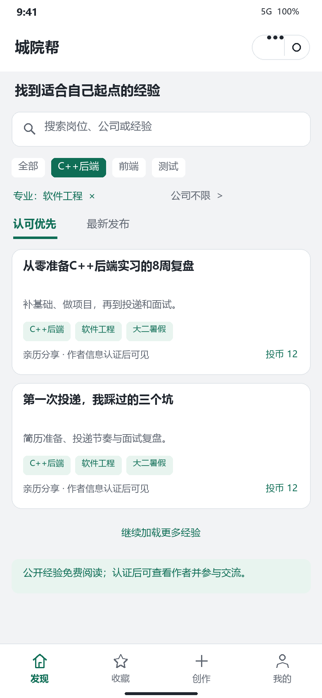

小程序发现页认可排序示例

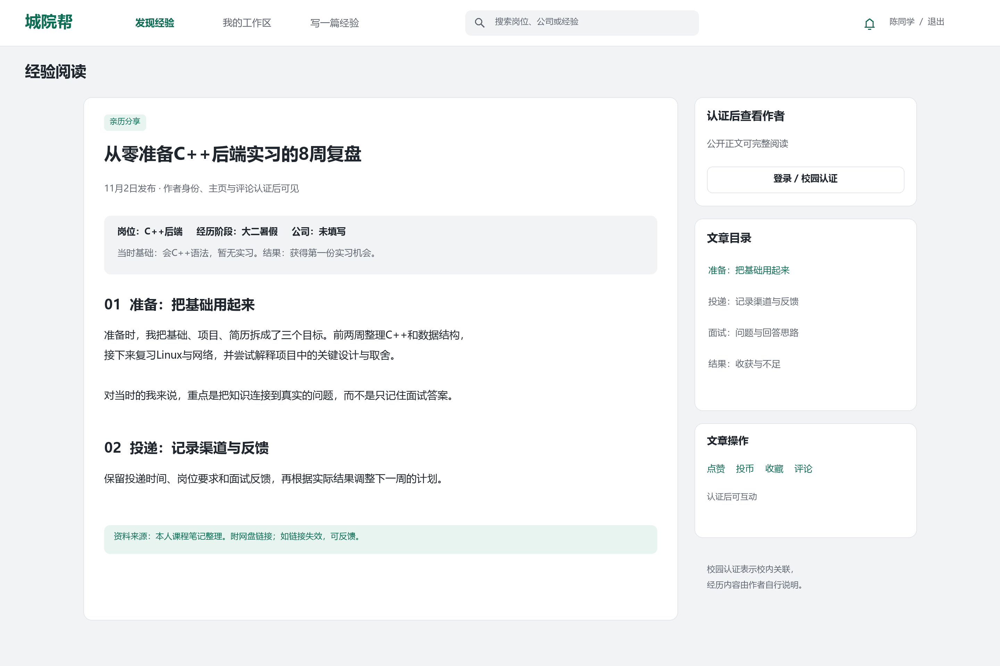

网页阅读功能原型

### 5.12 作者创作与草稿原型

小程序满足基础文字、图片、预览和草稿恢复；网页承担完整Markdown创作。必要信息在发布前确认，写作提示可跳过；上传失败和版本冲突保留可恢复内容。

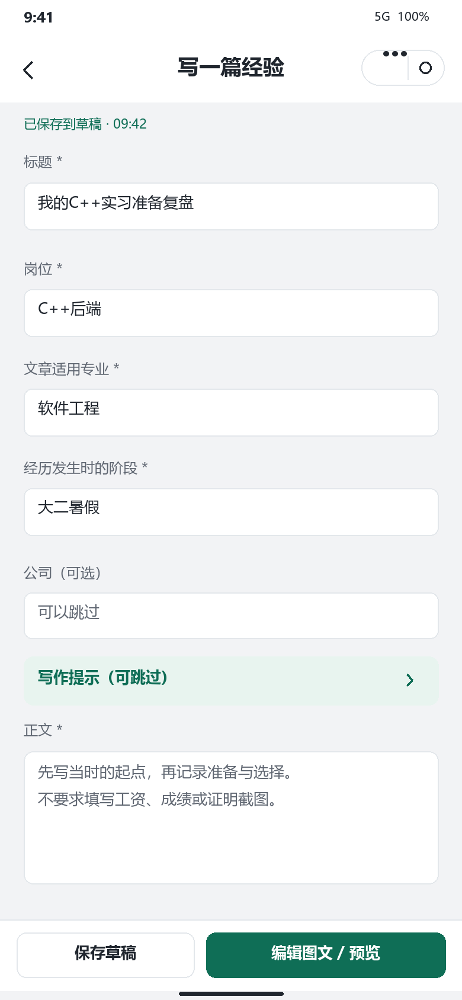

小程序基础创作功能原型

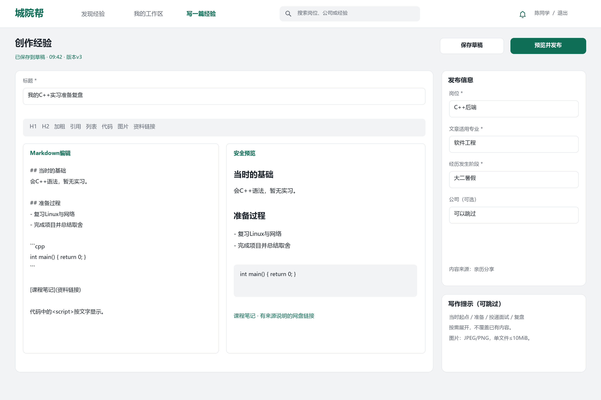

网页创作功能原型

### 5.13 原型覆盖及反馈入口

功能原型覆盖表、W01—W14线框和64张页面/状态属于已有材料；11月4日交互模型另定义45个页面ID与22个端到端场景，编号不自动一一对应。读者、作者、社区与运维均应按具体任务验证，记录实际操作版本、问题、修改与回访。

| 终端与角色 | 重点检查 | 记录要求 |
| --- | --- | --- |
| 读者小程序与网页 | 筛选含义、空结果、长文阅读、游客认证引导 | 用户是否独立完成、提示内容、原话、截图/笔记 |
| 作者小程序与网页 | 必要信息、写作提示、图片失败、预览与草稿 | 输入能否保留、是否理解保存位置、未支持编辑的提示 |
| 社区与运维 | 独立授权、案件定位、受控操作与结果真实性 | 目标任务、权限、异常、后续真实接口及演练证据 |

## 6 数据模型与ER图

账号在注册成功时创建，个人资料与认证分别为可选的一对一关系；钱包一对一建立。文章可有多个正文版本，版本与图片为多对多引用，认可收藏是账号与文章的多对多关系。本章采用 PowerDesigner 16.5 由 CDM 原生转换生成的 LDM 图。逻辑图显示字段、逻辑类型和对象之间的关联。概念层两条多对多关系在逻辑层通过 MediaRef 和 Reaction 展开。表6-1保留概念基数及参与约束，字段定义和结构式见第8章。

### ER01 数据模型 账号与认证

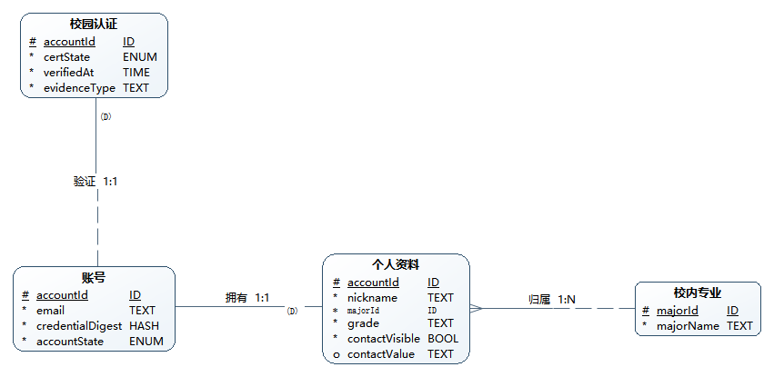

ER01 数据模型 账号与认证

实体框内列出字段和逻辑类型。原生连线表示实体间的关联，关系名旁标1:1或1:N。# 与下划线标记主标识，* 表示必填，○ 表示允许为空。概念层的多对多关系见 SRS 表6-1。

### ER02 数据模型 经验文章与正文

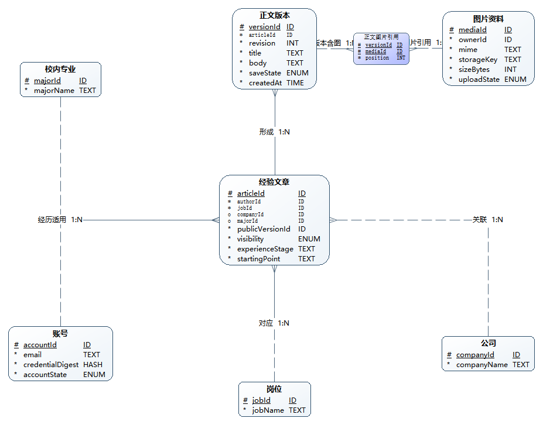

ER02 数据模型 经验文章与正文

### ER02A 文章归属与岗位公司 属性详图

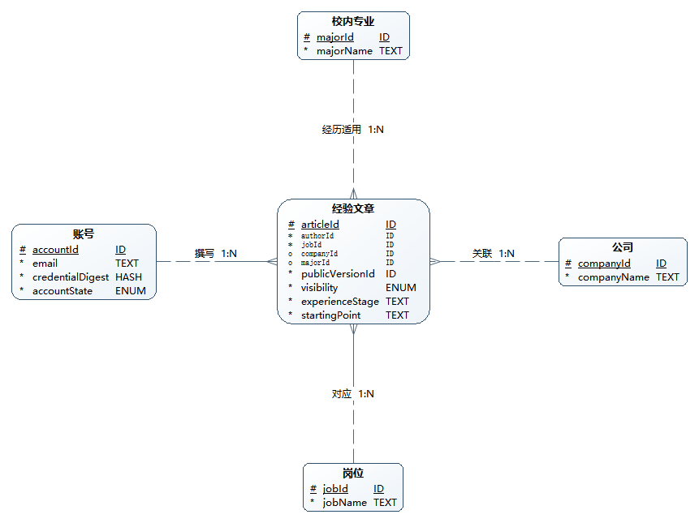

ER02A 文章归属与岗位公司 属性详图

### ER02B 正文版本与图片 属性详图

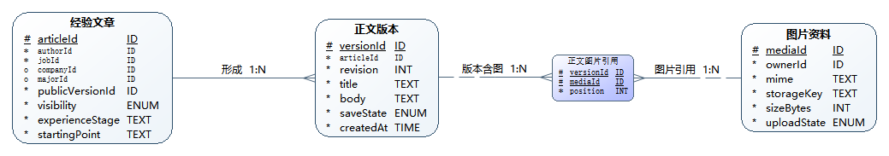

ER02B 正文版本与图片 属性详图

正文图片引用 MediaRef 承接正文版本与图片资料的多对多引用，position 表示在正文中的顺序。

### ER03 数据模型 交流与激励

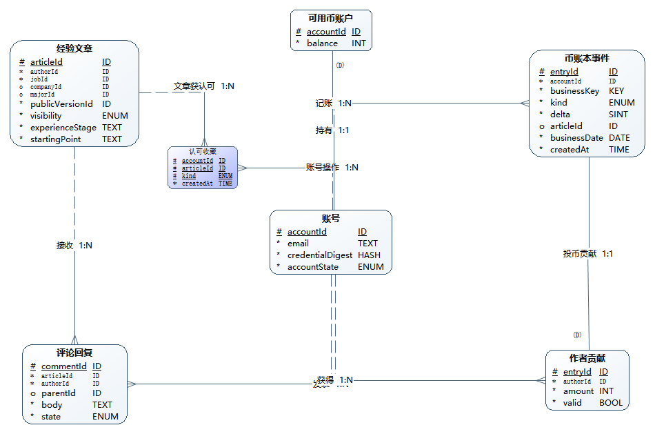

ER03 数据模型 交流与激励

### ER03A 评论与认可 属性详图

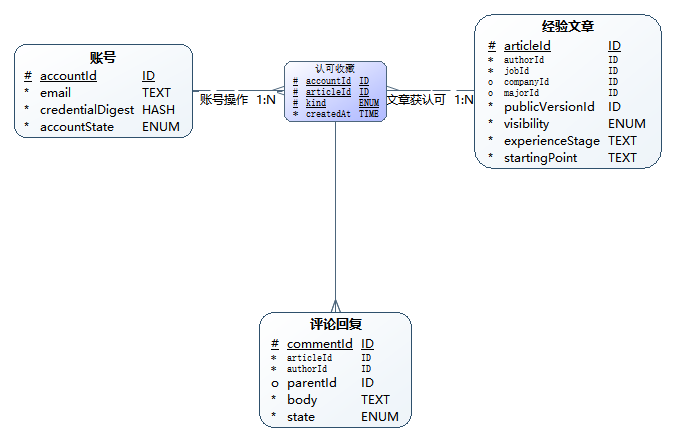

ER03A 评论与认可 属性详图

认可收藏 Reaction 承接账号与文章的多对多关系。accountId、articleId 与 kind 共同构成主标识。

### ER03B 币账本与贡献 属性详图

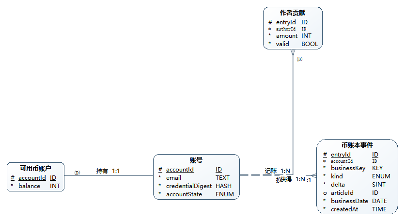

ER03B 币账本与贡献 属性详图

### ER04 数据模型 治理与运维

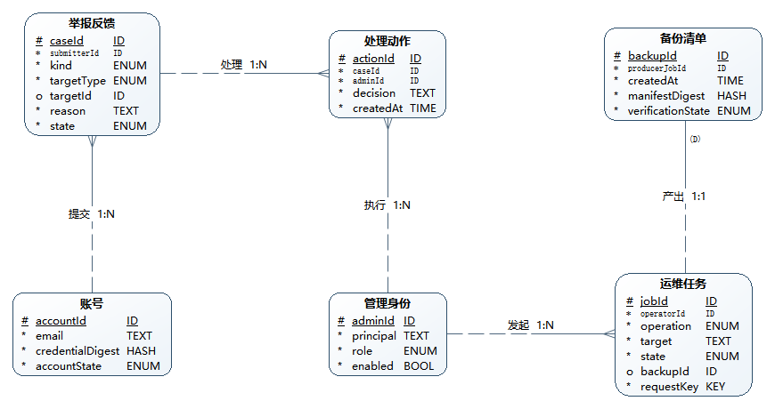

ER04 数据模型 治理与运维

### ER04A 案件与处理 属性详图

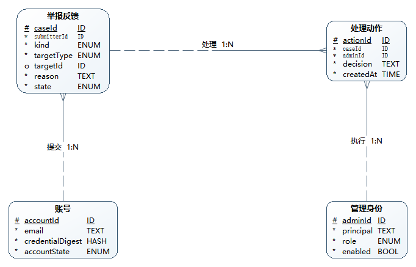

ER04A 案件与处理 属性详图

### ER04B 运维任务与备份 属性详图

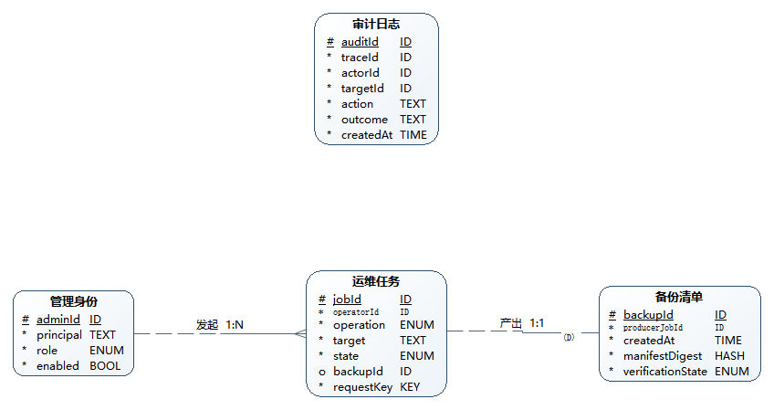

ER04B 运维任务与备份 属性详图

审计日志 AuditEvent 通过对象类型和标识定位业务对象，实体框单列。

### ER05 数据模型 作者荣誉

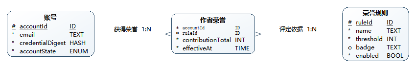

ER05 数据模型 作者荣誉

作者荣誉字段沿用 SRS，主标识由设计阶段明确。

### ER06 数据模型 会话与邮箱校验

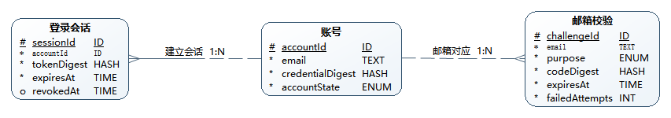

ER06 数据模型 会话与邮箱校验

### ER07 数据模型 通知与阅读进度

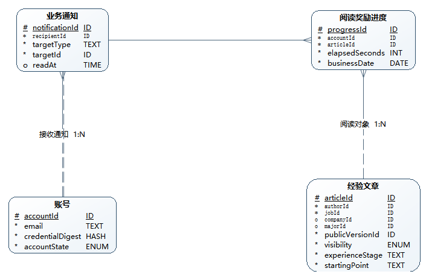

ER07 数据模型 通知与阅读进度

表6-1 实体联系类型与参与约束

| 联系 | 关系类型 | 参与及可选性约束 |
| --- | --- | --- |
| 账号 拥有 个人资料 | 1:1 | 每个个人资料必须关联且仅关联一个账号；账号允许没有关联的个人资料，关联时最多一个。 |
| 账号 验证 校园认证 | 1:1 | 每个校园认证必须关联且仅关联一个账号；账号允许没有关联的校园认证，关联时最多一个。 |
| 校内专业 归属 个人资料 | 1:N | 每个个人资料必须关联且仅关联一个校内专业；校内专业允许没有关联的个人资料，关联时可有多个。 |
| 账号 撰写 经验文章 | 1:N | 每个经验文章必须关联且仅关联一个账号；账号允许没有关联的经验文章，关联时可有多个。 |
| 经验文章 形成 正文版本 | 1:N | 每个正文版本必须关联且仅关联一个经验文章；每个经验文章必须关联至少一个正文版本。 |
| 岗位 对应 经验文章 | 1:N | 每个经验文章必须关联且仅关联一个岗位；岗位允许没有关联的经验文章，关联时可有多个。 |
| 公司 关联 经验文章 | 1:N | 经验文章允许没有关联的公司，关联时最多一个；公司允许没有关联的经验文章，关联时可有多个。 |
| 校内专业 经历适用 经验文章 | 1:N | 经验文章允许没有关联的校内专业，关联时最多一个；校内专业允许没有关联的经验文章，关联时可有多个。 |
| 正文版本 引用 图片资料 | M:N | 图片资料允许没有关联的正文版本，关联时可有多个；正文版本允许没有关联的图片资料，关联时可有多个。正文图片引用MediaRef承接版本与图片的关联及顺序。 |
| 经验文章 接收 评论回复 | 1:N | 每个评论回复必须关联且仅关联一个经验文章；经验文章允许没有关联的评论回复，关联时可有多个。 |
| 账号 发表 评论回复 | 1:N | 每个评论回复必须关联且仅关联一个账号；账号允许没有关联的评论回复，关联时可有多个。 |
| 账号 认可收藏 经验文章 | M:N | 经验文章允许没有关联的账号，关联时可有多个；账号允许没有关联的经验文章，关联时可有多个。认可与收藏分别记录，同账号同文章同类型只保留一条有效记录。 |
| 账号 持有 可用币账户 | 1:1 | 每个可用币账户必须关联且仅关联一个账号；每个账号必须关联且仅关联一个可用币账户。 |
| 账号 记账 币账本事件 | 1:N | 每个币账本事件必须关联且仅关联一个账号；账号允许没有关联的币账本事件，关联时可有多个。 |
| 币账本事件 投币贡献 作者贡献 | 1:1 | 每个作者贡献必须关联且仅关联一个币账本事件；币账本事件允许没有关联的作者贡献，关联时最多一个。仅投币事件形成作者贡献，登录或阅读奖励不形成该关联。 |
| 账号 获得 作者贡献 | 1:N | 每个作者贡献必须关联且仅关联一个账号；账号允许没有关联的作者贡献，关联时可有多个。 |
| 账号 提交 举报反馈 | 1:N | 每个举报反馈必须关联且仅关联一个账号；账号允许没有关联的举报反馈，关联时可有多个。 |
| 举报反馈 处理 处理动作 | 1:N | 每个处理动作必须关联且仅关联一个举报反馈；举报反馈允许没有关联的处理动作，关联时可有多个。 |
| 管理身份 执行 处理动作 | 1:N | 每个处理动作必须关联且仅关联一个管理身份；管理身份允许没有关联的处理动作，关联时可有多个。 |
| 管理身份 发起 运维任务 | 1:N | 每个运维任务必须关联且仅关联一个管理身份；管理身份允许没有关联的运维任务，关联时可有多个。 |
| 运维任务 产出 备份清单 | 1:1 | 每个备份清单必须关联且仅关联一个运维任务；运维任务允许没有关联的备份清单，关联时最多一个。只有成功生成备份的任务关联备份清单。 |
| 账号 获得荣誉 作者荣誉 | 1:N | 每个作者荣誉必须关联且仅关联一个账号；账号允许没有关联的作者荣誉，关联时可有多个。 |
| 荣誉规则 评定依据 作者荣誉 | 1:N | 每个作者荣誉必须关联且仅关联一个荣誉规则；荣誉规则允许没有关联的作者荣誉，关联时可有多个。 |
| 账号 建立会话 登录会话 | 1:N | 每个登录会话必须关联且仅关联一个账号；账号允许没有关联的登录会话，关联时可有多个。 |
| 账号 邮箱对应 邮箱校验 | 1:N | 邮箱校验允许没有关联的账号，关联时最多一个；账号允许没有关联的邮箱校验，关联时可有多个。注册前的邮箱校验允许尚无账号；账号建立后仍可有多次校验记录。 |
| 账号 接收通知 业务通知 | 1:N | 每个业务通知必须关联且仅关联一个账号；账号允许没有关联的业务通知，关联时可有多个。 |
| 账号 累计阅读 阅读奖励进度 | 1:N | 每个阅读奖励进度必须关联且仅关联一个账号；账号允许没有关联的阅读奖励进度，关联时可有多个。 |
| 经验文章 阅读对象 阅读奖励进度 | 1:N | 每个阅读奖励进度必须关联且仅关联一个经验文章；经验文章允许没有关联的阅读奖励进度，关联时可有多个。 |

正文图片引用MediaRef承接版本与图片的多对多关系；Reaction承接账号与文章的认可收藏关系。案件目标是文章、评论或平台反馈的互斥选择，不将所有可选外键同时必填。审计支持多个业务对象，通过对象类型与标识定位。

## 7 功能模型与数据流图

### DFD00 功能模型 系统上下文

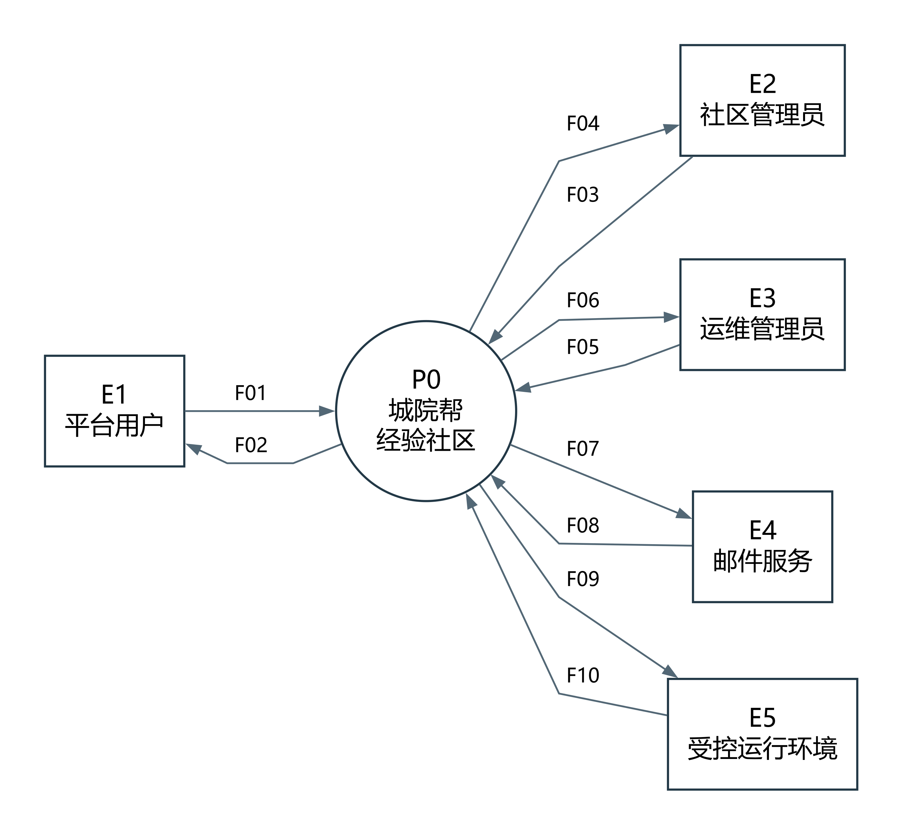

DFD00 功能模型 系统上下文

只表示信息边界与传递，不表示物理部署或操作时序。

### DFD01 一级数据流 身份与经验内容

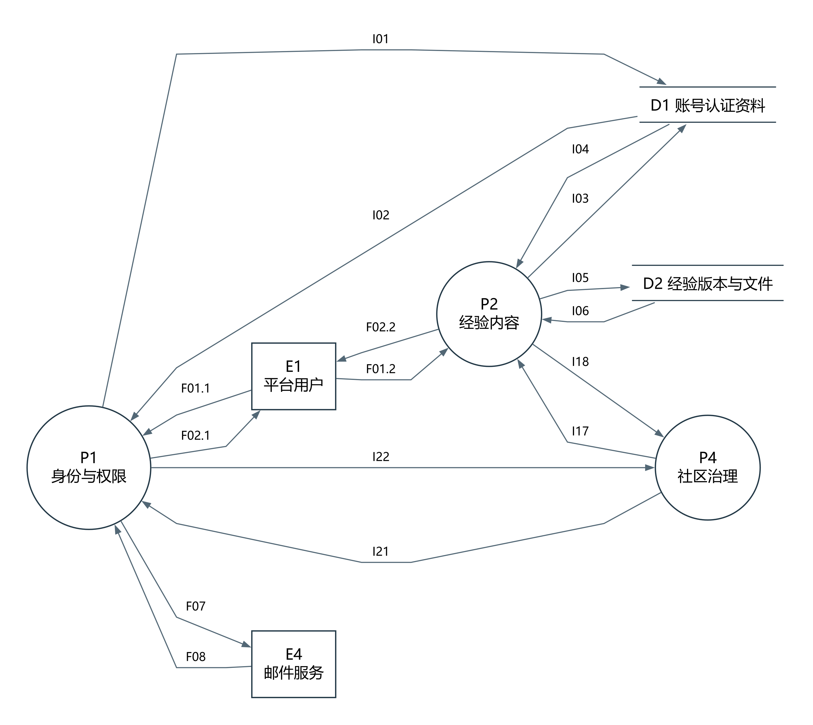

DFD01 一级数据流 身份与经验内容

存储用上下两条线；跨页重复编号是同一对象，P1至P5合起来构成一级模型。

### DFD02 一级数据流 交流激励与治理

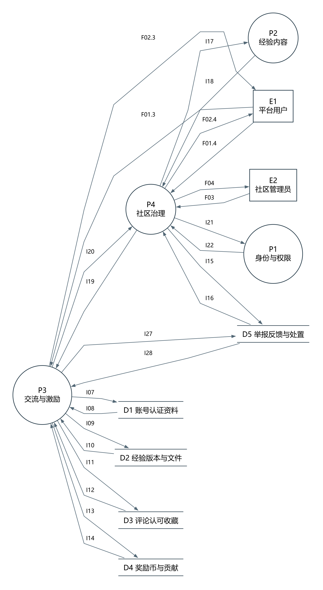

DFD02 一级数据流 交流激励与治理

存储用上下两条线；跨页重复编号是同一对象，P1至P5合起来构成一级模型。

### DFD03 一级数据流 独立运维

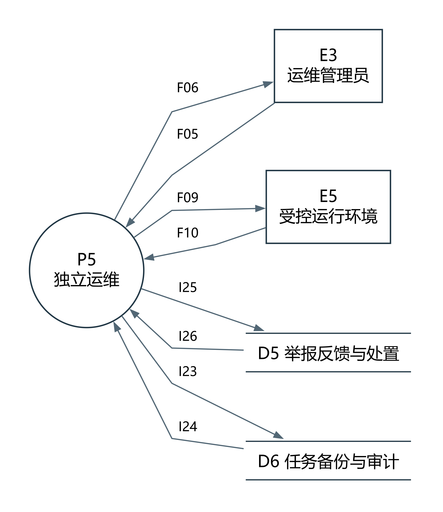

DFD03 一级数据流 独立运维

存储用上下两条线；跨页重复编号是同一对象，P1至P5合起来构成一级模型。

### DFD21 二级数据流 文章发布 P2

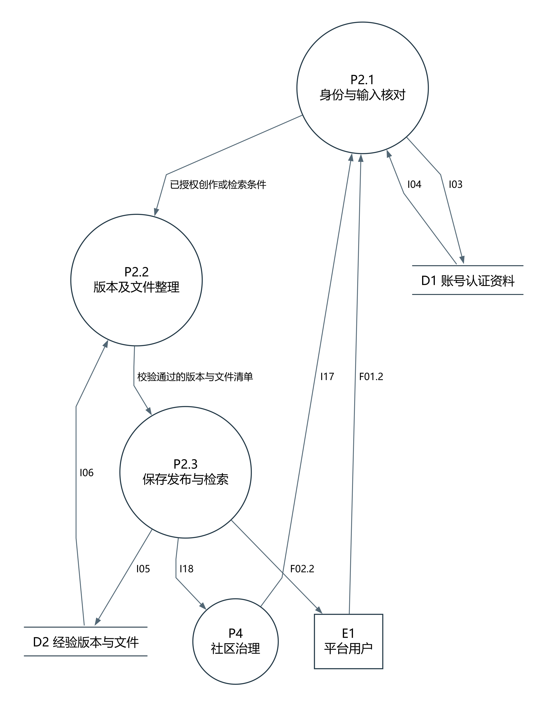

DFD21 二级数据流 文章发布 P2

继承父处理所有输入输出；内部处理链表示信息变换，不等同于界面点击流程。

### DFD31 二级数据流 交流与投币 P3

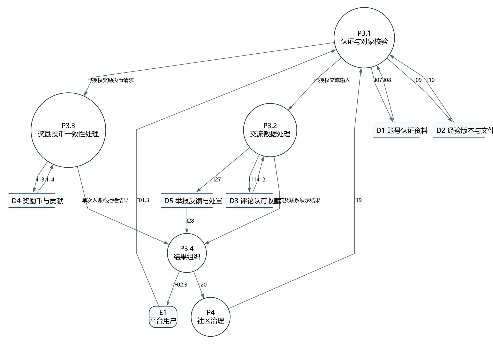

DFD31 二级数据流 交流与投币 P3

### DFD41 二级数据流 举报反馈 P4

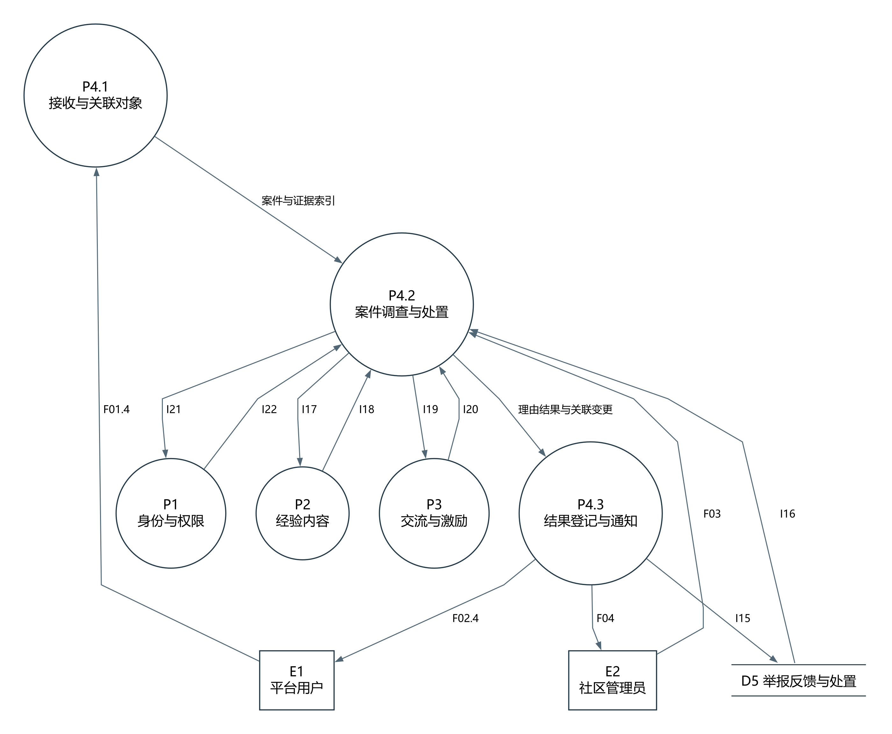

DFD41 二级数据流 举报反馈 P4

### DFD51 二级数据流 运维执行 P5

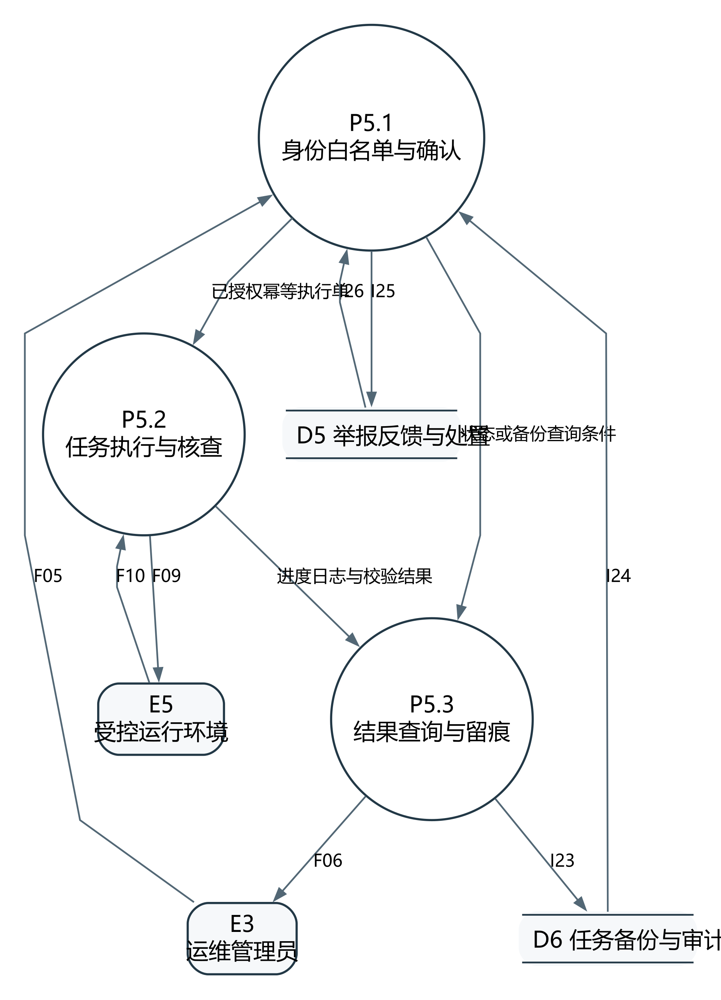

DFD51 二级数据流 运维执行 P5

继承父处理所有输入输出；内部处理链表示信息变换，不等同于界面点击流程。

### 7.4 上下层数据流平衡与逻辑存储

| 上层流 | 一级承接 | 数据含义 |
| --- | --- | --- |
| F01 | F01.1 + F01.2 + F01.3 + F01.4 | 用户认证、内容、互动和案件输入的集合 |
| F02 | F02.1 + F02.2 + F02.3 + F02.4 | 用户对应结果的集合 |
| F03、F04 | P4与E2保持同名同向 | 治理输入和结果 |
| F05、F06 | P5与E3保持同名同向 | 运维输入和结果 |
| F07、F08 | P1与E4保持同名同向 | 邮件和投递回执 |
| F09、F10 | P5与E5保持同名同向 | 受控执行与结果 |

二级图逐条继承父处理的全部外部流和存储流，替换的只有父处理端为对应子处理，另一端与方向不变。数据流平衡核查CSV列出全部映射；静态核查对编号集合和方向做精确比较，不仅比较箭头数量。

| 存储 | 组成及访问 |
| --- | --- |
| D1 账号认证资料 | 账号、个人资料、校园认证、邮箱校验、校内专业、登录会话 |
| D2 经验版本与文件 | 经验文章、正文版本、图片资料、正文图片引用、岗位、公司 |
| D3 评论认可收藏 | 评论回复、认可收藏 |
| D4 奖励币与贡献 | 可用币账户、币账本事件、作者贡献、荣誉规则、作者荣誉、阅读奖励进度 |
| D5 举报反馈与处置 | 举报反馈、处理动作、管理身份、业务通知 |
| D6 任务备份与审计 | 运维任务、备份清单、审计日志 |

## 8 数据字典

本章统一数据元素、结构、数据流、数据存储和加工的定义。ER属性、DFD数据流和状态图中的同名对象使用相同含义；正则表达式定义词法，跨字段、唯一性、权限及事务规则另做语义校验。

### 8.1 数据组成记号与结构定义

“+”表示按序组成，“[a|b]”表示择一，“{x}”表示零到多次重复，“1{x}”表示至少一次，“(x)”表示可选，“=”表示定义。此处的结构定义与正则分开，避免将关系和重复记录塞进单个正则。

| 类别与名称 | 定义或规则 |
| --- | --- |
| 结构 / ArticleInput | title + jobId + (companyId) + (majorId) + experienceStage + startingPoint + 1{ContentBlock} + expectedRevision |
| 结构 / ContentBlock | [TextBlock\|ImageRef\|SourceLink] |
| 结构 / TextBlock | text |
| 结构 / ImageRef | mediaId + position + (caption) |
| 结构 / SourceLink | url + description |
| 结构 / AuthInput | email + password + challengeId + code |
| 结构 / InteractionInput | articleId + [CommentInput\|ReactionInput\|CoinInput\|RewardInput\|ContactQuery] |
| 结构 / CoinInput | amount + requestKey；amount∈{1,2}，累计而非单次额度≤2 |
| 结构 / CaseInput | kind + targetType + (targetId) + reason + {EvidenceImage} |
| 结构 / OpsInput | operation + target + requestKey + (backupId) + confirmation |
| 结构 / BusinessResult | status + code + message + traceId + (data) |

草稿输入可逐步补全；组合结构中的可选项不免除发布校验。发布前必须按BR06与FR-C01确认岗位、专业和经历阶段等必需信息。

### 8.2 数据元素与实体字段字典

以下为27个分析实体的134个字段。逻辑类型、范围、可空条件和取值依据与数据元素字典CSV一致；逻辑标识不预设物理数据库列宽。

#### Account 账号 D1

| 字段与含义 | 逻辑类型与范围 | 可空条件 | 业务约束与依据 |
| --- | --- | --- | --- |
| accountId 唯一标识 | 逻辑标识 符合标识类型定义；引用必须指向相应实体 | 否 | 不可变主标识 |
| email 校园邮箱 | Unicode文本 非空字符序列；不在分析模型中指定物理列宽 | 否 | 唯一且私有 |
| credentialDigest 凭证摘要 | 不可逆摘要 非空摘要值；不保存明文秘密；算法与编码由设计定义 | 否 | 不得保存明文密码 |
| accountState 状态 | 枚举 ACTIVE或DISABLED | 否 | ACTIVE或DISABLED |

#### Profile 个人资料 D1

| 字段与含义 | 逻辑类型与范围 | 可空条件 | 业务约束与依据 |
| --- | --- | --- | --- |
| accountId 账号标识 | 逻辑标识 符合标识类型定义；引用必须指向相应实体 | 否 | 主标识且关联账号 |
| nickname 昵称 | Unicode文本 非空字符序列；不在分析模型中指定物理列宽 | 否 | 公开名 |
| majorId 专业标识 | 逻辑标识 符合标识类型定义；引用必须指向相应实体 | 否 | 关联校内专业 |
| grade 年级 | Unicode文本 非空字符序列；不在分析模型中指定物理列宽 | 否 | 当前年级 |
| contactVisible 联系开关 | 布尔值 true或false | 否 | 默认不公开 |
| contactValue 联系方式 | Unicode文本 非空字符序列；不在分析模型中指定物理列宽 | 允许；按字段语义及当前对象状态校验 | 仅经认证且作者允许时返回 |

#### Certification 校园认证 D1

| 字段与含义 | 逻辑类型与范围 | 可空条件 | 业务约束与依据 |
| --- | --- | --- | --- |
| accountId 账号标识 | 逻辑标识 符合标识类型定义；引用必须指向相应实体 | 否 | 主标识且关联账号 |
| certState 认证状态 | 枚举 UNVERIFIED或VERIFIED或REVOKED | 否 | UNVERIFIED或VERIFIED或REVOKED |
| verifiedAt 验证时间 | 时间点 有效时间；显示按Asia/Shanghai | 否 | 成功后记录 |
| evidenceType 依据类型 | Unicode文本 非空字符序列；不在分析模型中指定物理列宽 | 否 | 本期EMAIL |

#### EmailChallenge 邮箱校验 D1

| 字段与含义 | 逻辑类型与范围 | 可空条件 | 业务约束与依据 |
| --- | --- | --- | --- |
| challengeId 校验标识 | 逻辑标识 符合标识类型定义；引用必须指向相应实体 | 否 | 主标识 |
| email 校园邮箱 | Unicode文本 非空字符序列；不在分析模型中指定物理列宽 | 否 | 私有 |
| purpose 用途 | 枚举 REGISTER或PASSWORD_RESET | 否 | REGISTER或PASSWORD_RESET |
| codeDigest 验证码摘要 | 不可逆摘要 非空摘要值；不保存明文秘密；算法与编码由设计定义 | 否 | 不存明文 |
| expiresAt 截止时间 | 时间点 有效时间；显示按Asia/Shanghai | 否 | 早于当前时间即失效 |
| failedAttempts 错误次数 | 整数 ≥0 | 否 | 非负整数 |

#### Major 校内专业 D1

| 字段与含义 | 逻辑类型与范围 | 可空条件 | 业务约束与依据 |
| --- | --- | --- | --- |
| majorId 专业标识 | 逻辑标识 符合标识类型定义；引用必须指向相应实体 | 否 | 主标识 |
| majorName 专业名 | Unicode文本 非空字符序列；不在分析模型中指定物理列宽 | 否 | 标准名称 |

#### Article 经验文章 D2

| 字段与含义 | 逻辑类型与范围 | 可空条件 | 业务约束与依据 |
| --- | --- | --- | --- |
| articleId 文章标识 | 逻辑标识 符合标识类型定义；引用必须指向相应实体 | 否 | 主标识 |
| authorId 作者标识 | 逻辑标识 符合标识类型定义；引用必须指向相应实体 | 否 | 关联账号 |
| jobId 岗位标识 | 逻辑标识 符合标识类型定义；引用必须指向相应实体 | 否 | 主要浏览入口 |
| companyId 公司标识 | 逻辑标识 符合标识类型定义；引用必须指向相应实体 | 允许；按字段语义及当前对象状态校验 | 可空筛选 |
| majorId 经历专业标识 | 逻辑标识 符合标识类型定义；引用必须指向相应实体 | 允许；按字段语义及当前对象状态校验 | 支持同专业筛选 |
| publicVersionId 公开版本 | 逻辑标识 符合标识类型定义；引用必须指向相应实体 | 否 | 发布后指向有效版本 |
| visibility 可见状态 | 枚举 DRAFT或PUBLIC或WITHDRAWN或HIDDEN | 否 | DRAFT或PUBLIC或WITHDRAWN或HIDDEN |
| experienceStage 经历阶段 | Unicode文本 非空字符序列；不在分析模型中指定物理列宽 | 否 | 经历发生时的年级 |
| startingPoint 当时基础 | Unicode文本 非空字符序列；不在分析模型中指定物理列宽 | 否 | 与当前个人资料区分 |

#### ArticleVersion 正文版本 D2

| 字段与含义 | 逻辑类型与范围 | 可空条件 | 业务约束与依据 |
| --- | --- | --- | --- |
| versionId 版本标识 | 逻辑标识 符合标识类型定义；引用必须指向相应实体 | 否 | 主标识 |
| articleId 文章标识 | 逻辑标识 符合标识类型定义；引用必须指向相应实体 | 否 | 关联文章 |
| revision 修订号 | 整数 ≥0 | 否 | 同文唯一且单调递增 |
| title 标题 | Unicode文本 非空字符序列；不在分析模型中指定物理列宽 | 否 | 非空 |
| body 正文块 | Unicode文本 非空字符序列；不在分析模型中指定物理列宽 | 否 | 文字图片和来源的有序组合 |
| saveState 保存状态 | 枚举 DRAFT或PUBLISHED | 否 | DRAFT或PUBLISHED |
| createdAt 形成时间 | 时间点 有效时间；显示按Asia/Shanghai | 否 | 保存时间 |

#### Media 图片资料 D2

| 字段与含义 | 逻辑类型与范围 | 可空条件 | 业务约束与依据 |
| --- | --- | --- | --- |
| mediaId 文件标识 | 逻辑标识 符合标识类型定义；引用必须指向相应实体 | 否 | 主标识 |
| ownerId 所有者 | 逻辑标识 符合标识类型定义；引用必须指向相应实体 | 否 | 关联账号 |
| mime 文件类型 | Unicode文本 非空字符序列；不在分析模型中指定物理列宽 | 否 | 以实际内容校验 |
| storageKey 存储键 | Unicode文本 非空字符序列；不在分析模型中指定物理列宽 | 否 | 服务端生成 |
| sizeBytes 大小字节 | 整数 ≥0 | 否 | 正整数 |
| uploadState 状态 | 枚举 UPLOADING或READY或FAILED | 否 | UPLOADING或READY或FAILED |

#### MediaRef 正文图片引用 D2

| 字段与含义 | 逻辑类型与范围 | 可空条件 | 业务约束与依据 |
| --- | --- | --- | --- |
| versionId 版本标识 | 逻辑标识 符合标识类型定义；引用必须指向相应实体 | 否 | 复合主标识之一 |
| mediaId 文件标识 | 逻辑标识 符合标识类型定义；引用必须指向相应实体 | 否 | 复合主标识之一 |
| position 顺序 | 整数 ≥0 | 否 | 非负整数 |

#### Job 岗位 D2

| 字段与含义 | 逻辑类型与范围 | 可空条件 | 业务约束与依据 |
| --- | --- | --- | --- |
| jobId 岗位标识 | 逻辑标识 符合标识类型定义；引用必须指向相应实体 | 否 | 主标识 |
| jobName 岗位名称 | Unicode文本 非空字符序列；不在分析模型中指定物理列宽 | 否 | 规范名 |

#### Company 公司 D2

| 字段与含义 | 逻辑类型与范围 | 可空条件 | 业务约束与依据 |
| --- | --- | --- | --- |
| companyId 公司标识 | 逻辑标识 符合标识类型定义；引用必须指向相应实体 | 否 | 主标识 |
| companyName 公司名 | Unicode文本 非空字符序列；不在分析模型中指定物理列宽 | 否 | 用于筛选，不代表平台背书 |

#### Comment 评论回复 D3

| 字段与含义 | 逻辑类型与范围 | 可空条件 | 业务约束与依据 |
| --- | --- | --- | --- |
| commentId 评论标识 | 逻辑标识 符合标识类型定义；引用必须指向相应实体 | 否 | 主标识 |
| articleId 文章标识 | 逻辑标识 符合标识类型定义；引用必须指向相应实体 | 否 | 关联文章 |
| authorId 评论者 | 逻辑标识 符合标识类型定义；引用必须指向相应实体 | 否 | 关联账号 |
| parentId 上级评论 | 逻辑标识 符合标识类型定义；引用必须指向相应实体 | 允许；按字段语义及当前对象状态校验 | 可空且属于同文 |
| body 内容 | Unicode文本 非空字符序列；不在分析模型中指定物理列宽 | 否 | 文字及图片引用 |
| state 状态 | 枚举 VISIBLE或DELETED或HIDDEN | 否 | VISIBLE或DELETED或HIDDEN |

#### Reaction 认可收藏 D3

| 字段与含义 | 逻辑类型与范围 | 可空条件 | 业务约束与依据 |
| --- | --- | --- | --- |
| accountId 账号标识 | 逻辑标识 符合标识类型定义；引用必须指向相应实体 | 否 | 复合主标识之一 |
| articleId 文章标识 | 逻辑标识 符合标识类型定义；引用必须指向相应实体 | 否 | 复合主标识之一 |
| kind 类型 | 枚举 LIKE或FAVORITE，复合主标识之一 | 否 | LIKE或FAVORITE，复合主标识之一 |
| createdAt 时间 | 时间点 有效时间；显示按Asia/Shanghai | 否 | 重复提交不得新增第二行 |

#### Wallet 可用币账户 D4

| 字段与含义 | 逻辑类型与范围 | 可空条件 | 业务约束与依据 |
| --- | --- | --- | --- |
| accountId 账号标识 | 逻辑标识 符合标识类型定义；引用必须指向相应实体 | 否 | 主标识 |
| balance 余额 | 整数 ≥0 | 否 | 非负整数；与账本一致 |

#### CoinEntry 币账本事件 D4

| 字段与含义 | 逻辑类型与范围 | 可空条件 | 业务约束与依据 |
| --- | --- | --- | --- |
| entryId 事件标识 | 逻辑标识 符合标识类型定义；引用必须指向相应实体 | 否 | 主标识 |
| accountId 账号标识 | 逻辑标识 符合标识类型定义；引用必须指向相应实体 | 否 | 发生者 |
| businessKey 幂等键 | 幂等键 8—64个字母、数字、下划线或连字符 | 否 | 同一业务作用唯一 |
| kind 类型 | 枚举 LOGIN_REWARD或READ_REWARD或DONATION | 否 | LOGIN_REWARD或READ_REWARD或DONATION |
| delta 币变动 | 有符号整数 奖励为正，投币为负；按业务及账本一致性校验 | 否 | 奖励为正投币为负 |
| articleId 文章标识 | 逻辑标识 符合标识类型定义；引用必须指向相应实体 | 条件允许；投币时必填 | 投币时必填 |
| businessDate 业务日 | 业务日期 有效公历日YYYY-MM-DD；正则后仍校验日期语义 | 否 | Asia/Shanghai自然日 |
| createdAt 时间 | 时间点 有效时间；显示按Asia/Shanghai | 否 | 入账时间 |

#### Contribution 作者贡献 D4

| 字段与含义 | 逻辑类型与范围 | 可空条件 | 业务约束与依据 |
| --- | --- | --- | --- |
| entryId 投币事件 | 逻辑标识 符合标识类型定义；引用必须指向相应实体 | 否 | 主标识且关联币账本 |
| authorId 受益作者 | 逻辑标识 符合标识类型定义；引用必须指向相应实体 | 否 | 关联账号 |
| amount 贡献币数 | 整数 单次1或2；每用户每文章累计≤2 | 否 | 等于对应扣币绝对值 |
| valid 有效性 | 布尔值 true或false | 否 | 治理撤销必须留痕 |

#### Case 举报反馈 D5

| 字段与含义 | 逻辑类型与范围 | 可空条件 | 业务约束与依据 |
| --- | --- | --- | --- |
| caseId 案件标识 | 逻辑标识 符合标识类型定义；引用必须指向相应实体 | 否 | 主标识 |
| submitterId 提交者 | 逻辑标识 符合标识类型定义；引用必须指向相应实体 | 否 | 关联账号 |
| kind 类别 | 枚举 REPORT或FEEDBACK | 否 | REPORT或FEEDBACK |
| targetType 目标类型 | 枚举 ARTICLE或COMMENT或PLATFORM | 否 | ARTICLE或COMMENT或PLATFORM |
| targetId 目标标识 | 逻辑标识 符合标识类型定义；引用必须指向相应实体 | 条件允许；PLATFORM反馈可空，其余有明确目标 | 平台反馈可空 |
| reason 理由 | Unicode文本 非空字符序列；不在分析模型中指定物理列宽 | 否 | 文字及证据图片 |
| state 处理状态 | 枚举 OPEN或PROCESSING或NEEDS_ACTION或CLOSED | 否 | OPEN或PROCESSING或NEEDS_ACTION或CLOSED |

#### ModerationAction 处理动作 D5

| 字段与含义 | 逻辑类型与范围 | 可空条件 | 业务约束与依据 |
| --- | --- | --- | --- |
| actionId 动作标识 | 逻辑标识 符合标识类型定义；引用必须指向相应实体 | 否 | 主标识 |
| caseId 案件标识 | 逻辑标识 符合标识类型定义；引用必须指向相应实体 | 否 | 关联案件 |
| adminId 管理员 | 逻辑标识 符合标识类型定义；引用必须指向相应实体 | 否 | 关联管理身份 |
| decision 处置 | Unicode文本 非空字符序列；不在分析模型中指定物理列宽 | 否 | 理由与结果 |
| createdAt 时间 | 时间点 有效时间；显示按Asia/Shanghai | 否 | 不可由作者删除 |

#### AdminIdentity 管理身份 D5

| 字段与含义 | 逻辑类型与范围 | 可空条件 | 业务约束与依据 |
| --- | --- | --- | --- |
| adminId 管理标识 | 逻辑标识 符合标识类型定义；引用必须指向相应实体 | 否 | 主标识 |
| principal 登录名 | Unicode文本 非空字符序列；不在分析模型中指定物理列宽 | 否 | 非普通用户自动升级 |
| role 管理范围 | 枚举 COMMUNITY或OPS | 否 | COMMUNITY或OPS |
| enabled 是否可用 | 布尔值 true或false | 否 | 停用后受限请求拒绝 |

#### OpsJob 运维任务 D6

| 字段与含义 | 逻辑类型与范围 | 可空条件 | 业务约束与依据 |
| --- | --- | --- | --- |
| jobId 任务标识 | 逻辑标识 符合标识类型定义；引用必须指向相应实体 | 否 | 主标识 |
| operatorId 运维身份 | 逻辑标识 符合标识类型定义；引用必须指向相应实体 | 否 | 关联管理身份 |
| operation 操作 | 枚举 DEPLOY或RESTART或BACKUP或RESTORE | 否 | DEPLOY或RESTART或BACKUP或RESTORE |
| target 目标 | Unicode文本 非空字符序列；不在分析模型中指定物理列宽 | 否 | 受控白名单 |
| state 状态 | 枚举 QUEUED或RUNNING或VERIFYING或SUCCEEDED或FAILED或RECONCILE | 否 | QUEUED或RUNNING或VERIFYING或SUCCEEDED或FAILED或RECONCILE |
| backupId 备份标识 | 逻辑标识 符合标识类型定义；引用必须指向相应实体 | 条件允许；恢复任务必填 | 恢复时必填 |
| requestKey 幂等键 | 幂等键 8—64个字母、数字、下划线或连字符 | 否 | 重复提交不重复执行 |

#### Backup 备份清单 D6

| 字段与含义 | 逻辑类型与范围 | 可空条件 | 业务约束与依据 |
| --- | --- | --- | --- |
| backupId 备份标识 | 逻辑标识 符合标识类型定义；引用必须指向相应实体 | 否 | 主标识 |
| producerJobId 产生任务 | 逻辑标识 符合标识类型定义；引用必须指向相应实体 | 否 | 关联成功备份任务 |
| createdAt 备份时点 | 时间点 有效时间；显示按Asia/Shanghai | 否 | 需展示恢复覆盖时点 |
| manifestDigest 清单摘要 | 不可逆摘要 非空摘要值；不保存明文秘密；算法与编码由设计定义 | 否 | 数据库和图片目录一致性 |
| verificationState 校验状态 | 枚举 VALID或INVALID | 否 | VALID或INVALID |

#### AuditEvent 审计日志 D6

| 字段与含义 | 逻辑类型与范围 | 可空条件 | 业务约束与依据 |
| --- | --- | --- | --- |
| auditId 审计标识 | 逻辑标识 符合标识类型定义；引用必须指向相应实体 | 否 | 主标识 |
| traceId 追踪标识 | 逻辑标识 符合标识类型定义；引用必须指向相应实体 | 否 | 关联调用链 |
| actorId 操作者 | 逻辑标识 符合标识类型定义；引用必须指向相应实体 | 否 | 可脱敏 |
| targetId 对象 | 逻辑标识 符合标识类型定义；引用必须指向相应实体 | 否 | 关联文章案件或任务 |
| action 动作 | Unicode文本 非空字符序列；不在分析模型中指定物理列宽 | 否 | 权限拒绝及关键写入留痕 |
| outcome 结果 | Unicode文本 非空字符序列；不在分析模型中指定物理列宽 | 否 | 成功失败及错误码 |
| createdAt 时间 | 时间点 有效时间；显示按Asia/Shanghai | 否 | 便于定位，不含密码验证码令牌 |

#### HonorRule 荣誉规则 D4

| 字段与含义 | 逻辑类型与范围 | 可空条件 | 业务约束与依据 |
| --- | --- | --- | --- |
| ruleId 规则标识 | 逻辑标识 符合标识类型定义；引用必须指向相应实体 | 否 | 主标识 |
| name 称号 | Unicode文本 非空字符序列；不在分析模型中指定物理列宽 | 否 | 最高已确认城院之星 |
| threshold 有效贡献门槛 | 整数 >0；按已启用规则评定 | 否 | 完整表须经确认后启用 |
| badge 图案引用 | Unicode文本 非空字符序列；不在分析模型中指定物理列宽 | 允许；按字段语义及当前对象状态校验 | 按已确认规则配置 |
| enabled 是否启用 | 布尔值 true或false | 否 | 未确认规则不启用 |

#### HonorAward 作者荣誉 D4

| 字段与含义 | 逻辑类型与范围 | 可空条件 | 业务约束与依据 |
| --- | --- | --- | --- |
| accountId 账号标识 | 逻辑标识 符合标识类型定义；引用必须指向相应实体 | 否 | 关联账号 |
| ruleId 规则标识 | 逻辑标识 符合标识类型定义；引用必须指向相应实体 | 否 | 关联已启用规则 |
| contributionTotal 有效贡献 | 整数 ≥0 | 否 | 依据Contribution汇总，不以可花余额代替 |
| effectiveAt 生效时间 | 时间点 有效时间；显示按Asia/Shanghai | 否 | 规则版本与评定时间留存 |

#### Session 登录会话 D1

| 字段与含义 | 逻辑类型与范围 | 可空条件 | 业务约束与依据 |
| --- | --- | --- | --- |
| sessionId 会话标识 | 逻辑标识 符合标识类型定义；引用必须指向相应实体 | 否 | 主标识 |
| accountId 账号标识 | 逻辑标识 符合标识类型定义；引用必须指向相应实体 | 否 | 关联账号 |
| tokenDigest 令牌摘要 | 不可逆摘要 非空摘要值；不保存明文秘密；算法与编码由设计定义 | 否 | 不存公开令牌 |
| expiresAt 截止时间 | 时间点 有效时间；显示按Asia/Shanghai | 否 | 过期不可访问 |
| revokedAt 撤销时间 | 时间点 有效时间；显示按Asia/Shanghai | 允许；按字段语义及当前对象状态校验 | 可空，退出后记录 |

#### Notification 业务通知 D5

| 字段与含义 | 逻辑类型与范围 | 可空条件 | 业务约束与依据 |
| --- | --- | --- | --- |
| notificationId 通知标识 | 逻辑标识 符合标识类型定义；引用必须指向相应实体 | 否 | 主标识 |
| recipientId 接收账号 | 逻辑标识 符合标识类型定义；引用必须指向相应实体 | 否 | 仅本人读取 |
| targetType 关联类型 | Unicode文本 非空字符序列；不在分析模型中指定物理列宽 | 否 | 文章评论案件或身份事件 |
| targetId 关联标识 | 逻辑标识 符合标识类型定义；引用必须指向相应实体 | 否 | 跳转时仍校验权限 |
| readAt 已读时间 | 时间点 有效时间；显示按Asia/Shanghai | 允许；按字段语义及当前对象状态校验 | 可空 |

#### ReadProgress 阅读奖励进度 D4

| 字段与含义 | 逻辑类型与范围 | 可空条件 | 业务约束与依据 |
| --- | --- | --- | --- |
| progressId 进度标识 | 逻辑标识 符合标识类型定义；引用必须指向相应实体 | 否 | 主标识 |
| accountId 账号标识 | 逻辑标识 符合标识类型定义；引用必须指向相应实体 | 否 | 关联认证账号 |
| articleId 文章标识 | 逻辑标识 符合标识类型定义；引用必须指向相应实体 | 否 | 关联阅读文章 |
| elapsedSeconds 累计秒数 | 整数 ≥0 | 否 | 达到180秒可申请奖励 |
| businessDate 业务日期 | 业务日期 有效公历日YYYY-MM-DD；正则后仍校验日期语义 | 否 | 每日只领一次，领取以账本业务键去重 |

### 8.3 数据流字典

| 编号 | 来源与去向 | 名称 | 组成或语义 |
| --- | --- | --- | --- |
| F01 | E1 → P0 | 用户业务请求 | 认证输入+检索条件+创作输入+互动输入+举报反馈 |
| F02 | P0 → E1 | 用户业务结果 | 认证结果+公开文章+受限资料+互动结果+案件回执 |
| F03 | E2 → P0 | 治理请求 | 案件筛选+处置理由+目标 |
| F04 | P0 → E2 | 治理结果 | 案件详情+关联文章评论+处置结果 |
| F05 | E3 → P0 | 运维请求 | 受控操作+目标+二次确认+幂等键 |
| F06 | P0 → E3 | 运维结果 | 状态+脱敏日志+备份清单+执行结果 |
| F07 | P0 → E4 | 验证码邮件 | 投递地址+模板+验证码 |
| F08 | E4 → P0 | 邮件回执 | 请求标识+投递结果 |
| F09 | P0 → E5 | 受控执行请求 | 任务标识+白名单操作+目标+备份清单 |
| F10 | E5 → P0 | 运行结果 | 任务状态+执行日志+校验结果 |
| F01.1 | E1 → P1 | 账号认证输入 | 上层集合 F01 |
| F02.1 | P1 → E1 | 认证及资料结果 | 上层集合 F02 |
| F01.2 | E1 → P2 | 检索及创作输入 | 上层集合 F01 |
| F02.2 | P2 → E1 | 公开文章及创作结果 | 上层集合 F02 |
| F01.3 | E1 → P3 | 评论认可奖励投币输入 | 上层集合 F01 |
| F02.3 | P3 → E1 | 受限交流及账本结果 | 上层集合 F02 |
| F01.4 | E1 → P4 | 举报反馈输入 | 上层集合 F01 |
| F02.4 | P4 → E1 | 案件回执 | 上层集合 F02 |
| I01 | P1 → D1 | 身份资料写入 | 见实体与数据结构字典 |
| I02 | D1 → P1 | 身份与验证记录 | 见实体与数据结构字典 |
| I03 | P2 → D1 | 作者与权限查询 | 见实体与数据结构字典 |
| I04 | D1 → P2 | 作者与权限快照 | 见实体与数据结构字典 |
| I05 | P2 → D2 | 草稿版本图片引用写入 | 见实体与数据结构字典 |
| I06 | D2 → P2 | 文章版本与分类 | 见实体与数据结构字典 |
| I07 | P3 → D1 | 认证与联系权限查询 | 见实体与数据结构字典 |
| I08 | D1 → P3 | 认证资料与联系开关 | 见实体与数据结构字典 |
| I09 | P3 → D2 | 文章资格与作者查询 | 见实体与数据结构字典 |
| I10 | D2 → P3 | 可见文章与作者 | 见实体与数据结构字典 |
| I11 | P3 → D3 | 评论认可收藏写入 | 见实体与数据结构字典 |
| I12 | D3 → P3 | 评论认可收藏记录 | 见实体与数据结构字典 |
| I13 | P3 → D4 | 奖励投币原子入账 | 见实体与数据结构字典 |
| I14 | D4 → P3 | 余额账本与贡献 | 见实体与数据结构字典 |
| I15 | P4 → D5 | 案件处置写入 | 见实体与数据结构字典 |
| I16 | D5 → P4 | 案件与证据 | 见实体与数据结构字典 |
| I17 | P4 → P2 | 目标核查与可见性处置 | 见实体与数据结构字典 |
| I18 | P2 → P4 | 关联文章与处置结果 | 见实体与数据结构字典 |
| I19 | P4 → P3 | 评论核查与处置 | 见实体与数据结构字典 |
| I20 | P3 → P4 | 关联评论与处置结果 | 见实体与数据结构字典 |
| I21 | P4 → P1 | 账号限制或恢复决定 | 见实体与数据结构字典 |
| I22 | P1 → P4 | 受限身份处理结果 | 见实体与数据结构字典 |
| I23 | P5 → D6 | 任务备份审计写入 | 见实体与数据结构字典 |
| I24 | D6 → P5 | 任务备份与脱敏日志 | 见实体与数据结构字典 |
| I25 | P5 → D5 | 运维管理身份查询 | 见实体与数据结构字典 |
| I26 | D5 → P5 | 运维身份授权范围 | 见实体与数据结构字典 |
| I27 | P3 → D5 | 互动业务通知写入 | 见实体与数据结构字典 |
| I28 | D5 → P3 | 本人业务通知 | 见实体与数据结构字典 |

### 8.4 数据存储字典

| 存储 | 内容 | 关联分析实体 |
| --- | --- | --- |
| D1 | 账号认证资料 | Account、Profile、Certification、EmailChallenge、Major、Session |
| D2 | 经验版本与文件 | Article、ArticleVersion、Media、MediaRef、Job、Company |
| D3 | 评论认可收藏 | Comment、Reaction |
| D4 | 奖励币与贡献 | Wallet、CoinEntry、Contribution、HonorRule、HonorAward、ReadProgress |
| D5 | 举报反馈与处置 | Case、ModerationAction、AdminIdentity、Notification |
| D6 | 任务备份与审计 | OpsJob、Backup、AuditEvent |

### 8.5 数据加工字典

| 加工 | 职责 | 输入与输出的核对依据 |
| --- | --- | --- |
| P1 | 身份与权限 | 由第7章DFD及本章数据流字典中同一加工的输入、输出流共同定义；下层加工另与第10章IPO对应。 |
| P2 | 经验内容 | 由第7章DFD及本章数据流字典中同一加工的输入、输出流共同定义；下层加工另与第10章IPO对应。 |
| P3 | 交流与激励 | 由第7章DFD及本章数据流字典中同一加工的输入、输出流共同定义；下层加工另与第10章IPO对应。 |
| P4 | 社区治理 | 由第7章DFD及本章数据流字典中同一加工的输入、输出流共同定义；下层加工另与第10章IPO对应。 |
| P5 | 独立运维 | 由第7章DFD及本章数据流字典中同一加工的输入、输出流共同定义；下层加工另与第10章IPO对应。 |

### 8.6 正则表达式与语义校验

| 数据项 | 正则表达式 | 语义补充 |
| --- | --- | --- |
| 校园邮箱 | ^[A-Za-z0-9._%+-]+@stu\.hzcu\.edu\.cn$ | 规范化并唯一；只接受固定后缀；不公开原值 |
| 验证码 | ^[0-9]{6}$ | 用途、摘要、有效期300秒和一次消费另验 |
| 普通数字标识 | ^[1-9][0-9]{0,18}$ | 逻辑数字ID格式示例；须存在且可访问，不限定所有标识都用数字 |
| UUID校验标识 | ^[0-9a-fA-F]{8}-[0-9a-fA-F]{4}-[0-9a-fA-F]{4}-[0-9a-fA-F]{4}-[0-9a-fA-F]{12}$ | 只表示字面格式；服务端查记录和用途 |
| 幂等键 | ^[A-Za-z0-9_-]{8,64}$ | 同账号同操作范围唯一；不能仅凭客户端字符串可信 |
| 业务日期 | ^\d{4}-\d{2}-\d{2}$ | 还须合法日历日期，使用Asia/Shanghai |
| 可见状态 | ^(DRAFT\|PUBLIC\|WITHDRAWN\|HIDDEN)$ | 转换仍须检查授权、版本和原状态 |
| 运维操作 | ^(DEPLOY\|RESTART\|BACKUP\|RESTORE)$ | 枚举与目标白名单、二次确认同时校验 |
| 资料链接 | ^https?://[^\s]+$ | 仅粗查形式；协议与跳转处理独立核验，不作为URL完整解析器 |

正则前先做约定的空白与大小写规范化；密码不做静默截断。邮箱唯一、验证码用途与有效期、版本冲突、余额及权限均须进行独立语义校验。正则样例属于格式定义，不是完整的认证实现。

### 8.7 格式正反例与边界验证

| 字段/正则 |  | 通过例子 | 拒绝例子 |
| --- | --- | --- | --- |
| 邮箱：^[A-Za-z0-9._%+-]+@stu\.hzcu\.edu\.cn$ |  | 32401211@stu.hzcu.edu.cn | a@example.com |
| 验证码：^[0-9]{6}$ |  | 083521 | 83521、12A456 |
| 幂等键：^[A-Za-z0-9_-]{8,64}$ |  | coin_20261028_01 | 短键abc、含空格 |
| 日期：^\d{4}-\d{2}-\d{2}$ |  | 2026-10-28 | 26/10/28 |
| 可见状态：^(DRAFT\|PUBLIC\|WITHDRAWN\|HIDDEN)$ |  | PUBLIC | PUBLISHED |
| 格式合法仍需检查的项目 | 本项目规则与反例 |  |  |
| 日期和数据存在性 | 2026-99-99符合字符形式但不是有效日期；articleId形式合法也必须对应真实文章。 |  |  |
| 投币语义 | amount=2但余额1时拒绝；累计已2时再投1拒绝；自己的文章拒绝。 |  |  |
| 身份和幂等 | 必须校园认证且目标公开；同一业务键重复请求返回已有结果，不能再扣币。 |  |  |
| 图片和资料链接 | 正则不证明资源安全；上传结果、文件归属、引用存在性及链接协议在业务规则中验证。 |  |  |

格式校验的正例、反例和边界值进入测试用例；规则参数变更需要同时更新SRS、字典和验收预期。

## 9 数据规范化

以“账号对文章的点赞/收藏记录”贯穿各级规范化。为便于推导，Reaction采用(accountId,articleId,kind)作为候选键；工程实现可另设代理标识，但必须保留相同唯一约束。

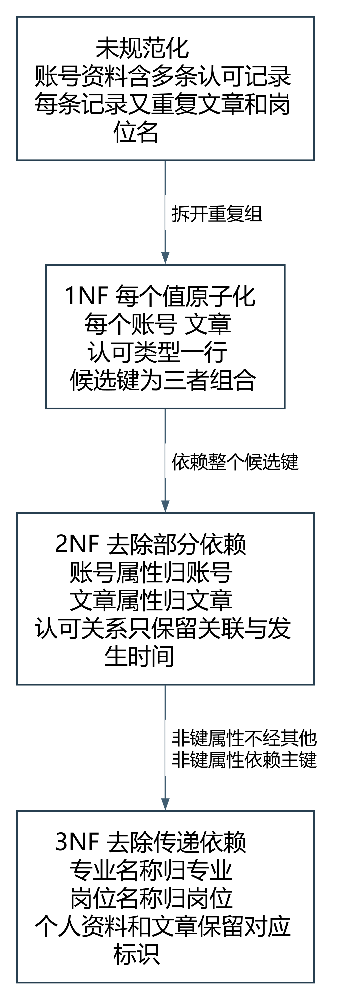

认可数据从重复组到3NF

使用同一认可记录例子展示完整分解。分析关系R以(accountId,articleId,kind)为候选键；若实现采用代理ID，仍需保留同一组合唯一约束。字段名称与现行字典对齐。

| 阶段 | 分解结果 |  | 依赖判断 |
| --- | --- | --- | --- |
| 未规范化 | 账号信息中嵌套多条认可记录，每条又携带文章、专业和岗位名称。 |  | 重复组不可直接用统一记录处理。 |
| 1NF | R(accountId, articleId, kind, createdAt, accountEmail, majorId, majorName, articleTitle, jobId, jobName)。候选键为(accountId,articleId,kind)。 |  | 每行只含一次认可；每个字段原子化。 |
| 2NF | Account(accountId,email,majorId,majorName)；Article(articleId,title,jobId,jobName)；Reaction(accountId,articleId,kind,createdAt)。 |  | accountId→账号属性、articleId→文章属性从组合键中分出；createdAt依赖完整组合键。 |
| 3NF | Account(accountId,email)；Profile(accountId,majorId)；Major(majorId,name)；Article(articleId,title,jobId)；Job(jobId,name)；Reaction结构保持。 |  | 消除accountId→majorId→majorName及articleId→jobId→jobName的传递依赖。 |
| 函数依赖 |  | 处理 |  |
| accountId→email,majorId |  | 账号自身属性放Account |  |
| articleId→title,jobId |  | 文章自身属性放Article |  |
| (accountId,articleId,kind)→createdAt |  | 完整候选键决定认可发生时间，放Reaction |  |
| majorId→majorName；jobId→jobName |  | 名称分别放Major和Job；去除传递依赖 |  |

规范化服务于数据一致性，不等于要求所有查询直接拼接宽表。面向展示的摘要属于设计阶段的读取方案，不改变逻辑实体和唯一约束。

依据：第3章需求分析第37页；本文件第9章。

## 10 功能层次与辅助分析图

### 10.1 功能层次树与IPO衔接

FHT01按功能将系统分解为账号认证、经验发布检索、交流激励、社区治理和独立运维。文章发布继续分为P2.1、P2.2、P2.3，与DFD21保持同名；与HIER01的数据结构分解分别使用。

同一个作者发布案例串联W06/W09、功能层次P2、IPO01、DFD21及SRS FR-C。输入为认证身份、草稿版本、正文图片和分类；处理校验权限与版本、整理文件、保存并切换公开版本；输出文章标识与成功回执或具体失败原因。

| 环节 | 要说明的内容 | 检查依据 |
| --- | --- | --- |
| 功能层次FHT01 | 系统有哪些功能，发布任务属于哪一层 | P2以及P2.1—P2.3 |
| IPO01 | 发布输入、处理及输出 | 认证、版本、文件、保存、回执 |
| DFD21 | 数据在外部实体、加工和存储间怎样流转 | F01.2、F02.2及D1/D2 |
| 原型W06/W09 | 作者从哪里录入和触发发布 | BR06、FR-C01—C09及图片/冲突异常 |

图见附件“功能层次与IPO衔接G04.pdf/drawio”。需求资料收集采用网络资料调研和组内讨论；没有真实访谈与任务走查结果，不将原型展示视作用户验收。

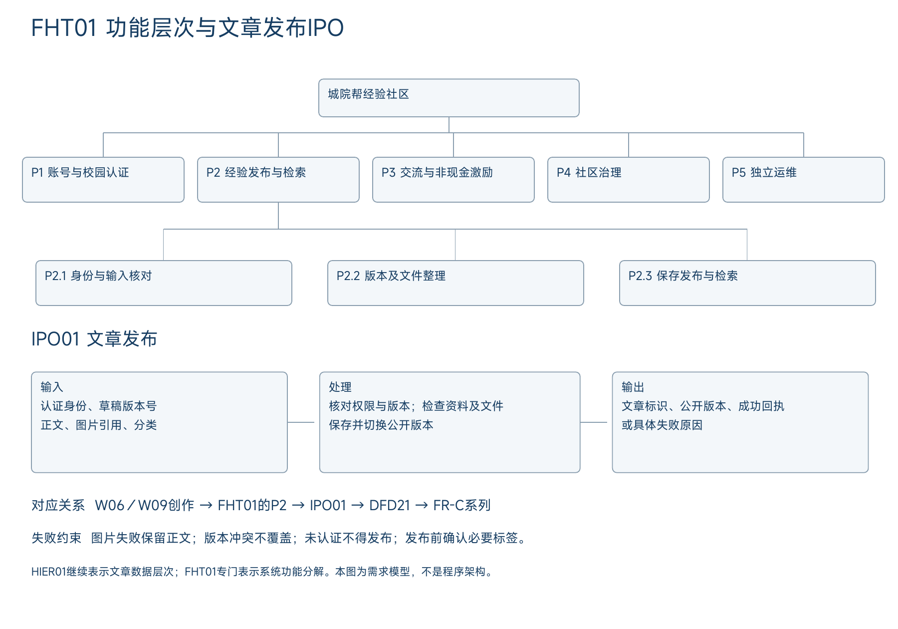

功能层次树与文章发布IPO衔接

### 10.2 层次方框图与文章数据结构

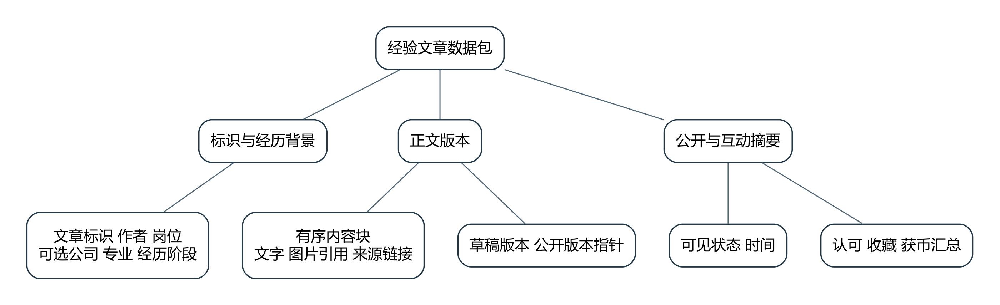

HIER01 层次方框图 文章数据结构

### 10.3 Warnier图的重复与选择

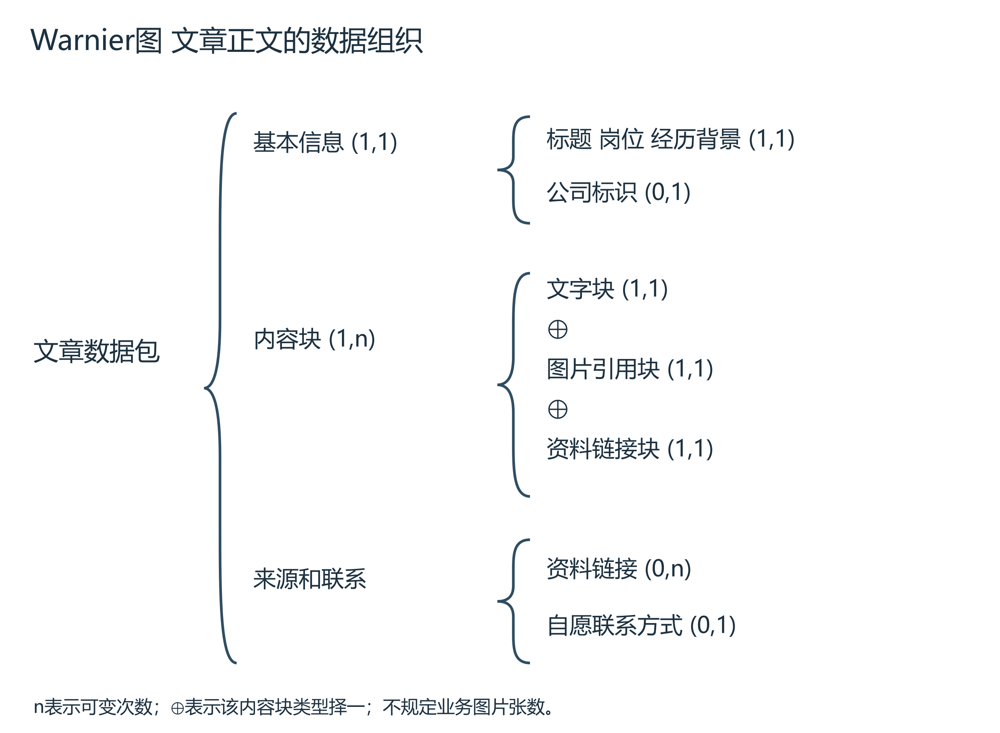

WARN01 Warnier图

### 10.4 IPO输入处理输出图

IPO01 IPO 图 发布经验文章

处理过程对应P2，输入输出都在数据字典中定义。

### 10.5 改进IPO加工说明

| 字段 | 定义 |
| --- | --- |
| 系统 模块 编号 | 城院帮；P3.3奖励投币一致性处理；IPO-P33 |
| 编制责任与日期 | 王晨整理处理及约束，刘景浩复核操作场景；2026年10月28日 |
| 被调用与调用 | P3.1校验后进入；读取D4并调用原子记账逻辑；返回P3.4，不限定具体代码函数 |
| 输入 | 认证身份、articleId、amount、requestKey、业务时间；D1认证、D2作者及可见状态、D4余额与累计投币 |
| 处理 | 检查幂等→检查身份非自投→检查累计≤2和余额→原子写扣币账本与贡献→提交；任一步失败回滚 |
| 输出 | 已提交的余额和贡献变化，或不改变数据的拒绝原因；重复请求返回原结果 |
| 局部数据 | 规范化业务键、原余额、累计投币、目标作者、错误分类；不在日志中写凭证 |
| 异常及注释 | 并发请求必须再次核对额度；已提交后不允许用户自行撤回；治理修正另建审计事件 |

### 10.6 改进IPO图

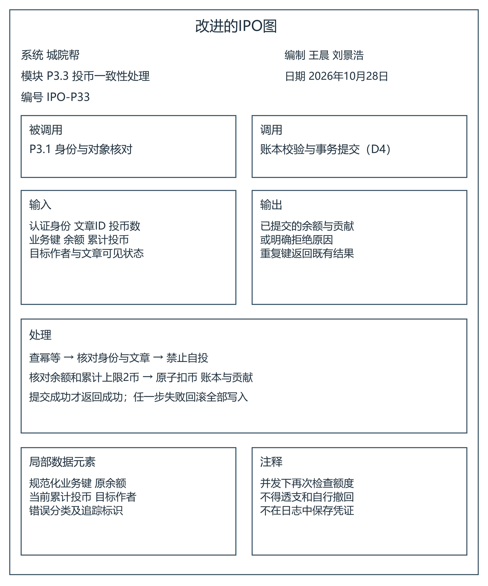

P3.3改进IPO图（字段与课件第57页对应）

依据：《第3章 需求分析》第57页；同一加工的结构化说明见10.5。

## 11 行为模型与状态转换图

状态图按业务对象分别定义状态、事件、守卫条件和动作；状态转换表与图中的T编号一致。数据状态不能通过前端文案单独修改。

### 11.1 校园认证状态转换图

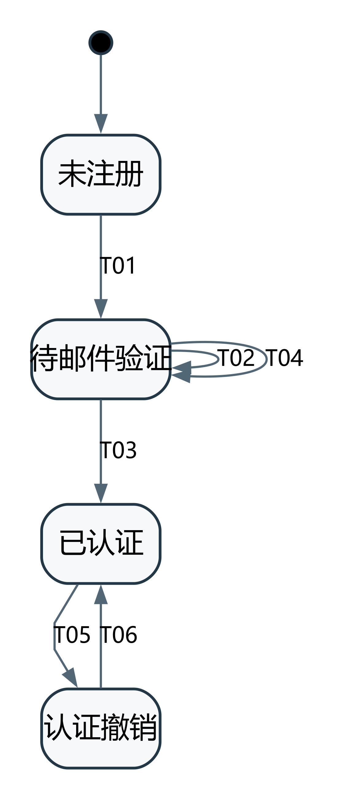

STD01 行为模型 校园认证

实心点为唯一初态，双圈表示终态；T编号对应事件[条件]/动作。认证状态按核验、撤销与限制事件变化。

| 转换与当前状态 | 事件 条件及动作 | 目标状态 |
| --- | --- | --- |
| T01 未注册 | 申请注册[邮箱合法]/建立校验记录 | 待邮件验证 |
| T02 待邮件验证 | 邮件失败或重发[间隔满足]/更新投递结果 | 待邮件验证 |
| T03 待邮件验证 | 提交验证码[有效且正确]/创建账号和认证 | 已认证 |
| T04 待邮件验证 | 错误或过期/拒绝并提示重试 | 待邮件验证 |
| T05 已认证 | 管理撤销[有权限]/记录理由并限制 | 认证撤销 |
| T06 认证撤销 | 重新验证[依据有效]/恢复认证 | 已认证 |

### 11.2 文章公开状态转换图

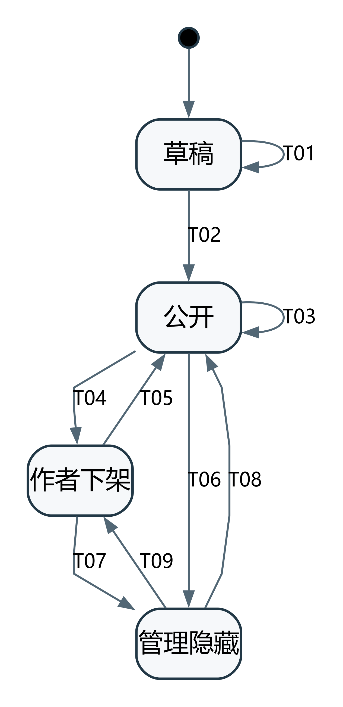

STD02 行为模型 文章公开状态

实心点为唯一初态，双圈表示终态；T编号对应事件[条件]/动作。文章未发布编辑副本不改变当前公开版本。

| 转换与当前状态 | 事件 条件及动作 | 目标状态 |
| --- | --- | --- |
| T01 草稿 | 保存[本人且版本匹配]/保存草稿 | 草稿 |
| T02 草稿 | 发布[资料及图片有效]/建立公开版本 | 公开 |
| T03 公开 | 修改并发布[版本匹配]/替换公开版本 | 公开 |
| T04 公开 | 下架[本人]/撤去公开展示 | 作者下架 |
| T05 作者下架 | 重新发布[本人且未被隐藏]/公开有效版本 | 公开 |
| T06 公开 | 治理隐藏[社区权限]/记录理由 | 管理隐藏 |
| T07 作者下架 | 治理隐藏[社区权限]/保留原状态 | 管理隐藏 |
| T08 管理隐藏 | 解除隐藏[社区权限且原为公开]/恢复公开 | 公开 |
| T09 管理隐藏 | 解除隐藏[原为作者下架]/恢复下架 | 作者下架 |

### 11.3 举报反馈案件状态转换图

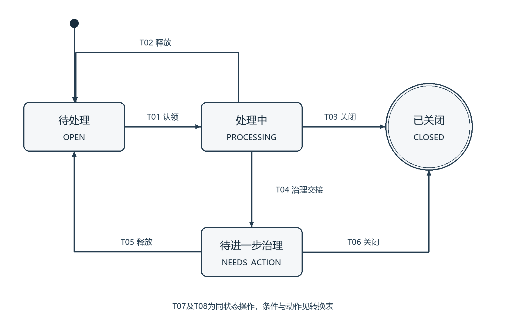

STD03 举报反馈案件四态与处理动作

OPEN、PROCESSING、NEEDS_ACTION和CLOSED为当前案件合同。NEEDS_ACTION表示待进一步治理，不能显示为已经隐藏、处罚、退币或等待用户补充。具体处理结果、公开答复与案件状态分开保存。

| 编号及状态转换 | 事件与条件 | 动作及结果 |
| --- | --- | --- |
| T01 O → P | 认领[有效管理员且revision一致] | 登记负责人 |
| T02 P → O | 释放[当前负责人且理由完整] | 清空负责人 |
| T03 P → C | 提交决定[反馈答复或无需治理] | 保存公开答复 |
| T04 P → N | 需要进一步治理[理由和答复完整] | 记录交接 |
| T05 N → O | 释放[当前负责人且理由完整] | 清空负责人 |
| T06 N → C | 提交决定[反馈答复或无需治理] | 保存结果 |
| T07 N → N | 仍需进一步治理[当前负责人] | 保留交接状态 |
| T08 P → P | 重复认领[同一负责人和当前revision] | 不追加处置 |

图中O/P/N/C分别对应四个接口状态。OPEN不能跳过认领直接处理；CLOSED拒绝新的认领、释放和处置。重复认领与仍需治理的同状态操作列在表中。完整内容治理和申诉等后续能力仍按FR-M实现，不能用基础案件流代替。

### 11.4 单次投币事务状态转换图

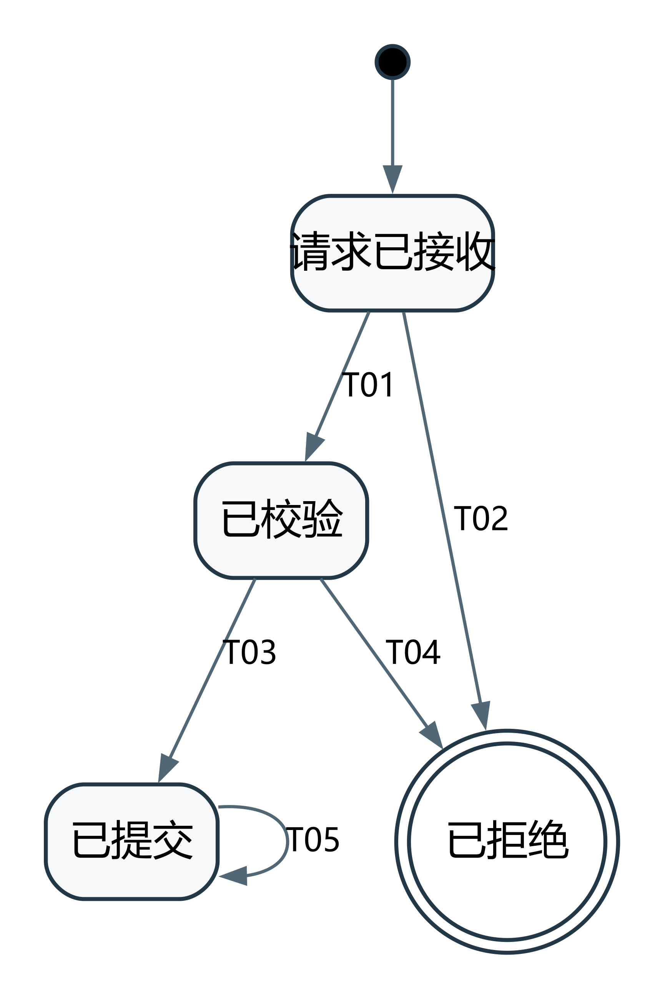

STD04 行为模型 单次投币事务

实心点为唯一初态，双圈表示终态；T编号对应事件[条件]/动作。已提交为允许同幂等键返回原结果的稳定持久状态，已拒绝为终态。

| 转换与当前状态 | 事件 条件及动作 | 目标状态 |
| --- | --- | --- |
| T01 请求已接收 | 校验[认证且非自投且额度合法]/核对余额 | 已校验 |
| T02 请求已接收 | 校验[条件不满足]/不写账 | 已拒绝 |
| T03 已校验 | 提交[余额和累计额度仍合法]/原子扣币记账贡献 | 已提交 |
| T04 已校验 | 并发冲突或写入失败/回滚 | 已拒绝 |
| T05 已提交 | 相同幂等键重试/返回原结果 | 已提交 |

### 11.5 独立运维任务状态转换图

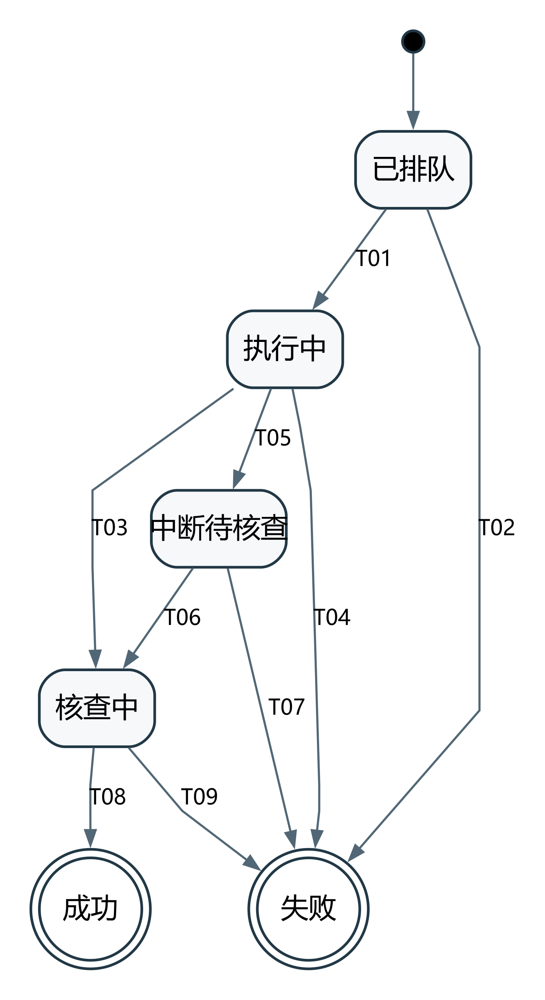

STD05 行为模型 独立运维任务

实心点为唯一初态，双圈表示终态；T编号对应事件[条件]/动作。连接中断进入待核查，不直接判为成功。

| 转换与当前状态 | 事件 条件及动作 | 目标状态 |
| --- | --- | --- |
| T01 已排队 | 启动[白名单授权及确认有效]/锁定目标 | 执行中 |
| T02 已排队 | 启动[条件不符]/拒绝执行并留痕 | 失败 |
| T03 执行中 | 执行完成/核对目标及版本 | 核查中 |
| T04 执行中 | 执行报错/保护现场 | 失败 |
| T05 执行中 | 连接中断或重启/保持任务标识 | 中断待核查 |
| T06 中断待核查 | 人工核对[可取得结果]/继续校验 | 核查中 |
| T07 中断待核查 | 核对[确认失败]/执行回退预案 | 失败 |
| T08 核查中 | 校验[状态与清单一致]/登记成功 | 成功 |
| T09 核查中 | 校验[失败]/记录失败与回退结果 | 失败 |

状态内部活动按课件语法解释：运维“执行中”entry登记开始，do执行受控任务，exit登记执行结论；“核查中”do核对服务与清单。投币“已提交”视为稳定持久状态，允许同幂等键读取原结果而不重复执行，不强行画成禁止重复读取的终态。认证和文章是持续存续对象，可没有终态。

### 11.6 跨模型业务不变量

| 约束编号 | 必须保持的不变量 |
| --- | --- |
| INV01 | 任何受限数据请求必须同时满足身份、角色、对象状态和联系开关，隐藏按钮不构成授权。 |
| INV02 | 同一已提交业务键只产生一次奖励或投币；余额≥0；每篇每人累计投币≤2；禁止自投及用户撤回。 |
| INV03 | 投币扣减、账本和对应作者贡献同成同败，页面显示以已提交事实为准。 |
| INV04 | 公开内容始终来自明确的公开版本；作者编辑未发布副本不得直接污染公开内容。 |
| INV05 | 管理员隐藏与作者下架分别记录；作者不能自行解除管理隐藏；解除隐藏保留此前作者下架状态。 |
| INV06 | 运维执行与成功核查分离；连接中断不得直接记成功；恢复前保留当前可回退状态。 |
| INV07 | 日志、公开返回与导出不得出现明文密码、验证码、会话令牌或真实校园邮箱。 |

## 12 界面与外部接口要求

| 接口 | 必要输入与输出 | 出错及约束 |
| --- | --- | --- |
| 读者与作者界面 | 岗位、公司、同专业条件；公开文章；认证后评论与作者资料 | 空结果、拒绝访问、网络失败均可理解；草稿保存失败不清空输入 |
| 网页与小程序共用服务 | 统一账号、需求编号、业务日期及错误分类 | 复杂Markdown不能被移动编辑静默截断；过期版本写入必须冲突提示 |
| SMTP邮件 | 邮箱校验请求与投递回执 | 验证码不写日志；投递失败不得宣称用户已收信 |
| 独立运维执行 | 任务编号、幂等键、白名单目标、受控操作、确认 | 禁止任意命令；服务停机时仍可查任务；恢复先保护当前状态 |
| 资料网盘链接 | 作者自愿添加资料来源和说明 | 不复制未授权付费资料；失效链接可报告；不代管站外账号 |

小程序与网页共享账号含义、内容格式和接口语义，分别维护页面和构建。错误traceId用于诊断；幂等requestId仅在对应API明确支持时使用，不将二者混用。真实邮箱、凭据与私人证据不进入公开页面、URL或日志。

| 接口领域 | 当前合同与读取要求 |
| --- | --- |
| 公开目录与阅读 | GET /api/v1/catalog；GET /api/v1/articles；GET /api/v1/articles/{id}。首页最新显式传sort=latest；默认recognized。 |
| 账号和本人 | 校园邮箱密码账号；注册先验证stu.hzcu.edu.cn；GET /api/v1/me按服务端身份检查。 |
| 公开阅读权限 | 游客正文免费；不公开作者受限资料、评论或本人互动状态。内容不可用统一404，不推测隐藏/删除原因。 |
| 图片与创作 | 按用途隔离上传与读取；不设置固定业务张数上限。文章单文件10MiB、请求12MiB等以接口合同为技术边界。 |
| 独立运维 | 运维账号、接口与受控执行器独立；实际部署、重启、备份、恢复仍属本期需求，静态原型不能替代执行结果。 |

## 13 非功能需求与质量验收

### 13.1 NFR01 权限与私有数据

页面、查询、文件和直接请求均执行同一访问边界；本人私有数据和管理数据不得因隐藏按钮而失去保护。认证和联系开关变化作用于新的请求与刷新结果。

验收 覆盖访客、未认证、认证、社区及运维角色，执行直接请求与图片地址检查；受限响应不含隐藏数据。

关联 TC-NFR01；WBS 6.4

### 13.2 NFR02 数据与账本一致性

发布、更新、奖励领取、投币和治理操作必须有可判定结果。相同业务重试不产生重复效果，余额不得为负，版本冲突不得静默覆盖。

验收 比较重复与并发操作前后余额、事件和有效贡献；核对文章版本、目标状态和治理结果。

关联 TC-NFR02；WBS 6.1,6.4

### 13.3 NFR03 内容与文件安全

Markdown、图片和用户输入安全显示，代码片段按文字呈现。图片支持JPEG和PNG，按内容校验格式，单文件上限10MiB，不设业务图片张数上限；格式错误、超限和上传失败可定位且保留正文。草稿、评论和证据图片按用途授权；日志、导出及提交材料不泄露凭据。

验收 检查危险文本、文件类型、访问用途及日志；合法代码示例仍可阅读，危险内容不执行。

关联 TC-NFR03；WBS 6.4

### 13.4 NFR04 正常负载响应

固定合成200用户、2000文章、5000评论，30并发，60秒升载后运行10分钟；读取P95不超过1秒，正文写入和评论请求不超过2秒，非预期错误率低于1%。图片传输、邮件投递和运维长任务另测。

验收 保存环境、数据、请求构成、脚本、原始JTL、P95、吞吐及错误分类；性能数字为验收目标，不是已有成绩。

关联 TC-NFR04；WBS 6.2

### 13.5 NFR05 压力与稳定性

10、30、50、100并发各运行2分钟并记录边界；100仅作容量探测。10并发运行30分钟，账本和内容不出现不一致；压力后降至10并发，目标2分钟内恢复正常响应。

验收 保存资源趋势、异常、降载时间及数据核对；按确认口径检查恢复后的响应与错误率。

关联 TC-NFR05；WBS 6.3

### 13.6 NFR06 双端兼容与可用性

微信开发者工具和现代桌面浏览器中完成核心流程；基础移动创作可独立使用，网页Markdown在小程序安全阅读，复杂编辑限制明确。操作失败、空结果和权限状态可区分。

验收 分别走查两端阅读、筛选、草稿、图片、发布和管理入口；记录实际环境及限制，不以接口性能替代端侧体验。

关联 TC-NFR06；WBS 6.4

### 13.7 NFR07 故障与编辑恢复

保存、图片上传和会话失效时保留可恢复输入；结果不确定时允许核对已确认状态。服务故障不得造成无说明的重复发布或部分扣币。

验收 在断网、错误响应、部分图片失败、重复提交与冲突场景检查输入和数据结果。

关联 TC-NFR07；WBS 6.1,6.4

### 13.8 NFR08 运维独立可达

业务进程停止和业务数据库维护期间，运维入口的授权、任务查询及持久日志仍可使用。整机或运维服务本身故障另依维护手册处理。

验收 实际停止业务服务并查询已有任务；恢复过程保持结果可追踪，记录边界而不承诺整机故障时自救。

关联 TC-NFR08；WBS 6.5

### 13.9 NFR09 备份与可恢复性

备份清单须匹配业务数据、图片和版本。计划RPO不超过24小时，RTO不超过10分钟；演示运行期间至少每天备份一次，部署、恢复及重要数据变更前额外备份。保留最近7份成功备份和至少1份离机副本，损坏及不兼容备份拒绝使用。

验收 保存备份时点与清单、成功及失败日志、恢复计时和恢复前后关键记录；检查RPO/RTO目标、最近7份成功备份及离机副本。该目标供需求评审，不代表恢复演练已经通过。

关联 TC-NFR09；WBS 6.5

### 13.10 NFR10 可维护与可追溯

需求编号与用例、设计、工作包及版本可关联；错误和运维任务有可定位标识；配置变化登记原因、修改人、时间、受影响项和复核结论。

验收 抽取需求追踪到场景和计划工作包；检查版本清单与日志可定位性，记录仍未关闭的问题。

关联 TC-NFR10；WBS 6.1,6.5,7.1

### 13.11 NFR11 隐私与数据保留

真实邮箱、私人账本及管理记录按用途授权。退出清理端侧受限缓存；运行日志及关键审计保存不少于30天；演示账号和测试数据于课程收尾后30天内按交接清单清理或脱敏，处置记录随课程材料归档。本期不采集学生证或毕业材料；未来扩展另定保留规则。

验收 用不同账号、退出重入和直接文件请求检查；核对保留策略与实际配置，不以公开URL代替授权。

关联 TC-NFR11；WBS 6.4,7.1

### 13.12 NFR12 环境与课堂交付

支持王晨电脑本地课堂运行及可重复启动。腾讯云2核2GB为可选验证环境；微信正式发布与公网运营不作为本次验收前提。真实认证与预置演示身份分别标明。

验收 另一成员按说明冷启动并走查；记录本机与可选云结果；演示数据和模拟条件清楚标识。

关联 TC-NFR12；WBS 6.5,7.2

性能目标为计划验收值：固定演示环境与样本数据，30并发时读请求P95不超过1秒、写请求P95不超过2秒；递增压力、持续运行及恢复测试按系统测试计划执行并保存原始记录。实际吞吐和最大容量以测试结果为准。

## 14 需求验证与用户确认

### 14.1 一致性完整性现实性有效性

| 验证维度 | 项目检查实例 | 判定依据及证据 |
| --- | --- | --- |
| 一致性 | 未认证者不能查看评论；图、SRS和权限表一致。F01.3在P3子图仍有输入，F02.3仍有输出。 | 编号/字段/流向检查；上下层平衡表；跨文档复核 |
| 完整性 | 52项FR与12项NFR均有验收场景；ER、DFD、STD和五类字典能够追踪。 | 64项追踪矩阵；27实体134字段；课件主题与11项评审索引 |
| 现实性 | 两人226.55人时、课堂本机环境；复杂长文在网页创作，移动端基本图文；运维采用白名单执行。 | 计划人时、资源、风险和性能测试条件；不是实际性能结论 |
| 有效性 | 代表用户能否找到同专业经验、保存草稿、定位举报，并理解联系开关。 | 任务3.8真实走查记录、问题与修订、参与者确认；静态核查不能替代 |

### 14.2 结构化工具与检查产物

使用JSON/CSV保存需求、实体、数据流和状态，draw.io编辑图形，Word/PDF形成正式材料；通过唯一标识、引用完整性、状态可达性和流平衡检查辅助人工评审。课件PSL/PSA体现的结构化分析和检查思想在当前工具中实现。

依据：课件3.8，第60—68页。

### 14.3 原型走查反馈修改与确认

| 走查者及任务 | 成功条件 | 记录内容 |
| --- | --- | --- |
| 读者：按岗位＋同专业找文章 | 能理解筛选并找到公开文章；能清空条件 | 耗时、误解、失败步骤、修改建议 |
| 作者：写图文并保存/预览 | 识别必填信息、可跳过提示及保存结果 | 上传失败、草稿恢复、跨端冲突反馈 |
| 社区/运维管理员 | 能定位原文评论；危险操作有确认及结果 | 角色、任务完成情况和需要调整的入口 |

本材料为可导航的文档线框，不代表已运行页面。实际走查后在登记表保存反馈和修订，并由参与者确认。

按 UW01—UW04 组织四类代表走查。记录代表代号、实际日期、原型版本、设备、任务表现、原话、修改责任和复测结果。当前待邀约与执行。

### 14.4 需求评审与放行条件

第3、13章定义逐项验收要求，第6—11章提供模型和字典依据。评审既检查材料是否提供，也检查描述是否准确；目录可定位不等于内容已正确。FR/NFR编号覆盖、字典/ER一致、数据流平衡、状态守卫和用例反例均须交叉检查。11项证据定位见附录B。

## 15 需求追踪与开发计划修订

### 15.1 需求模型用例验收及WBS追踪

追踪覆盖全部52项FR和12项NFR。下表用于正文查阅，完整多向关系和完成标准保留在需求追踪矩阵CSV；任何需求变更同步模型、字典、交互和验收条目。

| 需求 | 主题 | 用例及验收 | 模型与逻辑存储 |
| --- | --- | --- | --- |
| FR-A01 | 统一账号登录与退出 | UC02 TC-A01 | P1 / ER01 / STD01 / D1 |
| FR-A02 | 校园邮箱自动认证 | UC02 TC-A02 | P1 / ER01 / STD01 / D1 |
| FR-A03 | 证明材料人工认证 | UC02 TC-A03 | P1 / ER01 / STD01 / D1 |
| FR-A04 | 认证失效与权限变化 | UC02 TC-A04 | P1 / ER01 / STD01 / D1 |
| FR-A05 | 资料与隐私设置 | UC02 TC-A05 | P1 / ER01 / STD01 / D1 |
| FR-A06 | 管理账号分权 | UC08,UC09 TC-A06 | P1 / ER01 / STD01 / D1 |
| FR-R01 | 免费浏览与全文阅读 | UC01 TC-R01 | P2 / ER02 / STD02 / D1,D2 |
| FR-R02 | 岗位与关键词检索 | UC01 TC-R02 | P2 / ER02 / STD02 / D1,D2 |
| FR-R03 | 专业与公司组合筛选 | UC01 TC-R03 | P2 / ER02 / STD02 / D1,D2 |
| FR-R04 | 认可与最新排序 | UC01 TC-R04 | P2 / ER02 / STD02 / D1,D2 |
| FR-R05 | 来源与资料链接 | UC01 TC-R05 | P2 / ER02 / STD02 / D1,D2 |
| FR-R06 | 认证阅读边界 | UC01,UC05 TC-R06 | P2 / ER02 / STD02 / D1,D2 |
| FR-C01 | 轻量发布信息 | UC03 TC-C01 | P2 / ER02 / STD02 / D2 |
| FR-C02 | 网页Markdown创作 | UC03 TC-C02 | P2 / ER02 / STD02 / D2 |
| FR-C03 | 小程序基础图文创作 | UC03,UC04 TC-C03 | P2 / ER02 / STD02 / D2 |
| FR-C04 | 图片上传与失败处理 | UC03,UC05 TC-C04 | P2 / ER02 / STD02 / D2 |
| FR-C05 | 多草稿保存与恢复 | UC03 TC-C05 | P2 / ER02 / STD02 / D2 |
| FR-C06 | 预览与发布 | UC03 TC-C06 | P2 / ER02 / STD02 / D2 |
| FR-C07 | 修改与版本冲突 | UC04 TC-C07 | P2 / ER02 / STD02 / D2 |
| FR-C08 | 下架删除与恢复权限 | UC04,UC08 TC-C08 | P2 / ER02 / STD02 / D2 |
| FR-C09 | 可跳过写作提示 | UC03 TC-C09 | P2 / ER02 / STD02 / D2 |
| FR-I01 | 评论与回复 | UC05 TC-I01 | P3 / ER03 / STD02,STD03 / D1,D2,D3 |
| FR-I02 | 评论管理边界 | UC05,UC08 TC-I02 | P3 / ER03 / STD02,STD03 / D1,D2,D3 |
| FR-I03 | 点赞认可 | UC05 TC-I03 | P3 / ER03 / STD02,STD03 / D1,D2,D3 |
| FR-I04 | 收藏与重访 | UC05 TC-I04 | P3 / ER03 / STD02,STD03 / D1,D2,D3 |
| FR-I05 | 作者公开主页 | UC05 TC-I05 | P3 / ER03 / STD02,STD03 / D1,D2,D3 |
| FR-I06 | 作者联系开关 | UC05 TC-I06 | P3 / ER03 / STD02,STD03 / D1,D2,D3 |
| FR-I07 | 自愿站外联系 | UC05 TC-I07 | P3 / ER03 / STD02,STD03 / D1,D2,D3 |
| FR-G01 | 简单奖励任务 | UC06 TC-G01 | P3 / ER03 / STD04 / D4 |
| FR-G02 | 奖励领取与日上限 | UC06 TC-G02 | P3 / ER03 / STD04 / D4 |
| FR-G03 | 向文章投币 | UC06 TC-G03 | P3 / ER03 / STD04 / D4 |
| FR-G04 | 余额与账本查询 | UC06 TC-G04 | P3 / ER03 / STD04 / D4 |
| FR-G05 | 荣誉与勋章展示 | UC06 TC-G05 | P3 / ER03 / STD04 / D4 |
| FR-G06 | 贡献失效与追溯 | UC06,UC08 TC-G06 | P3 / ER03 / STD04 / D4 |
| FR-M01 | 提交反馈和举报 | UC07 TC-M01 | P4 / ER04 / STD03 / D5 |
| FR-M02 | 定位上下文处理 | UC08 TC-M02 | P4 / ER04 / STD03 / D5 |
| FR-M03 | 发布后内容巡查 | UC08 TC-M03 | P4 / ER04 / STD03 / D5 |
| FR-M04 | 用户限制及申诉 | UC08 TC-M04 | P4 / ER04 / STD03 / D5 |
| FR-M05 | 认证材料审核 | UC02,UC08 TC-M05 | P4 / ER04 / STD03 / D5 |
| FR-M06 | 岗位专业和公司分类维护 | UC08 TC-M06 | P4 / ER04 / STD03 / D5 |
| FR-M07 | 治理审计与状态查询 | UC07,UC08 TC-M07 | P4 / ER04 / STD03 / D5 |
| FR-O01 | 服务状态与错误日志 | UC09,UC10 TC-O01 | P5 / ER04 / STD05 / D6 |
| FR-O02 | 受控操作与确认 | UC09,UC10 TC-O02 | P5 / ER04 / STD05 / D6 |
| FR-O03 | 网页实际执行部署 | UC09 TC-O03 | P5 / ER04 / STD05 / D6 |
| FR-O04 | 网页实际重启业务 | UC09 TC-O04 | P5 / ER04 / STD05 / D6 |
| FR-O05 | 一致性备份 | UC10 TC-O05 | P5 / ER04 / STD05 / D6 |
| FR-O06 | 备份校验与恢复 | UC10 TC-O06 | P5 / ER04 / STD05 / D6 |
| FR-O07 | 任务互斥与持久记录 | UC09,UC10 TC-O07 | P5 / ER04 / STD05 / D6 |
| FR-O08 | 恢复回退与运维交接 | UC09,UC10 TC-O08 | P5 / ER04 / STD05 / D6 |
| FR-P01 | 本人文章草稿和收藏入口 | UC03,UC04,UC05 TC-P01 | P1,P2,P3,P4 / ER01,ER02,ER04 / STD01,STD02,STD03 / D1,D2,D3,D5 |
| FR-P02 | 业务通知与已读状态 | UC02,UC05,UC08 TC-P02 | P1,P2,P3,P4 / ER01,ER02,ER04 / STD01,STD02,STD03 / D1,D2,D3,D5 |
| FR-P03 | 规则说明与无结果提示 | UC01,UC02,UC06 TC-P03 | P1,P2,P3,P4 / ER01,ER02,ER04 / STD01,STD02,STD03 / D1,D2,D3,D5 |
| NFR01 | 权限与私有数据 | 跨场景 TC-NFR01 | P1,P2,P3,P4,P5 / ER01,ER02,ER03,ER04 / STD01,STD02,STD03,STD04,STD05 / D1,D2,D3,D4,D5,D6 |
| NFR02 | 数据与账本一致性 | 跨场景 TC-NFR02 | P1,P2,P3,P4,P5 / ER01,ER02,ER03,ER04 / STD01,STD02,STD03,STD04,STD05 / D1,D2,D3,D4,D5,D6 |
| NFR03 | 内容与文件安全 | 跨场景 TC-NFR03 | P1,P2,P3,P4,P5 / ER01,ER02,ER03,ER04 / STD01,STD02,STD03,STD04,STD05 / D1,D2,D3,D4,D5,D6 |
| NFR04 | 正常负载响应 | 跨场景 TC-NFR04 | P1,P2,P3,P4,P5 / ER01,ER02,ER03,ER04 / STD01,STD02,STD03,STD04,STD05 / D1,D2,D3,D4,D5,D6 |
| NFR05 | 压力与稳定性 | 跨场景 TC-NFR05 | P1,P2,P3,P4,P5 / ER01,ER02,ER03,ER04 / STD01,STD02,STD03,STD04,STD05 / D1,D2,D3,D4,D5,D6 |
| NFR06 | 双端兼容与可用性 | 跨场景 TC-NFR06 | P1,P2,P3,P4,P5 / ER01,ER02,ER03,ER04 / STD01,STD02,STD03,STD04,STD05 / D1,D2,D3,D4,D5,D6 |
| NFR07 | 故障与编辑恢复 | 跨场景 TC-NFR07 | P1,P2,P3,P4,P5 / ER01,ER02,ER03,ER04 / STD01,STD02,STD03,STD04,STD05 / D1,D2,D3,D4,D5,D6 |
| NFR08 | 运维独立可达 | 跨场景 TC-NFR08 | P1,P2,P3,P4,P5 / ER01,ER02,ER03,ER04 / STD01,STD02,STD03,STD04,STD05 / D1,D2,D3,D4,D5,D6 |
| NFR09 | 备份与可恢复性 | 跨场景 TC-NFR09 | P1,P2,P3,P4,P5 / ER01,ER02,ER03,ER04 / STD01,STD02,STD03,STD04,STD05 / D1,D2,D3,D4,D5,D6 |
| NFR10 | 可维护与可追溯 | 跨场景 TC-NFR10 | P1,P2,P3,P4,P5 / ER01,ER02,ER03,ER04 / STD01,STD02,STD03,STD04,STD05 / D1,D2,D3,D4,D5,D6 |
| NFR11 | 隐私与数据保留 | 跨场景 TC-NFR11 | P1,P2,P3,P4,P5 / ER01,ER02,ER03,ER04 / STD01,STD02,STD03,STD04,STD05 / D1,D2,D3,D4,D5,D6 |
| NFR12 | 环境与课堂交付 | 跨场景 TC-NFR12 | P1,P2,P3,P4,P5 / ER01,ER02,ER03,ER04 / STD01,STD02,STD03,STD04,STD05 / D1,D2,D3,D4,D5,D6 |

### 15.2 需求分析任务的具体分解

| WBS与任务 | 任务负责人 | 计划人时 | 产物与完成判断 |
| --- | --- | --- | --- |
| 3.1 用户场景、用例与权限边界 | 王晨、刘景浩 | 4.0 | 游客、未认证、认证、社区和运维角色分开；普通账号不能访问管理数据 |
| 3.2 功能、数据与非功能需求 | 王晨 | 3.2 | REQ编号关联用例；认证资料、隐私、状态、冲突、币账本与恢复边界可验收 |
| 3.3 双端原型与场景核对 | 刘景浩 | 3.2 | 原型覆盖空结果、加载失败、认证提示、草稿保存和运维任务失败 |
| 3.4 SRS基线与需求评审材料 | 王晨、刘景浩 | 4.0 | 需求、原型、权限和异常一致；未决问题记录；10月25日提交材料齐全 |
| 3.5 需求课堂评审反馈处理 | 刘景浩 | 3.2 | 11月4日新意见在课后完成登记与修订；变更有责任人和复核结论 |
| 3.6 课件核对及三模型骨架 | 王晨、刘景浩 | 6 | ER有实体属性和基数；DFD上下文、一级与关键二级对应，范围与权限一致 |
| 3.7 字典规范化及行为辅助模型 | 王晨、刘景浩 | 5 | 字段约束完整；1NF至3NF有实例；状态、层次、Warnier和IPO可解释 |
| 3.8 界面线框与真实用户走查 | 王晨、刘景浩 | 4 | 覆盖正常与异常；真实参与和反馈分别登记，未确认不得代签 |
| 3.9 需求验证追踪与阶段提交 | 王晨、刘景浩 | 5 | 一致完整现实有效四项检查；未关闭问题有责任期限；提交材料同版本 |

### 15.3 技术变更与资源修订

原计划基准为226.55人时、人工预算10366.93元。原生微信小程序与独立Vue网页的20—35人时追加预测尚未进入MPP分配；需求分析发现的原型、兼容与回归负担需进一步细分并评审资源。3.8计划日期不代表真实用户走查已发生，实际日期应由记录回写。

## 16 需求参数与变更管理

| 编号与主题 | 状态及决定 | 责任与关闭节点 |
| --- | --- | --- |
| OP01 统一登录与跨端绑定 | 已关闭；两端共用校园邮箱密码账号，微信绑定后续扩展 | 王晨、刘景浩；需求评审前 |
| OP02 验证码参数 | 已关闭；技术参数来自当前代码静态读取：6位、300秒、60秒、每小时5次，后续变更受控 | 王晨；认证设计前 |
| OP03 认证材料与保留策略 | 转未来范围；本期仅校园邮箱注册，材料人工认证不阻塞本期 | 双方；社区管理主责刘景浩；需求评审前 |
| OP04 奖励参数 | 已关闭；每日登录2币，阅读180秒1币，每日最多一次，合计3币 | 王晨、刘景浩；激励需求基线前 |
| OP05 投币参数 | 部分关闭；额度2币/篇、不自行撤回已确认；治理认定无效贡献的返还和审计细则在设计评审确定 | 王晨、刘景浩；激励需求基线前 |
| OP06 完整荣誉表 | 本期验收配置化荣誉能力；正式称号、门槛和图案纳入设计规则表，经确认后启用；未启用规则不展示。 | 王晨、刘景浩；激励设计前 |
| OP07 图文技术边界 | 本期JPEG/PNG、单文件10MiB；不设图片业务张数上限；复杂Markdown移动编辑保留原文并提示网页处理。 | 双方；刘景浩整理网页边界；编辑与存储设计前 |
| OP08 内容治理细则 | 设计细化；按对应工作包确定并记录配置及验收条件 | 刘景浩；王晨复核；治理需求基线前 |
| OP09 备份与恢复服务指标 | 需求候选验收目标：RPO≤24小时、RTO≤10分钟；至少每天一次及重要变更前备份，保留最近7份成功备份和1份离机副本。 | 刘景浩设计；王晨验证；运维设计前 |
| OP10 性能验收固定条件 | 本机配置见计划；样本200用户/2000文章/5000评论，读写请求80:20，升载60秒后稳态10分钟；预期业务拒绝与非预期错误分列。 | 王晨；刘景浩复核；测试方案基线前 |
| OP11 阶段专用模板与原表 | 已关闭；已收到70页第3章课件与11项需求评审原表 | 王晨作为项目负责人；收到材料后核对 |
| OP12 后端技术方案 | 已关闭；当前采用Java21/Spring Boot和MySQL；C++复用方案不纳入本期 | 王晨、刘景浩；总体设计基线前 |

参数变更须记录原因、受影响规则、模型、验收、工作包及成本，并经双方确认。本期必须验收配置化荣誉展示能力；完整称号、门槛和图案作为设计规则表管理，经设计评审确认后启用，不再将荣誉能力排除出本期验收。

本次合并不新增需求编号或调整计划总量。按11月5日校准统一游客权限、认可排序、激励范围、图片张数、案件状态、不可用原因和实际网页运维口径；完整荣誉规则等尚缺参数保留为明确待确认项，不写成已经启用。

## 参考资料

[R1] 第3章 需求分析，软件工程课程课件，70页；需求分析任务第6—13页、建模第25—27页、小结第69页。

[R2] 软件工程课程项目评审表 需求阶段评审，课程提供，2页，11项。

[R3] GB/T 8567—2006 计算机软件文档编制规范，第7.11节 软件需求规格说明。

[R4] GB/T 9385—2008 计算机软件需求规格说明规范，编制原则、内容及附录A。

[R5] 张海藩等 软件工程导论，第6版，清华大学出版社，需求分析相关章节。

[R6] Kathy Schwalbe IT项目管理，第8版，机械工业出版社，范围、进度、资源、风险及配置管理相关内容。

[R7] 城院帮项目计划V1.7、可行性分析报告V1.6；本组需求讨论、公开网络调研、2026年10月31日会议纪要和需求追踪数据。

[R8] 城院帮共享后端399dcbb0009fa9ae4ac557fb7e9296775fcd7be9的接口合同与源码；2026年11月5日主控基线校准记录。源码静态读取与软件运行验证分开登记。

## 附录A 国标条目与章节对应

| 编制内容 | 本文件位置 |
| --- | --- |
| 标识 引用与用途 | 封面、文档控制、第1章、参考资料 |
| 产品概况 用户与运行环境 | 第2章 |
| 功能及接口要求 | 第3—5、12章 |
| 数据与质量要求 | 第6—9、13章 |
| 行为与约束 | 第4、10—11、16章 |
| 验证及可追踪性 | 第14—15章、附录B—D |

本文件参照国标组织需求内容，并按课程要求将分析过程和完整模型纳入主文档。原始国标保存在本机参考目录；此处为编制对应关系，不代表官方认证。

## 附录B 需求阶段11项评审对应与证据状态

| 条目 | 评审内容 | 正文或配套证据 | 当前状态 |
| --- | --- | --- | --- |
| 1 | 项目演示PPT | 第5章原型、第2章产品与角色；配套需求汇报PPT/PDF | PPT已准备，课堂效果以实际展示评价 |
| 2 | 阶段成果是否齐全 | 文档控制、第15章、附录D；项目计划及会议等配套成果 | 文档材料已形成，是否按时提交以实际邮件/记录为准 |
| 3 | 项目计划随课程调整 | 15.2—15.3及项目计划V1.7、WBS/MPP | 已列修订任务，资源增量尚待确认分配 |
| 4 | 项目会议与记录 | 14.4、附录D；10月31日腾讯会议纪要 | 有实际讨论来源与纪要；实际起止和人时按原证据登记 |
| 5 | 成员绩效评价 | 附录D；同次会议的职责与评价 | 王晨91.2、刘景浩91.3为已提供综合评价，不补造分项评分 |
| 6 | 用户类别与用户代表 | 2.1、2.4；14.3 | 四类代表已登记，待访谈与走查。项目计划第4章与本文件2.1对应。 |
| 7 | 界面原型 | 5.11—5.13、原型附件 | 现有功能原型已提供；可运行原型按实际开发记录 |
| 8 | 用户确认与反馈修改 | 14.3、附录D反馈与任务走查表 | UW01—UW04 待实际走查，完成后登记反馈、修改与复测结果。 |
| 9 | SRS功能与非功能需求 | 第3章52项FR；第13章12项NFR | 逐项规格与完成标准已定义，不等于实现通过 |
| 10 | 数据字典与ER图及准确性 | 第6章ER、第8章完整字典；第7、11章交叉核查 | 27实体134字段、46数据流；按标识/基数/类型/状态交叉复核 |
| 11 | 配置系统与及时更新 | 文档控制、15.1、附录D；Git/GitHub文档分支 | 已接入共享文档分支，PR需另一成员复核后合并 |

## 附录C 需求基线与接口实现边界

| 事项 | 当前需求口径 | 接口或实现边界 |
| --- | --- | --- |
| 游客访问 | 公开正文免费；评论、作者资料、主页、互动及联系须认证 | 公开接口不得由前端补受限字段 |
| 排序与激励 | 获币→点赞→发布时间→ID；收藏独立；G01—G06本期 | 首页最新显式latest；完整荣誉参数待补 |
| 图片 | 无固定每文/评论/举报张数限制 | 文章单图10MiB、请求12MiB等仅为技术校验 |
| 案件状态 | OPEN/PROCESSING/NEEDS_ACTION/CLOSED | NEEDS_ACTION为待进一步治理，不证明已隐藏/处罚/返币；与第8、11章一致 |
| 不可用原因 | 公共入口统一不可用；本人/管理上下文按授权解释 | 不能从公共404推断真实原因 |
| 真实运维 | 独立网页、接口、任务存储和受控执行器保留 | 共享快照尚无完整运维实现与恢复证据 |
| 原型与联调 | 可先以标识清楚的演示数据做交互验证 | 真实联调须另核实共享后端进入main；原型不等于系统验收 |

## 附录D 可编辑模型与阶段附件索引

| 附件 | 作用 |
| --- | --- |
| models/数据元素字典G04.csv | 全部134字段的可编辑结构化字典 |
| models/数据流字典G04.csv；数据结构与正则规则G04.csv | 46项数据流和结构、正则定义 |
| models/需求追踪矩阵G04.csv | 64项需求到规则、用例、模型、WBS与验收的多向追踪 |
| models/图表与模型/需求分析模型G04.drawio | 可编辑ER、DFD与状态图；独立DOT/SVG/PNG供逐图查阅 |
| prototypes | 功能原型、线框、覆盖表和原型说明 |
| meetings-research | 10月31日会议纪要及综合评价、研究来源、反馈与用户确认记录 |
| schedule | 详细任务、WBS、MPP、甘特和工程网络 |
| presentations | 需求评审PPT、PDF、讲稿及查阅导航 |
| models/ER联系与参与约束G04.csv | 28项联系的类型、最低参与数量及可选关联约束 |
