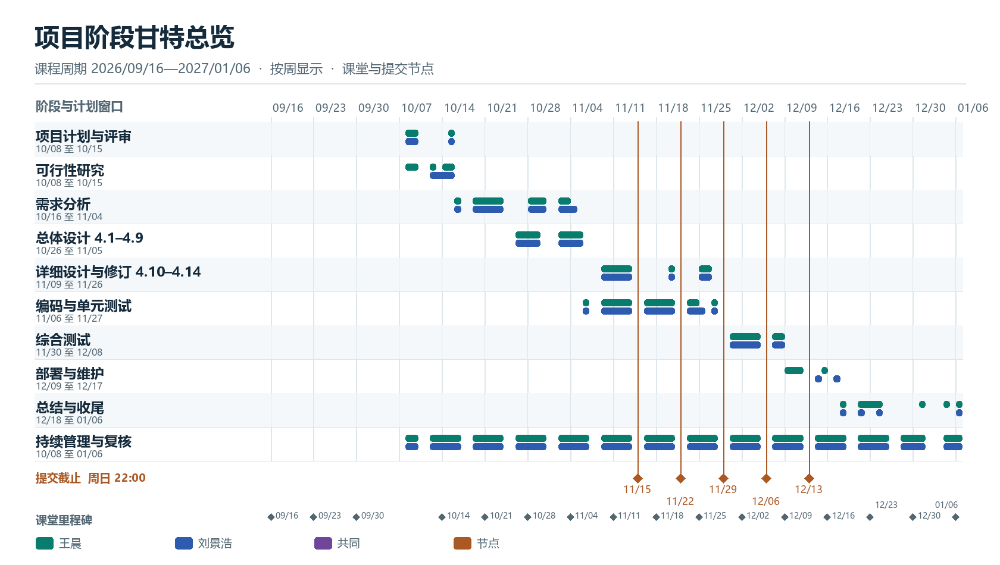
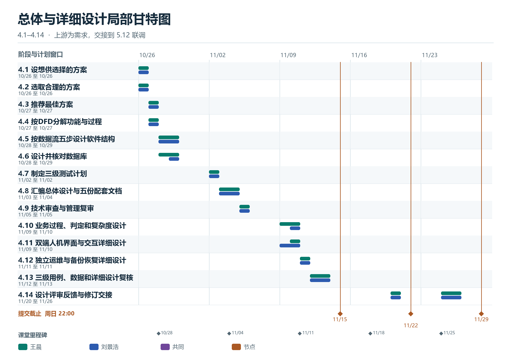
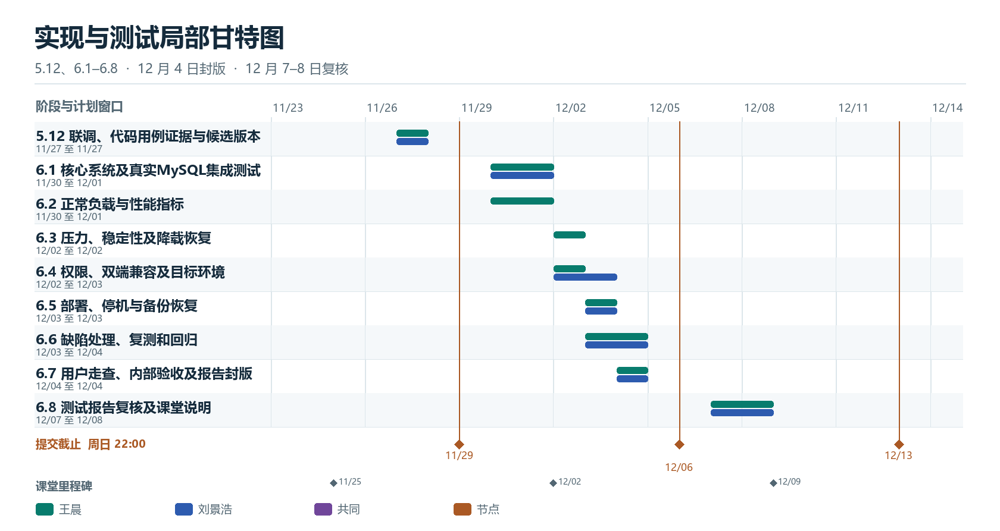
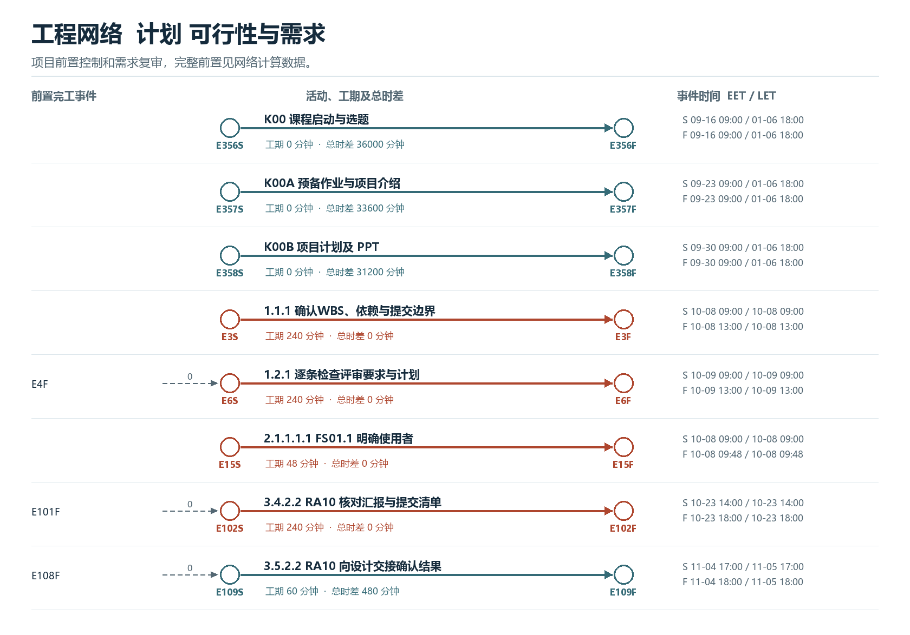
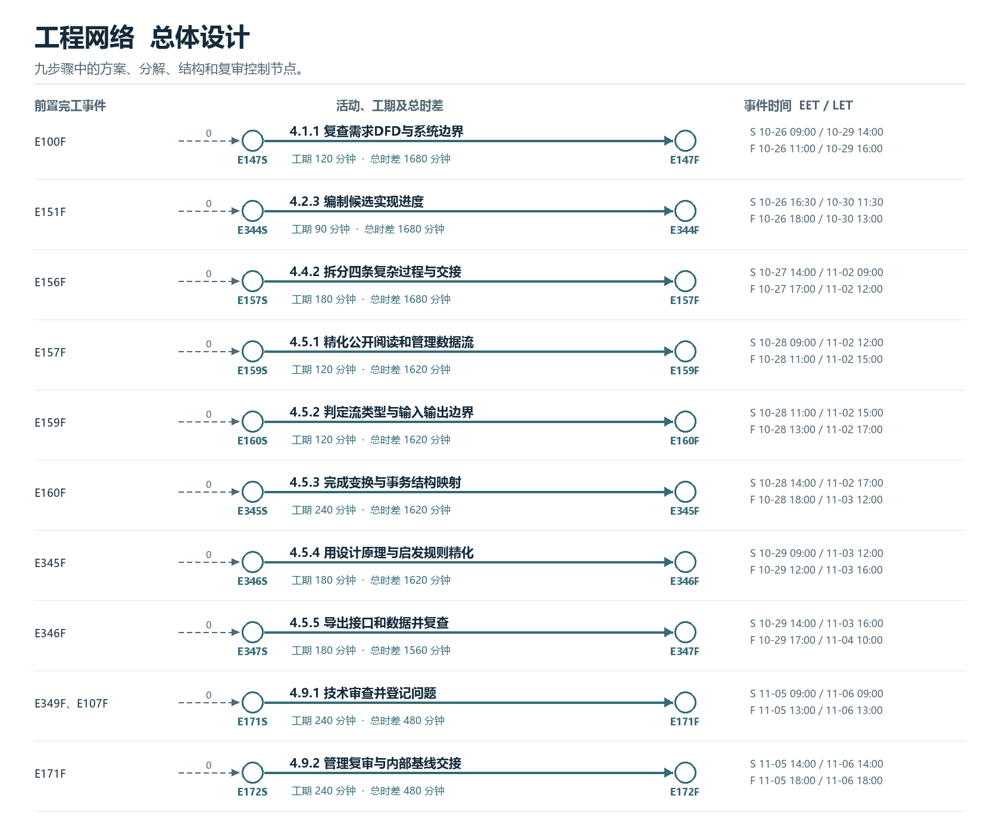
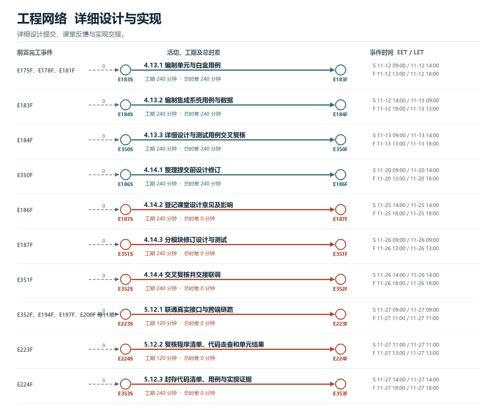
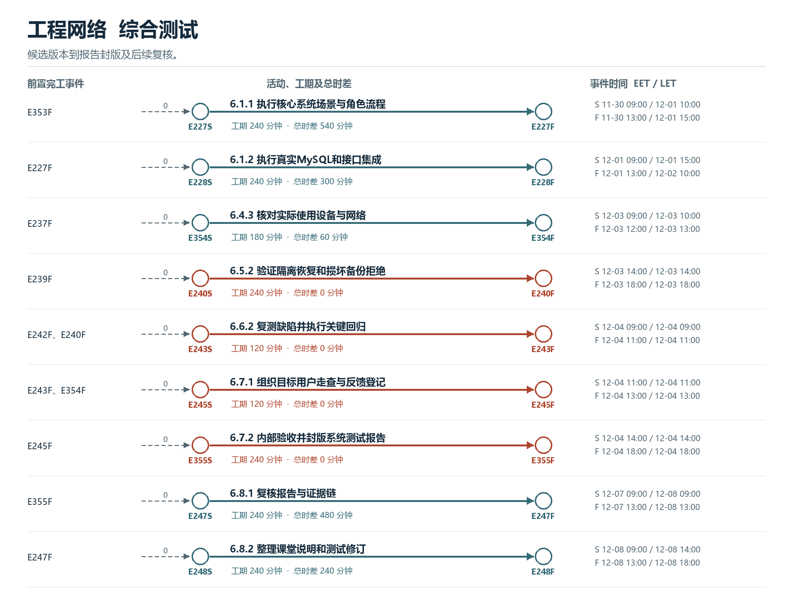
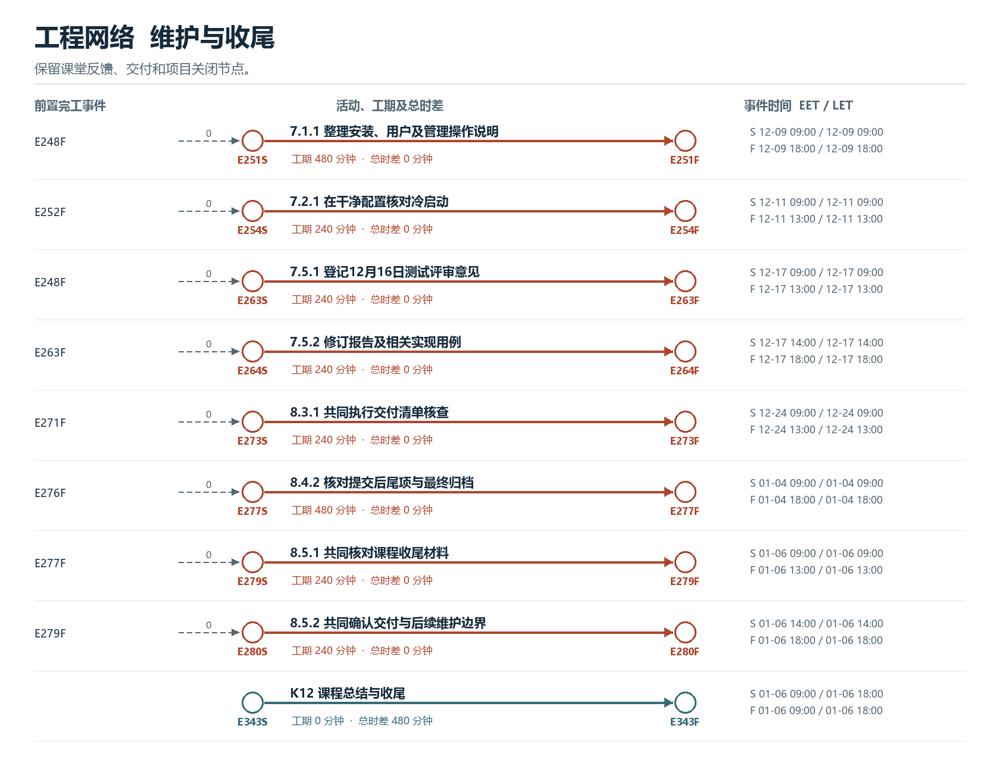
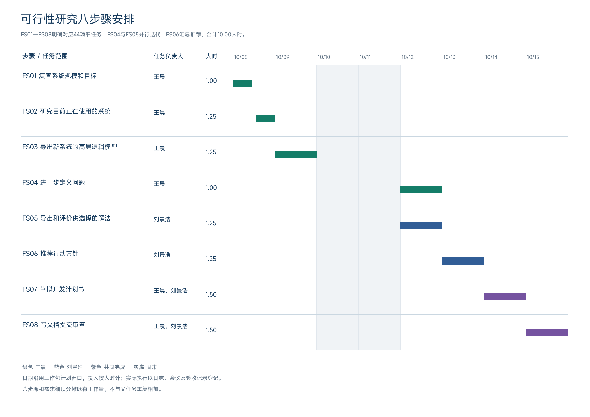
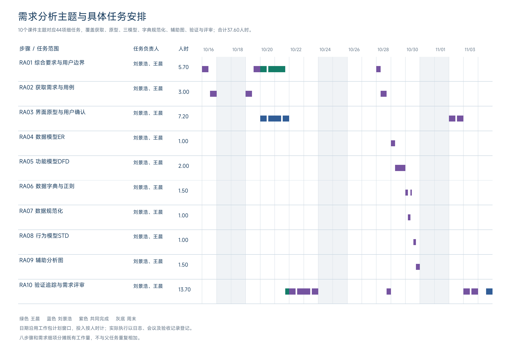

城院帮项目计划

编制依据 GB/T 8567—2006 第7.2节 软件开发计划 SDP

软件工程课程项目 G04

组长兼项目负责人 王晨 32401211
成员 刘景浩 32401205

课程周期 2026年9月16日—2027年1月6日

文档版本 V1.8  校订日期 2026年11月13日

实习与求职经验分享社区
免费阅读 非现金激励 自愿站外联系

本计划覆盖从首堂课启动到课程作业评审收尾的完整周期。项目任务、人时和验收按同一排期基线核对。

# 文档控制

本次修订按课件第5章、第6章及总体设计报告重构设计任务，补充实现阶段测试与取证。课程提交节点按原要求安排。

| 字段 | 记录 |
| --- | --- |
| 文档标识 | G04-SDP-20261112-01 |
| 标题 | 城院帮项目计划 |
| 小组与项目负责人 | G04；王晨32401211，组长兼项目负责人；刘景浩32401205 |
| 修订日期与文档状态 | 2026年11月13日，V1.8 课程排期及目录校订 |
| 输入与排期基准 | 软件工程课程计划第18页、总体设计报告 V1.2、SRS V1.5.1，排期基准 G04-BL-20261112-DT |
| 修订说明 | 对齐 2026 年 9 月 16 日首堂课与 2027 年 1 月 6 日课程作业评审，更新 16 个课堂节点、二级目录与评审页码。59 个工作包、275.85 人时和 12622.90 元直接人工预算。 |
| 当前版本与交付标识 | V1.8，G04-SDP-20261112-01，2026年11月13日校订 |

正文按GB/T 8567—2006第7.2节的13章组织，详细活动见第6章。附录A、B提供任务分解、逐周安排与完成条件，附录C对应教师16项评审要求。[Q1]

项目计划 275.85 人时，直接人工预算 12622.90 元。原生 MPP 已重开核对 353 条人员分配、日期及前置。执行人时与完成证据按工作日志登记。

正文采用 GB/T 8567—2006 第 7.2 节 13 章。附录 A、B 提供工作包及逐周计划，附录 C 对应计划阶段 16 项评审。

## 目录

- [文档控制](#文档控制)
- [1 引言](#1-引言)
- [2 引用文件](#2-引用文件)
- [3 交付产品](#3-交付产品)
  - [交付成果登记](#交付成果登记)
  - [里程碑准入与验收条件](#里程碑准入与验收条件)
  - [3.6 课程里程碑与提交安排](#36-课程里程碑与提交安排)
  - [09/16—09/30 课程启动与计划初稿](#09160930-课程启动与计划初稿)
  - [10/14 项目计划评审](#1014-项目计划评审)
  - [10/21—11/04 可行性与需求评审](#10211104-可行性与需求评审)
  - [11/11—11/25 总体设计与详细设计评审](#11111125-总体设计与详细设计评审)
  - [12/02—12/16 实现交付与测试评审](#12021216-实现交付与测试评审)
  - [12/30—01/06 项目总评与课程收尾](#12300106-项目总评与课程收尾)
- [4 所需工作概述](#4-所需工作概述)
- [5 实施整个软件开发活动的计划](#5-实施整个软件开发活动的计划)
  - [生命周期与 WBS 对应](#生命周期与-wbs-对应)
- [6 实施详细软件开发活动的计划](#6-实施详细软件开发活动的计划)
  - [6.4 总体设计与技术复审](#64-总体设计与技术复审)
  - [6.6 详细设计与设计评审](#66-详细设计与设计评审)
  - [6.7 实现成果与单元测试](#67-实现成果与单元测试)
  - [6.11 系统测试与验收](#611-系统测试与验收)
  - [6.18 联合评审与意见处理](#618-联合评审与意见处理)
- [7 进度表和活动网络图](#7-进度表和活动网络图)
  - [阶段甘特图与人员投入](#阶段甘特图与人员投入)
  - [工程网络与关键路径](#工程网络与关键路径)
- [8 项目组织和资源](#8-项目组织和资源)
  - [8.1 项目组织与成员分工](#81-项目组织与成员分工)
- [9 培训](#9-培训)
- [10 项目估算](#10-项目估算)
  - [10.2 工作量估算](#102-工作量估算)
  - [10.3 成本估算](#103-成本估算)
- [11 风险管理](#11-风险管理)
- [12 支持条件](#12-支持条件)
- [13 注解](#13-注解)
- [附录A 工作包时间责任与完成标准](#附录a-工作包时间责任与完成标准)
- [附录B 详细任务分解与周安排](#附录b-详细任务分解与周安排)
  - [课程启动与预备阶段 09/16—09/30](#课程启动与预备阶段-09160930)
- [附录C 计划阶段16项评审对照](#附录c-计划阶段16项评审对照)
- [附录D 会议与成员阶段评价](#附录d-会议与成员阶段评价)
- [附录E 模板依据与量化管理](#附录e-模板依据与量化管理)
  - [E2 每周负荷与实际记录](#e2-每周负荷与实际记录)
  - [E3 成员贡献评分](#e3-成员贡献评分)
- [附录F 人工预算与配套管理文件](#附录f-人工预算与配套管理文件)
- [附录G Git图形界面协作说明](#附录g-git图形界面协作说明)
- [附录H 日志需求与开发工作记录](#附录h-日志需求与开发工作记录)
- [附录I 可行性八步骤与需求分析任务安排](#附录i-可行性八步骤与需求分析任务安排)

# 1 引言

## 1.1 标识

项目标识 HZCU-CampusHub，文档标识 G04-SDP-2026。文档 V1.8，修订 G04-SDP-20261112-01，日期 2026 年 11 月 12 日。 本轮按 2026 年 11 月 13 日课程日期与目录校订。

## 1.2 系统概述

城院帮面向已经明确求职岗位、正在准备投递与面试的大学生，提供实习与求职经验分享社区。重点服务大三、大四读者，鼓励已获得实习或工作经历的校内学生与校友分享亲历。平台结构支持全校，首批内容与演示案例聚焦计算机相关专业。

核心使用场景：读者选择目标岗位，并按公司、同专业等条件筛选经验，了解与自己起点接近的人如何准备投递和面试。阅读后可收藏、评论，必要时自愿查看作者联系方式并在站外联系。

项目总目标：在课程周期内完成微信小程序、读者与作者网页端、社区管理网页和运维管理网页，交付可运行的经验社区及配套工程文档。产品采用免费阅读、非现金激励和自愿站外联系的模式。

准备实习与求职的学生需要跨渠道搜集资料，判断经验与自身专业、基础和目标岗位的适用性，并找到相似起点的准备路径与交流渠道。项目按岗位、同专业筛选、经历背景和文章评论组织亲历经验，需求依据前期讨论与求职场景分析。[R5]

开发方为G04王晨与刘景浩，使用方为本校读者、作者及管理维护角色；本组承担课堂项目投入。教师和助教依课程要求评审，未设企业委托方。现阶段正式运行现场为个人电脑、Windows及WSL2本地课堂演示环境。

## 1.3 文档概述

本文规定交付产品、开发活动、进度网络、组织资源、培训、估算、风险与支持条件，与可行性分析报告、WBS、周计划和系统测试计划配套使用。

## 1.4 与其他计划之间的关系

本计划统筹范围、进度与资源；可行性分析报告说明方案选择与实施依据；系统测试计划细化功能、性能、压力和恢复验证；工作日志、周会议纪要及问题变更记录支持执行检查。总体设计、详细设计和操作手册按对应工作包交付。

## 1.5 基线

排期基准 G04-BL-20261112-DT。课件的 2026 年 9 月 16 日课程启动与 2027 年 1 月 6 日收尾分别为项目起点和终点。9 月课堂节点按课件登记，10 月 8 日为有工时估算的任务起始日。

本计划采用下表所列范围、任务、排期、测试和课程资料作为输入，需求、设计及测试成果按相应里程碑形成受控版本。

本计划文档修订标识为G04-SDP-20261112-01，日期为2026年11月12日；排期基准采用G04-BL-20261112-DT。输入文件、版本及SHA256见《版本与输入基线G04.json》。

| 输入编号 | 输入文件与版本日期 | 用途 |
| --- | --- | --- |
| IN01 | 城院帮软件需求规格说明书G04.docx；V1.2，2026年10月28日 | 初步范围、角色和需求输入；原10月23日需求目标保留历史；本轮3.6—3.9修订后登记内部确认。 |
| IN02—IN04 | 任务数据.json、详细周计划G04.md、任务人员工时明细G04.csv；10月28日修订登记 | WBS、交接、负责人和275.85人时估算。 |
| IN05—IN06 | 城院帮项目计划G04.mpp、计划阶段评审原表.pdf；10月28日修订登记 | 日期依赖与课程16项检查要求。 |
| IN07—IN08 | 系统测试计划G04.docx；10月18日整理。10月17日周会纪要；10月21日整理 | 测试与恢复要求；会议1.054人时／人及91.0、90.5分评价。 |
| IN10 | 第2章 可行性研究(1).pdf；课程提供版，58页；2026年10月21日接收 | 八步骤、系统流程图、DFD、数据字典与成本效益方法。 |
| IN11 | 软件工程-课程项目评审表-需求阶段评审.pdf；课程提供版，2页、11项；2026年10月21日接收 | 当前周需求交接与证据检查，不替代计划阶段16项原表。 |
| IN12—IN14 | 第3章需求分析.pdf 70页及需求评审表2页，10月28日接收；SRS V1.2、模型说明V1.1及分析报告V1.3 | 三模型、数据规范化、辅助图、四维验证及11项评审对照。 |
| IN15—IN16 | 本周课程作业通知；10月31日元宝会议纪要及组长评分补充 | 11月1日22时提交要求；文档共同评审、协作环境与分支规范；本期评价91.2/91.3。 |
| IN09–IN11 | 总体设计 V1.2.1；课件第5、6章；实现阶段评审表 | 总体、详细设计、实现测试的结构与验收依据。 |

项目计划 V1.8 采用总体设计 V1.2.1 和统一 SRS V1.5.1。V1.7 计划 226.55 人时，作为本轮重估对照。

# 2 引用文件

[R1] 软件工程课程课件 第13章 软件项目管理，97页。依据13.1软件规模、13.2工作量估算、13.3进度计划、13.4人员组织、13.5质量保证及13.6配置管理。

[R2] 软件工程课程课件 第1章 软件工程学概述，78页。依据软件生命周期、瀑布模型、文档及阶段评审。

[R3] 软件工程课程计划与团队作业通知，2026学年。课程节点、阶段成果及周日22时邮件提交要求。

[R4] 软件工程课程项目计划阶段评审检查表，2页，16项评审要求。

[R5] G04初步需求与已确认产品范围，2026年10月18日整理；对应IN01初步需求规格说明书，登记路径、版本及摘要见1.5与《版本与输入基线G04.json》。

[R6] 张海藩、牟永敏 软件工程导论 第6版，清华大学出版社，2013，ISBN 9787302330981。教材结构参考；用于生命周期、可行性和项目管理方法对应。

[R7] Kathy Schwalbe．IT项目管理 原书第8版．北京：机械工业出版社，2017。版次采用本组指定教材，出版年与上海交通大学在线课程教材目录核对：https://cnmooc.sjtu.cn/portal/course/5762/15509.mooc ，查阅2026年10月21日。

[R8] 工具官方参考文档，网页登记日期为2026年10月21日；网页文档与实际工具版本分别记录。

Microsoft．Learn more about resource units，Project桌面版资源单位说明：https://support.microsoft.com/en-us/project/learn-more-about-resource-units 。

Apache Software Foundation．JMeter User Manual，在线手册：https://jmeter.apache.org/usermanual/index.html 。

JUnit Team．JUnit User Guide，参考文档版本6.1.3：https://docs.junit.org/6.1.3/overview.html 。实际依赖由工程构建清单锁定。

Git项目．Git Reference，在线参考：https://git-scm.com/docs 。实际Git版本在发布清单登记。

课件参考条目按资料名称、章节与课程来源列示。项目管理方法以所提供课件和评审表为直接依据，任务估算与技术方案由本组制定。

[F1] GB/T 8567—2006第7.2节第7、8章。进度表、活动网络图、项目组织和资源为本组计划的编制依据；周计划字段和控制指标由本组结合课程要求制定。

[F2] GB/T 8567—2006第7.2节。计划跟踪和更新、配置控制、进度与资源安排。完整131页PDF副本已保存，标准状态于2026年10月16日在国家标准公开系统核对为现行；实际与预测分开、预警阈值为本组控制规则。

[R11] GB/T 8567—2006 计算机软件文档编制规范，第7.2节软件开发计划。正文13章与标准章序对应；第6章按本项目规模说明适用及裁剪。

课程资料采用课程提供版本，以章节名称、页数和2026年10月28日修订登记日期识别；课件条目保留课程来源，不列教师作者姓名。已保存输入文件的路径和SHA256见《版本与输入基线G04.json》，在线资料按版本或查阅日期登记。

[R9] 软件工程课程课件 第2章 可行性研究，58页；2026年10月21日接收。八步骤见PDF第8—14页，两类图见第16—39页，数据字典见第41—49页，成本效益见第51—56页。

[R10] 软件工程课程项目评审表 需求阶段评审，2页、11项，2026年10月21日接收。作为需求阶段交接依据，计划阶段16项评审继续保留。

[R12] 第3章 需求分析，软件工程课程课件，70页，2026年10月28日接收。三模型见25—26、69页；实体联系、规范化、状态和辅助图见29—57页；验证见60—68页。

# 3 交付产品

## 3.1 程序

交付微信小程序源码及开发者工具可运行产物、读者作者网页、社区管理网页、独立运维网页与执行器、业务服务、数据库迁移和初始化脚本。各程序以发布清单中的版本、构建方式和运行条件标识。

## 3.2 文档

## 交付成果登记

下表为交付成果索引，计划形成日期来自WBS。执行时在《交付成果登记G04.csv》中记录实际日期、版本、证据与确认人，达到完成标准并经复核后登记验收结果。课堂日期和邮件截止见第3.6节。[F2]

| 成果与WBS | 计划形成日 | 责任与复核 | 交付及完成依据 |
| --- | --- | --- | --- |
| D01 项目计划及排期 1.3 | 10/15 | 王晨组织，双方确认 | 正式计划、WBS、MPP、工程网络与预算。任务可分配、交接与验收；评审意见逐项登记 |
| D02 可行性报告 2.3 | 10/15 | 双方编写，交叉确认 | 报告、方案比较及实施安排；技术、成本、资源、进度和验收要求明确 |
| D03 需求修订基线 3.6—3.9及3.5 | 11/01提交 11/03复核 11/04反馈 | 双方编写，交叉确认 | SRS、三模型、字段字典、原型走查、追踪和11项对照。用户确认及内部审查有真实记录后登记验收，不把原10/23目标当实际完成。 |
| D04 总体与详细设计 4.1–4.14 | 11/05 内部节点；11/13 详细设计；11/26 修订 | 王晨负责技术和管理，刘景浩负责交互及治理运维，两人复核 | 九步设计、配套文档、详细设计及课堂反馈，按证据登记 |
| D05 集成候选版本 5.12 | 11/27 | 王晨集成，刘景浩核对端到端流程 | 真实接口联调、程序清单、代码走查与单元结果，11 月 29 日提交 |
| D06 首轮内部验收 6.7 | 12/04 | 刘景浩汇总，王晨技术核对，双方确认 | 目标环境、真实用户、功能集成、性能及恢复，12 月 4 日封版并于 12 月 6 日提交 |
| D07 运行维护与交接 7.3 | 12/14 | 王晨统稿，刘景浩复核运维操作，双方交接 | 运行手册、备份、回退及交接记录。双方可按手册冷启动并演练；失败能定位和回退 |
| D08 总结与归档 8.5 | 01/06 | 王晨组织，刘景浩核查附件，双方确认 | 总结、最终包、清单与真实评价。1月3日提交基线，1月4日核对尾项，1月6日确认收尾 |

## 3.3 服务

提供本机安装与冷启动演示、角色和操作说明、部署重启备份恢复演练，以及双方交接。课程后持续运营、云端服务等级和第三方咨询不作为本次承诺。

## 3.4 非移交产品

个人开发环境、AI会话、缓存、临时预览、私人资料和实际账号密钥不作为交付产品；工具依赖以安装说明或版本清单提供。正式源码、工程文档与可复现的测试证据不因使用AI而排除。

## 3.5 验收标准

## 里程碑准入与验收条件

里程碑是检查成果和作出下一步决定的时点。内部形成、邮件提交、课堂评审分别登记；预计日期不能作为实际完成证明。教师反馈先分析影响，再回到对应需求、设计或实现任务处理。[F2]

| 检查点 | 必须具备的输入 | 通过条件与未通过处理 |
| --- | --- | --- |
| 需求修订 11月3—4日 | 课件、三模型、字典、原型及用户反馈 | 64项需求追踪及四维验证；实际用户确认、未决项和评审意见有责任及期限，阻塞问题未关闭不得签署设计输入基线。 |
| 设计基线 11月5日 | SRS与接口、数据、关键状态和恢复方案 | 关键设计问题关闭；测试条件可执行；未关闭阻塞项先处理 |
| 集成候选 11月27日 | 模块产物、单元结果、接口与联调数据 | 双端和管理链路使用实际接口；失败明确责任并重排 |
| 首轮内部验收 12月4日 | 固定版本、测试数据、用例、性能压力及恢复记录 | 核心流程执行且严重缺陷关闭；限制和剩余项有期限 |
| 最终归档 1月3日至6日 | 运行包、文档、证据、已知问题与真实成员评价 | 1月3日提交当时基线，1月4日核对尾项，1月6日完成收尾 |

核心流程全部执行，阻塞与严重缺陷关闭。未关闭的一般问题列影响、责任人与期限。必须需求有实际验收结果；本机网页部署、业务重启、备份恢复有真实记录；代码、安装包、报告和测试版本一致。公网部署及小程序正式发布不作为本次课堂条件。

## 3.6 课程里程碑与提交安排

课程日期和成果名称取自教师《课程计划》第 18 页。表中单列现有邮件截止与组内交接，课堂意见在课后登记并进入对应修订。9 月节点按课件记录，12 月 23 日为教学节点。

| 课堂日期 | 邮件截止 周日22时 | 课件里程碑 | 项目对应工作 |
| --- | --- | --- | --- |
| 09/16 | — | 学生分组信息、课程作业选择 | 课程项目起点，分组与选题按课堂要求登记。 |
| 09/23 | — | 提交预备作业、项目介绍及 PPT | 预备作业和项目介绍节点。 |
| 09/30 | — | 项目计划及 PPT | 初次项目计划及 PPT 节点；10 月 14 日安排计划评审与修订。 |
| 10/14 | 10/11 | 项目计划修订 | 1.2评审材料；1.3课后修订 |
| 10/21 | 10/18 | 可行性分析报告 | 2.3内部结论与交叉确认 |
| 10/28 | 10/25 | 需求说明 SRS、需求评审 PPT | 3.4需求基线与完整用例 |
| 11/04 | 11/01 | SRS 修订 | 先提交已有修订；3.5处理当堂新意见 |
| 11/11 | 11/08 | 总体设计报告 | 4.9内部设计基线 |
| 11/18 | 11/15 | 详细设计报告 | 4.13.3 详细设计与用例复核 |
| 11/25 | 11/22 | 总体及详细设计修订、翻转 PPT1 | 4.14.1 提交前修订；4.14.2–4.14.4 处理课堂意见 |
| 12/02 | 11/29 | 代码清单、测试用例、翻转 PPT2 | 5.12.3 代码清单、用例及候选版本 |
| 12/09 | 12/06 | 系统测试报告 | 6.7.2 12月4日封版；6.8属后续复核 |
| 12/16 | 12/13 | 测试报告修订 | 6.8 复核结果与已取得的修订；7.5处理课堂意见 |
| 12/23 | — | 教学节点 | 课件仅列教学内容；本周项目任务仍按 WBS 8 执行。 |
| 12/30 | 12/27 | 项目总结报告、总评 PPT | 8.3交付核查与演练 |
| 01/06 | 01/03 | 课程收尾、课程作业评审 | 1 月 3 日提交归档基线，1 月 4 日核对尾项，1 月 6 日课程评审及交付确认。 |

## 09/16—09/30 课程启动与计划初稿

9 月 16 日首堂课为项目起点。9 月 23 日安排预备作业与项目介绍，9 月 30 日安排项目计划及 PPT。

## 10/14 项目计划评审

提交版、课堂评审及课后修订分别登记。计划评审的 16 项依据见附录 C。

## 10/21—11/04 可行性与需求评审

10 月 21 日对应可行性报告，10 月 28 日对应 SRS 与需求评审 PPT，11 月 4 日对应需求评审与 SRS 修订。

## 11/11—11/25 总体设计与详细设计评审

11 月 11 日对应总体设计报告，11 月 18 日对应详细设计报告，11 月 25 日进行设计评审，意见进入 4.14。

## 12/02—12/16 实现交付与测试评审

12 月 2 日对应代码清单与测试用例，12 月 9 日对应系统测试报告，12 月 16 日对应测试评审与报告修订。

## 12/30—01/06 项目总评与课程收尾

12 月 30 日对应项目总结及总评 PPT。2027 年 1 月 6 日课程作业评审并完成 8.5 交付确认，为项目终点。

组长使用学校邮箱提交，邮件主题为“SE2026-G04-作业名称”，按课程要求抄送助教和本组成员。收件、抄送、附件、来源及版本在发送前核对并保留发送记录。

最终收尾日为2027年1月6日；1月3日提交当时确认的归档基线，1月4日处理并核对尾项。周计划与附录A、B给出各项中间成果的截止和确认人。

# 4 所需工作概述

| 用户/参与者 | 核心功能与价值 |
| --- | --- |
| 访客、登录但未认证用户 | 浏览、检索、筛选、免费阅读文章及文章内资料链接；进行必要的登录与认证操作。 |
| 已认证读者 | 查看评论和作者主页；点赞、投币、收藏、评论与图片回复；举报/反馈；自愿站外联系。 |
| 已认证作者（与读者同账号） | 网页Markdown与小程序基础图文创作；多草稿、预览、发布、修改、下架；可选联系方式；查看认可与荣誉。 |
| 社区管理员 | 网页端认证审核、巡查、举报/反馈/申诉处理、分类维护、必要的用户限制与操作留痕。 |
| 运维管理员 | 独立运维权限；网页查看服务状态、错误日志和备份记录，执行部署、重启、备份恢复，追踪任务结果。 |

内容范围包括求职准备、面试流程与复盘、实习资料、成长路径、岗位与公司体验。文章可关联岗位、公司、专业、经历阶段和发生时间，正文采用自由撰写与可跳过的写作提示。

身份与交流：本期仅校园邮箱注册并验证码认证，材料人工审核和微信绑定列后续扩展；主页显示昵称、专业、年级与认证状态，不公开真实邮箱。未认证用户只浏览和阅读文章，评论、作者主页和联系方式由认证用户访问。所有限制在服务端执行。

创作与激励：网页端支持Markdown和图片，小程序提供基础图文创作、草稿、预览、修改和下架。资料可附网盘链接。点赞表示认可，投币表示特别有帮助，收藏供以后查阅。币通过简单日常任务获得，每日设领取上限，不兑换现金；作者按收到的有效币累计获得称号与勋章。

治理原则：先发布、后管理。认证用户可以举报、反馈，社区管理员查看关联文章及评论、处理问题并保留操作记录。禁止广告及欺骗性内容。荣誉体现社区贡献，不作为经历真实性的保证。

本次交付不包含付费文章、支付、现金打赏、咨询订单、站内即时通信、任务悬赏、跑腿、招聘交易及独立考研考公板块。

## 交付目标与可检查结果

项目目标按读者使用、作者创作、管理维护和课程成果四类结果检查，并通过需求编号和验收用例建立追踪关系。交付、进度和资源按GB/T 8567—2006第7.2节组织，阶段产物与完成标准见下表。[Q1]

| 目标 | 预期结果 | 对应工作与检查 |
| --- | --- | --- |
| G1 找到并阅读经验 | 岗位为主入口，专业与公司辅助筛选；未认证权限在接口端执行 | 需求3.1—3.4；文章与权限用例，报告第6章 |
| G2 分享与交流 | 网页Markdown、小程序图文、草稿发布、评论及非现金激励形成完整流程 | 实现5.2—5.9、5.12；双端异常与账本证据 |
| G3 管理与维护 | 社区与运维权限分开；网页部署、重启、备份恢复及失败保护可复核 | 设计4.12、实现5.10—5.11；验证6.4—6.5、维护7.1—7.3 |
| G4 课程交付 | 本地可启动；核心用例执行、严重缺陷关闭，文档、版本与运行包一致 | 验收6.7；归档8.3—8.5，完整标准见第3、6章 |

## 实施假设与约束

本计划采用两人协作、现有电脑、本地课堂演示及免费经验社区的实施范围。集中开发与测试追加投入按周计划组织；校园邮箱、跨端内容、独立运维与恢复纳入技术验证。可研C01—C05与本计划任务、负责人和验收节点对应，范围或资源变更通过问题与变更登记管理。

# 5 实施整个软件开发活动的计划

## 5.1 软件开发过程

采用阶段成果与评审控制的开发过程，WBS按软件工程阶段组织。需求和总体、详细设计分别交付报告；11月5日完成内部设计评审后，11月6日开始集中实现。课堂在11月11日、18日和25日分别检查设计材料，新增意见通过影响分析进入模块调整，不将编码开始等同于课堂评审已通过。[R1][R2]

| 阶段 | 本项目工作与产物 | 阶段完成条件 |
| --- | --- | --- |
| 项目计划与评审 | WBS、周计划、Project、预算、风险与责任 | 每项任务可分配、可交接、可验收；评审意见有记录 |
| 可行性研究 | 技术、经济、操作、进度、资料与风险分析 | 关键技术有验证方法，失败有替代方案 |
| 需求分析 | SRS、用例、原型、权限、数据与异常 | 需求有编号和明确验收条件；双方确认内部基线 |
| 总体与详细设计 | 架构、ER、接口、流程、状态及运行恢复设计 | 关键问题关闭；文档足以指导实现和测试 |
| 编码与单元测试 | 双端、业务和管理运维模块；单元与联调记录 | AI输出人工核验；真实接口联通，形成候选版本 |
| 综合测试 | 功能、接口、安全兼容、性能压力、稳定性与恢复证据 | 核心用例通过；阻塞和严重缺陷关闭；限制明确 |
| 部署与维护 | 本机发布包、操作规程、维护变更与交接 | 可冷启动、恢复、回退；双方可操作管理流程 |
| 总结与收尾 | 偏差分析、总结、真实评价、版本和最终交付 | 资料同版本，课程意见完成处理，交接有记录 |

## 生命周期与 WBS 对应

WBS设8个顶层工作组，并保留管理、评审和收尾活动。教材的软件生命周期仍按问题定义、可行性研究、需求分析、总体设计、详细设计、编码与单元测试、综合测试、维护8阶段理解。总体与详细设计共用WBS第4组，但分别交付和评审；项目计划、部署和总结是管理及交付活动。[R2]

| 教材阶段 | 本项目工作包 | 阶段产物或当前处理 |
| --- | --- | --- |
| 问题定义 | 前期范围与选题讨论 | 已过阶段作为历史依据，不重新列为本期待办 |
| 可行性研究 | 2.1—2.3 | 关键技术条件、方案比较及可行性报告 |
| 需求分析 | 3.1—3.5 | SRS、原型、权限异常、追踪及反馈修订 |
| 总体设计 | 4.1–4.9 | 课件第5章九步，重点是从需求DFD推导候选与五步结构映射。产物为总体设计和五份配套文档。 |
| 详细设计 | 4.10–4.14 | 课件第6章，细化业务过程、界面、数据结构与复杂度，形成测试用例及反馈修订。 |
| 编码与单元测试 | 5.1—5.12 | 模块实现、单元验证、交叉复核与联调 |
| 综合测试 | 6.1—6.8 | 功能、安全、兼容、性能压力、稳定性与恢复 |
| 维护 | 7.1—7.5 | 部署交接、维护变更、缺陷修复与回归 |

采用带反馈的阶段控制：需求或设计评审意见进入问题和变更台账，先分析范围、接口、排期与测试影响，再回到受影响阶段修订。内部基线及课堂复核分别记录，关键问题未关闭时不扩大后续实现范围；执行中同步更新周计划和Project。[R1][R2]

## 5.2 软件开发总体计划

## 系统架构与开发工具

微信原生小程序承担移动端阅读与基础创作；独立Vue 3/TypeScript/Vite网页承担长文、完整创作和管理。两端共用Java/Spring Boot接口、MySQL、内容结构与权限规则，页面组件和构建流程分别维护。独立运维执行器处理受控部署、重启、备份及恢复。

系统架构与本机部署

| 工程活动 | 采用工具 | 主要产物 |
| --- | --- | --- |
| 计划与正式文档 | Microsoft Word、Excel | 计划、SRS、可行性、测试维护报告与追踪表 |
| 项目排期 | Microsoft Project | 原生MPP、阶段与详细甘特图、依赖、资源和关键任务 |
| 分析与设计 | draw.io、Axure RP | 架构、工程网络、ER、流程和交互原型；许可不足时用可用的同类原型工具 |
| AI辅助开发 | Codex/GPT、WorkBuddy | 框架、接口及具体代码由Codex/GPT辅助实现；小程序及相关页面使用WorkBuddy；豆包用于PPT。两人审查后入Git。 |
| 前端 | VS Code、微信开发者工具 | 微信原生小程序与Vue 3独立网页构建与双端调试、开发者工具演示 |
| 后端与数据库 | IntelliJ IDEA、Java、Spring Boot、MySQL | 接口代码、SQL、初始化和数据库版本 |
| 单元接口及集成 | JUnit、Spring测试支持、Postman | 单元结果、接口集合、数据断言和集成证据 |
| 性能压力与稳定性 | Apache JMeter | 脚本、JTL、P95、错误率和资源趋势 |
| 缺陷跟踪 | Bugzilla | 复现、等级、指派、修复、复测和关闭记录 |
| 配置与协作 | Git、GitHub、SourceTree | 版本历史、个人分支、合并复核与基线；组长创建维护项目仓库 |

工具按工程活动选择。JMeter用于HTTP接口度量，浏览器和微信开发者工具用于页面与小程序体验检查。两位成员对各自任务的代码、文档及验证结果负责。[R1][R8]

软件开发方法以需求和设计基线、模块实现、单元验证、集成与综合测试为主；评审意见按影响返回相关阶段。代码与过程材料采用本章软件产品标准，接口字段及错误码在设计中细化，测试步骤和证据格式由系统测试计划承接。

复用框架、依赖及已有成果前，负责人核对版本、许可证、接口和测试覆盖。关键需求包括权限、草稿恢复、跨端版本、币账本与运维失败保护，均按本期验收场景复核。

现有电脑承载本地环境，性能记录包括实际配置及资源竞争情况。方案评审记录备选项、理由、限制和确认人；教师评审、内部复核及用户试用各自保存记录。

## 软件产品标准

本项目采用G04-STD-2026 V1.0软件产品标准，2026年10月21日生效用于后续编写和复核。下表作为代码、接口、文档与测试记录的共同检查依据；具体字段和设计决策在需求及设计中按版本细化。

| 检查范围 | 采用标准 | 检查与记录 |
| --- | --- | --- |
| 代码格式与命名 | Java统一4空格缩进、UTF-8；类用UpperCamelCase，方法与变量用lowerCamelCase，常量用UPPER_SNAKE_CASE；前端统一2空格，组件用UpperCamelCase；SQL表和列用小写下划线。 | 任务负责人格式检查，另一成员复核差异。 |
| 注释与复杂逻辑 | 对外接口说明用途、输入输出和错误；事务、幂等、权限及恢复过程说明关键约束和失败处理；公共方法写必要参数与返回说明，避免复制无效注释。复杂分支拆分并列边界用例。 | PR说明关联REQ与WBS，保存复杂逻辑检查和用例。 |
| 接口与错误 | HTTP接口传输JSON并采用UTF-8；字段命名统一lowerCamelCase；响应包含code、message、data、traceId，分页明确页码与上限；状态码区分成功、输入错误、未认证、无权限、冲突和服务失败。 | 接口文档与Postman断言一致；兼容变化先评估调用端。 |
| 安全与配置 | 服务端执行权限校验、输入校验与参数化SQL；密码、验证码、令牌和SMTP授权码不写日志和仓库；外部响应不暴露堆栈。Debug与Release诊断按配置切换，默认Release。 | 检查越权、危险输入、日志脱敏与配置样例。 |
| 文档与版本 | 使用统一文档编号、版本、日期及输入基线；正文12磅、表格11磅；图表注明编号与来源，长表重复表头；Word刷新目录后导出PDF；正文、附件与文件摘要清单同批发布。 | 封版时交叉复核目录、引用、图表、文件摘要和交付清单。 |
| 需求与测试记录 | REQ标识需求，TC标识用例，DEF标识缺陷，CR标识变更；记录对象版本、环境、输入、步骤、预期、实际、结果及证据路径。功能、性能、压力、稳定性和恢复结果分别保存。 | 测试报告关联需求与缺陷；重测记录引用修复版本。 |
| 脚本与交付 | 运维脚本只执行已配置目标与固定动作，检查返回状态并保留任务编号；数据库迁移新增版本，不覆盖已发布迁移；发布清单列构建、依赖、配置项和校验摘要。 | 交叉复核后合并，发布前执行冷启动与失败恢复检查。 |

# 6 实施详细软件开发活动的计划

## 6.1 项目计划和监督

王晨组织周检查、风险与变更，刘景浩汇总任务及配置状态；双方核对产物、阻塞、预测完成与下周任务。跟踪表分别记录基线、预测、实际及证据，缺项登记补录责任。测试、安装及移交见系统测试计划和6.12、6.13节。

## 6.2 建立软件开发环境

对应工程基础与工具核查任务。两人分别核对开发、测试环境及依赖版本；统一Git开发库、数据库迁移、配置样例与文档目录。AI、编辑器和个人缓存属于辅助环境；密钥保存在本机忽略配置中。

## 6.3 系统需求分析

需求分析按课件建立数据、功能、行为三个模型：ER图、分层DFD和状态转换图。3.1—3.4保留原计划历史；新增3.6—3.9完成本轮课件核对、字典规范化、原型走查和四维验证，3.5接收11月4日课堂意见。真实用户确认是设计输入基线的前提。

## 可行性研究与需求交接

可行性八步骤在2.1—2.3工作包下设FS01—FS08，向下展开44项任务，合计10.00人时。需求分析在3.1—3.9下展开44项执行任务，覆盖课件10个主题；其中3.6—3.9仍为20.00人时。任务、责任、日期、人时和产物见附录I，并与WBS、甘特图及Project源对应。

### 6.3.1 需求与可行性方法的交付展示

| 分析成果 | 具体完成判断 | 展示位置 |
| --- | --- | --- |
| 可行性八步骤 | 44项分解，逐步有输入、动作、项目结果、完成标准和WBS；不能只列八个名称 | 可研第3.5节；成果页码导航 |
| 两类流程图 | 物理程序/介质数据流与逻辑DFD明确区分；P1—P5、D1—D6同名 | 可研第5.2节 |
| 三个分析模型 | 用投币案例显示ER对象联系、DFD数据变换和STD状态条件；完整模型另附 | 需求分析第3、4、7章 |
| 字典与规范化 | 五类字典有实例；组合、正则和语义分开；展示同一例子1NF→2NF→3NF | 需求分析第5、6章 |
| 辅助工具 | 层次方框、带重复/选择的Warnier、IPO和课件表形改进IPO均有实际图 | 需求分析第8章 |
| 验证和审查 | 四类验证有场景与证据；11项评审能定位；真实用户反馈与会议如实登记 | 需求分析第9、10章 |

可行性与需求细化的原始估算见附录 I。当前设计、实现交接和测试按 V1.8 排期，工作包与末级任务以当前 Project 核查为准。

## 6.4 总体设计与技术复审

总体设计以 SRS DFD00–03 为起点，按第 5 章九步骤确定架构、分解处理和导出软件结构。王晨负责 DFD、后端、数据库和项目管理，刘景浩负责双端、人机交互、治理与运维场景。两人分别完成和交叉复核各自的设计输入。

| 课件步骤与WBS | 计划活动 | 交付与验收 |
| --- | --- | --- |
| 4.1 设想供选择的方案 | 引用 DFD00–03，检查 P1–P5 及 D1–D6，提出并筛除处理分组。 | 候选分组、共享数据及运行边界能回查需求模型。 |
| 4.2 选取合理的方案 | A、B、C 各提供系统流程、物理清单、成本／效益和进度。 | 四项资料逐套完整，工作量及工期假设可追溯。 |
| 4.3 推荐最佳方案 | 比较工程约束、成本、用户体验和部署条件。 | 选型理由及风险有记录。 |
| 4.4 功能分解 | 将 18 个 DFD 处理分解到程序、数据和验证。 | 发布、投币、处置、恢复有过程设计输入和异常取证。 |
| 4.5 设计软件结构 | 4.5.1 精化DFD，4.5.2 判定流类型和边界，4.5.3 变换／事务映射，4.5.4 启发规则精化，4.5.5 导出接口数据并复查。 | HIPO、Yourdon、精化前后结构、接口和复查回路一一对应。 |
| 4.6 设计数据库 | 核对逻辑与物理关系、字段、约束、索引和迁移。 | 数据库设计结果和文件存储边界可定位。 |
| 4.7 制定测试计划 | 为三级测试编制策略、方案、预期结果和进度。 | 与 SRS、用例、环境和 WBS 一致。 |
| 4.8 书写文档 | 统稿总体设计、系统说明、用户手册、测试计划、详细实现计划和数据库设计结果。 | 技术内容与文档整编分别计时，图、表及目录同步。 |
| 4.9 审查和复审 | 技术审查登记问题，管理复审核对范围、工时和风险。 | 问题及结论可追踪，实际签认另登记。 |

## 6.5 软件需求分析

将系统要求分配到认证、内容、互动、社区和运维软件配置项，建立REQ到接口、数据和验收用例的追踪。未关闭的规则经双方确认后更新SRS，不以代码行为替代需求确认。

## 6.6 详细设计与设计评审

详细设计按课件第 6 章开展。4.10 形成结构化业务过程、状态、判定表及 McCabe 复杂度。4.11 明确小程序和网页的人机交互、图片、草稿和错误反馈。4.12 形成运维任务、备份文件结构和恢复过程。4.13 以过程设计输入编制三级用例、合成数据及复核。4.14 分别安排提交前修订、课堂意见、模块修订和联调交接。

## 6.7 实现成果与单元测试

WBS 5.1–5.11 按模块留存程序清单、规范、单元与白盒用例、工具执行结果和内部走查。5.12.2 交叉复核失败与修复，5.12.3 核对候选版本并封存 11 月 29 日提交材料。

## 6.8 配置项集成和测试

WBS 5.12.1 接通业务、双端、社区与独立运维的真实接口，前置包含 4.14.4 和各模块实现。6.1.2 以隔离 MySQL、接口工具和实际报告验证跨模块状态和事务。

## 6.9 CSCI合格性测试

对软件配置项按对应需求与用例检查。在本地目标环境和微信开发者工具中执行；与实现者交叉复核，保留独立性限制。由另一成员验收不能称为独立第三方认证。

## 6.10 CSCI与HWCI集成和测试

本项目不开发定制硬件配置项，不单设专用硬件集成工作包。现有电脑、WSL2、数据库及开发者工具的运行兼容和资源检查纳入环境核查、兼容及系统测试，不省略实际运行检查。

## 6.11 系统测试与验收

WBS 6.1–6.8 安排功能、性能、压力、稳定性、权限、目标设备、部署恢复、缺陷回归和报告。6.4.3 核对用户实际环境，6.7.1 记录最终用户任务走查。6.7.2 于 12 月 4 日封存 12 月 6 日提交报告，6.8 复核及课堂说明单列。

| 场景 | 需求/设计要规定的行为 | 计划验证证据 |
| --- | --- | --- |
| 验证码错误、过期、发送失败 | 清晰反馈、可重新申请；次数与有效期在SRS确定 | 成功/失败/过期、不同邮箱资格及日志不泄密 |
| 未认证或普通账号请求受限数据 | 服务端拒绝；不返回隐藏资料与管理信息 | 直接接口请求及不同角色回归 |
| 断网、保存失败、图片部分上传失败 | 保留可恢复正文；标记失败图片；重试不重复发布 | 草稿/图片/重复提交场景记录 |
| 同一文章跨设备编辑 | 识别版本冲突，不静默覆盖另一端新内容 | 双端冲突与恢复结果 |
| 重复领取、并发投币、余额不足 | 奖励只发一次；投币记录与余额一致；不得透支 | 重复与并发请求后的余额/贡献一致性 |
| 文章/评论被下架、收藏链接失效 | 明确不可用状态，保留必要记录；不泄漏已隐藏内容 | 旧链接、通知跳转、收藏等相邻路径回归 |
| 举报、申诉、管理员处理失败 | 保留原状态或明确结果；理由与操作人可追踪 | 处理前后状态、通知、审计及失败回退 |
| 运维网页操作失败或重复提交 | 目标确认、权限校验、任务互斥与持久日志；业务停机可查询 | 部署/重启/恢复、越权、重复、失败与业务停机场景 |
| 外部网盘/联系方式失效 | 用户可反馈；平台不保证站外服务结果 | 文章资料与联系入口提示及反馈闭合 |

| 测试类别 | 对象与工具 | 责任与证据 |
| --- | --- | --- |
| 单元 | 权限、状态、账本和筛选；JUnit及Spring测试 | 各模块负责人；代码版本与单元结果 |
| 接口、功能和集成 | 五类角色、双端与完整链路；Postman | 刘景浩统筹、双方修复；集合、断言和缺陷 |
| 安全与兼容 | 越权、隐私、危险输入、图片、双端编辑 | 刘景浩；直接API、浏览器及开发者工具记录 |
| 性能与负载 | 查询、详情、发布与评论；JMeter | 王晨；JTL、P95、错误率、吞吐与资源趋势 |
| 压力与稳定性 | 容量边界、持续运行与降载恢复 | 王晨；阶梯脚本、故障和一致性记录 |
| 部署与备份恢复 | 冷启动、部署重启、损坏备份、回退 | 王晨验证、刘景浩配合运维实现；恢复前后数据与执行日志 |

性能与恢复目标

以下是计划验收目标，最终结论必须注明执行环境、版本、数据与实际结果。同机施压需记录资源竞争；JMeter结果不能替代页面渲染和小程序体验检查。

| 场景 | 计划目标 | 必须保留的证据 |
| --- | --- | --- |
| 30并发负载 | 合成200用户、2000文章、5000评论；60秒升载、运行10分钟；读P95≤1秒、写≤2秒，非预期错误率<1% | 环境版本、脚本、原始JTL与统计结果 |
| 阶梯压力 | 10、30、50、100并发，各运行2分钟，升载30秒；100用于探测，不承诺此容量 | 吞吐、错误、CPU内存、失效点与数据一致性 |
| 稳定性与恢复 | 10并发运行30分钟；压力后降至10并发，2分钟内恢复；账本与数据不发生不一致 | 持续运行结果、降载恢复及数据库断言 |
| 备份恢复 | 数据库、图片及版本清单一致；拒绝损坏或不兼容备份；恢复前保护当前状态 | 备份哈希、恢复日志、关键记录及失败保护结果 |

## 6.12 软件使用准备

课堂启动顺序：启动WSL2与数据库，启动网页和运维服务，再启动业务后端，检查接口后打开网页及小程序。演示前关闭无关软件、确认磁盘空间和备份、重置测试数据。邮箱发信与外部网盘需要网络；本机文章与主要交互流程使用预置数据演示。

演示邮箱32401211@stu.hzcu.edu.cn用于收件和认证场景。读者作者、社区管理员与运维管理员分别准备测试身份。邮箱及平台凭据分别存于受控本地配置，交付材料和日志仅保留脱敏信息。

运维网页提供服务状态、错误日志、备份记录，以及部署、业务服务重启、备份和恢复操作。部署使用已准备的发布包；重启对象为项目业务服务；恢复对象为演示数据库与关联文件。每次确认目标和版本或备份标识，生成持久化任务编号，展示排队、执行中、成功或失败状态。普通用户和社区管理员无运维执行权限。

部署流程：检查发布包及环境、保存必要备份、切换应用、执行健康检查、记录结果。失败保留证据并进入回退处理。执行服务对同一目标的冲突任务互斥，防止重复请求造成重复操作。

恢复流程：核对备份完整性、数据库与图片匹配、应用版本兼容性，保存当前状态，在维护状态执行恢复，验证后恢复访问。恢复会覆盖目标数据，备份时点之后的变更可能丢失，确认页明确显示影响。Git代码回退与数据库恢复分别管理。

备份覆盖演示数据库与图片关联文件、版本及完整性清单。演示环境运行期间安排每日备份及重要部署前备份；不要求电脑关机时执行定时任务。备份放在应用目录之外，并在验收前制作离机副本。同一电脑内另一目录只用于操作恢复，不能视为整机故障保护。日志屏蔽密码、令牌和认证材料。课堂前先验证网页实际发起四类操作，以及越权、重复请求、失败和业务服务停机后的查询行为。

社区运营准备至少8篇示例文章，覆盖4类主题，标注来源，虚构内容标演示数据。管理员处理举报与反馈时可直接查看对应文章及评论，并将处理理由反馈给用户。

维护流程为问题登记、影响分析、修复安排、执行、回归、归档与反馈。王晨负责集成环境、运行架构核对及部署恢复验收；刘景浩负责独立执行服务、运维网页、操作手册和模块修复；双方完成维护交接。课程结束交付运行手册、已知问题、备份与交接记录。

## 6.13 软件移交准备

对应部署维护与WBS第8组收尾。交付可执行程序、源码、迁移脚本、文档、依赖版本、测试报告、已知限制、备份清单及操作说明；两人按手册完成冷启动与维护交接，核对版本、文件哈希和恢复证据。

## 6.14 软件配置管理

配置管理覆盖代码、文档和数据。Git管理版本，GitHub用于协作，王晨负责仓库创建、成员授权及合并协调。main保持可交付；工作分支采用“类型/姓名缩写-任务名”，如feat/wc-email-auth、feat/ljh-web-editor，双方交叉复核后合并。此为会后由组长授权完善的规则，会议原首字母方案保留在附录D。密钥、认证材料与备份不提交仓库。细则见分支命名与协作约定G04.md。[R1，第74—85页]

| 配置项 | 主责与核对内容 | 留存方式 |
| --- | --- | --- |
| 需求与计划 | 刘景浩汇总；王晨复核技术/排期 | 文档标识、评审意见、影响范围和修订记录 |
| 原型、架构与接口 | 王晨技术设计；刘景浩页面流程 | draw.io源文件、接口约定与对应需求号 |
| 源码与数据库脚本 | 各模块主责；王晨集成 | Git提交、迁移版本、关键配置模板 |
| 用例、报告与演示数据 | 刘景浩汇总；王晨核对技术结果 | 需求关联、执行版本、结果及数据来源 |
| 发布包与工具版本 | 王晨发布清单；刘景浩核对交付 | 构建标识、依赖及工具版本、发布说明 |
| 密钥与身份材料 | 授权人员受控访问 | 独立受控保存，不纳入普通仓库或公开附件 |

提交与评审节点：11月1日22时前提交初版项目计划、SRS和评审PPT；11月3日按3.9工作包完成评审前复核与更新；11月4日处理课堂评审反馈。设计11月5日、实现11月27日、首轮内部验收12月4日保持原计划。初版提交不等于需求已批准。

变更流程：提出请求、分析影响、双方确认、实施、验证、同步材料、登记状态。记录编号、理由、受影响需求与配置项、责任人、计划处理日期、实施版本和复核结论。涉及课程范围与截止日的变化按课程要求向教师说明。

刘景浩维护配置与变更记录，王晨核查技术版本。交付前双方核对文档、代码、数据库脚本、测试证据及发布包的一致性。收尾归档项目总结、最终交付包、运行手册、已知问题、阶段评价与课程反馈。

## 配置审计与状态报告

配置审计：每个阶段封版前，刘景浩按清单检查文件标识、版本、修改记录、相关图表及证据是否同步；王晨核对任务、接口、数据库脚本和运行包的一致性；双方确认遗漏及未关闭问题。产物为基线核查清单、文件摘要和问题处理记录。[R1，13.6.2，PDF第84页]

状态报告：每周记录当前基线、提出/批准/实施/验证中的变更、缺陷、未决事项、责任人和处理期限，说明本周版本相对上一基线的变化。刘景浩汇总，王晨复核并在周会议中确认。配置审计与状态报告同标识、版本控制和变化控制一起纳入配置管理，属于计划安排，不预填实际完成记录。[R1，13.6.2，PDF第85页]

## 版本同步清单

范围或验收变化同步需求、设计和测试；日期或依赖变化同步Project、甘特、网络、周计划及交付登记；人时成本变化同步人工明细与预算。相关报告、图表和汇报材料采用同一版本清单。

## 6.15 软件产品评估

阶段成果由负责人先按完成标准自查，另一人复核需求覆盖、可运行性和证据；记录对象版本、场景、结论、限制及确认人。内部确认、教师评审与真实用户反馈分开，未达标项关联问题台账。

## 6.16 软件质量保证

质量保证从需求开始，REQ需求编号、TC用例编号、设计模块、WBS工作包、代码版本及证据相互关联。完成标准用检查场景、预期结果和应保存证据描述，避免只写“功能完成”。[R1，13.5]

| 检查点 | 检查内容 | 责任与产物 |
| --- | --- | --- |
| 计划及评审 | 范围、期限、预算、依赖、资源与16项材料 | 双方共同确认，王晨组织；问题与处理记录 |
| 需求与设计 | 角色、状态、异常、数据、非功能和可验收性 | 各自编写与交叉复核；追踪表与基线 |
| 模块实现与接入 | 契约、权限、事务、草稿冲突和错误处理 | 任务负责人自查，另一人复核；单元接口与评审证据 |
| 测试、维护与交付 | 实测结果、缺陷关闭、恢复与版本一致 | 双方提供证据与修复；报告、维护单和发布清单 |

## 6.17 问题解决过程

任务预计无法赶上交接即登记，由组长分析是否影响关键路径、测试和提交；另一成员承担可独立子任务或资料复核，重排后同步Project、周计划、风险和变更。

## 进度预警与问题升级

以下为本计划的建议控制规则，双方在执行周会确认适用。已确认的历史会议不增加未发生的决定。负责人发现风险已发生时登记问题编号，关联WBS、交付成果、处理动作和关闭证据；影响基线时另提变更。

| 触发条件 | 处理时限与负责人 | 保存记录 |
| --- | --- | --- |
| 关键活动预测延期，或严重权限与恢复风险 | 发现当日由任务负责人告知王晨；暂停受影响放行，双方评估 | 问题、受影响交付、措施与重新检查日期 |
| 一般任务预计延期1日以上，或任务人时预测偏差超过20% | 负责人登记；最近周会比较拆分、协作与后移；不得挤掉必要测试 | 原因、剩余人时、预测完成与容量变化 |
| 数据不足或未提交证据 | 缺项标记未登记或待复核，负责人登记补录期限 | 缺失项、补录责任和期限 |

每个问题关联对象、复现条件、影响、负责人、修复版本和重测证据；需要改基线时先评估变更，再实施及确认关闭。

## 6.18 联合评审与意见处理

双方在计划、可行性、需求、设计、系统验收和收尾节点共同复核。技术评审检查方案与证据，管理评审检查范围、期限、成本及风险；会议记录保存实际日期、参与人、结论和后续行动。

## 6.19 文档编制

报告由双方按任务协作，王晨统筹项目管理与技术一致性，刘景浩汇总相关测试、网页及运维材料。正式Word更新目录后同源导出PDF，图表、周计划和台账与对应版本一起检查。文档清单见第3章，任务细分见附录A、B。

## 6.20 其他软件开发活动

风险见第11章，进度、工时及问题指标按实际记录逐周更新。隐私材料与演示数据分开管理。本项目由两人协作完成，按模块交接并复盘工具、流程和估算偏差，必要时修订计划并留痕。

# 7 进度表和活动网络图

完整WBS树状图作为排期附件。资源容量按两名成员日常各30—45分钟及集中阶段追加投入检查，任务人时、周负荷和贡献评价规则见附录E。

WBS 有 8 个生命周期及交付工作组，另设 M 持续管理和 K 课程里程碑。当前 59 个工作包、358 个 Project 条目和 257 个末级条目。零工期课程节点不累计人员工作量。

## 按目标组织的阶段路线

依据国标第7.2节第7、8章，将总体进度、活动依赖、任务负责人和资源逐项衔接。三段总览用于浏览，教材阶段与详细WBS另列；日期和验收标准采用本组计划数据。[Q1]

| 阶段 | 计划时间 | 主要产物与WBS | 进入下一段的条件 |
| --- | --- | --- | --- |
| 启动、分析与设计 | 9月16日至11月5日 | 课程启动、预备作业、计划、可行性、需求和总体设计；K00–K00B、WBS 1–4 | 形成可验收的范围与设计，11月5日双方核对后进入集中实现 |
| 实现与验证 | 11月6日至12月4日 | 双端、共享接口、社区及运维；WBS 5—6 | 11月27日联调；12月4日按实际证据进行首轮内部验收 |
| 维护与收尾 | 12月7日至1月6日 | 反馈修复、部署维护、总结归档；WBS 7—8 | 保护恢复和回退证据，1月3日提交归档基线，1月6日收尾 |

## 详细任务的准入与完成登记

每项任务使用现有WBS标识，同时记录角色、交付物、前置、排期、工期、计划及实际人时。开始前由负责人确认上游产物和环境；结束后保存产物版本、场景结果与复核结论。工期是进度跨度，人时是人员投入，两者不互换。[F2]

## 阶段甘特图与人员投入

图2 项目阶段甘特总览。绿蓝两轨分别展示王晨和刘景浩的分配日期，橙色为提交，灰色为课堂节点。

### 设计、实现和测试局部排期

图3 设计阶段局部甘特图。

图4 实现与测试局部甘特图。

《任务执行跟踪G04.csv》按执行任务登记计划日期、人时、实际开始与结束、预测完成、产物证据及复核结果。工作量按末级执行任务汇总，管理、文档及交叉复核统一纳入容量检查。

项目计划投入 275.85 人时、人工 12622.90 元。工作日历为周一至周五，上午 09:00–13:00、下午 14:00–18:00。周日 22:00 是课程提交截止，组内按工作日封版。

正文总览和两张局部图来自同一份 Project 排期。详细甘特图按阶段分页，前置和人员分配可用原生 MPP、XML 和分配核查表复查。

## 工程网络与关键路径

工程网络采用箭线表示法。五幅分图展示控制活动，前置完工事件编号跨页一致。完整活动、虚活动、事件时刻和日历约束见同版工程网络计算数据。

EET 与 LET 采用原生 Project 的最早、最迟时刻。实活动的持续期、总时差和人时分别核算。0 分钟虚活动表达完成到开始关系。五个提交任务设置原生 Deadline，课程节点独立列在 K 组。

| 控制链或节点 | 安排及管理含义 |
| --- | --- |
| 4.9.2 | 存在日历时差。总时差 480 分钟。 |
| 4.13.3 | 存在日历时差。总时差 240 分钟。 |
| 4.14.4 | 4.14.2 → 4.14.3 → 4.14.4。总时差 0 分钟。 |
| 5.12.3 | 4.14.2 → 4.14.3 → 4.14.4 → 5.12.1 → 5.12.2 → 5.12.3。总时差 0 分钟。 |
| 6.7.2 | 6.2.2 → 6.3.1 → 6.3.2 → 6.5.1 → 6.5.2 → 6.6.2 → 6.7.1 → 6.7.2。总时差 0 分钟。 |
| 6.8.2 | 存在日历时差。总时差 240 分钟。 |
| 8.5.2 | 7.1.1 → 7.1.2 → 7.2.1 → 7.2.2 → 7.3.1 → 7.3.2 → 7.4.1 → 7.4.2 → 8.1.1 → 8.1.2 → 8.2.1 → 8.2.2 → 8.3.1 → 8.3.2 → 8.4.1 → 8.4.2 → 8.5.1 → 8.5.2。总时差 0 分钟。 |

5.9–5.11 的部分前置来自人员实施顺序。预算和周负荷以两人分配为依据，涉及资源、技术或课程日期的限制均写入任务说明。

## 关键路径计算举例

| 活动 | 起止事件 | 起点EET | 终点LET | 持续期 | 总时差 | 结论 |
| --- | --- | --- | --- | --- | --- | --- |
| 4.13.3 | E350S → E350F | 11-13 09:00 | 11-13 18:00 | 240 | 240 | 留有时差 |
| 4.14.4 | E352S → E352F | 11-26 14:00 | 11-26 18:00 | 240 | 0 | 零时差 |
| 5.12.3 | E353S → E353F | 11-27 14:00 | 11-27 18:00 | 240 | 0 | 零时差 |
| 6.7.2 | E355S → E355F | 12-04 14:00 | 12-04 18:00 | 240 | 0 | 零时差 |
| 6.8.2 | E248S → E248F | 12-08 09:00 | 12-08 18:00 | 240 | 240 | 留有时差 |

Project 在日历、前置和 Deadline 下计算总时差。控制节点按实际前置连接，零时差项应优先保护。

实现提交控制链与系统测试报告控制链如下。

4.14.2 → 4.14.3 → 4.14.4 → 5.12.1 → 5.12.2 → 5.12.3。
6.2.2 → 6.3.1 → 6.3.2 → 6.5.1 → 6.5.2 → 6.6.2 → 6.7.1 → 6.7.2。

两条控制链受提交约束。联调与测试报告的封版按实际证据确认，交接延期由组长登记。

## 工程网络图 计划可行性与需求

图5 计划可行性与需求。S、F 分别为起止事件，单位为工作分钟。

## 工程网络图 总体设计

图6 总体设计。S、F 分别为起止事件，单位为工作分钟。

## 工程网络图 详细设计与实现

图7 详细设计与实现。S、F 分别为起止事件，单位为工作分钟。

## 工程网络图 综合测试

图8 综合测试。S、F 分别为起止事件，单位为工作分钟。

## 工程网络图 维护与收尾

图9 维护与收尾。S、F 分别为起止事件，单位为工作分钟。

# 8 项目组织和资源

## 8.1 项目组织与成员分工

王晨担任组长兼项目负责人，承担项目管理、共享后端、小程序、集成和性能验证，并统筹测试报告、交付手册与最终归档；计划146.30人时。刘景浩承担网页阅读创作、社区及独立运维开发、功能安全兼容验证和交叉复核；计划129.55人时。双方均参加需求、设计、开发、文档和验收，AI作为工具，实际贡献依据验收成果记录。

| 成员 | 主要负责工作 | 共同与持续责任 |
| --- | --- | --- |
| 王晨 32401211；组长兼项目负责人 | 项目管理；共享后端、认证、文章API、移动创作、交流激励、集成与性能恢复验证；146.30人时 | 双方共同完成需求设计与验收；主责测试报告、交付手册、总评和归档；刘景浩交叉复核 |
| 刘景浩 32401205 | 网页阅读与Markdown、社区治理、独立运维执行及网页；功能安全兼容验证；129.55人时 | 需求原型、测试数据和用例；提供模块说明及证据；独立复核王晨统稿，双方修复本人模块 |

人员组织采用两人协商的小型民主协作组：双方共同决定需求和重要技术方案，各自对模块负责并交叉复核；王晨作为组长承担进度、变更、风险及提交协调责任。该安排参考课件13.4民主制程序员组，管理责任和技术协商权分别明确。[R1，13.4]

共同任务明确双方工作

计划与可行性由双方共同确认：王晨整理范围、资源与关键技术，刘景浩整理操作、内容来源与原型；SRS与设计分别提供业务规则和交互场景。开发按模块负责；6.6.1两人各用1.25人时修复本人模块，刘景浩统筹缺陷台账。王晨主责6.8测试报告、7.1交付手册、8.2总评材料、8.4整改归档，刘景浩独立复核；共同验收仍由双方确认。

工作包6.6由刘景浩统筹缺陷台账与回归。王晨修复后端、移动和激励模块，刘景浩修复网页、社区及运维模块。模块负责人完成修复，另一成员独立复核，共同处理跨模块问题。

10月11日两人讨论GitHub账号、版本工具和初始分工，初看AI计划。王晨借助GPT制作PDF、借助豆包制作PPT；先按AI计划分工，后续根据老师意见和实际情况修订。会议原命名方案与会后完善的协作规则分别见附录D、第6.14章。

## 决策与交接职责

| 事项 | 组织和执行 | 确认与留痕 |
| --- | --- | --- |
| 周计划与资源安排 | 王晨汇总，刘景浩提供模块状态；双方核对容量 | 双方确认承诺任务、期限和交接；保留纪要 |
| 范围日期预算调整 | 提出人说明影响，王晨协调，刘景浩核对任务与材料 | 双方确认；涉及课程约束按要求请教师评审 |
| 模块完成与阶段放行 | 任务负责人自查，另一人交叉复核 | 通过证据记入交付登记；共同成果分别说明承担内容 |
| 文档和发布材料封版 | 王晨汇总和封版，刘景浩独立复核清单与版本 | 双方核对引用、版本及未决项；审核批准按实际填写 |

## 周会固定检查顺序

先核对上周承诺与验收证据，再分析偏差和阻塞，更新风险及变更，最后确认下周任务、交接和每人可用人时。王晨组织并检查课程截止，刘景浩汇总模块、文档和配置状态，双方确认。实际会议日期、地点、讨论与评分据实填写。周会模板及问题、变更登记表使用相同编号。

## 8.2 项目资源

资源使用现有电脑与已选开发工具，Windows与WSL2 Linux为正式演示环境。现有腾讯云轻量服务器为2核2GB，仅作可选部署验证资源，是否承载全部服务以实测为准，不列入课堂验收必需条件。现阶段不要求新增云服务器或公网域名。工具可用性和邮件发信条件按实际需要核查；10月12日前核查本机资源、磁盘、邮箱渠道与工具条件。

计划工作量按任务和周安排管理，不将AI生成速度直接换算为固定效率提升。每周对照实际难度调整后续任务交接，保留计划与实际偏差说明。

资源与预算检查

Project纳入192项核心子任务、14项周管理与35项交叉复核，包含353条人员分配。王晨计划146.30人时，刘景浩129.55人时。按每工作日45分钟的日常容量核查，高峰阶段存在负荷超出；周计划据此安排集中投入和任务交接。进度、开发、文档和复核统一跟踪。

资源取得与可用时间按周计划检查。两名成员日常各30—45分钟，集中实现、联调和测试阶段追加投入。附录E、F记录计划、实际与追加需求；王晨组织每周容量检查，刘景浩核对本人任务及交接。

# 9 培训

## 9.1 项目的技术要求

两人需掌握Git分支与交叉复核、Java业务接口、双端创作、数据库迁移、JMeter结果判读及部署恢复。不熟悉的环节先进行最小验证，再结合结果安排实现与复核。

## 9.2 培训计划

培训融入原有环境准备、联调、测试和维护交接任务，不另虚增人时：实现前双方核对分支及环境步骤；综合测试前王晨说明负载脚本与结果，刘景浩说明功能与回归记录；维护交接时各自演示负责模块，另一人照手册复现。产物为步骤说明、复现记录和问题处理结果。

# 10 项目估算

## 10.1 规模估算

规模采用计划阶段平均复杂度估算：18×4＋4×5＋8×4＋9×10＋1×7＝221个未调整功能点。14项技术因素影响分合计34，TCF＝0.65＋0.01×34＝0.99，调整后FP＝218.79。规模与WBS工作量分别管理，因素明细见可行性报告附录D3，需求变更时同步复核。[R1，13.1—13.2] 功能点为计划阶段规模初估，需求模型细化后在3.9复核范围；本轮图形和文档数量不计作新增软件功能点。

## 10.2 工作量估算

## 人时估算与排期修订依据

以末级任务估算修订、复用、复核、执行和取证。V1.7 对照为 226.55 人时，V1.8 为 275.85 人时，增加 49.30 人时。总体与详细设计 64.25 人时，综合测试 37.25 人时。

| 估算例子 | 计划工作量 人时 | 估算包含内容 |
| --- | --- | --- |
| 4.5 按数据流五步设计软件结构 | 8.25 | HLD12–14与平衡记录；变换流与事务流判定；HLD07–09、HLD15及HIPO；HLD16–17与规则对照；HLD11、接口与数据结构表 |
| 4.13 三级用例、数据和详细设计复核 | 8.00 | 单元用例与路径表；三级用例、合成数据与取证方案；详细设计交接与用例基线 |
| 5.12 联调、代码用例证据与候选版本 | 8.50 | 联调记录和候选版本；程序清单、走查记录及单元结果；11月29日实现阶段提交材料 |
| 6.2 正常负载与性能指标 | 3.25 | JMeter配置、原始数据与资源趋势；负载结果与缺陷 |
| 6.5 部署、停机与备份恢复 | 5.00 | 部署及停机演练记录；恢复及回退记录 |
| 6.7 用户走查、内部验收及报告封版 | 4.75 | 用户走查和确认记录；12月6日提交基线 |

每周复盘记录原估计、实际完成量和偏差原因；连续延期或交接不符时重新估算后续任务，优先拆分、调整顺序或协作处理。更新必须同步任务表、甘特图、网络计算、预算和变更记录，不以省略测试消除延期。

计划工作量按任务和周安排管理，不将AI生成速度直接换算为固定效率提升。每周对照实际难度调整后续任务交接，保留计划与实际偏差说明。

## 人时与人工折算控制总额

| 成员或成本项 | 计划数量 | 估算金额与口径 |
| --- | --- | --- |
| 王晨 | 146.30 人时 | 6694.69 元 |
| 刘景浩 | 129.55 人时 | 5928.21 元 |
| 团队人工 | 275.85 人时 | 12622.90 元 |
| 人工估算与新增现金 | 现金 0 元 | 12622.90 元 |

直接人工与现金采购分别登记。计划人时和实际投入分别管理，每周比较人员负荷与可用容量。原生MPP采用275.85计划人时和45.76元／人时费率，高峰负荷通过集中投入、任务顺序及接口交接安排管理。

### 工作量交叉核验

按末级 WBS 和实际负责人汇总后，与 Project 原生分配交叉核对。原三点估计属于 V1.7 估算背景。V1.8 的变更依据、个人分钟及人工预算见《设计与测试估算变更G04》。

## 10.3 成本估算

| 成本项目 | 数量及口径 | 计划金额 |
| --- | --- | --- |
| 王晨人工折算 | 146.30 人时 × 45.76 元／人时 | 6694.69 |
| 刘景浩人工折算 | 129.55 人时 × 45.76 元／人时 | 5928.21 |
| 项目总估算 | 直接人工按未舍入值汇总 | 12622.90 |

本期复用现有电脑、可用开发工具与既有服务器资源，无新增现金采购预算；人工按275.85人时、45.76元／人时估算。任何后续新增采购须先评估并经双方确认后调整计划。

## 10.4 关键计算机资源估算

2026年10月21日核对演示电脑配置，按下列CPU、内存、磁盘与备份预算组织部署和测试，并在环境清单中记录实际配置。

| 实测项目 | 2026年10月21日记录 |
| --- | --- |
| 处理器 | AMD Ryzen 7 8845H，8个物理核心、16个逻辑处理器 |
| 系统与物理内存 | Windows 11家庭中文版，10.0.26200；系统可用物理内存31.29 GiB |
| 磁盘 | C盘总298.86 GiB、空闲51.41 GiB；D盘总652.86 GiB、空闲235.88 GiB |
| 工程软件基准 | Java 21、Spring Boot 4.1.1、MySQL 8；已存工程pom.xml及README记载。补丁版本、WSL2发行版和工具版本在部署清单锁定。 |

### 内存与处理器预算

| 运行部分 | 计划资源 | 检查要求 |
| --- | --- | --- |
| WSL2服务环境 | 4个逻辑处理器、内存预算8 GiB | 作为本地部署的配置目标，实施时记录实际限制与占用。 |
| 业务与数据库 | Spring Boot JVM上限512 MiB；MySQL预算1 GiB | 共享认证、文章与互动接口；先检查索引、分页和连接池。 |
| 网页与独立运维 | 网页服务与执行器合计512 MiB | 执行器和任务记录独立于被维护业务进程。 |
| WSL2系统及缓冲 | 预算4 GiB，另留2 GiB余量 | 服务分配合计不超过8 GiB；运行数据缓存随实测调整。 |
| Windows客户端与施压 | 浏览器、开发者工具及编辑工具合计4 GiB；JMeter JVM上限2 GiB | 同机测量单独记录资源竞争，关闭无关构建和AI桌面任务。 |
| 宿主系统与余量 | Windows预算8 GiB；上述预算合计22 GiB | 本机可用物理内存31.29 GiB，计划余量约9.29 GiB。 |

### 数据与备份空间估算

| 空间对象 | 计划容量 | 估算依据 |
| --- | --- | --- |
| 业务数据库 | 2 GiB | 200用户、2000文章、5000评论；正文按16 KiB、评论按1 KiB估算，另含用户、账本、索引及增长余量。 |
| 图片 | 6 GiB | 估算2000篇×平均3张×平均1 MiB，约5.86 GiB；用于容量规划，不构成文章图片数量限制。 |
| 滚动备份 | 24 GiB | 保留3份完整快照，每份按数据库2 GiB＋图片6 GiB估算；按未压缩容量预留。 |
| 日志、包与临时空间 | 8 GiB | 运行日志预算1 GiB，发布与回退包4 GiB，导出和临时处理3 GiB。 |
| 本地数据合计 | 40 GiB | 数据与备份计划使用D盘受控目录；C盘另留8 GiB用于代码、依赖和构建。 |
| 离机备份 | 至少8 GiB可用 | 验收前将一份完整快照另存其他物理设备；同机另一目录不能替代离机保护。 |

本地部署预留C盘8 GiB、D盘40 GiB。4.6、4.12由双方确认目录与资源限制，5.10—5.11由刘景浩实现受控目录和保留策略，6.2、6.3由王晨记录资源趋势，6.5核对备份容量与恢复一致性。腾讯云2核2GB服务器作为扩展验证资源。

## 10.5 管理预留

管理预留为0人时、0元，基准工作量275.85人时、直接人工预算12622.90元。管理、交叉复核和测试已作为执行任务计入预算，超出基准的投入按变更流程处理。

当剩余工作预测超出人时或成本基线，任务负责人提出变更，说明原因、剩余投入、交接和质量影响；王晨组织分析，刘景浩复核，双方确认后更新任务、Project、预算及风险。涉及课程范围或截止变化时提交教师评审。未经确认不启用额外预算，不削减必要测试。

工作量增加20%的情景为331.02人时，属于敏感性分析，不属于已批准管理预留，也不计入现有总预算。

# 11 风险管理

每周进行一次双人复盘，检查完成证据、阻塞、依赖变化与下周任务。关键活动延误时当周调整顺序、拆分任务或协作处理，影响范围及截止日的变化与教师沟通。[R1，第22—44页]

| 风险 | 优先级 | 负责人 | 应对措施 |
| --- | --- | --- | --- |
| 本机资源、邮箱或开发工具受限 | 高 | 王晨 | 10/12前完成WSL2、磁盘与工具访问，核查发信渠道；预置认证账号，准备离机备份。 |
| 11月关键模块集中或接口交接延误 | 高 | 王晨 | 周复盘优先检查零时差活动，提供固定接口约定和示例，及时拆分移交。 |
| 恢复覆盖数据或备份不一致 | 高 | 王晨 | 恢复前校验与现状备份，独立控制服务，失败停止并记录。 |
| 认证资料越权或币记录不一致 | 高 | 王晨 | 服务端鉴权、事务及重复防护，验收覆盖权限与并发异常。 |
| 双端格式与编辑状态不一致 | 中 | 刘景浩 | 提前统一内容模型与接口，验证图片失败和编辑冲突。 |
| 文章或作者供给不足 | 中 | 刘景浩 | 用来源明确的示例完成演示，记录用户反馈，逐步邀请经历作者。 |
| AI输出错误或版本丢失 | 中 | 两人 | 关键内容交叉复核，Git版本化并备份，答辩前解释自身模块。 |
| 需求扩大影响交付 | 中 | 两人 | 变更前分析范围、日期与成本影响，优先完成已确认社区范围。 |

## 进度预警与问题升级

以下为本计划的建议控制规则，双方在执行周会确认适用。已确认的历史会议不增加未发生的决定。负责人发现风险已发生时登记问题编号，关联WBS、交付成果、处理动作和关闭证据；影响基线时另提变更。

| 触发条件 | 处理时限与负责人 | 保存记录 |
| --- | --- | --- |
| 关键活动预测延期，或严重权限与恢复风险 | 发现当日由任务负责人告知王晨；暂停受影响放行，双方评估 | 问题、受影响交付、措施与重新检查日期 |
| 一般任务预计延期1日以上，或任务人时预测偏差超过20% | 负责人登记；最近周会比较拆分、协作与后移；不得挤掉必要测试 | 原因、剩余人时、预测完成与容量变化 |
| 数据不足或未提交证据 | 标记未登记或待复核，不以0或100%代填；负责人补录 | 缺失项、补录责任和期限 |

## 周会固定检查顺序

先核对上周承诺与验收证据，再分析偏差和阻塞，更新风险及变更，最后确认下周任务、交接和每人可用人时。王晨组织并检查课程截止，刘景浩汇总模块、文档和配置状态，双方确认。实际会议日期、地点、讨论与评分据实填写。周会模板及问题、变更登记表使用相同编号。

# 12 支持条件

## 12.1 计算机系统支持

最终课堂演示与验收使用组长电脑。Windows运行浏览器和微信开发者工具；WSL2 Linux承载网页服务、Spring Boot后端、MySQL和独立运维执行服务。小程序以微信开发者工具演示为验收方式。本机部署方案已确定，环境安装、地址配置及启动验证按周计划执行，不能将方案确定视为已部署成功。

| 位置 | 部署或运行内容 | 边界与准备要求 |
| --- | --- | --- |
| Windows | 浏览器、微信开发者工具、开发工具 | 小程序在开发者工具中演示，网页由浏览器访问 |
| WSL2 Linux | 网页服务、业务后端、MySQL、独立运维服务 | 按项目目录与服务名操作；数据库不向公共网络开放 |
| 本机数据目录 | 发布包、图片、认证材料、日志、备份 | 开发与演示配置、账号、数据分开；备份另存目录 |
| 离机副本 | 验收用数据库与文件备份 | 验收前另存一份，记录位置；可在U盘或另一设备保存 |
| 腾讯云轻量服务器 | 已有2核2GB，可选验证 | 不承担必需演示流程，不要求扩容或额外云端开发 |

校园邮箱发信和外部链接依赖外部网络；离线演示应明确无法完成的场景，不冒称真实发送或公网部署。运行凭据通过本机配置取得，不写入报告。

## 12.2 需要需方承担的工作和提供的条件

本项目按课程安排接受教师与助教评审。小组准备校园账号、演示设备、合成数据和提交材料，用户试用遵循自愿原则。课堂交付为本地演示，全校持续运营须另行核对授权、资源和服务条件。

## 12.3 需要分包商承担的工作和提供的条件

本项目由G04两名成员承担，无分包任务。AI软件作为辅助工具纳入资源管理；工具可用性变化由负责人登记、比较替代方案并按变更流程处理。

# 13 注解

SDP为软件开发计划，FAR为可行性分析报告，SRS为软件需求规格说明，CSCI为计算机软件配置项，HWCI为计算机硬件配置项，WBS为工作分解结构，EET和LET为事件最早与最迟时刻。工期表示排期跨度，人时表示个人投入；两人同时各投入1小时合计2人时。

正文采用国标第7.2节13章，第6章覆盖20类活动并说明裁剪。专用硬件、分包与独立第三方验证不适用；安装、移交、配置和质量安排由正文及配套台账承接。WBS、图表、周会与成员评分按课程要求补充。

# 附录A 工作包时间责任与完成标准

各执行任务均列人工预算，项目人工预算12622.90元见附录F。192项子任务在附录B按周展开，工作包负责人、复核人和依赖在Project使用同一数据。

## 1 项目计划与评审

| 工作包 | 日期、人时与人工预算 | 任务负责人及复核 | 前置产物与完成标准 |
| --- | --- | --- | --- |
| 1.1 任务分解、排期与资源预算 | 10/08；2.00人时；人工预算91.52元 | 王晨、刘景浩；复核共同确认 | 无前置；WBS与Project任务表；预算及风险清单。完成标准：每项任务写明负责人、计划人时、前置、产物与人工预算；管理活动单列 |
| 1.2 项目计划内部复核与汇报材料 | 10/09；2.00人时；人工预算91.52元 | 王晨、刘景浩；复核共同确认 | 前置1.1；计划评审记录；PPT提示词与附件清单。完成标准：16项要求有材料位置；图表、分工和提交节点一致 |
| 1.3 项目计划评审反馈与修订 | 10/15；2.00人时；人工预算91.52元 | 王晨、刘景浩；复核共同确认 | 前置1.2；问题单、修订稿和计划基线标签。完成标准：逐项记录处理人、修改内容和复核结果；未关闭问题有期限 |

## 2 可行性研究

| 工作包 | 日期、人时与人工预算 | 任务负责人及复核 | 前置产物与完成标准 |
| --- | --- | --- | --- |
| 2.1 关键技术与工具可行性验证 | 10/08—10/12；4.50人时；人工预算205.92元 | 王晨；复核刘景浩 | 无前置；环境配置清单；关键技术验证记录。完成标准：真实发信、编译、权限和恢复条件有验证记录；失败说明替代措施 |
| 2.2 经济、操作及内容供给分析 | 10/12—10/13；2.50人时；人工预算114.40元 | 刘景浩；复核王晨 | 前置1.2；经济操作分析；内容来源与邀请方案。完成标准：现有资源与新增费用分别列明，资料来源可追溯，作者招募与供给条件明确 |
| 2.3 可行性报告与内部评审 | 10/14—10/15；3.00人时；人工预算137.28元 | 王晨、刘景浩；复核共同确认 | 前置2.1,2.2；可行性报告；条件结论及问题清单。完成标准：技术、经济、操作、进度及风险都有依据；高风险项明确验证和应对 |

## 3 需求分析

| 工作包 | 日期、人时与人工预算 | 任务负责人及复核 | 前置产物与完成标准 |
| --- | --- | --- | --- |
| 3.1 用户场景、用例与权限边界 | 10/16—10/19；4.00人时；人工预算183.04元 | 王晨、刘景浩；复核共同确认 | 前置2.3；用例清单；角色权限矩阵。完成标准：游客、未认证、认证、社区和运维角色分开；普通账号不能访问管理数据 |
| 3.2 功能、数据与非功能需求 | 10/20—10/21；3.20人时；人工预算146.43元 | 王晨；复核刘景浩 | 前置3.1；SRS需求条目；数据字典与验收条件。完成标准：REQ编号关联用例；认证资料、隐私、状态、冲突、币账本与恢复边界可验收 |
| 3.3 双端原型与场景核对 | 10/20—10/21；3.20人时；人工预算146.43元 | 刘景浩；复核王晨 | 前置3.1；可点击原型或线框；场景核对记录。完成标准：原型覆盖空结果、加载失败、认证提示、草稿保存和运维任务失败 |
| 3.4 SRS基线与需求评审材料 | 10/22—10/23；4.00人时；人工预算183.04元 | 王晨、刘景浩；复核共同确认 | 前置3.2,3.3；内部需求基线；追踪表与汇报素材。完成标准：需求、原型、权限和异常一致；未决问题记录；10月25日提交材料齐全 |
| 3.5 需求课堂评审反馈处理 | 11/04；3.20人时；人工预算146.43元 | 刘景浩；复核王晨 | 前置3.9；SRS修订；需求变更与影响记录。完成标准：11月4日新意见在课后完成登记与修订；变更有责任人和复核结论 |
| 3.6 课件核对及三模型骨架 | 10-28—10-29；6人时；274.56元 | 王晨、刘景浩；王晨协调 | 3.4；课件覆盖、ER与DFD骨架。ER有实体属性和基数；DFD上下文、一级与关键二级对应，范围与权限一致 |
| 3.7 字典规范化及行为辅助模型 | 10-30—10-30；5人时；228.8元 | 王晨、刘景浩；王晨协调 | 3.6；字段字典、正则、状态及辅助图。字段约束完整；1NF至3NF有实例；状态、层次、Warnier和IPO可解释 |
| 3.8 界面线框与真实用户走查 | 11-02—11-02；4人时；183.04元 | 王晨、刘景浩；刘景浩协调 | 3.7；原型、代表与反馈记录。覆盖正常与异常；真实参与和反馈分别登记，未确认不得代签 |
| 3.9 需求验证追踪与阶段提交 | 11-03—11-03；5人时；228.8元 | 王晨、刘景浩；王晨协调 | 3.8；SRS、模型追踪、评审对照及阶段材料。一致完整现实有效四项检查；未关闭问题有责任期限；提交材料同版本 |

## 4 总体与详细设计

| 工作包 | 日期、人时与人工预算 | 任务负责人及复核 | 前置产物与完成标准 |
| --- | --- | --- | --- |
| 4.1 设想供选择的方案 | 10/26 2.00 人时 91.52 元 | 王晨 1.50、刘景浩 0.50 | 3.4.2。DFD00–03引用表；候选处理分组表。末级产物逐项验收并归档，缺项有处理人及期限 |
| 4.2 选取合理的方案 | 10/26 3.00 人时 137.28 元 | 王晨 2.00、刘景浩 1.00 | 4.1.2。HLD01–03与物理清单；三套成本效益表；三套方案进度表。末级产物逐项验收并归档，缺项有处理人及期限 |
| 4.3 推荐最佳方案 | 10/27 1.25 人时 57.20 元 | 王晨 0.75、刘景浩 0.50 | 4.2.3。推荐方案与风险记录。末级产物逐项验收并归档，缺项有处理人及期限 |
| 4.4 按DFD分解功能与过程 | 10/27 3.00 人时 137.28 元 | 王晨 2.25、刘景浩 0.75 | 4.3.1。DFD处理分解表；四类过程判定表。末级产物逐项验收并归档，缺项有处理人及期限 |
| 4.5 按数据流五步设计软件结构 | 10/28–10/29 8.25 人时 377.52 元 | 王晨 6.25、刘景浩 2.00 | 4.4.2。HLD12–14与平衡记录；变换流与事务流判定；HLD07–09、HLD15及HIPO；HLD16–17与规则对照；HLD11、接口与数据结构表。末级产物逐项验收并归档，缺项有处理人及期限 |
| 4.6 设计并核对数据库 | 10/28–10/29 3.50 人时 160.16 元 | 王晨 3.00、刘景浩 0.50 | 4.4.2。ER01–04与HLD10；数据库设计结果技术内容。末级产物逐项验收并归档，缺项有处理人及期限 |
| 4.7 制定三级测试计划 | 11/02 3.50 人时 160.16 元 | 王晨 1.25、刘景浩 2.25 | 4.5.5、4.6.2。测试策略和场景；测试计划四项材料。末级产物逐项验收并归档，缺项有处理人及期限 |
| 4.8 汇编总体设计与五份配套文档 | 11/03–11/04 6.50 人时 297.44 元 | 王晨 3.25、刘景浩 3.25 | 4.5.5、4.7.2、4.6.2。系统说明、用户手册；测试计划、数据库设计结果；详细实现计划；总体设计和五份配套稿。末级产物逐项验收并归档，缺项有处理人及期限 |
| 4.9 技术审查与管理复审 | 11/05 3.75 人时 171.60 元 | 王晨 2.25、刘景浩 1.50 | 4.8.4、3.5.2。技术审查清单；管理复审与基线登记。末级产物逐项验收并归档，缺项有处理人及期限 |
| 4.10 业务过程、判定和复杂度设计 | 11/09–11/10 4.25 人时 194.48 元 | 王晨 3.50、刘景浩 0.75 | 4.9.2。认证与发布过程图；账本及治理详细设计。末级产物逐项验收并归档，缺项有处理人及期限 |
| 4.11 双端人机界面与交互详细设计 | 11/09–11/10 4.25 人时 194.48 元 | 王晨 0.50、刘景浩 3.75 | 4.9.2。双端界面详细设计；跨端流程与界面状态。末级产物逐项验收并归档，缺项有处理人及期限 |
| 4.12 独立运维与备份恢复详细设计 | 11/11 4.50 人时 205.92 元 | 王晨 1.50、刘景浩 3.00 | 4.9.2。运维过程图与状态定义；恢复过程与数据结构。末级产物逐项验收并归档，缺项有处理人及期限 |
| 4.13 三级用例、数据和详细设计复核 | 11/12–11/13 8.00 人时 366.08 元 | 王晨 4.00、刘景浩 4.00 | 4.10.2、4.11.2、4.12.2。单元用例与路径表；三级用例、合成数据与取证方案；详细设计交接与用例基线。末级产物逐项验收并归档，缺项有处理人及期限 |
| 4.14 设计评审反馈与修订交接 | 11/20–11/26 8.50 人时 388.96 元 | 王晨 4.25、刘景浩 4.25 | 4.13.3。11月22日设计修订包；课堂反馈与责任清单；设计修订稿及变更记录；修订基线与联调输入。末级产物逐项验收并归档，缺项有处理人及期限 |

## 5 编码与单元测试

| 工作包 | 日期、人时与人工预算 | 任务负责人及复核 | 前置产物与完成标准 |
| --- | --- | --- | --- |
| 5.1 项目骨架、配置与接口约定 | 11/06 1.80 人时 82.37 元 | 王晨 1.80 | 4.9.2。工程框架与接口示例。双方按契约独立工作；配置与凭据分离；构建入口可复现 |
| 5.2 登录、邮箱与材料认证 | 11/09–11/10 3.00 人时 137.28 元 | 王晨 3.00 | 5.1.2。认证模块及单元用例。验证码错误、过期和发送失败有反馈；认证材料受控；审核有理由与通知 |
| 5.3 文章存储、岗位检索与筛选接口 | 11/11–11/13 2.00 人时 91.52 元 | 王晨 2.00 | 5.2.2。内容、检索接口及单元用例。草稿不公开；组合检索准确；图片关联正确；错误响应与版本字段符合契约 |
| 5.4 小程序与网页阅读页面 | 11/06–11/10 5.50 人时 251.68 元 | 刘景浩 5.50 | 4.9.2。双端阅读与筛选界面。此时按契约使用模拟数据并明确标注；真实API接入在5.12完成 |
| 5.5 网页Markdown创作与草稿 | 11/11–11/13 5.50 人时 251.68 元 | 刘景浩 5.50 | 5.4.2。编辑、预览、草稿及图片工具。正文图片保存一致；失败保留内容；危险脚本过滤；复杂正文格式保留 |
| 5.6 小程序文字与图片创作 | 11/16–11/17 5.50 人时 251.68 元 | 王晨 5.50 | 5.3.2。移动创作及上传模块。手机能完成图文创作；失败图片可逐项重试；不静默覆盖复杂正文 |
| 5.7 双端草稿、发布与文章管理 | 11/18–11/19 5.50 人时 251.68 元 | 王晨 4.50、刘景浩 1.00 | 5.6.2、5.5.2。发布、修改、下架与草稿接口。更新有版本冲突提示；管理员下架不可由作者自行恢复；删除不误删他人数据 |
| 5.8 评论、点赞、投币、收藏与荣誉 | 11/20–11/24 5.50 人时 251.68 元 | 王晨 5.50 | 5.7.2。交流与激励模块及单元用例。未认证不能取得评论主页联系方式；作者关闭联系立即生效；余额不负、不自投、不重复奖励；贡献与消费分开 |
| 5.9 社区审核、反馈与举报网页 | 11/16–11/18 5.50 人时 251.68 元 | 刘景浩 5.50 | 5.5.2。管理端与人工认证处理。刘景浩同时负责社区处理API与网页；复用认证契约；一键定位原文评论；理由、通知、限制申诉及审计可追溯 |
| 5.10 独立运维执行与备份服务 | 11/19–11/23 6.50 人时 297.44 元 | 刘景浩 6.50 | 5.9.2。固定部署、重启、备份恢复执行器。仅受控服务与目录；任务互斥且持久；恢复前备份；数据库与图片一致；业务停机仍可查任务 |
| 5.11 运维网页、状态与操作记录 | 11/24–11/25 6.50 人时 297.44 元 | 刘景浩 6.50 | 5.10.2。运维面板及操作反馈。各动作显示目标与影响并确认；显示运行、成功、失败状态和审计；不提供任意命令输入 |
| 5.12 联调、代码用例证据与候选版本 | 11/27 8.50 人时 388.96 元 | 王晨 4.25、刘景浩 4.25 | 4.14.4、5.2.2、5.3.2、5.4.2、5.5.2、5.6.2、5.7.2、5.8.2、5.9.2、5.10.2、5.11.2。联调记录和候选版本；程序清单、走查记录及单元结果；11月29日实现阶段提交材料。末级产物逐项验收并归档，缺项有处理人及期限 |

## 6 综合测试

| 工作包 | 日期、人时与人工预算 | 任务负责人及复核 | 前置产物与完成标准 |
| --- | --- | --- | --- |
| 6.1 核心系统及真实MySQL集成测试 | 11/30–12/01 5.25 人时 240.24 元 | 王晨 2.25、刘景浩 3.00 | 5.12.3。系统用例记录；集成报告及接口证据。末级产物逐项验收并归档，缺项有处理人及期限 |
| 6.2 正常负载与性能指标 | 11/30–12/01 3.25 人时 148.72 元 | 王晨 3.25 | 5.12.3。JMeter配置、原始数据与资源趋势；负载结果与缺陷。末级产物逐项验收并归档，缺项有处理人及期限 |
| 6.3 压力、稳定性及降载恢复 | 12/02 3.75 人时 171.60 元 | 王晨 3.75 | 6.2.2。压力记录；稳定性与降载证据。末级产物逐项验收并归档，缺项有处理人及期限 |
| 6.4 权限、双端兼容及目标环境 | 12/02–12/03 5.75 人时 263.12 元 | 王晨 0.50、刘景浩 5.25 | 6.1.2。权限及内容安全记录；双端兼容记录；目标设备测试登记。末级产物逐项验收并归档，缺项有处理人及期限 |
| 6.5 部署、停机与备份恢复 | 12/03 5.00 人时 228.80 元 | 王晨 3.75、刘景浩 1.25 | 6.3.2。部署及停机演练记录；恢复及回退记录。末级产物逐项验收并归档，缺项有处理人及期限 |
| 6.6 缺陷处理、复测和回归 | 12/03–12/04 5.25 人时 240.24 元 | 王晨 2.50、刘景浩 2.75 | 6.4.3、6.3.2、6.5.2。缺陷、修订提交与复测计划；复测与回归记录。末级产物逐项验收并归档，缺项有处理人及期限 |
| 6.7 用户走查、内部验收及报告封版 | 12/04 4.75 人时 217.36 元 | 王晨 2.00、刘景浩 2.75 | 6.6.2、6.4.3。用户走查和确认记录；12月6日提交基线。末级产物逐项验收并归档，缺项有处理人及期限 |
| 6.8 测试报告复核及课堂说明 | 12/07–12/08 4.25 人时 194.48 元 | 王晨 2.75、刘景浩 1.50 | 6.7.2。报告复核记录；12月9日课堂材料和12月13日修订准备。末级产物逐项验收并归档，缺项有处理人及期限 |

## 7 部署与维护

| 工作包 | 日期、人时与人工预算 | 任务负责人及复核 | 前置产物与完成标准 |
| --- | --- | --- | --- |
| 7.1 安装包、用户与维护说明 | 12/09—12/10；3.00人时；人工预算137.28元 | 王晨；复核刘景浩 | 前置6.8；发布包、安装用户管理运维说明。完成标准：指南包括版本、目录、冷启动、四类操作影响、离机备份和已知限制；对应同一安装包 |
| 7.2 干净环境启动与课堂演示 | 12/11；3.00人时；人工预算137.28元 | 王晨；复核刘景浩 | 前置7.1；干净环境启动及课堂演示核查记录。完成标准：按指南可复现；预认证演示与真实邮箱验证分开；测试账号不展示凭据 |
| 7.3 维护申请与变更演练 | 12/14；3.00人时；人工预算137.28元 | 刘景浩；复核王晨 | 前置7.2；维护变更单、回退与回归记录。完成标准：在隔离测试环境完成申请、评估、实施、回归及版本归档演练 |
| 7.4 运维交接与反馈整改 | 12/15；3.00人时；人工预算137.28元 | 王晨；复核刘景浩 | 前置7.3；交接清单、备份与权限配置记录。完成标准：双方能操作固定运维任务；离机副本有位置和完整性记录；私密配置独立交接 |
| 7.5 课堂测试评审意见处理 | 12/17；3.00人时；人工预算137.28元 | 刘景浩；复核王晨 | 前置6.8；测试评审修订和残留风险记录。完成标准：逐项处理、复核和记录；未解决问题明确责任及期限；同版本更新交付包 |

## 8 总结与收尾

| 工作包 | 日期、人时与人工预算 | 任务负责人及复核 | 前置产物与完成标准 |
| --- | --- | --- | --- |
| 8.1 项目总结与计划偏差分析 | 12/18—12/21；3.60人时；人工预算164.74元 | 王晨、刘景浩；复核共同确认 | 前置7.4,7.5；总结报告、偏差分析和实际贡献证据。完成标准：按工作包、提交和问题单总结管理、开发与文档成果，说明计划偏差及原因 |
| 8.2 总评材料与详细计划附录 | 12/22—12/23；3.00人时；人工预算137.28元 | 王晨；复核刘景浩 | 前置8.1；总评素材、完整周计划和引用。完成标准：PPT由豆包制作；正文与附录范围分工日期一致；无旧范围截图与凭据 |
| 8.3 最终验收与汇报演练 | 12/24；3.60人时；人工预算164.74元 | 王晨、刘景浩；复核共同确认 | 前置8.2；交付基线、验收清单及演练记录。完成标准：源码、脚本、包、文档、测试与图表同版本；12月27日提交、12月30日汇报 |
| 8.4 总评反馈处理与归档 | 12/31—01/04；3.00人时；人工预算137.28元 | 王晨；复核刘景浩 | 前置8.3；总评修订、提交基线及归档尾项记录。完成标准：12月31日准备1月3日提交基线；1月4日核对尾项并追加归档记录 |
| 8.5 课程收尾与交付确认 | 01/06；3.60人时；人工预算164.74元 | 王晨、刘景浩；复核共同确认 | 前置8.4；收尾确认、最终清单与实际成员评价。完成标准：1月6日课程收尾；实际互评由双方确认；后续运维范围另行约定 |

附录 B 按周列任务与交接。可行性与需求的完整末级分解另见附录 I，最新日期、工时、前置及产物以同版 Project 与任务明细核对。

# 附录B 详细任务分解与周安排

周任务行列当周分摊人时与人工预算；跨周任务在各周分别计入投入，任务全量估算见附录A和任务分解CSV。每行按所列子任务范围执行与检查，工作包整体完成标准见附录A。工作量以人时列示，日期只表示交接边界。全部子任务、周管理与复核均列计划人时和按45.76元/人时计算的人工预算；项目合计275.85人时、12622.90元，实际投入另记。双方每周按Project的R类任务检查对方产物，记录问题、修改和关闭结论；共同任务由双方确认。

## 课程启动与预备阶段 09/16—09/30

9 月 16 日课程启动与选题，9 月 23 日预备作业和项目介绍，9 月 30 日项目计划及 PPT。上述节点以课程日期登记。第 1—14 周为原有任务分解的执行周，工时从有分配的任务汇总。

## 第1周 10/05—10/11

本周目标：计划评审准备与关键条件核查。

交接与提交：10月9日双方确认计划、图表和汇报；10月11日22时提交评审材料。关键技术验证接续至10月12日。

持续管理 M01：10/08—10/09；0.85人时；人工预算38.90元。负责人王晨，刘景浩提供状态。检查完成证据、阻塞、下周交接和提交节点；更新风险变更及实际差异；双方确认记录；保存周会议及变更记录。

| 编号 | 当周具体任务 | 任务负责人 | 前置与交接 | 产物与完成标准 |
| --- | --- | --- | --- | --- |
| 1.1.1 | 确认WBS、依赖与提交边界；10/08；1.00人时；人工预算45.76元 | 王晨、刘景浩 | 无；按约定输入启动 | 形成确认WBS、依赖与提交边界对应产物；按附录A核对内容与未决问题。证据：WBS与Project任务表；预算及风险清单 |
| 1.1.2 | 建立资源预算与风险安排；10/08；1.00人时；人工预算45.76元 | 王晨、刘景浩 | 1.1.1 | 完成建立资源预算与风险安排；记录交叉复核或双方确认结论。证据：WBS与Project任务表；预算及风险清单 |
| 1.2.1 | 逐条检查评审要求与计划；10/09；1.00人时；人工预算45.76元 | 王晨、刘景浩 | 1.1.2 | 形成逐条检查评审要求与计划对应产物；按附录A核对内容与未决问题。证据：计划评审记录；PPT提示词与附件清单 |
| 1.2.2 | 确认汇报材料与提交清单；10/09；1.00人时；人工预算45.76元 | 王晨、刘景浩 | 1.2.1 | 完成确认汇报材料与提交清单；记录交叉复核或双方确认结论。证据：计划评审记录；PPT提示词与附件清单 |
| 2.1.1 | 验证双端构建与邮箱条件；10/08；2.25人时；人工预算102.96元 | 王晨 | 无；按约定输入启动 | 形成验证双端构建与邮箱条件对应产物；按附录A核对内容与未决问题。证据：环境配置清单；关键技术验证记录 |
| 2.1.2 | 本周启动：核查独立运维、存储与恢复路径；10/09；本周1.13人时；人工预算51.71元 | 王晨 | 2.1.1 | 确认邮件渠道、运维独立执行和备份范围的配置条件。证据：环境配置清单；关键技术验证记录 |

## 第2周 10/12—10/18

本周目标：计划修订与可行性结论。

交接与提交：10月14日课堂意见在15日修订；可行性结论由双方确认，10月18日22时提交。

持续管理 M02：10/12—10/16；0.85人时；人工预算38.90元。负责人王晨，刘景浩提供状态。检查完成证据、阻塞、下周交接和提交节点；更新风险变更及实际差异；双方确认记录；保存周会议及变更记录。

| 编号 | 当周具体任务 | 任务负责人 | 前置与交接 | 产物与完成标准 |
| --- | --- | --- | --- | --- |
| 1.3.1 | 登记课堂计划意见与影响；10/15；1.00人时；人工预算45.76元 | 王晨、刘景浩 | 1.2.2 | 形成登记课堂计划意见与影响对应产物；按附录A核对内容与未决问题。证据：问题单、修订稿和计划基线标签 |
| 1.3.2 | 共同修订排期与计划基线；10/15；1.00人时；人工预算45.76元 | 王晨、刘景浩 | 1.3.1 | 完成共同修订排期与计划基线；记录交叉复核或双方确认结论。证据：问题单、修订稿和计划基线标签 |
| 2.1.2 | 本周收尾：核查独立运维、存储与恢复路径；10/12；本周1.12人时；人工预算51.25元 | 王晨 | 2.1.1 | 执行样例核查并记录真实结果、失败与替代措施。证据：环境配置清单；关键技术验证记录 |
| 2.2.1 | 核查工具、设备与现金费用；10/12；1.25人时；人工预算57.20元 | 刘景浩 | 1.2.2 | 形成核查工具、设备与现金费用对应产物；按附录A核对内容与未决问题。证据：经济操作分析；内容来源与邀请方案 |
| 2.2.2 | 分析资料来源、作者邀请与操作成本；10/13；1.25人时；人工预算57.20元 | 刘景浩 | 2.2.1 | 完成分析资料来源、作者邀请与操作成本；记录交叉复核或双方确认结论。证据：经济操作分析；内容来源与邀请方案 |
| 2.3.1 | 双方汇总技术与资源判断；10/14；1.50人时；人工预算68.64元 | 王晨、刘景浩 | 2.1.2,2.2.2 | 形成双方汇总技术与资源判断对应产物；按附录A核对内容与未决问题。证据：可行性报告；条件结论及问题清单 |
| 2.3.2 | 共同评审可行性结论与条件；10/15；1.50人时；人工预算68.64元 | 王晨、刘景浩 | 2.3.1 | 完成共同评审可行性结论与条件；记录交叉复核或双方确认结论。证据：可行性报告；条件结论及问题清单 |
| 3.1.1 | 共同核对读者作者与管理场景；10/16；2.00人时；人工预算91.52元 | 王晨、刘景浩 | 2.3.2 | 形成共同核对读者作者与管理场景对应产物；按附录A核对内容与未决问题。证据：用例清单；角色权限矩阵 |

## 第3周 10/19—10/25

本周目标：补充可行性研究，完成需求、原型与验收条件。

交接与提交：需求、权限、原型与验收条件形成同一基线；10月25日22时交SRS和需求PPT。

持续管理 M03：10/19—10/23；0.85人时；人工预算38.90元。负责人王晨，刘景浩提供状态。检查完成证据、阻塞、下周交接和提交节点；更新风险变更及实际差异；双方确认记录；保存周会议及变更记录。

| 编号 | 当周具体任务 | 任务负责人 | 前置与交接 | 产物与完成标准 |
| --- | --- | --- | --- | --- |
| 3.1.2 | 确认权限矩阵与核心用例；10/19；2.00人时；人工预算91.52元 | 王晨、刘景浩 | 3.1.1 | 完成确认权限矩阵与核心用例；记录交叉复核或双方确认结论。证据：用例清单；角色权限矩阵 |
| 3.2.1 | 细化文章交流、激励与治理规则；10/20；1.60人时；人工预算73.22元 | 王晨 | 3.1.2 | 形成细化文章交流、激励与治理规则对应产物；按附录A核对内容与未决问题。证据：SRS需求条目；数据字典与验收条件 |
| 3.2.2 | 定义数据、异常与非功能验收；10/21；1.60人时；人工预算73.22元 | 王晨 | 3.2.1 | 完成定义数据、异常与非功能验收；记录交叉复核或双方确认结论。证据：SRS需求条目；数据字典与验收条件 |
| 3.3.1 | 绘制双端阅读创作原型；10/20；1.60人时；人工预算73.22元 | 刘景浩 | 3.1.2 | 形成绘制双端阅读创作原型对应产物；按附录A核对内容与未决问题。证据：可点击原型或线框；场景核对记录 |
| 3.3.2 | 核对社区和运维管理流程；10/21；1.60人时；人工预算73.22元 | 刘景浩 | 3.3.1 | 完成核对社区和运维管理流程；记录交叉复核或双方确认结论。证据：可点击原型或线框；场景核对记录 |
| 3.4.1 | 共同汇总SRS与需求追踪，含FS01—FS07补充复核；10/22；2.00人时；人工预算91.52元 | 王晨、刘景浩 | 3.2.2,3.3.2 | 补齐可行性八步骤输入、系统流程图与DFD、数据字典定义及方案理由；衔接SRS、ER与追踪。王晨侧重逻辑、数据和计划，刘景浩侧重参照软件、终端及操作，两人交叉确认。证据：可研附录F—I、需求追踪表。 |
| 3.4.2 | 内部复核并准备需求汇报；10/23；2.00人时；人工预算91.52元 | 王晨、刘景浩 | 3.4.1 | 含FS08文档审查0.50人时，其余1.50人时用于需求PPT和提交核对；按需求评审11项登记真实证据与未关闭项，双方确认内容、引用和附件版本。 |

## 第4周 10/26—11/01

本周目标：总体设计方案、功能分解和五步结构映射。

交接与提交：根据本周课程要求和10月31日文档共同评审更新材料；11月1日22时前提交项目计划、初版SRS及需求评审PPT。11月3日保留评审前复核，不作为本次作业截止。

持续管理 M04：10/26—10/30；0.85人时；人工预算38.90元。负责人王晨，刘景浩提供状态。检查完成证据、阻塞、下周交接和提交节点；更新风险变更及实际差异；双方确认记录；保存周会议及变更记录。

| 编号 | 当周具体任务 | 任务负责人 | 前置与交接 | 产物与完成标准 |
| --- | --- | --- | --- | --- |
| 3.6.1 | 核对课件评审表、用户及范围；10-28；3人时；137.28元 | 王晨、刘景浩（王晨1.75、刘景浩1.25人时） | 3.4.2 | ER有实体属性和基数；DFD上下文、一级与关键二级对应，范围与权限一致；保存 课件覆盖、ER与DFD骨架 |
| 3.6.2 | 建立ER与分层DFD并交叉核对；10-29；3人时；137.28元 | 王晨、刘景浩（王晨1.75、刘景浩1.25人时） | 3.6.1 | ER有实体属性和基数；DFD上下文、一级与关键二级对应，范围与权限一致；保存 课件覆盖、ER与DFD骨架 |
| 3.7.1 | 细化数据字典正则及规范化；10-30；2.5人时；114.4元 | 王晨、刘景浩（王晨1.5、刘景浩1人时） | 3.6.2 | 字段约束完整；1NF至3NF有实例；状态、层次、Warnier和IPO可解释；保存 字段字典、正则、状态及辅助图 |
| 3.7.2 | 核对状态转换及辅助图形；10-30；2.5人时；114.4元 | 王晨、刘景浩（王晨1.5、刘景浩1人时） | 3.7.1 | 字段约束完整；1NF至3NF有实例；状态、层次、Warnier和IPO可解释；保存 字段字典、正则、状态及辅助图 |
| 4.1.1 | 复查需求DFD与系统边界 | 王晨 0.75 | 10/26；3.4.2 | DFD00–03引用表。P1–P5与D1–D6均可定位 |
| 4.1.2 | 形成处理分组与排除条件 | 王晨 0.75、刘景浩 0.50 | 10/26；4.1.1 | 候选处理分组表。每个候选说明授权、时序与数据共享；运维停机可达条件可查 |
| 4.2.1 | 整理三方案流程与物理元素 | 王晨 0.75、刘景浩 0.50 | 10/26；4.1.2 | HLD01–03与物理清单。A、B、C均有终端、进程、存储和运维路径 |
| 4.2.2 | 估算成本和效益 | 王晨 0.75 | 10/26；4.2.1 | 三套成本效益表。人时乘以45.76元，假设与计划口径清晰 |
| 4.2.3 | 编制候选实现进度 | 王晨 0.50、刘景浩 0.50 | 10/26；4.2.2 | 三套方案进度表。每套写明前置、责任、估算和产物 |
| 4.3.1 | 推荐方案并记录取舍 | 王晨 0.75、刘景浩 0.50 | 10/27；4.2.3 | 推荐方案与风险记录。得分、权衡和选型理由能追到三档比较 |
| 4.4.1 | 逐项追踪18个DFD处理 | 王晨 1.25 | 10/27；4.3.1 | DFD处理分解表。18个处理全部映射到程序及数据 |
| 4.4.2 | 拆分四条复杂过程与交接 | 王晨 1.00、刘景浩 0.75 | 10/27；4.4.1 | 四类过程判定表。发布、投币、处置、恢复都有失败和取证条件 |
| 4.5.1 | 精化公开阅读和管理数据流 | 王晨 1.00 | 10/28；4.4.2 | HLD12–14与平衡记录。原DFD与精化图相互定位 |
| 4.5.2 | 判定流类型与输入输出边界 | 王晨 0.75 | 10/28；4.5.1 | 变换流与事务流判定。输入、中心与输出及动作路径清楚 |
| 4.5.3 | 完成变换与事务结构映射 | 王晨 2.00、刘景浩 0.75 | 10/28；4.5.2 | HLD07–09、HLD15及HIPO。可追踪DFD到两级结构与分派 |
| 4.5.4 | 用设计原理与启发规则精化 | 王晨 1.25、刘景浩 0.50 | 10/29；4.5.3 | HLD16–17与规则对照。核对模块独立性、扇入扇出、控制域与接口 |
| 4.5.5 | 导出接口和数据并复查 | 王晨 1.25、刘景浩 0.75 | 10/29；4.5.4 | HLD11、接口与数据结构表。五步有输入输出，问题能回到精化DFD |
| 4.6.1 | 核对逻辑实体与物理关系 | 王晨 1.50 | 10/28；4.4.2 | ER01–04与HLD10。业务库和运维文件边界完整 |
| 4.6.2 | 核对迁移、字段、约束与索引 | 王晨 1.50、刘景浩 0.50 | 10/29；4.6.1 | 数据库设计结果技术内容。字段、主外键、事务及迁移可追溯 |

## 第5周 11/02—11/08

本周目标：总体设计数据库、测试计划、文档及内部复审。

交接与提交：11月4日课后处理需求复审意见；11月5日内部设计评审；11月6日开始实现；11月8日交总体设计。

持续管理 M05：11/02—11/06；0.85人时；人工预算38.90元。负责人王晨，刘景浩提供状态。检查完成证据、阻塞、下周交接和提交节点；更新风险变更及实际差异；双方确认记录；保存周会议及变更记录。

| 编号 | 当周具体任务 | 任务负责人 | 前置与交接 | 产物与完成标准 |
| --- | --- | --- | --- | --- |
| 3.5.1 | 记录需求复审意见；11/04；1.60人时；人工预算73.22元 | 刘景浩 | 3.9.2 | 形成记录需求复审意见对应产物；按附录A核对内容与未决问题。证据：SRS修订；需求变更与影响记录 |
| 3.5.2 | 修订需求并同步设计影响；11/04；1.60人时；人工预算73.22元 | 刘景浩 | 3.5.1 | 完成修订需求并同步设计影响；记录交叉复核或双方确认结论。证据：SRS修订；需求变更与影响记录 |
| 5.1.1 | 搭建模块骨架与环境配置；11/06；0.80人时；人工预算36.61元 | 王晨 | 4.9.2 | 骨架与配置可构建，凭据独立。证据：工程骨架、环境模板和接口示例 |
| 5.1.2 | 核对共享接口和错误格式；11/06；1.00人时；人工预算45.76元 | 王晨 | 5.1.1 | 共享请求、错误格式与接口示例明确。证据：工程骨架、环境模板和接口示例 |
| 5.4.1 | 实现双端筛选与阅读界面；11/06；3.50人时；人工预算160.16元 | 刘景浩 | 4.9.2 | 双端检索阅读按共享契约完成。证据：页面与交互记录；模拟数据说明 |
| 3.8.1 | 准备导航线框与用户代表任务；11-02；2人时；91.52元 | 王晨、刘景浩（王晨0.75、刘景浩1.25人时） | 3.7.2 | 覆盖正常与异常；真实参与和反馈分别登记，未确认不得代签；保存 原型、代表与反馈记录 |
| 3.8.2 | 执行代表走查并登记修改与确认；11-02；2人时；91.52元 | 王晨、刘景浩（王晨0.75、刘景浩1.25人时） | 3.8.1 | 覆盖正常与异常；真实参与和反馈分别登记，未确认不得代签；保存 原型、代表与反馈记录 |
| 3.9.1 | 同步SRS与四维验证及追踪；11-03；2.5人时；114.4元 | 王晨、刘景浩（王晨1.5、刘景浩1人时） | 3.8.2 | 一致完整现实有效四项检查；未关闭问题有责任期限；提交材料同版本；保存 SRS、模型追踪、评审对照及阶段材料 |
| 3.9.2 | 同步计划排期并核对评审提交包；11-03；2.5人时；114.4元 | 王晨、刘景浩（王晨1.5、刘景浩1人时） | 3.9.1 | 一致完整现实有效四项检查；未关闭问题有责任期限；提交材料同版本；保存 SRS、模型追踪、评审对照及阶段材料 |
| 4.7.1 | 编制三级测试策略与方案 | 王晨 0.50、刘景浩 1.25 | 11/02；4.5.5、4.6.2 | 测试策略和场景。单元、集成、系统的职责和准入明确 |
| 4.7.2 | 编制预期结果、取证与进度 | 王晨 0.75、刘景浩 1.00 | 11/02；4.7.1 | 测试计划四项材料。测试目标、工具、责任和WBS一致 |
| 4.8.1 | 汇编系统说明与用户手册 | 王晨 0.50、刘景浩 1.25 | 11/03；4.5.5 | 系统说明、用户手册。五类角色及运维停机边界清楚 |
| 4.8.2 | 汇编测试计划与数据库设计结果 | 王晨 1.00、刘景浩 0.75 | 11/03；4.7.2、4.6.2 | 测试计划、数据库设计结果。口径、图、字段和追踪附件一致 |
| 4.8.3 | 汇编详细实现计划 | 王晨 0.75、刘景浩 0.50 | 11/04；4.8.2 | 详细实现计划。日期、负责人、人时、前置与Project一致 |
| 4.8.4 | 统稿总体设计并核对配套材料 | 王晨 1.00、刘景浩 0.75 | 11/04；4.8.1、4.8.3 | 总体设计和五份配套稿。课件九步与数据流五步可定位 |
| 4.9.1 | 技术审查并登记问题 | 王晨 1.25、刘景浩 0.75 | 11/05；4.8.4、3.5.2 | 技术审查清单。阻断问题有责任、证据和处理时限 |
| 4.9.2 | 管理复审与内部基线交接 | 王晨 1.00、刘景浩 0.75 | 11/05；4.9.1 | 管理复审与基线登记。验收状态据实际记录，交接可定位 |

## 第6周 11/09—11/15

本周目标：详细过程、界面、运维和三级用例复核。

交接与提交：11月13日完成详细设计和用例复核，11月15日提交。

持续管理 M06：11/09—11/13；0.85人时；人工预算38.90元。负责人王晨，刘景浩提供状态。检查完成证据、阻塞、下周交接和提交节点；更新风险变更及实际差异；双方确认记录；保存周会议及变更记录。

| 编号 | 当周具体任务 | 任务负责人 | 前置与交接 | 产物与完成标准 |
| --- | --- | --- | --- | --- |
| 5.2.1 | 实现登录与校园邮箱验证；11/09；1.50人时；人工预算68.64元 | 王晨 | 5.1.2 | 登录验证码错误、过期、发信失败可处理。证据：认证代码、单元结果与接口集合 |
| 5.2.2 | 实现材料认证接口和角色限制；11/10；1.50人时；人工预算68.64元 | 王晨 | 5.2.1 | 材料受控；审核理由、结果和角色权限正确。证据：认证代码、单元结果与接口集合 |
| 5.3.1 | 实现文章图片、草稿存储接口；11/11；1.00人时；人工预算45.76元 | 王晨 | 5.2.2 | 草稿不公开；正文、图片和版本关联正确。证据：内容API、SQL、单元与接口结果 |
| 5.3.2 | 实现岗位专业公司筛选与分页；11/12—11/13；1.00人时；人工预算45.76元 | 王晨 | 5.3.1 | 岗位专业公司组合筛选及分页正确。证据：内容API、SQL、单元与接口结果 |
| 5.4.2 | 核对游客状态、失败和空结果；11/09—11/10；2.00人时；人工预算91.52元 | 刘景浩 | 5.4.1 | 空结果与失败可恢复；模拟数据标注清楚。证据：页面与交互记录；模拟数据说明 |
| 5.5.1 | 实现Markdown、图片和资料链接；11/11；3.50人时；人工预算160.16元 | 刘景浩 | 5.4.2 | Markdown预览、图片和网盘链接可用。证据：编辑器模块；保存失败及预览检查 |
| 5.5.2 | 实现预览、保存与草稿恢复；11/12—11/13；2.00人时；人工预算91.52元 | 刘景浩 | 5.5.1 | 保存失败保留正文，危险脚本受控，草稿可恢复。证据：编辑器模块；保存失败及预览检查 |
| 4.10.1 | 细化认证与发布状态和过程 | 王晨 1.75 | 11/09；4.9.2 | 认证与发布过程图。修订冲突、权限与回执可验证 |
| 4.10.2 | 细化账本及治理并计算复杂度 | 王晨 1.75、刘景浩 0.75 | 11/10；4.10.1 | 账本及治理详细设计。异常退出和独立路径能生成用例 |
| 4.11.1 | 细化小程序和网页交互 | 刘景浩 2.00 | 11/09；4.9.2 | 双端界面详细设计。正文、创作、加载与空态明确 |
| 4.11.2 | 细化图片、草稿和跨端冲突 | 王晨 0.50、刘景浩 1.75 | 11/10；4.11.1 | 跨端流程与界面状态。失败有提示，草稿可恢复 |
| 4.12.1 | 细化独立运维授权与任务状态 | 王晨 0.75、刘景浩 1.50 | 11/11；4.9.2 | 运维过程图与状态定义。业务停机可查，受理和成功分开 |
| 4.12.2 | 细化备份结构、恢复和回退 | 王晨 0.75、刘景浩 1.50 | 11/11；4.12.1 | 恢复过程与数据结构。损坏拒绝、版本核查、保护副本可检 |
| 4.13.1 | 编制单元与白盒用例 | 王晨 1.50、刘景浩 1.25 | 11/12；4.10.2、4.11.2、4.12.2 | 单元用例与路径表。需求、分支、预期及执行证据字段齐全 |
| 4.13.2 | 编制集成系统用例与数据 | 王晨 1.50、刘景浩 1.75 | 11/12；4.13.1 | 三级用例、合成数据与取证方案。62条本期需求均有用例映射 |
| 4.13.3 | 详细设计与测试用例交叉复核 | 王晨 1.00、刘景浩 1.00 | 11/13；4.13.2 | 详细设计交接与用例基线。11月15日提交材料可核对 |

## 第7周 11/16—11/22

本周目标：模块实现及提交前设计修订。

交接与提交：11月20日备齐修订，11月22日提交。

持续管理 M07：11/16—11/20；0.85人时；人工预算38.90元。负责人王晨，刘景浩提供状态。检查完成证据、阻塞、下周交接和提交节点；更新风险变更及实际差异；双方确认记录；保存周会议及变更记录。

| 编号 | 当周具体任务 | 任务负责人 | 前置与交接 | 产物与完成标准 |
| --- | --- | --- | --- | --- |
| 5.6.1 | 实现移动图文编辑和上传；11/16；3.50人时；人工预算160.16元 | 王晨 | 5.3.2 | 手机图文与图片上传可独立完成。证据：移动创作代码；图片和草稿用例 |
| 5.6.2 | 实现移动草稿保存及恢复；11/17；2.00人时；人工预算91.52元 | 王晨 | 5.6.1 | 失败图片可重试，草稿恢复不覆盖复杂正文。证据：移动创作代码；图片和草稿用例 |
| 5.7.1 | 实现发布、修改、下架和恢复接口；11/18；3.50人时；人工预算160.16元 | 王晨 | 5.6.2,5.5.2 | 生命周期接口及冲突检测可用。证据：生命周期API；双端文章管理与单元结果 |
| 5.7.2 | 接通双端作者文章管理；11/19；2.00人时；人工预算91.52元 | 王晨 | 5.7.1 | 双端管理一致；管理下架不能自行恢复。证据：生命周期API；双端文章管理与单元结果 |
| 5.8.1 | 实现主页、评论图片及收藏交流；11/20；3.50人时；人工预算160.16元 | 王晨 | 5.7.2 | 评论图片、主页联系、收藏有认证边界。证据：交流激励模块；事务并发、权限与通知用例 |
| 5.9.1 | 实现认证审核与举报反馈处理接口；11/16；3.50人时；人工预算160.16元 | 刘景浩 | 5.5.2 | 处理API复用认证，状态理由审计齐备。证据：社区管理API与网页；处理状态和权限记录 |
| 5.9.2 | 实现社区管理网页并联调；11/17—11/18；2.00人时；人工预算91.52元 | 刘景浩 | 5.9.1 | 网页定位原文评论；处理、申诉和通知联通。证据：社区管理API与网页；处理状态和权限记录 |
| 5.10.1 | 实现独立运维任务执行服务；11/19；4.00人时；人工预算183.04元 | 刘景浩 | 5.9.2 | 独立执行器鉴权、目标白名单及任务互斥可用。证据：执行器、备份清单与失败保护用例 |
| 5.10.2 | 本周启动：实现部署重启、备份恢复及失败保护；11/20；本周1.25人时；人工预算57.20元 | 刘景浩 | 5.10.1 | 四类操作留痕；数据库图片一致，恢复前保护当前状态。证据：执行器、备份清单与失败保护用例 |
| 4.14.1 | 整理提交前设计修订 | 王晨 1.00、刘景浩 1.00 | 11/20；4.13.3 | 11月22日设计修订包。真实已取得的意见和剩余事项明确 |

## 第8周 11/23—11/29

本周目标：课堂反馈修订、真实联调与实现材料封版。

交接与提交：11月25日登记课堂意见，26日修订，27日联调封版，29日提交。

持续管理 M08：11/23—11/27；0.85人时；人工预算38.90元。负责人王晨，刘景浩提供状态。检查完成证据、阻塞、下周交接和提交节点；更新风险变更及实际差异；双方确认记录；保存周会议及变更记录。

| 编号 | 当周具体任务 | 任务负责人 | 前置与交接 | 产物与完成标准 |
| --- | --- | --- | --- | --- |
| 5.8.2 | 实现点赞、领取投币、荣誉排序与通知；11/23—11/24；2.00人时；人工预算91.52元 | 王晨 | 5.8.1 | 余额不负、不重复奖励、不自投；荣誉及通知一致。证据：交流激励模块；事务并发、权限与通知用例 |
| 5.10.2 | 本周收尾：实现部署重启、备份恢复及失败保护；11/23；本周1.25人时；人工预算57.20元 | 刘景浩 | 5.10.1 | 四类操作留痕；数据库图片一致，恢复前保护当前状态。证据：执行器、备份清单与失败保护用例 |
| 5.11.1 | 实现运维状态、日志和备份列表；11/24；4.00人时；人工预算183.04元 | 刘景浩 | 5.10.2 | 状态、日志及备份列表权限正确。证据：运维网页；四类操作与失败反馈记录 |
| 5.11.2 | 联调网页部署重启与备份恢复；11/25；2.50人时；人工预算114.40元 | 刘景浩 | 5.11.1 | 网页确认目标和影响，失败及停机仍能查结果。证据：运维网页；四类操作与失败反馈记录 |
| 4.14.2 | 登记课堂设计意见及影响 | 王晨 0.75、刘景浩 0.75 | 11/25；4.14.1 | 课堂反馈与责任清单。每条意见有处理人和涉及产物 |
| 4.14.3 | 分模块修订设计与测试 | 王晨 1.50、刘景浩 1.50 | 11/26；4.14.2 | 设计修订稿及变更记录。接口、状态和用例一致 |
| 4.14.4 | 交叉复核并交接联调 | 王晨 1.00、刘景浩 1.00 | 11/26；4.14.3 | 修订基线与联调输入。风险、限制与联调责任明晰 |
| 5.12.1 | 联通真实接口与跨端链路 | 王晨 1.75、刘景浩 1.75 | 11/27；4.14.4、5.2.2、5.3.2、5.4.2、5.5.2、5.6.2、5.7.2、5.8.2、5.9.2、5.10.2、5.11.2 | 联调记录和候选版本。实际环境和受限功能可定位 |
| 5.12.2 | 复核程序清单、代码走查和单元结果 | 王晨 1.25、刘景浩 1.25 | 11/27；5.12.1 | 程序清单、走查记录及单元结果。按提交版本和实际证据分开登记 |
| 5.12.3 | 封存代码清单、用例与实现证据 | 王晨 1.25、刘景浩 1.25 | 11/27；5.12.2 | 11月29日实现阶段提交材料。真实接口与测试入口可复现 |

## 第9周 11/30—12/06

本周目标：集成、系统、设备、用户走查与报告封版。

交接与提交：12月4日封存报告基线，12月6日提交。

持续管理 M09：11/30—12/04；0.85人时；人工预算38.90元。负责人王晨，刘景浩提供状态。检查完成证据、阻塞、下周交接和提交节点；更新风险变更及实际差异；双方确认记录；保存周会议及变更记录。

| 编号 | 当周具体任务 | 任务负责人 | 前置与交接 | 产物与完成标准 |
| --- | --- | --- | --- | --- |
| 6.1.1 | 执行核心系统场景与角色流程 | 王晨 0.50、刘景浩 2.00 | 11/30；5.12.3 | 系统用例记录。按版本、环境及预期逐项判定 |
| 6.1.2 | 执行真实MySQL和接口集成 | 王晨 1.75、刘景浩 1.00 | 12/01；6.1.1 | 集成报告及接口证据。记录实际工具、用例、失败与版本 |
| 6.2.1 | 固定环境执行30并发负载 | 王晨 2.00 | 11/30；5.12.3 | JMeter配置、原始数据与资源趋势。记录读写P95、错误率和样本基线 |
| 6.2.2 | 分析常规负载并核对阈值 | 王晨 1.25 | 12/01；6.2.1 | 负载结果与缺陷。阈值和结果区分，异常进入台账 |
| 6.3.1 | 执行阶梯压力与边界探测 | 王晨 1.75 | 12/02；6.2.2 | 压力记录。100并发标为探测，保留边界 |
| 6.3.2 | 执行稳定性与降载恢复 | 王晨 2.00 | 12/02；6.3.1 | 稳定性与降载证据。记录恢复时间和数据核验 |
| 6.4.1 | 验证角色隔离与隐私 | 王晨 0.50、刘景浩 1.50 | 12/02；6.1.2 | 权限及内容安全记录。认证、治理、运维角色边界可核对 |
| 6.4.2 | 验证双端浏览、编辑及图片 | 刘景浩 2.00 | 12/02；6.4.1 | 双端兼容记录。失败和草稿恢复可验证 |
| 6.4.3 | 核对实际使用设备与网络 | 刘景浩 1.75 | 12/03；6.4.2 | 目标设备测试登记。记录版本、设备、证据和局限 |
| 6.5.1 | 验证冷启动与停机运维入口 | 王晨 1.75、刘景浩 0.50 | 12/03；6.3.2 | 部署及停机演练记录。业务停止时独立入口可核查 |
| 6.5.2 | 验证隔离恢复和损坏备份拒绝 | 王晨 2.00、刘景浩 0.75 | 12/03；6.5.1 | 恢复及回退记录。按RPO/RTO和保护副本核对 |
| 6.6.1 | 按模块处理已登记缺陷 | 王晨 1.25、刘景浩 1.50 | 12/03；6.4.3、6.3.2 | 缺陷、修订提交与复测计划。每项有复现、修复版本及状态 |
| 6.6.2 | 复测缺陷并执行关键回归 | 王晨 1.25、刘景浩 1.25 | 12/04；6.6.1、6.5.2 | 复测与回归记录。严重缺陷及残留风险明确 |
| 6.7.1 | 组织目标用户走查与反馈登记 | 王晨 0.50、刘景浩 1.25 | 12/04；6.6.2、6.4.3 | 用户走查和确认记录。有角色、环境、实际结果及未确认项 |
| 6.7.2 | 内部验收并封版系统测试报告 | 王晨 1.50、刘景浩 1.50 | 12/04；6.7.1 | 12月6日提交基线。只汇总已取证结果，缺项与影响单列 |

## 第10周 12/07—12/13

本周目标：测试证据复核、课堂说明与发布准备。

交接与提交：12月7–8日复核，12月9日课堂说明，12月13日提交已有修订。

持续管理 M10：12/07—12/11；0.85人时；人工预算38.90元。负责人王晨，刘景浩提供状态。检查完成证据、阻塞、下周交接和提交节点；更新风险变更及实际差异；双方确认记录；保存周会议及变更记录。

| 编号 | 当周具体任务 | 任务负责人 | 前置与交接 | 产物与完成标准 |
| --- | --- | --- | --- | --- |
| 7.1.1 | 整理安装、用户及管理操作说明；12/09；1.50人时；人工预算68.64元 | 王晨 | 6.8.2 | 形成整理安装、用户及管理操作说明对应产物；按附录A核对内容与未决问题。证据：发布包、安装用户管理运维说明 |
| 7.1.2 | 整理运维、恢复与故障维护规程；12/10；1.50人时；人工预算68.64元 | 王晨 | 7.1.1 | 完成整理运维、恢复与故障维护规程；记录交叉复核或双方确认结论。证据：发布包、安装用户管理运维说明 |
| 7.2.1 | 在干净配置核对冷启动；12/11；1.50人时；人工预算68.64元 | 王晨 | 7.1.2 | 形成在干净配置核对冷启动对应产物；按附录A核对内容与未决问题。证据：干净环境启动及课堂演示核查记录 |
| 7.2.2 | 核对演示数据、认证与外网失败回退；12/11；1.50人时；人工预算68.64元 | 王晨 | 7.2.1 | 完成核对演示数据、认证与外网失败回退；记录交叉复核或双方确认结论。证据：干净环境启动及课堂演示核查记录 |
| 6.8.1 | 复核报告与证据链 | 王晨 1.50、刘景浩 0.75 | 12/07；6.7.2 | 报告复核记录。区分12月6日提交稿与复核稿 |
| 6.8.2 | 整理课堂说明和测试修订 | 王晨 1.25、刘景浩 0.75 | 12/08；6.8.1 | 12月9日课堂材料和12月13日修订准备。确认使用最新证据和修订记录 |

## 第11周 12/14—12/20

本周目标：维护交接与课堂测试意见处理。

交接与提交：双方完成维护与备份交接；17日处理测试课堂新意见；开始真实总结和偏差分析。

持续管理 M11：12/14—12/18；0.85人时；人工预算38.90元。负责人王晨，刘景浩提供状态。检查完成证据、阻塞、下周交接和提交节点；更新风险变更及实际差异；双方确认记录；保存周会议及变更记录。

| 编号 | 当周具体任务 | 任务负责人 | 前置与交接 | 产物与完成标准 |
| --- | --- | --- | --- | --- |
| 7.3.1 | 登记维护申请和影响分析；12/14；1.50人时；人工预算68.64元 | 刘景浩 | 7.2.2 | 形成登记维护申请和影响分析对应产物；按附录A核对内容与未决问题。证据：维护变更单、回退与回归记录 |
| 7.3.2 | 执行修改回退及回归演练；12/14；1.50人时；人工预算68.64元 | 刘景浩 | 7.3.1 | 完成执行修改回退及回归演练；记录交叉复核或双方确认结论。证据：维护变更单、回退与回归记录 |
| 7.4.1 | 核对备份、配置与维护资料；12/15；1.50人时；人工预算68.64元 | 王晨 | 7.3.2 | 形成核对备份、配置与维护资料对应产物；按附录A核对内容与未决问题。证据：交接清单、备份与权限配置记录 |
| 7.4.2 | 双方练习操作并确认交接；12/15；1.50人时；人工预算68.64元 | 王晨 | 7.4.1 | 完成双方练习操作并确认交接；记录交叉复核或双方确认结论。证据：交接清单、备份与权限配置记录 |
| 7.5.1 | 登记12月16日测试评审意见；12/17；1.50人时；人工预算68.64元 | 刘景浩 | 6.8.2 | 形成登记12月16日测试评审意见对应产物；按附录A核对内容与未决问题。证据：测试评审修订和残留风险记录 |
| 7.5.2 | 修订报告及相关实现用例；12/17；1.50人时；人工预算68.64元 | 刘景浩 | 7.5.1 | 完成修订报告及相关实现用例；记录交叉复核或双方确认结论。证据：测试评审修订和残留风险记录 |
| 8.1.1 | 共同核对计划实际与阶段成果；12/18；1.80人时；人工预算82.37元 | 王晨、刘景浩 | 7.4.2,7.5.2 | 形成共同核对计划实际与阶段成果对应产物；按附录A核对内容与未决问题。证据：总结报告、偏差分析和实际贡献证据 |

## 第12周 12/21—12/27

本周目标：总结材料、交付核查与总评演练。

交接与提交：总结与总评素材相互核对；24日共同验收演练；27日22时交总结和总评PPT。

持续管理 M12：12/21—12/25；0.85人时；人工预算38.90元。负责人王晨，刘景浩提供状态。检查完成证据、阻塞、下周交接和提交节点；更新风险变更及实际差异；双方确认记录；保存周会议及变更记录。

| 编号 | 当周具体任务 | 任务负责人 | 前置与交接 | 产物与完成标准 |
| --- | --- | --- | --- | --- |
| 8.1.2 | 共同总结偏差风险和协作贡献；12/21；1.80人时；人工预算82.37元 | 王晨、刘景浩 | 8.1.1 | 完成共同总结偏差风险和协作贡献；记录交叉复核或双方确认结论。证据：总结报告、偏差分析和实际贡献证据 |
| 8.2.1 | 整理总评PPT资料和详细周计划；12/22；1.50人时；人工预算68.64元 | 王晨 | 8.1.2 | 形成整理总评PPT资料和详细周计划对应产物；按附录A核对内容与未决问题。证据：总评素材、完整周计划和引用 |
| 8.2.2 | 核对引用、图表与交付目录；12/23；1.50人时；人工预算68.64元 | 王晨 | 8.2.1 | 完成核对引用、图表与交付目录；记录交叉复核或双方确认结论。证据：总评素材、完整周计划和引用 |
| 8.3.1 | 共同执行交付清单核查；12/24；1.80人时；人工预算82.37元 | 王晨、刘景浩 | 8.2.2 | 形成共同执行交付清单核查对应产物；按附录A核对内容与未决问题。证据：交付基线、验收清单及演练记录 |
| 8.3.2 | 共同预演并确认提交版本；12/24；1.80人时；人工预算82.37元 | 王晨、刘景浩 | 8.3.1 | 完成共同预演并确认提交版本；记录交叉复核或双方确认结论。证据：交付基线、验收清单及演练记录 |

## 第13周 12/28—01/03

本周目标：总评反馈与1月3日归档基线。

交接与提交：参与12月30日总评；31日准备1月3日提交基线，未完成尾项另列；元旦不排正常任务。

持续管理 M13：12/28—12/31；0.85人时；人工预算38.90元。负责人王晨，刘景浩提供状态。检查完成证据、阻塞、下周交接和提交节点；更新风险变更及实际差异；双方确认记录；保存周会议及变更记录。

| 编号 | 当周具体任务 | 任务负责人 | 前置与交接 | 产物与完成标准 |
| --- | --- | --- | --- | --- |
| 8.4.1 | 处理总评意见并准备提交基线；12/31；1.50人时；人工预算68.64元 | 王晨 | 8.3.2 | 12月31日形成1月3日待提交基线。证据：总评修订、提交基线及归档尾项记录 |

## 第14周 01/04—01/06

本周目标：归档尾项核对与课程收尾。

交接与提交：1月4日核对归档尾项；6日双方确认课程收尾和最终交付。

持续管理 M14：01/04—01/06；0.85人时；人工预算38.90元。负责人王晨，刘景浩提供状态。检查完成证据、阻塞、下周交接和提交节点；更新风险变更及实际差异；双方确认记录；保存周会议及变更记录。

| 编号 | 当周具体任务 | 任务负责人 | 前置与交接 | 产物与完成标准 |
| --- | --- | --- | --- | --- |
| 8.4.2 | 核对提交后尾项与最终归档；01/04；1.50人时；人工预算68.64元 | 王晨 | 8.4.1 | 1月4日核对尾项，以补充记录归档。证据：总评修订、提交基线及归档尾项记录 |
| 8.5.1 | 共同核对课程收尾材料；01/06；1.80人时；人工预算82.37元 | 王晨、刘景浩 | 8.4.2 | 形成共同核对课程收尾材料对应产物；按附录A核对内容与未决问题。证据：收尾确认、最终清单与实际成员评价 |
| 8.5.2 | 共同确认交付与后续维护边界；01/06；1.80人时；人工预算82.37元 | 王晨、刘景浩 | 8.5.1 | 完成共同确认交付与后续维护边界；记录交叉复核或双方确认结论。证据：收尾确认、最终清单与实际成员评价 |

# 附录C 计划阶段16项评审对照

| 条目 | 教师检查要求 | 材料位置 | 核查口径 |
| --- | --- | --- | --- |
| 1 | 项目演示PPT与效果 | 项目介绍第1、4、5章；实际汇报PPT | 项目定位、核心功能、计划、可行性和成员工作完整，图表与正文清晰 |
| 2 | 按进度提交全部阶段成果 | 项目计划第3、6、7章；附录B；交付成果登记 | 内部形成、邮件提交、课堂反馈分开，实际记录另补 |
| 3 | 可行性报告及关键技术 | 可行性报告第7、10章；条件C01—C05 | 方案选择、实施责任、验证产物及变更触发条件清楚 |
| 4 | 计划模板是否合适 | 国标第7.2节13章；国标与评审对照 | 直接采用国标章序和内容，另保留课程16项要求；不以企业资料为编制依据。 |
| 5 | 成员任务贯穿全程及甘特图 | 项目计划第7、8章；附录A、B；甘特图 | 两人均有开发、文档、验证与评审任务 |
| 6 | Project 绘制 GANTT 且准确 | 第7章、原生MPP、阶段与详细甘特图、重开核验 | 353条分配、五个Deadline与任务链重新核对。资源表保留过载提示。 |
| 7 | 每位组员明确合理分工 | 项目计划第8章；附录A、B | 明确主责、共同工作、交接及复核责任 |
| 8 | WBS合理并体现瀑布阶段 | 项目计划第5、7章；WBS和网络 | 九步总体设计、详细设计和实施测试分别交付，反馈回到相关设计及用例。 |
| 9 | 完成时间估计合理 | 项目计划第7、10章；任务执行跟踪 | 工期、工作日历、依赖、人时和实际分别说明 |
| 10 | 每项任务指定负责人 | 项目计划第8章；附录A、B；任务登记 | 学生负责执行与复核，AI为工具 |
| 11 | 结合课程进度调整计划 | 项目计划第3、6.1、6.14章；附录B | 课堂与提交日期区分；变更批准后同步基线 |
| 12 | 整体及每项预算合理 | 项目计划第10章；附录E、F；预算工作簿 | 人工 12622.90 元，现金采购 0 元，使用末级分配逐项汇总。 |
| 13 | 配置工具与文档版本管理 | 项目计划第6.14章；Git说明和变更登记 | 标识、版本、变化控制、配置审计和状态报告 |
| 14 | 负荷与过载说明 | 项目计划第8、10、11章；附录E | MPP采用275.85人时；每周检查日常容量与集中投入，实际投入记入日志 |
| 15 | 合理及时的项目会议记录 | 项目计划第8章、附录D；真实会议及周会模板 | 历史事实保留；后续按上周检查、问题、下周分工填写 |
| 16 | 有效的成员绩效评价 | 项目计划第8章、附录D、E；成员评分表 | 按实际成果、整改和协作记录形成阶段评价 |

# 附录D 会议与成员阶段评价

本附录汇总阶段讨论、文档修订及成员评价。10月11日和17日记录按历史阶段保留；10月31日需求阶段记录见本附录及本期周会附件。

| 日期与记录 | 讨论内容 | 形成决定 |
| --- | --- | --- |
| 2026年10月11日；会议纪要 | GitHub账号、Git版本控制、AI生成计划初看与初始职责。 | 采用Git/GitHub协作，设置个人任务分支；初始分工按计划执行，结合教师意见和实际工作调整。 |
| 2026年10月17日；腾讯会议，本地录制63分14秒 | 计划评审整改、国标与本校模板、人时工资预算、测试、SourceTree与Logo。 | 统一报告结构与图表，按任务细分人时和人工预算，选用SourceTree及小组Logo，测试覆盖功能、性能、压力和恢复。 |
| 2026年10月31日；线上会议，会议号434440602 | 本周文档任务、SRS与评审表、WorkBuddy/GitHub、主对话与执行对话、分支提交。 | 双方共同评审文档；按课程要求更新计划并准备SRS及PPT；王晨统筹提交，刘景浩协助环境与材料核对。 |

10月17日周会由王晨组织，王晨与刘景浩共同参加。会议投入按录制时间登记，两人各1.054人时、团队2.108人时，计入M02周会活动。

成员评价采用百分制，下表为10月17日计划修订与周会阶段评价，由组长于10月18日评定。后续里程碑评价结合对应阶段的实际成果、质量、进度和协作记录执行。

| 成员 | 本阶段实际承担 | 阶段评分 |
| --- | --- | --- |
| 王晨；组长兼项目负责人 | 组织计划评审整改讨论，汇总报告与配套材料，借助GPT制作计划文档、豆包制作PPT；统筹人时预算、排期与提交。 | 91.0分 |
| 刘景浩 | 参与计划修订和评审问题核对，讨论并试用Git图形工具，比较Logo方案，对资料、分工、预算及后续安排提出检查反馈。 | 90.5分 |

配套记录：20261011会议纪要G04、20261017周会议纪要与成员评价G04、20261031需求阶段周会议纪要与成员评价G04。10月31日评分为王晨91.2、刘景浩91.3；本期工作为文档共同评审和协作环境讨论，计划人时不替代实际投入。

# 附录E 模板依据与量化管理

## E1 人员工时估算

人员投入按执行任务自下而上估算，分为准备理解、交互实施、验证修复和文档交接四类。[Q3][Q4][Q6] 执行任务作为人时累计层，工作包和阶段汇总下级投入。日常每人每天30—45分钟，集中开发及测试按周确认额外投入。

单人时长建议为需求子任务1.6小时，设计主作业2.5小时、核对2小时，普通模块主作业3.5小时、核对2小时，运维主作业4小时、核对2.5小时，测试准备1.2小时、执行结果核对1.5小时、缺陷修复2.5小时。周管理王晨0.6小时、刘景浩参与进度沟通0.25小时，交叉复核每项0.45小时。共同任务分别估计个人投入，不将整项工作重复给双方。

5.1工程基础、5.2邮箱账号与5.3公开检索已有局部实现及验证记录，后续复核适配按子任务0.8—1.5人时估计。计入人员实际参与的准备、交互、检查、修复和交接时间；两人同时各投入1小时计2人时。

详细设计和测试准备按 4.10–4.13 拆分。4.13 的单元与白盒、集成系统用例和交叉复核分别估算。执行中以实际记录核对偏差。

| 阶段 | 王晨人时 | 刘景浩人时 | 团队人时 | 人工预算 元 |
| --- | --- | --- | --- | --- |
| 1 项目计划与评审 | 3.00 | 3.00 | 6.00 | 274.56 |
| 2 可行性研究 | 6.00 | 4.00 | 10.00 | 457.60 |
| 3 需求分析 | 18.20 | 19.40 | 37.60 | 1720.58 |
| 4 总体与详细设计 | 36.25 | 28.00 | 64.25 | 2940.08 |
| 5 编码与单元测试 | 26.55 | 34.75 | 61.30 | 2805.09 |
| 6 综合测试 | 20.75 | 16.50 | 37.25 | 1704.56 |
| 7 部署与维护 | 9.00 | 6.00 | 15.00 | 686.40 |
| 8 总结与收尾 | 11.40 | 5.40 | 16.80 | 768.77 |
| M 持续项目管理与交叉复核 | 15.15 | 12.50 | 27.65 | 1265.26 |
| 合计 | 146.30 | 129.55 | 275.85 | 12622.90 |

当前计划合计 275.85 人时，王晨 146.30、刘景浩 129.55 人时，直接人工 12622.90 元。

工时以有人员分配的末级任务累计。工作包和阶段作汇总，零工期课堂节点只登记计划和实际状态。

集中投入按每周工作窗口与责任核对；审查工期可行性时先处理人员冲突，再确定范围与交接调整。

## E2 每周负荷与实际记录

日常按每人每天 30–45 分钟。周表以工作日 45 分钟作为容量上限，周末提交由阶段封版保障。

设计、实现和测试高峰需集中投入。按周分别登记计划、额外需求、已确认容量与实际人时。

周表按工作日窗口分摊任务投入，含管理和交叉复核。课程截止不增加日历工时。

人时展示两位小数，汇总使用未舍入分钟。

| 周 | 日期 | 王晨人时 | 刘景浩人时 | 每人日常容量 | 王晨加时 | 刘景浩加时 |
| --- | --- | --- | --- | --- | --- | --- |
| 1 | 10/05–10/11 | 6.10 | 2.55 | 1.50 | 4.60 | 1.05 |
| 2 | 10/12–10/18 | 5.55 | 6.40 | 3.75 | 1.80 | 2.65 |
| 3 | 10/19–10/25 | 7.25 | 6.90 | 3.75 | 3.50 | 3.15 |
| 4 | 10/26–11/01 | 23.15 | 10.90 | 3.75 | 19.40 | 7.15 |
| 5 | 11/02–11/08 | 14.85 | 19.35 | 3.75 | 11.10 | 15.60 |
| 6 | 11/09–11/15 | 15.85 | 20.15 | 3.75 | 12.10 | 16.40 |
| 7 | 11/16–11/22 | 15.85 | 14.05 | 3.75 | 12.10 | 10.30 |
| 8 | 11/23–11/29 | 10.70 | 15.80 | 3.75 | 6.95 | 12.05 |
| 9 | 11/30–12/06 | 19.95 | 16.60 | 3.75 | 16.20 | 12.85 |
| 10 | 12/07–12/13 | 9.35 | 3.10 | 3.75 | 5.60 | 0.00 |
| 11 | 12/14–12/20 | 5.40 | 7.60 | 3.75 | 1.65 | 3.85 |
| 12 | 12/21–12/27 | 6.30 | 3.40 | 3.75 | 2.55 | 0.00 |
| 13 | 12/28–01/03 | 2.10 | 0.47 | 3.00 | 0.00 | 0.00 |
| 14 | 01/04–01/06 | 3.90 | 2.27 | 2.25 | 1.65 | 0.03 |

峰值为王晨第 4 周 23.15 人时、刘景浩第 6 周 20.15 人时。第 9 周对应首轮系统测试封版，集中投入由周会核对。

Project按202条人员分配记录275.85人时。日常资源上限按45分钟／8小时工作日设为9.375%，两人均出现超载。周末容量单独核查，分配明细按周精确到0.01人时，个人与任务汇总一致。集中加时落实前，维持资源超载风险并逐周重排。

跟踪字段为任务编号、成员、日期、实际人时、成果、证据、剩余人时和复核人。偏差率＝（实际人时－计划人时）÷计划人时，计划为0的项目单列说明。阶段成果以验收记录为依据，投入与成果分别统计。

## E3 成员贡献评分

成员评价采用百分制。10月17日计划修订和10月31日需求阶段均保留组内综合评分；后续可按成果完成50分、质量25分、进度履约15分、协作10分细化并保存证据。当前总分与对应会议、实际工作一并登记。[Q4][Q5][Q6]

| 维度 | 满分 | 定量规则 | 证据 |
| --- | --- | --- | --- |
| 成果完成 | 50 | 按当期事先约定的任务权重累计已验收成果。共同任务记录各自具体部分；无证据项不默认完成。 | 成果清单、文件、提交或验收记录 |
| 成果质量 | 25 | 按合格检查项／适用检查项×25计算，记录问题及关闭证据；不得用工时或提交数量代替质量。 | 交叉复核表、缺陷关闭和验收记录 |
| 进度履约 | 15 | 按按期验收任务权重／到期任务总权重×15计算；批准延期使用调整后的日期。 | 任务基线、完成时间、变更记录 |
| 协作参与 | 10 | 本阶段采用出席并参与实际讨论5分、参与共同决定5分；依据会议记录核对。后续阶段重新约定适用事件。 | 实际会议及共同决定记录 |

分项评价根据阶段任务和验收范围确定权重，共同任务分别登记各自承担，记录分项依据、复核意见和总分。

| 评价阶段 | 王晨 | 刘景浩 | 依据 |
| --- | --- | --- | --- |
| 2026年10月17日计划修订与周会 | 91.0分 | 90.5分 | 10月18日组长综合评定；实际承担及会议记录见附录D。 |
| 2026年10月31日需求阶段文档共同评审 | 91.2分 | 91.3分 | 组内提供综合总分；双方参与本期文档评审和协作规范讨论，详见本期周会。 |

评价记录按阶段区分：10月17日王晨91.0、刘景浩90.5；10月31日需求阶段王晨91.2、刘景浩91.3。本期总分依据组内提供的综合评价记录，不反推未提供的分项得分。10月17日会议人时继续仅计入对应历史活动。

## E4 计划阶段材料核查

教师计划阶段评审共16项，逐项材料位置和完成标准见附录C。提交前按以下四组检查文档、图表、排期与过程记录的一致性。

| 核查范围 | 对应条目 | 检查内容 |
| --- | --- | --- |
| 成果与研究依据 | 1—4 | 核对汇报、阶段成果、可行性报告、项目计划及国标结构。 |
| 任务与进度 | 5—11 | 核对WBS、任务负责人、人时、课程节点、甘特图、工程网络及原生MPP。 |
| 预算与配置资源 | 12—14 | 复算任务及项目预算，核对Git版本登记、人员负荷和集中投入安排。 |
| 会议与成员评价 | 15—16 | 核对会议议题、进度问题、下一周分工、评分和实际成果依据。 |

## E5 引用与估算记录

[Q1] GB/T 8567—2006 计算机软件文档编制规范。第7.1节印刷页14—16、第7.2节印刷页16—23；完整规范及摘页见“国内模板与国标依据”。国家标准公开系统：https://openstd.samr.gov.cn/bzgk/std/newGbInfo?hcno=84C42B6277D2714B7176B10C6E6B1A44 。

[Q2] 软件工程课程团队作业要求及本组周会管理规则。周会记录时间地点、上周进度、问题原因、下周任务与负责人；此表为G04课程适配模板，不是GB/T 8567统一表单。

[Q3] Microsoft．Learn more about resource units，Project桌面版资源单位说明。https://support.microsoft.com/en-us/project/learn-more-about-resource-units ，查阅2026年10月21日。

[Q4] 软件工程课程 第13章 软件项目管理，97页。PDF第6—8页规模、第10—16页工作量、第17—43页进度、第44—57页组织。课程资料。

[Q5] 软件工程课程项目计划阶段评审检查表，2页，16项，等级分0—5。课程资料。

[Q6] 本组Project任务、WBS估算及2026年10月11日已确认会议记录；估算与评分为编制建议。

# 附录F 人工预算与配套管理文件

## 人工预算与现金支出分别管理

人工预算统一采用45.76元／人时的项目核算费率。费率测算输入为年度人工参考参数95,545元，按12个月、每月21.75个计薪日、每日8小时折算。该参数用于课程项目直接人工预算。[B1][B3]

小时费率＝95,545÷12÷21.75÷8＝45.7590996，预算取45.76元／人时。日常与集中投入采用同一费率，预算覆盖开发、文档、管理和复核的直接人工，实际支出另行登记。[B3]

| 成本项目 | 计划数量 | 单价及口径 | 金额 元 |
| --- | --- | --- | --- |
| 王晨人工折算 | 146.30 人时 | 45.76 元／人时 | 6694.69 |
| 刘景浩人工折算 | 129.55 人时 | 45.76 元／人时 | 5928.21 |
| 人工折算合计 | 275.85 人时 | 完整精度汇总 | 12622.90 |
| 项目总估算成本 | 人工及新增现金 | 现金采购 0 元 | 12622.90 |

各执行任务人工预算＝计划人时×45.76元／人时，项目合计12622.90元。设备与既有工具复用，新增采购预算为0元。工作包、阶段及项目按下级明细汇总，实际人时与现金支出另行登记。

人工成本按人时乘以45.76元／人时计算，采用完整精度汇总，报表展示保留两位小数；实际投入通过工作日志登记。

费率敏感性分析另采用年度人工参数168,604元和173,817元，分别折合80.75元／人时、83.25元／人时。计算方法见预算工作簿，任务工作量及排期使用原控制基准。

## 周会议与独立测试计划

使用《周会议纪要模板G04》记录时间地点、上一周任务与人时实际、问题原因、处理动作和下一周分工。两人共同任务分别确认职责、投入和交接，集中加时逐周确认。历史2026年10月11日记录单独保留，不以空白模板替代。

系统测试计划与四份测试文档按评审项登记。第 6 组 37.25 人时已计入团队总量。历史、待执行和实际通过分别记录。

# 附录G Git图形界面协作说明

项目版本控制采用Git，协作托管使用GitHub，仓库名HZCU-CampusHub。SourceTree用于图形化查看差异、暂存、提交、分支、获取、推送与历史记录；协作操作按任务保存提交和复核记录。[B4]

| 步骤 | 图形界面操作 | 完成依据 |
| --- | --- | --- |
| 获取任务 | 先同步远端，核对当前分支与任务 | 分支和远端记录 |
| 创建任务分支 | Branch中创建，例如feat/wc-email-auth或docs/ljh-test-plan | 分支名称与任务对应 |
| 检查改动 | 查看未暂存与已暂存差异，只选择当前任务文件 | 不包含密码、缓存和无关报告 |
| 提交 | 输入能说明目的的提交信息，创建提交 | 提交编号与WBS或问题号 |
| 推送协作 | 在SourceTree推送当前任务分支，在GitHub发起PR | PR链接、另一人复核意见 |
| 审核归档 | 另一人复核并解决意见，按规则合并 | 合并记录、交付标签与配置清单 |

协作流程：任务登记、建立个人任务分支、检查差异、提交推送、交叉复核PR、合并并标识基线。代码和交付资料分别按既定仓库管理，凭据及本地配置保持忽略，提交前检查暂存清单。

配置管理应同时覆盖标识、版本控制、变更控制、配置审计和状态报告。王晨在周检查中核对需求、程序、数据库迁移、测试与文档版本；刘景浩提供模块清单和差异，双方复核基线一致性。状态报告列新增、已合并、待审和阻塞，不能只列累计提交数作为贡献评分。

## 本附录引用

[B1] G04人工成本估算参数表，2026年10月15日。年度人工参数95,545元用于预算基准，168,604元和173,817元用于费率敏感性比较；计算结果见人时人工预算工作簿。

[B2] 人工费用背景资料登记，2026年10月15日。预算计算采用[B1]项目参数及[B3]计薪折算方法。

[B3] 人力资源社会保障部。关于职工全年月平均工作时间和工资折算问题的通知，人社部发〔2025〕2号。中国政府网，2025年1月2日。月计薪21.75天、每天8小时。https://app.www.gov.cn/govdata/gov/202501/02/523227/article.html 。

[B4] Atlassian．SourceTree产品介绍与入门文档。https://www.atlassian.com/software/sourcetree ；https://support.atlassian.com/sourcetree/kb/commit-push-and-pull-a-repository-on-sourcetree/ 。用于Git图形化协作工具选择和操作方法。

# 附录H 日志需求与开发工作记录

## H1 系统日志功能

日志需求关联FR-M07、FR-O01、FR-O03至FR-O07及NFR10至NFR11。4.1、4.4确定字段、权限与保存策略；5.1、5.9—5.11实现；6.1、6.4、6.5验证；7.1交接。当前275.85人时已包含相关工作，细化产生的额外投入按变更流程评估。

| 日志类别 | 必须记录 | 查看与保护 | 负责人及交付 | 完成标准 |
| --- | --- | --- | --- | --- |
| 运行与异常 | 时间、级别、模块、版本、请求关联编号、结果或错误码；必要时记录耗时 | 仅授权维护角色查看；对外错误不暴露堆栈及内部配置 | 王晨负责业务基础，刘景浩负责运维查看；字段字典与失败样例 | 一次失败可由关联编号定位原因，界面与日志结果一致 |
| 业务与社区审计 | 操作人标识、时间、动作、对象标识、前后状态、理由、结果、关联编号 | 社区管理按授权查看；不能用删除文章抹去治理审计 | 刘景浩负责治理，王晨复核关键状态；审计样例与权限矩阵 | 声明覆盖的关键动作逐项留痕，状态与实际业务一致 |
| 独立运维任务 | 部署、重启、备份、恢复的任务编号、目标、版本、阶段、发起人及结果 | 业务服务停机仍可查；不依赖被维护业务库才能查询 | 刘景浩实现执行记录，王晨验证；成功失败与中断样例 | 成功状态与实际执行结果一致；失败和中断可追踪 |
| 保存与清理 | 按配置分段、轮转、保留与清理；关键审计按保留规则保护 | 密码、验证码、令牌、SMTP授权码及认证证件不入普通日志 | 双方在设计评审确定参数，交付配置说明与清理记录 | 验证配置生效、日志空间可控；写入失败有处置结果 |

## H2 日志界面与验收

独立运维网页提供按时间、级别、关联编号或任务编号查询必要日志的入口，分批展示，访问角色与社区管理权限分离。日志内容按文本安全显示，拒绝通过参数读取任意服务器文件；保留天数、分段大小和总量上限在设计评审确定并形成配置清单，不在计划中虚构已经批准的数值。

TC-LOG01—05分别检查脱敏定位、角色与停机查询、治理审计、任务执行结果、轮转清理及写入失败处理。各项保存步骤、输入、预期、实际和脱敏证据；按对应工作包执行并记录结果。

## H3 开发工作日志

两人按实际投入填写“模板与量化/开发工作日志G04.csv”，记录日期、WBS、成员、当日目标、成果证据、实际人时、问题处理、下一步及复核状态。实际人时按工作日志记录；周会从日志核对前一周进度、问题原因和下一周分工。日志与SourceTree提交、问题单和验收记录互相引用，不用提交数量替代成员贡献。

# 附录I 可行性八步骤与需求分析任务安排

本附录把方法步骤细化成可分配、可交接、可核对的任务。日历窗口沿用原工作包计划，实际完成日期和投入根据工作日志、用户任务记录和阶段验收填写。上层任务汇总下层人时，不重复累计。

## I1 八步骤负责人和计划窗口

FS01—FS08对应可行性研究的八个方法步骤，44项分析任务作为末级活动进入原工作包。每个细项均给出负责人、计划人时、输入、产物与完成标准，汇总只计末级活动。

| 步骤与WBS | 负责人 | 计划日期 | 计划人时 | 交付成果 |
| --- | --- | --- | --- | --- |
| FS01 复查系统规模和目标 2.1.1.1 | 王晨 | 10/08—10/08 | 1.00 | 输出：用户—权限表、范围清单、目标与约束。完成标准：每项目标能找到需求和验收场景，范围外功能明确列出。 |
| FS02 研究目前正在使用的系统 2.1.1.2 | 王晨 | 10/08—10/08 | 1.25 | 输出：现状流程和问题—改进对应表。完成标准：每个改进点有具体信息断点，已有渠道中可复用的能力得到保留。 |
| FS03 导出新系统的高层逻辑模型 2.1.2.1 | 王晨 | 10/09—10/09 | 1.25 | 输出：推导图、系统流程图、上下文DFD、处理/存储表和字典。完成标准：物理载体图与逻辑数据流图用途分明，编号与需求模型一致。 |
| FS04 进一步定义问题 2.1.2.2 | 王晨 | 10/12—10/12 | 1.00 | 输出：修订后的问题陈述、范围和追踪链。完成标准：目标能够通过结果判断；未把实现方式写成用户问题。 |
| FS05 导出和评价供选择的解法 2.2.1.1 | 刘景浩 | 10/12—10/12 | 1.25 | 输出：候选方案表、优缺点、量化评分和成本区间。完成标准：至少两个可比较方案；推荐理由能追溯到共同标准。 |
| FS06 推荐行动方针 2.2.2.1 | 刘景浩 | 10/13—10/13 | 1.25 | 输出：推荐结论、条件、备选和变更入口。完成标准：说明为何继续、选什么、在何种情况下调整。 |
| FS07 草拟开发计划书 2.3.1.1 | 王晨、刘景浩 | 10/14—10/14 | 1.50 | 输出：正式项目计划、WBS、周安排、甘特、网络、预算和测试安排。完成标准：同一任务在各文件中的责任、日期和人时一致。 |
| FS08 写文档提交审查 2.3.2.1 | 王晨、刘景浩 | 10/15—10/15 | 1.50 | 输出：可阅读、可追踪、可审查的资料包。完成标准：图表可辨认、页码可定位、关键结论有依据，实际审查决定另行留痕。 |

FS04进一步定义问题与FS05方案比较在10月12日并行迭代，FS06汇总两者结果。范围、技术条件或方案结论发生变化时，返回相应步骤修订。

### FS01 复查系统规模和目标  2.1.1.1

| WBS | 具体任务 | 任务负责人 | 日期与投入 | 产物及完成标准 |
| --- | --- | --- | --- | --- |
| 2.1.1.1.1 | FS01.1 明确使用者 | 王晨 | 10/08 0.20人时 9.15元 | 主要读者是已明确目标岗位、准备投递和面试的校内学生；分享者是认证用户，重点邀请有实习或工作经历者。；输出：用户—权限表、范围清单、目标与约束。完成标准：每项目标能找到需求和验收场景，范围外功能明确列出。 |
| 2.1.1.1.2 | FS01.2 限定业务边界 | 王晨 | 10/08 0.20人时 9.15元 | 本期提供经验文章、评论、非现金认可、自愿站外联系、社区治理和独立运维；不建立咨询订单、现金交易和站内即时通信。；输出：用户—权限表、范围清单、目标与约束。完成标准：每项目标能找到需求和验收场景，范围外功能明确列出。 |
| 2.1.1.1.3 | FS01.3 划分访问权限 | 王晨 | 10/08 0.20人时 9.15元 | 未登录和未认证者阅读公开文章；作者主页、评论、联系方式与互动要求校园认证；社区管理与运维权限分别授予。；输出：用户—权限表、范围清单、目标与约束。完成标准：每项目标能找到需求和验收场景，范围外功能明确列出。 |
| 2.1.1.1.4 | FS01.4 把目标写成检查项 | 王晨 | 10/08 0.20人时 9.15元 | 按岗位检索，并组合公司、经历专业筛选；同一账号跨端使用；重复投币请求不重复记账；管理人员能定位举报对象。；输出：用户—权限表、范围清单、目标与约束。完成标准：每项目标能找到需求和验收场景，范围外功能明确列出。 |
| 2.1.1.1.5 | FS01.5 核对规模和约束 | 王晨 | 10/08 0.20人时 9.15元 | 按52项功能标识管理，其中50项本期、2项未来；12项非功能要求。两名成员，课堂本机演示，275.85人时控制额。；输出：用户—权限表、范围清单、目标与约束。完成标准：每项目标能找到需求和验收场景，范围外功能明确列出。 |

### FS02 研究目前正在使用的系统  2.1.1.2

| WBS | 具体任务 | 任务负责人 | 日期与投入 | 产物及完成标准 |
| --- | --- | --- | --- | --- |
| 2.1.1.2.1 | FS02.1 列出当前渠道 | 王晨 | 10/08 0.25人时 11.44元 | 招聘网站提供职位与公司入口；内容平台提供经验；群聊和个人联系用于补充；文档、收藏及网盘保存资料。；输出：现状流程和问题—改进对应表。完成标准：每个改进点有具体信息断点，已有渠道中可复用的能力得到保留。 |
| 2.1.1.2.2 | FS02.2 保留已有有效能力 | 王晨 | 10/08 0.25人时 11.44元 | 保留招聘网站查岗位和外部资料链接；平台不重复建设企业招聘系统、网盘和社交通信服务。；输出：现状流程和问题—改进对应表。完成标准：每个改进点有具体信息断点，已有渠道中可复用的能力得到保留。 |
| 2.1.1.2.3 | FS02.3 还原当前处理步骤 | 王晨 | 10/08 0.25人时 11.44元 | 先看岗位要求，再检索经验、人工判断适用性、分别收藏，剩余问题另找人询问。下图展示数据经过哪些载体。；输出：现状流程和问题—改进对应表。完成标准：每个改进点有具体信息断点，已有渠道中可复用的能力得到保留。 |
| 2.1.1.2.4 | FS02.4 定位信息断点 | 王晨 | 10/08 0.25人时 11.44元 | 经历起点难比较；同专业和同岗位信息分散；评论答复难持续复用；公开联系意愿不清楚。；输出：现状流程和问题—改进对应表。完成标准：每个改进点有具体信息断点，已有渠道中可复用的能力得到保留。 |
| 2.1.1.2.5 | FS02.5 把不足变成改进输入 | 王晨 | 10/08 0.25人时 11.44元 | 增加经历背景、岗位与专业筛选、稳定文章链接及评论上下文；联系由作者开关控制。后续走查核对实际使用效果。；输出：现状流程和问题—改进对应表。完成标准：每个改进点有具体信息断点，已有渠道中可复用的能力得到保留。 |

### FS03 导出新系统的高层逻辑模型  2.1.2.1

| WBS | 具体任务 | 任务负责人 | 日期与投入 | 产物及完成标准 |
| --- | --- | --- | --- | --- |
| 2.1.2.1.1 | FS03.1 抽去现状工具名称 | 王晨 | 10/09 0.25人时 11.44元 | 将“网站、群聊、网盘”等物理载体抽象为信息检索、适用性比较、经验保存和问题补充。；输出：推导图、系统流程图、上下文DFD、处理/存储表和字典。完成标准：物理载体图与逻辑数据流图用途分明，编号与需求模型一致。 |
| 2.1.2.1.2 | FS03.2 定义系统边界 | 王晨 | 10/09 0.20人时 9.15元 | 外部实体E1用户、E2社区管理员、E3运维管理员、E4邮件服务、E5受控运行环境；系统为P0。；输出：推导图、系统流程图、上下文DFD、处理/存储表和字典。完成标准：物理载体图与逻辑数据流图用途分明，编号与需求模型一致。 |
| 2.1.2.1.3 | FS03.3 明确输入与输出 | 王晨 | 10/09 0.20人时 9.15元 | 以F01—F10记录用户、治理、运维、邮件和执行请求及结果，逐一给出方向、名称及数据组成。；输出：推导图、系统流程图、上下文DFD、处理/存储表和字典。完成标准：物理载体图与逻辑数据流图用途分明，编号与需求模型一致。 |
| 2.1.2.1.4 | FS03.4 分解主要逻辑处理 | 王晨 | 10/09 0.20人时 9.15元 | P1身份与权限、P2经验内容、P3交流与激励、P4社区治理、P5独立运维；分别关联D1—D6逻辑存储。；输出：推导图、系统流程图、上下文DFD、处理/存储表和字典。完成标准：物理载体图与逻辑数据流图用途分明，编号与需求模型一致。 |
| 2.1.2.1.5 | FS03.5 建立字典并检查平衡 | 王晨 | 10/09 0.20人时 9.15元 | 父层外部输入输出在下层分配，名称与结构可追踪；原子字段、组合结构和语义约束分别定义。；输出：推导图、系统流程图、上下文DFD、处理/存储表和字典。完成标准：物理载体图与逻辑数据流图用途分明，编号与需求模型一致。 |
| 2.1.2.1.6 | FS03.6 推导目标物理实现 | 王晨 | 10/09 0.20人时 9.15元 | 在逻辑模型稳定后选择微信原生小程序与独立Vue网页、共享Java服务、MySQL、文件和独立运维执行器。系统流程图与DFD分开绘制。；输出：推导图、系统流程图、上下文DFD、处理/存储表和字典。完成标准：物理载体图与逻辑数据流图用途分明，编号与需求模型一致。 |

### FS04 进一步定义问题  2.1.2.2

| WBS | 具体任务 | 任务负责人 | 日期与投入 | 产物及完成标准 |
| --- | --- | --- | --- | --- |
| 2.1.2.2.1 | FS04.1 重写核心问题 | 王晨 | 10/12 0.20人时 9.15元 | 准备投递和面试的学生难以快速找到与目标岗位、专业和基础相近的亲历经验，并继续围绕内容交流。；输出：修订后的问题陈述、范围和追踪链。完成标准：目标能够通过结果判断；未把实现方式写成用户问题。 |
| 2.1.2.2.2 | FS04.2 拆开问题与解决手段 | 王晨 | 10/12 0.20人时 9.15元 | 问题是经验适用性、可检索和可复用性；“小程序”“投币”是候选手段，不能直接代替问题描述。；输出：修订后的问题陈述、范围和追踪链。完成标准：目标能够通过结果判断；未把实现方式写成用户问题。 |
| 2.1.2.2.3 | FS04.3 收紧本期范围 | 王晨 | 10/12 0.20人时 9.15元 | 招聘投递、咨询担保、付费阅读、考研考公、校园跑腿不纳入；毕业材料认证和微信绑定转后续需求。；输出：修订后的问题陈述、范围和追踪链。完成标准：目标能够通过结果判断；未把实现方式写成用户问题。 |
| 2.1.2.2.4 | FS04.4 补充反例和限制 | 王晨 | 10/12 0.20人时 9.15元 | 同专业筛选依据作者分享经历对应的专业；公开邮箱不出现；作者关闭联系入口后不再提供联系方式。；输出：修订后的问题陈述、范围和追踪链。完成标准：目标能够通过结果判断；未把实现方式写成用户问题。 |
| 2.1.2.2.5 | FS04.5 形成反馈和关闭方式 | 王晨 | 10/12 0.20人时 9.15元 | 范围、权限或用户目标有冲突时回到FS01—FS03；变更进入需求参数与决定表，经双方评审后更新基准。；输出：修订后的问题陈述、范围和追踪链。完成标准：目标能够通过结果判断；未把实现方式写成用户问题。 |

### FS05 导出和评价供选择的解法  2.2.1.1

| WBS | 具体任务 | 任务负责人 | 日期与投入 | 产物及完成标准 |
| --- | --- | --- | --- | --- |
| 2.2.1.1.1 | FS05.1 形成六类解法 | 刘景浩 | 10/12 0.25人时 11.44元 | A 微信原生小程序＋独立Vue网页；B原生微信小程序＋独立网页；C响应式网页；D跨平台App＋网页；E原生双移动端＋网页；F现有工具组合。；输出：候选方案表、优缺点、量化评分和成本区间。完成标准：至少两个可比较方案；推荐理由能追溯到共同标准。 |
| 2.2.1.1.2 | FS05.2 使用同一评价基准 | 刘景浩 | 10/12 0.20人时 9.15元 | 按需求覆盖25%、接触便利20%、团队能力20%、周期成本20%、维护扩展15%比较，不为某一解法单独改变范围。；输出：候选方案表、优缺点、量化评分和成本区间。完成标准：至少两个可比较方案；推荐理由能追溯到共同标准。 |
| 2.2.1.1.3 | FS05.3 逐项比较小程序与App | 刘景浩 | 10/12 0.20人时 9.15元 | 比较进入方式、移动创作、审核发布、设备能力、维护量和双端复用；网页补充桌面长文创作。；输出：候选方案表、优缺点、量化评分和成本区间。完成标准：至少两个可比较方案；推荐理由能追溯到共同标准。 |
| 2.2.1.1.4 | FS05.4 评估成员与工具能力 | 刘景浩 | 10/12 0.20人时 9.15元 | 两人协作；WorkBuddy承担前端辅助，Codex/GPT辅助后端；学生负责需求、复核、测试及交付，AI生成不等于完成。；输出：候选方案表、优缺点、量化评分和成本区间。完成标准：至少两个可比较方案；推荐理由能追溯到共同标准。 |
| 2.2.1.1.5 | FS05.5 换算工作量和人工成本 | 刘景浩 | 10/12 0.20人时 9.15元 | A按275.85人时、45.76元/人时测算12622.90元；其他解法采用相同单价按工作量增减比较，详见第4章。；输出：候选方案表、优缺点、量化评分和成本区间。完成标准：至少两个可比较方案；推荐理由能追溯到共同标准。 |
| 2.2.1.1.6 | FS05.6 计算并解释评分 | 刘景浩 | 10/12 0.20人时 9.15元 | A89、B78、C84、D66、E47、F72分。评分是本项目约束下的方案判断，附录D列出权重、原始分和理由。；输出：候选方案表、优缺点、量化评分和成本区间。完成标准：至少两个可比较方案；推荐理由能追溯到共同标准。 |

### FS06 推荐行动方针  2.2.2.1

| WBS | 具体任务 | 任务负责人 | 日期与投入 | 产物及完成标准 |
| --- | --- | --- | --- | --- |
| 2.2.2.1.1 | FS06.1 明确继续与否 | 刘景浩 | 10/13 0.25人时 11.44元 | 建议按限定范围继续推进需求和设计，以微信原生小程序＋独立Vue网页共享Java后端为推荐方案。；输出：推荐结论、条件、备选和变更入口。完成标准：说明为何继续、选什么、在何种情况下调整。 |
| 2.2.2.1.2 | FS06.2 给出推荐理由 | 刘景浩 | 10/13 0.25人时 11.44元 | 移动入口适合随时阅读和基础创作；网页适合Markdown长文；共享身份、内容和治理规则，减少重复实现。；输出：推荐结论、条件、备选和变更入口。完成标准：说明为何继续、选什么、在何种情况下调整。 |
| 2.2.2.1.3 | FS06.3 说明备选方针 | 刘景浩 | 10/13 0.25人时 11.44元 | 若发布或双端投入显著超出控制额，保留响应式网页作为缩减方案；须经变更确认，不能直接替换交付范围。；输出：推荐结论、条件、备选和变更入口。完成标准：说明为何继续、选什么、在何种情况下调整。 |
| 2.2.2.1.4 | FS06.4 定义继续条件 | 刘景浩 | 10/13 0.25人时 11.44元 | 需求模型与验收可追踪、跨端编辑不破坏正文、权限拒绝有效、投币一致性及受控恢复有可执行验证方案。；输出：推荐结论、条件、备选和变更入口。完成标准：说明为何继续、选什么、在何种情况下调整。 |
| 2.2.2.1.5 | FS06.5 定义调整触发点 | 刘景浩 | 10/13 0.25人时 11.44元 | 真实用户走查出现关键任务失败、邮箱链路不可用、核心资源超负荷、测试发现阻断风险时，组织评审并修订计划。；输出：推荐结论、条件、备选和变更入口。完成标准：说明为何继续、选什么、在何种情况下调整。 |

### FS07 草拟开发计划书  2.3.1.1

| WBS | 具体任务 | 任务负责人 | 日期与投入 | 产物及完成标准 |
| --- | --- | --- | --- | --- |
| 2.3.1.1.1 | FS07.1 分解交付工作 | 王晨、刘景浩 | 10/14 0.25人时 11.44元 | 以8个工程工作域、59个工作包管理；工作包继续分到具体任务、负责人、起止日期、前置与完成标准。；输出：正式项目计划、WBS、周安排、甘特、网络、预算和测试安排。完成标准：同一任务在各文件中的责任、日期和人时一致。 |
| 2.3.1.1.2 | FS07.2 估算人时与人员分配 | 王晨、刘景浩 | 10/14 0.25人时 11.44元 | 项目275.85人时：王晨146.30、刘景浩129.55；开发、文档、管理和交叉复核均计入，不只计算编程。；输出：正式项目计划、WBS、周安排、甘特、网络、预算和测试安排。完成标准：同一任务在各文件中的责任、日期和人时一致。 |
| 2.3.1.1.3 | FS07.3 建立依赖与排期 | 王晨、刘景浩 | 10/14 0.25人时 11.44元 | 使用原生Project维护依赖、阶段甘特和工程网络；总日历64个工作日，2027年1月6日收尾。；输出：正式项目计划、WBS、周安排、甘特、网络、预算和测试安排。完成标准：同一任务在各文件中的责任、日期和人时一致。 |
| 2.3.1.1.4 | FS07.4 核算成本与资源 | 王晨、刘景浩 | 10/14 0.25人时 11.44元 | 人工估算按45.76元/人时，总12622.90元；复用现有设备，不另列AI订阅。资源、风险和管理预留按计划管理。；输出：正式项目计划、WBS、周安排、甘特、网络、预算和测试安排。完成标准：同一任务在各文件中的责任、日期和人时一致。 |
| 2.3.1.1.5 | FS07.5 细排下一需求阶段 | 王晨、刘景浩 | 10/14 0.25人时 11.44元 | 3.6在10/28—29完成范围与三模型；3.7在10/30完成字典及辅助图；3.8在11/2走查；3.9在11/3闭环材料。合计20人时。；输出：正式项目计划、WBS、周安排、甘特、网络、预算和测试安排。完成标准：同一任务在各文件中的责任、日期和人时一致。 |
| 2.3.1.1.6 | FS07.6 安排监督与调整 | 王晨、刘景浩 | 10/14 0.25人时 11.44元 | 组长周检查进度、风险和变更；双方评审交接、分支合并与测试证据；课堂意见在后续工作包处理。；输出：正式项目计划、WBS、周安排、甘特、网络、预算和测试安排。完成标准：同一任务在各文件中的责任、日期和人时一致。 |

### FS08 写文档提交审查  2.3.2.1

| WBS | 具体任务 | 任务负责人 | 日期与投入 | 产物及完成标准 |
| --- | --- | --- | --- | --- |
| 2.3.2.1.1 | FS08.1 组织完整报告 | 王晨、刘景浩 | 10/15 0.25人时 11.44元 | 保留GB/T 8567—2006可行性研究报告的正文结构，在第3.5节逐步展示八步；项目计划列在材料包前。；输出：可阅读、可追踪、可审查的资料包。完成标准：图表可辨认、页码可定位、关键结论有依据，实际审查决定另行留痕。 |
| 2.3.2.1.2 | FS08.2 标记版本及输入 | 王晨、刘景浩 | 10/15 0.25人时 11.44元 | 报告V1.4、G04-FAR-20261028-02；引用70页需求课件、58页可行性课件、评审表及现行计划和SRS。；输出：可阅读、可追踪、可审查的资料包。完成标准：图表可辨认、页码可定位、关键结论有依据，实际审查决定另行留痕。 |
| 2.3.2.1.3 | FS08.3 核对图文一致 | 王晨、刘景浩 | 10/15 0.25人时 11.44元 | 检查P1—P5、D1—D6、F01—F10、需求编号、当前预算及版本；三模型、字典和案例同用一套数据规则。；输出：可阅读、可追踪、可审查的资料包。完成标准：图表可辨认、页码可定位、关键结论有依据，实际审查决定另行留痕。 |
| 2.3.2.1.4 | FS08.4 编制审查索引 | 王晨、刘景浩 | 10/15 0.25人时 11.44元 | 八步成果导航给出正文页码；课件主题给出图号；计划16项与需求11项评审分别列位置与材料。；输出：可阅读、可追踪、可审查的资料包。完成标准：图表可辨认、页码可定位、关键结论有依据，实际审查决定另行留痕。 |
| 2.3.2.1.5 | FS08.5 区分记录与待办 | 王晨、刘景浩 | 10/15 0.25人时 11.44元 | 历史会议和评分保留原日期；当前代表用户走查、需求周会和签认由实际参与者完成后填写。；输出：可阅读、可追踪、可审查的资料包。完成标准：图表可辨认、页码可定位、关键结论有依据，实际审查决定另行留痕。 |
| 2.3.2.1.6 | FS08.6 接收决定并闭环 | 王晨、刘景浩 | 10/15 0.25人时 11.44元 | 评审意见进入问题单，注明负责人、修改文件、关闭证据和确认日期；影响范围、人时或日期时提交变更并同步计划。；输出：可阅读、可追踪、可审查的资料包。完成标准：图表可辨认、页码可定位、关键结论有依据，实际审查决定另行留痕。 |

## I2 需求分析课件主题与工作分解

| 课件主题 | 对应WBS细项 | 任务负责人 | 人时 | 计划窗口 |
| --- | --- | --- | --- | --- |
| RA01 综合要求与用户边界 | 3.1.1.1；3.1.2.2；3.2.1.1；3.2.1.2；3.2.2.1；3.2.2.2；3.6.1.1 | 王晨；王晨、刘景浩 | 5.70 | 10/16—10/28 |
| RA02 获取需求与用例 | 3.1.1.2；3.1.2.1；3.6.1.2 | 王晨、刘景浩 | 3.00 | 10/16—10/28 |
| RA03 界面原型与用户确认 | 3.3.1.1；3.3.1.2；3.3.2.1；3.3.2.2；3.8.1.1；3.8.1.2；3.8.2.1；3.8.2.2 | 刘景浩；王晨、刘景浩 | 7.20 | 10/20—11/02 |
| RA04 数据模型ER | 3.6.2.1 | 王晨、刘景浩 | 1.00 | 10/29—10/29 |
| RA05 功能模型DFD | 3.6.2.2；3.6.2.3 | 王晨、刘景浩 | 2.00 | 10/29—10/29 |
| RA06 数据字典与正则 | 3.7.1.1；3.7.1.3 | 王晨、刘景浩 | 1.50 | 10/30—10/30 |
| RA07 数据规范化 | 3.7.1.2 | 王晨、刘景浩 | 1.00 | 10/30—10/30 |
| RA08 行为模型STD | 3.7.2.1 | 王晨、刘景浩 | 1.00 | 10/30—10/30 |
| RA09 辅助分析图 | 3.7.2.2；3.7.2.3；3.7.2.4 | 王晨、刘景浩 | 1.50 | 10/30—10/30 |
| RA10 验证追踪与需求评审 | 3.2.2.3；3.4.1.1；3.4.1.2；3.4.2.1；3.4.2.2；3.5.1.1；3.5.1.2；3.5.2.1；3.5.2.2；3.6.1.3；3.9.1.1；3.9.1.2；3.9.1.3；3.9.2.1；3.9.2.2；3.9.2.3 | 刘景浩；王晨；王晨、刘景浩 | 13.70 | 10/21—11/04 |

需求分析44项执行任务合计37.60人时。ER、DFD、STD分别作为数据、功能、行为模型；数据字典、正则与语义约束、规范化及辅助图均有独立任务；原型走查、问题修改与确认分别保存实际记录。

### 3.1.1 共同核对读者作者与管理场景

| WBS | 具体任务 | 任务负责人 | 日期与投入 | 产物及完成标准 |
| --- | --- | --- | --- | --- |
| 3.1.1.1 | RA01 确认用户类别与需求代表 | 王晨、刘景浩 | 10/16 1.00人时 45.76元 | 确认用户类别与需求代表的文档、图表或记录；游客、未认证、认证、社区和运维角色分开；普通账号不能访问管理数据 |
| 3.1.1.2 | RA02 整理需求来源与情景 | 王晨、刘景浩 | 10/16 1.00人时 45.76元 | 整理需求来源与情景的文档、图表或记录；游客、未认证、认证、社区和运维角色分开；普通账号不能访问管理数据 |

### 3.1.2 确认权限矩阵与核心用例

| WBS | 具体任务 | 任务负责人 | 日期与投入 | 产物及完成标准 |
| --- | --- | --- | --- | --- |
| 3.1.2.1 | RA02 描述用例主流程与异常 | 王晨、刘景浩 | 10/19 1.00人时 45.76元 | 描述用例主流程与异常的文档、图表或记录；游客、未认证、认证、社区和运维角色分开；普通账号不能访问管理数据 |
| 3.1.2.2 | RA01 核对角色权限和边界 | 王晨、刘景浩 | 10/19 1.00人时 45.76元 | 核对角色权限和边界的文档、图表或记录；游客、未认证、认证、社区和运维角色分开；普通账号不能访问管理数据 |

### 3.2.1 细化文章交流、激励与治理规则

| WBS | 具体任务 | 任务负责人 | 日期与投入 | 产物及完成标准 |
| --- | --- | --- | --- | --- |
| 3.2.1.1 | RA01 拆分功能需求与本期范围 | 王晨 | 10/20 0.80人时 36.61元 | 拆分功能需求与本期范围的文档、图表或记录；REQ编号关联用例；认证资料、隐私、状态、冲突、币账本与恢复边界可验收 |
| 3.2.1.2 | RA01 明确互动激励与治理规则 | 王晨 | 10/20 0.80人时 36.61元 | 明确互动激励与治理规则的文档、图表或记录；REQ编号关联用例；认证资料、隐私、状态、冲突、币账本与恢复边界可验收 |

### 3.2.2 定义数据、异常与非功能验收

| WBS | 具体任务 | 任务负责人 | 日期与投入 | 产物及完成标准 |
| --- | --- | --- | --- | --- |
| 3.2.2.1 | RA01 定义数据和接口约束 | 王晨 | 10/21 0.50人时 22.88元 | 定义数据和接口约束的文档、图表或记录；REQ编号关联用例；认证资料、隐私、状态、冲突、币账本与恢复边界可验收 |
| 3.2.2.2 | RA01 量化性能可靠性与安全指标 | 王晨 | 10/21 0.60人时 27.46元 | 量化性能可靠性与安全指标的文档、图表或记录；REQ编号关联用例；认证资料、隐私、状态、冲突、币账本与恢复边界可验收 |
| 3.2.2.3 | RA10 定义异常和验收场景 | 王晨 | 10/21 0.50人时 22.88元 | 定义异常和验收场景的文档、图表或记录；REQ编号关联用例；认证资料、隐私、状态、冲突、币账本与恢复边界可验收 |

### 3.3.1 绘制双端阅读创作原型

| WBS | 具体任务 | 任务负责人 | 日期与投入 | 产物及完成标准 |
| --- | --- | --- | --- | --- |
| 3.3.1.1 | RA03 整理小程序阅读与作者界面 | 刘景浩 | 10/20 0.80人时 36.61元 | 整理小程序阅读与作者界面的文档、图表或记录；原型覆盖空结果、加载失败、认证提示、草稿保存和运维任务失败 |
| 3.3.1.2 | RA03 整理网页创作与阅读线框 | 刘景浩 | 10/20 0.80人时 36.61元 | 整理网页创作与阅读线框的文档、图表或记录；原型覆盖空结果、加载失败、认证提示、草稿保存和运维任务失败 |

### 3.3.2 核对社区和运维管理流程

| WBS | 具体任务 | 任务负责人 | 日期与投入 | 产物及完成标准 |
| --- | --- | --- | --- | --- |
| 3.3.2.1 | RA03 核对社区案件与关联定位 | 刘景浩 | 10/21 0.80人时 36.61元 | 核对社区案件与关联定位的文档、图表或记录；原型覆盖空结果、加载失败、认证提示、草稿保存和运维任务失败 |
| 3.3.2.2 | RA03 核对独立运维与执行确认 | 刘景浩 | 10/21 0.80人时 36.61元 | 核对独立运维与执行确认的文档、图表或记录；原型覆盖空结果、加载失败、认证提示、草稿保存和运维任务失败 |

### 3.4.1 共同汇总SRS与需求追踪

| WBS | 具体任务 | 任务负责人 | 日期与投入 | 产物及完成标准 |
| --- | --- | --- | --- | --- |
| 3.4.1.1 | RA10 汇总功能非功能与SRS | 王晨、刘景浩 | 10/22 1.00人时 45.76元 | 汇总功能非功能与SRS的文档、图表或记录；补齐FS01—FS07可行性输入及SRS追踪；两图符号、数据字典结构式与正则、方案及能力理由和成本效益可解释；各问题有需求或验证归属。 |
| 3.4.1.2 | RA10 关联追踪编号与输入版本 | 王晨、刘景浩 | 10/22 1.00人时 45.76元 | 关联追踪编号与输入版本的文档、图表或记录；补齐FS01—FS07可行性输入及SRS追踪；两图符号、数据字典结构式与正则、方案及能力理由和成本效益可解释；各问题有需求或验证归属。 |

### 3.4.2 内部复核并准备需求汇报

| WBS | 具体任务 | 任务负责人 | 日期与投入 | 产物及完成标准 |
| --- | --- | --- | --- | --- |
| 3.4.2.1 | RA10 组织内部需求评审 | 王晨、刘景浩 | 10/23 1.00人时 45.76元 | 组织内部需求评审的文档、图表或记录；FS08文档审查0.50人时纳入本任务，其余1.50人时用于需求PPT和提交；按11项登记实际证据和未关闭项，双方确认。 |
| 3.4.2.2 | RA10 核对汇报与提交清单 | 王晨、刘景浩 | 10/23 1.00人时 45.76元 | 核对汇报与提交清单的文档、图表或记录；FS08文档审查0.50人时纳入本任务，其余1.50人时用于需求PPT和提交；按11项登记实际证据和未关闭项，双方确认。 |

### 3.5.1 记录需求复审意见

| WBS | 具体任务 | 任务负责人 | 日期与投入 | 产物及完成标准 |
| --- | --- | --- | --- | --- |
| 3.5.1.1 | RA10 登记课堂评审问题 | 刘景浩 | 11/04 0.80人时 36.61元 | 登记课堂评审问题的文档、图表或记录；11月4日新意见在课后完成登记与修订；变更有责任人和复核结论 |
| 3.5.1.2 | RA10 分析范围接口和排期影响 | 刘景浩 | 11/04 0.80人时 36.61元 | 分析范围接口和排期影响的文档、图表或记录；11月4日新意见在课后完成登记与修订；变更有责任人和复核结论 |

### 3.5.2 修订需求并同步设计影响

| WBS | 具体任务 | 任务负责人 | 日期与投入 | 产物及完成标准 |
| --- | --- | --- | --- | --- |
| 3.5.2.1 | RA10 修订需求与未关闭问题 | 刘景浩 | 11/04 0.80人时 36.61元 | 修订需求与未关闭问题的文档、图表或记录；11月4日新意见在课后完成登记与修订；变更有责任人和复核结论 |
| 3.5.2.2 | RA10 向设计交接确认结果 | 刘景浩 | 11/04 0.80人时 36.61元 | 向设计交接确认结果的文档、图表或记录；11月4日新意见在课后完成登记与修订；变更有责任人和复核结论 |

### 3.6.1 核对课件评审表、用户及范围

| WBS | 具体任务 | 任务负责人 | 日期与投入 | 产物及完成标准 |
| --- | --- | --- | --- | --- |
| 3.6.1.1 | RA01 核对综合要求与未来范围 | 王晨、刘景浩 | 10/28 1.00人时 45.76元 | 核对综合要求与未来范围的文档、图表或记录；ER有实体属性和基数；DFD上下文、一级与关键二级对应，范围与权限一致 |
| 3.6.1.2 | RA02 核对代表来源及获取方法 | 王晨、刘景浩 | 10/28 1.00人时 45.76元 | 核对代表来源及获取方法的文档、图表或记录；ER有实体属性和基数；DFD上下文、一级与关键二级对应，范围与权限一致 |
| 3.6.1.3 | RA10 建立课件与评审覆盖索引 | 王晨、刘景浩 | 10/28 1.00人时 45.76元 | 建立课件与评审覆盖索引的文档、图表或记录；ER有实体属性和基数；DFD上下文、一级与关键二级对应，范围与权限一致 |

### 3.6.2 建立ER与分层DFD并交叉核对

| WBS | 具体任务 | 任务负责人 | 日期与投入 | 产物及完成标准 |
| --- | --- | --- | --- | --- |
| 3.6.2.1 | RA04 建立ER实体属性与基数 | 王晨、刘景浩 | 10/29 1.00人时 45.76元 | 建立ER实体属性与基数的文档、图表或记录；ER有实体属性和基数；DFD上下文、一级与关键二级对应，范围与权限一致 |
| 3.6.2.2 | RA05 建立上下文一级和关键二级DFD | 王晨、刘景浩 | 10/29 1.25人时 57.20元 | 建立上下文一级和关键二级DFD的文档、图表或记录；ER有实体属性和基数；DFD上下文、一级与关键二级对应，范围与权限一致 |
| 3.6.2.3 | RA05 核对父子流平衡与边界 | 王晨、刘景浩 | 10/29 0.75人时 34.32元 | 核对父子流平衡与边界的文档、图表或记录；ER有实体属性和基数；DFD上下文、一级与关键二级对应，范围与权限一致 |

### 3.7.1 细化数据字典正则及规范化

| WBS | 具体任务 | 任务负责人 | 日期与投入 | 产物及完成标准 |
| --- | --- | --- | --- | --- |
| 3.7.1.1 | RA06 定义字典结构正则与语义 | 王晨、刘景浩 | 10/30 1.00人时 45.76元 | 定义字典结构正则与语义的文档、图表或记录；字段约束完整；1NF至3NF有实例；状态、层次、Warnier和IPO可解释 |
| 3.7.1.2 | RA07 分析函数依赖及1NF至3NF | 王晨、刘景浩 | 10/30 1.00人时 45.76元 | 分析函数依赖及1NF至3NF的文档、图表或记录；字段约束完整；1NF至3NF有实例；状态、层次、Warnier和IPO可解释 |
| 3.7.1.3 | RA06 核对处理逻辑与反例约束 | 王晨、刘景浩 | 10/30 0.50人时 22.88元 | 核对处理逻辑与反例约束的文档、图表或记录；字段约束完整；1NF至3NF有实例；状态、层次、Warnier和IPO可解释 |

### 3.7.2 核对状态转换及辅助图形

| WBS | 具体任务 | 任务负责人 | 日期与投入 | 产物及完成标准 |
| --- | --- | --- | --- | --- |
| 3.7.2.1 | RA08 绘制STD与状态转换表 | 王晨、刘景浩 | 10/30 1.00人时 45.76元 | 绘制STD与状态转换表的文档、图表或记录；字段约束完整；1NF至3NF有实例；状态、层次、Warnier和IPO可解释 |
| 3.7.2.2 | RA09 绘制层次方框图 | 王晨、刘景浩 | 10/30 0.50人时 22.88元 | 绘制层次方框图的文档、图表或记录；字段约束完整；1NF至3NF有实例；状态、层次、Warnier和IPO可解释 |
| 3.7.2.3 | RA09 绘制Warnier图 | 王晨、刘景浩 | 10/30 0.50人时 22.88元 | 绘制Warnier图的文档、图表或记录；字段约束完整；1NF至3NF有实例；状态、层次、Warnier和IPO可解释 |
| 3.7.2.4 | RA09 编制IPO与改进IPO | 王晨、刘景浩 | 10/30 0.50人时 22.88元 | 编制IPO与改进IPO的文档、图表或记录；字段约束完整；1NF至3NF有实例；状态、层次、Warnier和IPO可解释 |

### 3.8.1 准备导航线框与用户代表任务

| WBS | 具体任务 | 任务负责人 | 日期与投入 | 产物及完成标准 |
| --- | --- | --- | --- | --- |
| 3.8.1.1 | RA03 整理青绿四页与W01至W14线框 | 王晨、刘景浩 | 11/02 1.00人时 45.76元 | 整理青绿四页与W01至W14线框的文档、图表或记录；覆盖正常与异常；真实参与和反馈分别登记，未确认不得代签 |
| 3.8.1.2 | RA03 准备代表和任务走查表 | 王晨、刘景浩 | 11/02 1.00人时 45.76元 | 准备代表和任务走查表的文档、图表或记录；覆盖正常与异常；真实参与和反馈分别登记，未确认不得代签 |

### 3.8.2 执行代表走查并登记修改与确认

| WBS | 具体任务 | 任务负责人 | 日期与投入 | 产物及完成标准 |
| --- | --- | --- | --- | --- |
| 3.8.2.1 | RA03 执行任务并记录原话和问题 | 王晨、刘景浩 | 11/02 1.00人时 45.76元 | 执行任务并记录原话和问题的文档、图表或记录；覆盖正常与异常；真实参与和反馈分别登记，未确认不得代签 |
| 3.8.2.2 | RA03 修改原型并取得复核确认 | 王晨、刘景浩 | 11/02 1.00人时 45.76元 | 修改原型并取得复核确认的文档、图表或记录；覆盖正常与异常；真实参与和反馈分别登记，未确认不得代签 |

### 3.9.1 同步SRS与四维验证及追踪

| WBS | 具体任务 | 任务负责人 | 日期与投入 | 产物及完成标准 |
| --- | --- | --- | --- | --- |
| 3.9.1.1 | RA10 执行一致完整现实有效检查 | 王晨、刘景浩 | 11/03 1.00人时 45.76元 | 执行一致完整现实有效检查的文档、图表或记录；一致完整现实有效四项检查；未关闭问题有责任期限；提交材料同版本 |
| 3.9.1.2 | RA10 核对FR规则模型与验收追踪 | 王晨、刘景浩 | 11/03 1.00人时 45.76元 | 核对FR规则模型与验收追踪的文档、图表或记录；一致完整现实有效四项检查；未关闭问题有责任期限；提交材料同版本 |
| 3.9.1.3 | RA10 形成SRS候选版本与问题表 | 王晨、刘景浩 | 11/03 0.50人时 22.88元 | 形成SRS候选版本与问题表的文档、图表或记录；一致完整现实有效四项检查；未关闭问题有责任期限；提交材料同版本 |

### 3.9.2 同步计划排期并核对评审提交包

| WBS | 具体任务 | 任务负责人 | 日期与投入 | 产物及完成标准 |
| --- | --- | --- | --- | --- |
| 3.9.2.1 | RA10 同步计划WBS与排期证据 | 王晨、刘景浩 | 11/03 1.00人时 45.76元 | 同步计划WBS与排期证据的文档、图表或记录；一致完整现实有效四项检查；未关闭问题有责任期限；提交材料同版本 |
| 3.9.2.2 | RA10 按两张评审表核对交付包 | 王晨、刘景浩 | 11/03 1.00人时 45.76元 | 按两张评审表核对交付包的文档、图表或记录；一致完整现实有效四项检查；未关闭问题有责任期限；提交材料同版本 |
| 3.9.2.3 | RA10 准备讲稿与排练交接 | 王晨、刘景浩 | 11/03 0.50人时 22.88元 | 准备讲稿与排练交接的文档、图表或记录；一致完整现实有效四项检查；未关闭问题有责任期限；提交材料同版本 |

## I3 排期图及过程交接

可行性八步骤和需求分析甘特图采用同一份Project任务数据，图表只展示过程汇总；全部末级任务、前置及人员分配见原生MPP、MSPDI XML及任务明细。

可行性八步骤计划

需求分析主题计划

阶段会议中检查已完成证据、遗留问题、下一周任务与责任调整。当前最近的已确认会议为2026年10月31日腾讯会议434440602；本次两名成员组内评分为91.2、91.3，不将计划细化转记为新会议或新的实际完成。

会议与用户研究状态（2026年11月4日核对）：10月31日双方共同评审文档，阶段综合评分王晨91.2、刘景浩91.3。独立任务完成证据未留存；真实用户访谈和原型任务走查尚未开展，原定任务日期不作为实际完成证明。后续按当前WBS执行并保存问题、修改和确认记录。
